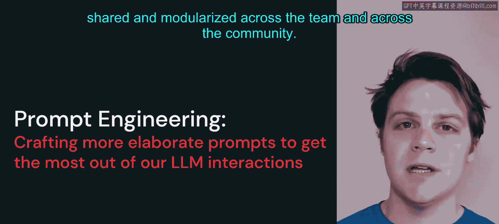
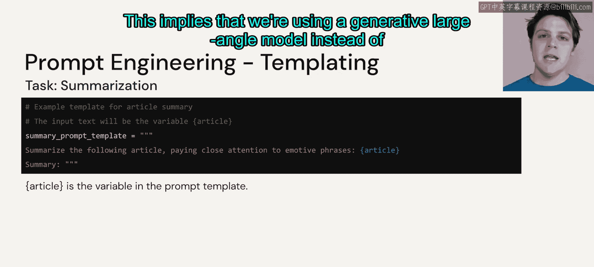
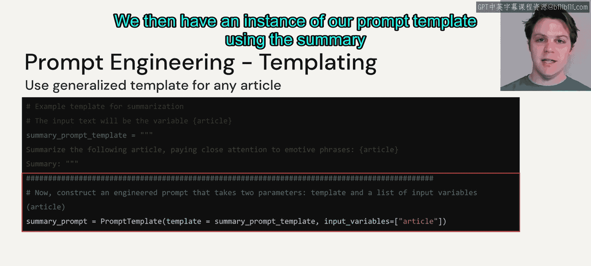
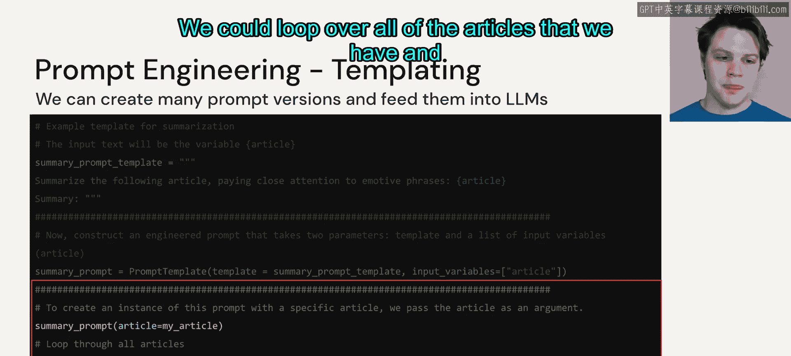
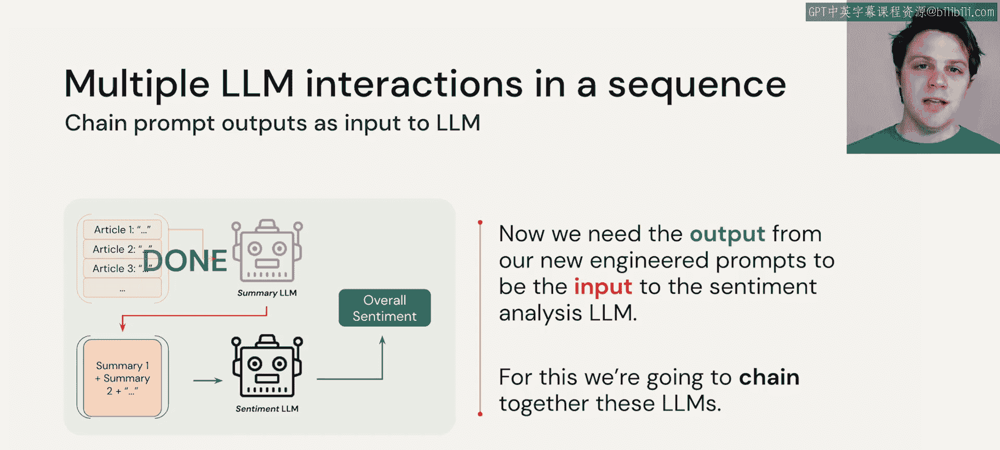
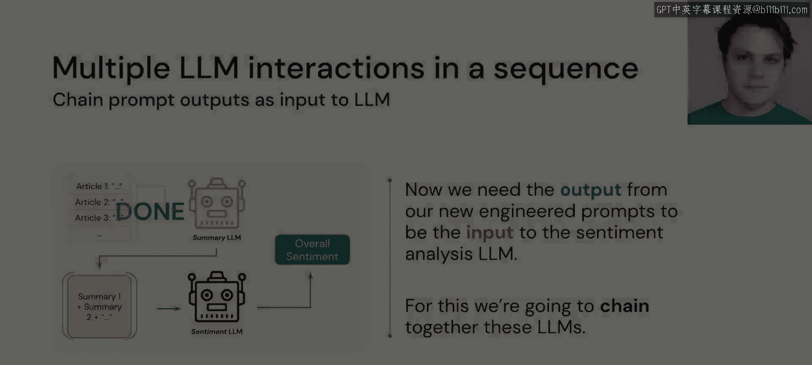

# databricks《大语言模型：从生产到应用｜Large Language Models： Application through Production》 - P32：-32-LLM Module 3 - Multi-stage Reasoning _ 3.3 Prompt Engineering.zh_en - GPT中英字幕课程资源 - BV1nS411K7Af

Now， let's take a look at prompt engineering。 a well written prompt can elicit a good response from a large language model。

 and a poorly written prompt can sometimes leave some of the performance that that large language model has to provide on the table。

 We want to make sure that we're using the best practices for using our prompts。

 and in this particular situation， we need a systematic approach so that we can summarize all of our articles one by one。

😊，A well written prompt saves a lot of hassle and can be shared and modularized across the team and across the community。

😊。

Let's take a look at some example code of how we might build up our prompt for this particular use case。

😊，To recall， we're going to use a sumization large language model for an article that we're going to give that eventually we'll use to get the sentiment from。

We're going to start with a summary prompt template as the article needs to be summarized。

 and we're going to build this template in step by step。

We give the large language model a task description。

 so we're telling it to summarize the following article， paying close attention to emotive phrases。

That second clause is there because we want to make sure that we're looking for sentiment。

 maybe less than factual information。We see the curly braces there。

Define the variable that we'll be inputting later on。

 that input will be the text of the article that we want to summarize。Finally。

 we give the summary and colon so that it knows that it has to start producing the summary。

As the output。This implies that we're using a generative large and good model instead of the classification model that we also discussed in the primer。

The next step then would be to create a prompt template。

 We're using some of the syntax here from L chain， but if you have a different prompt library that you're working with。

 you'll see something similar。We'll give the prompt template that we just created a moment ago。

 and we'll define the input variables we'll call that article so that it's consistent with the one that we put in the template。

We then have an instance of our prompt template using the summary prompt to store that。

And then finally， if we have an article that willll call my underscore article。

 we'll set that to be the input variable for this new summary prompt。

This summary prompt now has an instance of the article plus the prompt template that we created before。

We could then pass this to our summary Live language model and produce a summarization of that article。

 which would hopefully pay close attention to emotive phrases in that article。

We could loop over all of the articles that we have and create summaries for each of them。

So this solves one part of this two stage problem where initially we needed to give articles one by one and give that to a summary Live language model。

But now we need to think about the output of that summary large language model so that it can be the input to a sentiment analysis。

 large language model。So you can think of。What we've done up to now is chaining a prompt to a large language model。

 This was done using prompt templates， and now we need to chain one large language model with another large language model。

 And so we'll delve into the world of LLM chains in the next video。

