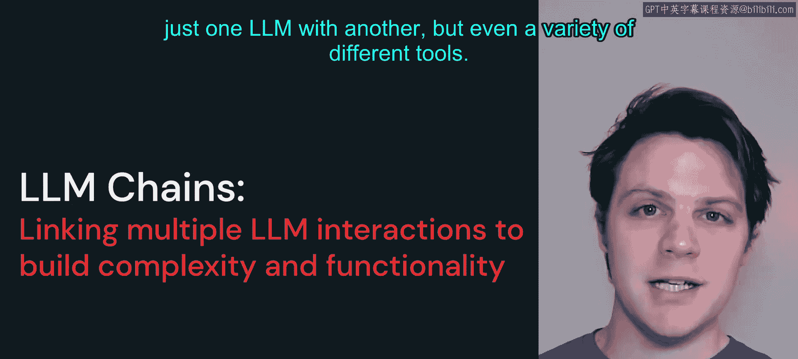
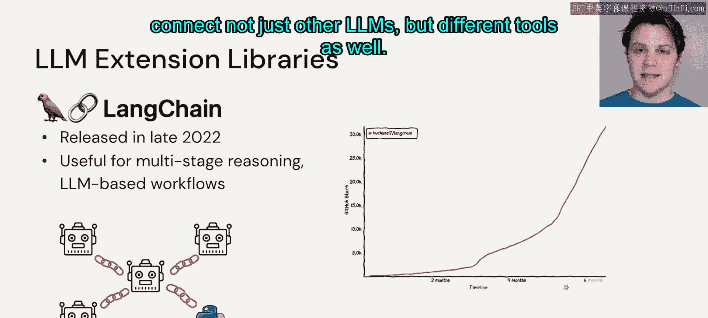
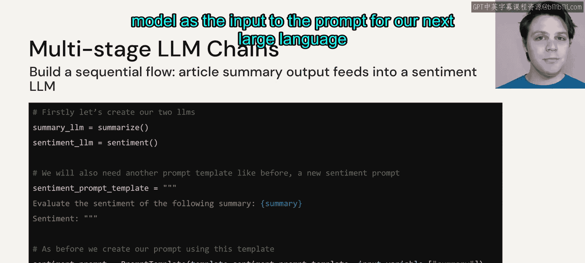
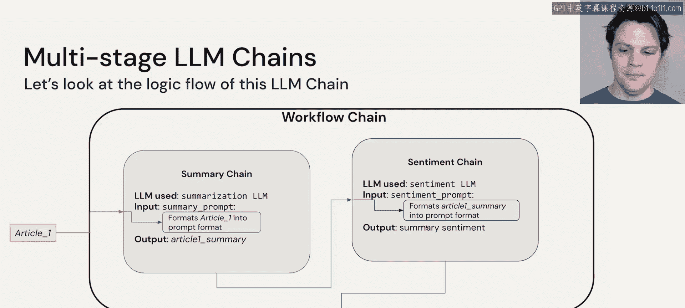
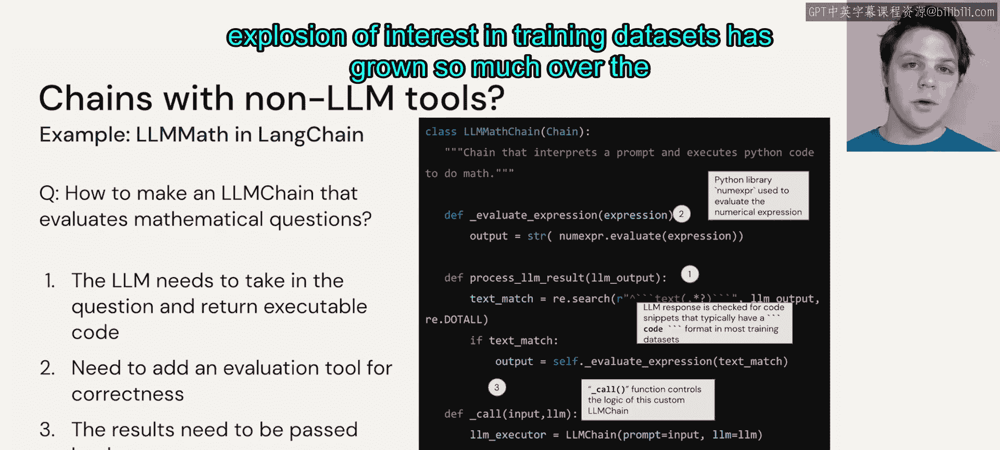
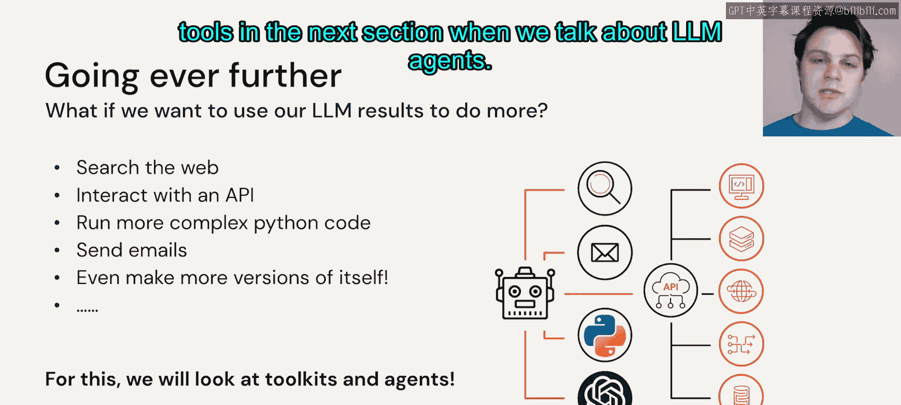

# databricks《大语言模型：从生产到应用｜Large Language Models： Application through Production》 - P33：-33-LLM Module 3 - Multi-stage Reasoning _ 3.4 LLM Chains.zh_en - GPT中英字幕课程资源 - BV1nS411K7Af

Now let's start with one of the most exciting areas of large language models。

 and that's LLM chains where we can link together not just one LLM with another。

 but even a variety of different tools。

The idea of LLM chains really started to come into popularity at the end of 2022 with the release of the Laang chainin Library。

 since then it's just gone from strength to strength in terms of popularity and we see applications using Laangchain popping up everywhere with amazing different types of products and workflows。

😊，In this section， we're going to talk about how Langchain does what it does and what we can do with large language models to connect not just other LLMs。

 but different tools as well。😊。

Let's go back to our example where we've finished taking in articles。

 summarizing them and creating a prompt template to do that summary。

 we now need to create another prompt template so that we can take our sentiment analysis。

And put that into our workflow。So we're going to create a new sentiment prompt template like we did for the summarization。

 and we're going to say evaluate the sentiment of the following summary and then pass in that summary。

😊，The LLM is then going to be requested to produce the sentiment。

 so this is very similar to what we saw before we're just finishing the loop of this problem so we have our two large language models they could come from the same provider。

 they might be different ones depending on how we want to leverage the resources we have at hand we might use a large language model that's fine- tuned for summarization and one that's fine tuned for sentiment。

So now we have the prompt that will take in as an input， the summary of the。

Article that we started with so we're going to take the output of the first large language model as the input to the prompt for our next Live language model。

So if we look at how we connect these two together， we end up with three different chains。Firstly。

 we have our workflow chain that connects all of the pieces together。

We then have inside that workflow chain， two smaller chains。The summary chain。

 which we saw previously connects the prompt and the article data。

To the large language model that we use for summarization。

The sentiment chain connects the output of the summary chain。

As the input to the prompt for our sentiment analysis Live language model。

 and then the output of the sentiment chain becomes the output of the workflow chain for the sentiment of Article 1。

Now there's quite a lot going on here， but you can think about this just as two small capsules being linked together to create our workflow。

😊。

So we can do more than just connect one large language model to another large language model。

 we can create。An endless amount of creativity by connecting large language models to say。

 mathematical suites， to programming tools， to search libraries to all kinds of things。😊。

Let's look at how we might build something like this and how the thought process might be required so that we can take the natural language that we're analyzing and connect it to these programmatic interfaces。

😊，The first step would be to take the text or the question that we give it and really return executable code if we're connecting to some kind of mathematical library。

😊，If we look at the code on the right here and look at box1。

 what we're doing is we're taking the large language model output。 So， for example， we might say。

Take this problem and multiply this number by this number。

What the large language model will do if we ask it to perform this with some kind of mathematical library is it'll generate text and code within that text。

It'll look for flags that it's been trained on to reduce code in particular with particular starting and ending tokens。

It'll then pass that code by looking for it， it'll pass that code into some kind of interpreter。

The interpreter will interpret this just as regular code as if a human was writing it into the prompt for that particular terminal。

It'll then return some result。 So it's multiplying， say 5 by 10。 It'll return 50。

 The LLM will then take in that value。 combinebine that with the original question that we asked and then produce a natural language response saying that our input。

5 times 10 is equal to 50。 and so behind the scenes。

 the large language model actually takes our input as a question。

 converts it into some response that should contain some kind of code。

It gives that code to something that can interpret it。

 it takes the result of what that interpreter did， and then it combines that with the input that we gave it so that produces a response that makes sense that flows in a natural language kind of way。

So this， while it seeming quite complicated， if we look at it step by step。

 really shows the amount of power that we can have with these large language models。😊。

Now this is dependent， of course， on the large language model being trained well enough so that it can produce code snippets based on natural language input。

Many of the large language models that you've heard of or that will look at in the class do include code in part of their training data。

 and that is one of the reasons that the exploration and the exploration of interest in training datasets has grown so much over the last few years。

We can go even further than just a simple Python code interpreter。

 we can actually if we have our large language model trained well enough or trained specifically enough。

 we can use it as a central reasoning tool。😊，And give it different types of。

Access to things like search engines， email clients， other large language models。

 the whole world really of the internet is open to what these large language models can do。

As long as we phrase our input， our prompts， such that the response from the LLM would contain code or snippets of code that would interact with some kind of API。

 and it can receive back the results of that API call。

 we can have our LLM actually connect to almost anything programmatic that we have。

We can do this in a structured way， we could even do this in a way that the LLM decides for itself what tools it should use。

We'll focus on how these models decide what to do with their tools in the next section when we talk about LLM agents。

