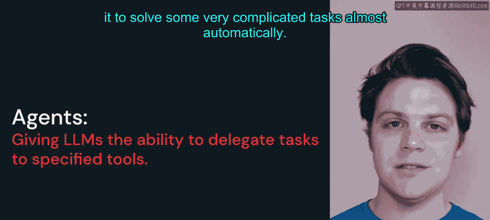
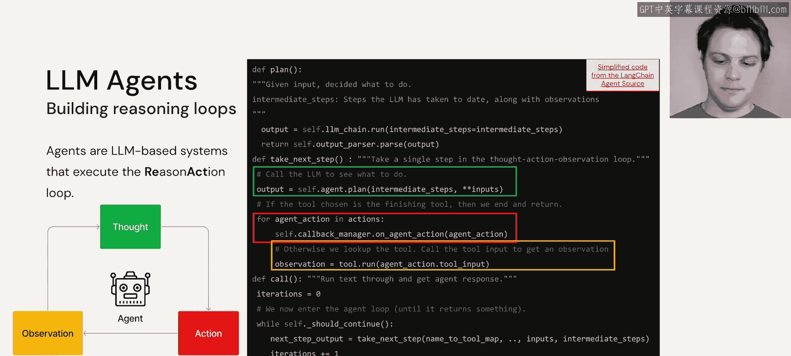
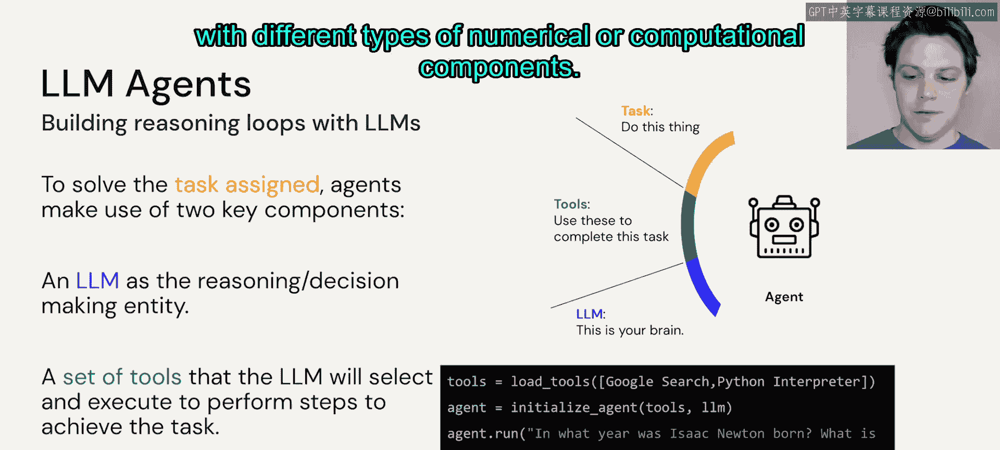
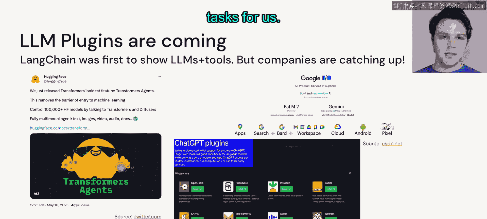
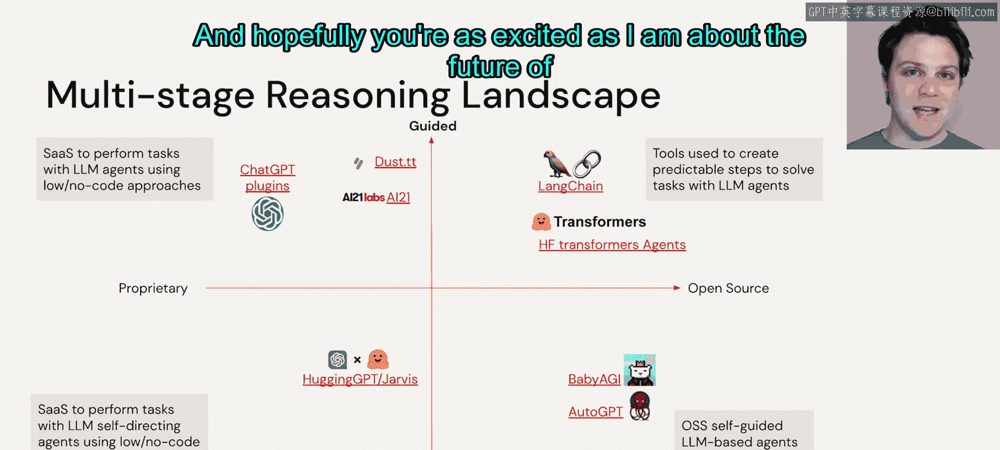
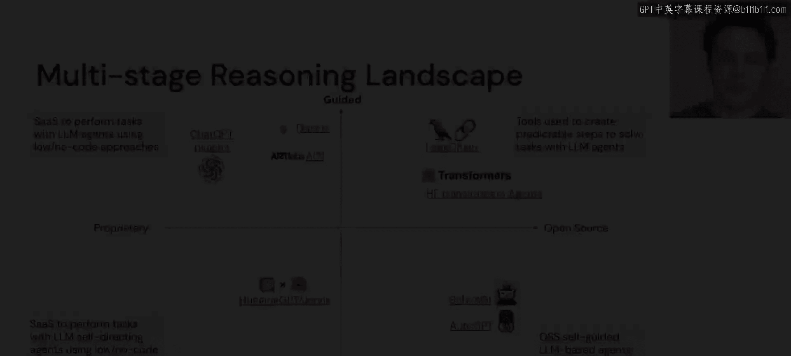

# databricks《大语言模型：从生产到应用｜Large Language Models： Application through Production》 - P34：-34-LLM Module 3 - Multi-stage Reasoning _ 3.5 Agents.zh_en - GPT中英字幕课程资源 - BV1nS411K7Af

Let's talk about one of the most exciting parts of LLMs and that's LLM agents。😊。

An LLM agent uses a large language model as a centralized reasoning unit and attaches tools and other components so that we can ask it to solve some very complicated tasks almost automatically。

😊。

And the LLM agent is built up of these reasoning loops that live language models have shown to be very adapted performing。

😊，A large language model can be given a task and we can ask it to provide a plan or a thought process of how it would complete this task。

We can then utilize this step by step approach and force the LLM to go through a thought。

 action and observation loop。😊，If we look at the code on the right here。

 we can see that we start by calling the LLM and giving it some kind of natural language request。

It can take that request， look at the description of the tools that it has at its disposal。

 and decide what to do next。It can then observe the result of performing that action with that particular tool and make the judgment as to whether or not it should stop and return with a completed task。

Or take another step and go through the process， taking the results that it currently has and putting that into the input of the LLM to the next step。

It continues this process until either a maximum amount of iterations has been performed or until it sees some kind of stopping criteria。

This makes LLM agents a very powerful tool in solving very complicated problems。

To build an LLM agent， we first need a task that it needs to solve。

 we need an LLM that's capable of performing good chain of thought reasoning。

And we need a set of tools that can interface with our large language model in the same way that we saw the mathematical tool used previously with our LLM chains。

😊，The tool descriptions are useful because the LLM will look at the request of the task that it has to perform。

 it will look at the description of the tool and it will decide which one it should use and how it should interface with it。

Because LLMs often have the ability to output code or API interaction code with their output。

 we can then leverage this fact to interact with different types of numerical or computational components。

LLM agents or LLM plugins。Are just starting to be released to the public and developed by the open source community Lanechain was the first largely used open source application of LLM agents。

 but the rest of the community is quickly taking notice and producing similar types of products Huging face just released their transformers agents a few weeks ago。

Google at their IO conference this year showed the integration of Palmm2 with their workspace。

And chattGPT is slowly releasing the plugins feature to the public where we can connect different types of tools to the chat GPT interface and have it complete really interesting and complex tasks for us。

Open AI acknowledge the fact that the open source community is moving in a very similar direction to the way it is and even reference L chain in their documentation when they discussed plugins。

Now， if we want to take this to an extreme level， we can actually give the LLM more automotive abilities and allow it to create copies of itself so that it can solved tasks given just a small amount of prompting。

😊，In the early months of 2023， a new product or a new repo rather was created under the name AutoGPT AutoGPT uses GPT4 to create clones of itself and delegates tasks to these copies so that it can solve truly complicated and fascinating tasks with just a natural language prompt。

😊，These multist reasoning tools therefore are starting to form a bit of a landscape。

We have differences in products based on whether they're proprietary or open sourced and whether or not they're guided like the structured building blocks we have for Lng chaining or hugging face transformers。

 and then some of the unguided ones like the hugging GPT or the baby AGI and autoGT。

Projects that are currently being worked on by the open source community。

I highly recommend you checking out all of these as they're very fascinating and continuously being updated to share some amazing abilities。

😊，We'll look at how we can build some of these in the notebook to follow and hopefully you're as excited as I am about the future of this LLM agent's landscape。

😊。

