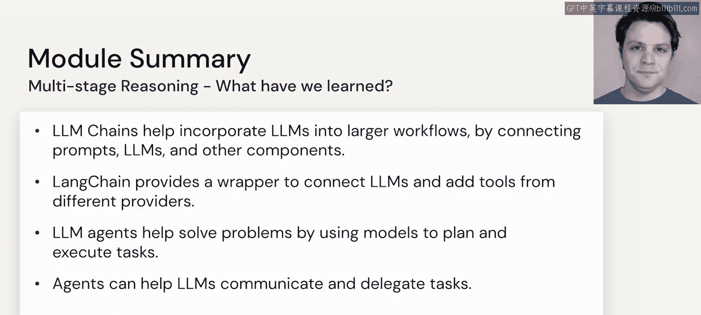

# databricks《大语言模型：从生产到应用｜Large Language Models： Application through Production》 - P35：-35-LLM Module 3 - Multi-stage Reasoning _ 3.6 Summary.zh_en - GPT中英字幕课程资源 - BV1nS411K7Af

I hope you've enjoyed this third module in this course where we dived into multi stageage reasoning with L chain and LLM agents。

😊，We looked at how LLM chains help us to build a structured format for our workflow so that we can combine our prompt templates with specific task specific。

LLMs to produce the results that we want piece by piece。

We saw that La chain can provide a wrapper around these chains so that it's easier to build and leverage different tools and architectures so that we can have our LLMs perform very different tasks。

 not just natural language processing， but also compiling code and running different types of complex logic。

And then we just saw how LLM agents can perform some truly amazing tasks that we're yet to see the full potential of。

😊。

I hope you've enjoyed this module and I think it's time we jump into the notebooks and see what these look like in action。

😊。

