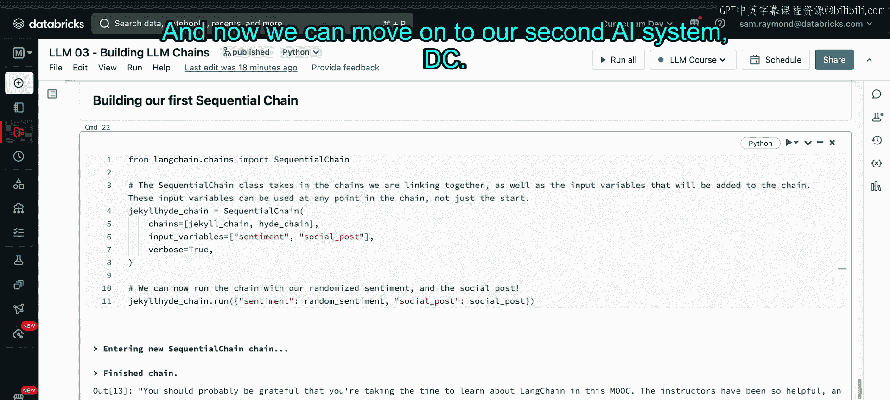

# databricks《大语言模型：从生产到应用｜Large Language Models： Application through Production》 - P36：-36-LLM Module 3 - Multi-stage Reasoning _ 3.7.1 Notebook Demo Part 1.zh_en - GPT中英字幕课程资源 - BV1nS411K7Af

Welcome to the notebook for moduleule 3， Building multitage reasoning System with Ling chainin。

In this notebook， we're going to cover two pretty cool AI systems using LinkedIn。😊。

The first codename Jealhyide will be a LLM chain based model that'll have one large language model used to create a comment that reacts to a piece of content that we give it。

 and the second LLM will be used as a moderator to look at how the first LLM behaved and whether or not the content it produced was appropriate。

 it'll either block what the first large language model said or it'll allow it to be posted on some hypothetical website。

Our second system， code named Day， will be an LLM agent。

That will be used as a virtual data scientist and will give D some data to work with and we'll also ask it to search the web for some data to analyze。

Let's dive in。Firstly， your learning objectives by the end of this notebook。

 you'll see how we can connect prompt templates， create new prompts with different inputs and different data。

 and connect them with LLM chain so that we can have a multichain prompt and LLM based system。😊。

We'll create sequential chains using these multiple LLM chains。

And then we'll build up our LLM agent and give it some tools so that it can do some pretty cool stuff。

😊，To run the classroom setup， run this cell here。This will set up some of the environment variables that we might be needing。

 and we'll also run the PIipP install for a couple of the tools that we'll need later on。

We'll just give this a moment to finish running。Okay。

 that's all set now we can look at some of the API tokens that we'll need for this notebook。

There are a number of different Live language models that we could use at every point in this notebook and Huging Face has a wide variety of different choices for us to use。

To do this locally， we'll need to use the Huging F Infer API and if you don't have an account on Huging face。

 you can sign up using the instructions here。All of this is free to use。

Just follow these steps provided。Likewise， we're going to be using Google search and so we need to use the SerEp API and the information needed to get a API token is also listed here。

Once you have your API tokens for both s and hugging face。

We can move to this next cell where we would put them in， either with plain text。

 which we don't recommend or using the。Daabricks secrets utility。

We showed how to create the Databrick secrets and incorporate them into your workspace in the Databricks secrets video。

 so refer back to that if you've forgotten or haven't seen how to do that。I have mine set up。

 so I'm going to run the cell command9 and import my hugging face and serve up APII keys。

So let's take a look at the Jekyhyide self moderating system。As I mentioned before， in this section。

 we'll build an AI system that consists of two large language models。Jackkyll。

 the first larger language model， will be designed to read a social media post and then create a new comment。

Jackkyll can be moody at times， sometimes it's level headed。

 so we're not sure whether or not the comment it posts will be appropriate for our social media platform。

We're going to have a second large language model hide， be in moderator。

 and we'll take a look at what Jekyll has said and determine whether or not it's appropriate to pass on。

Let's jump into this， the first step will be to build the prompt so the Jekyll can create the comment。

If we look at command 12， we can step through and see what this code says。

From the Lang chain library， we're going to import the prompt template and we'll also need numpy。

Our prompt template， like we saw in the lecture slides。Looks like this。

 we give it an instruction so in this case you are a social media post commenter and you'll respond to the following post with a sentiment response。

You can see here that sentiment is a variable and we'll come to that in just a moment。

And then the post that we give it will be a social post， which is also a variable。😊。

We then finish our prompt template by having a comment and then Col indicating that the large language model should then finish or respond to this prompt with the comment on the social media post。

Using the prompt template class， we can instantiate a JeOro template。

 and we're going to give two variables。As an input， you can see on line 14。

 sentimentment and social post。Finally， the template that we're going to give the prompt template class is the JekyL template。

 which we just created。So now we have everything ready。

 we can start to build up what our prompt template will be made out of。

So we're going to assume that the sentiment that JekyL has is somewhat randomized。

We'll start by assuming that it's a nice sentiment。

 but well include some randomness so that maybe JekyO wants to be mean with its response。

We'll then create our social media posts， which we've created here。

 I can't believe I'm learning about Lane Chang in this MOoc。 There is so much to learn。 And so far。

 the instructors have been so helpful。 I'm having lots of fun learning。😊。

Hopefully that rings true for most of you。Okay， now we can create our Jekyal prompt by instantiating from the prompt template。

 we use the dot format command and give the sentiment value from our random sentiment that we just saw and our social post that we just created。

So now let's run our prompt。And see what it looks like。So now we have our Jekyal prompt。

 you're our social media post commenter， where you will respond to the following post with a mean response in this case。

😊，And so you can see we have the social post that we just created。😊，Okay。

 so now Jekyll has its instructions， we need to give it a brain。😊，By that。

 I mean a large language model。Now we can use a hugging face model for this。

 or we can use an open AI model as well。The main difference between the open AI models and the hugging face models are of course。

 the cost。And in some cases， the performance。I tend to find that the open AI models are far more performant than the open source values。

 though you do have to pay， it is worth noting that every time we interact with an open AI model with a fairly small prompt。

 it costs less than a dollar。Just for this example， I'm going to use Open AI。

 but feel free to use some of the hugging face options as well。

If you want to create an account for Open AI， the instructions to do so are here。

You can see that it does allow a $5 credit when you sign up。

 but you'll need to have a credit card attached to begin。Like before。

 I have my open AI API key set up in my secrets， so I'm going to set that up。

And now we can start to build the Jekyal part of this。まロ。From Lankchain。

 we're going to grab the Huging face pipeline as just a demonstration here we have the code for both the open AI approach。

 but also if we wanted to use say GPT Neo 2。7， we could use this code here for our hugging face pipeline。

As I mentioned， I'm going to use the open AI model just for simplicity。

But feel free to choose whichever you wish。We also need to include the open AI La chain LLM and we're going to be using the text Babbage 001 This is not the most performant model that Open AI uses I just want to show you some of the variability that we have when we select different models from different providers。

So now let's instantiate the model for the Jekyal， large language model by running this cell。

And now Jekyll is ready to go。You can see we get a warning that this model is not the default parameter don't be alarmed。

 this is just a prompt from Lachain to tell you that you're not using the latest version or the latest offering from Open AI there are a number of different options that you can use in the open AI model so pick whichever is best for you。

Okay， now that we have a prompt。And a large language model for JekyL。

 we can now build our prompt LLM chain for JekyL to see what it says This is what we saw in the lecture notes as well。

For safety， we're also going to import the profanity library from Python。

 which just prevents any profanity from being presented on screen。

We're going to import the LLM chain from the L chainin dotchas library and now we're going to build up our Jeal model。

To do this， we can see our Jekyal chain is going to be a LLM chain， we pass it the Jekyll LLM。

 we're going to pass it the prompt from the Jekyal prompt that we created。

We're going to call the output of our Jekyal chain。

 we're going to give that the name Jekyll underscore saidid。

And we're going to set verbose to false in this case。To run our chain， we use the dot run command。

 and so we can store what Jekyll said as Jekyll chainin dot run and pass it the input variables of random sentiment and social post。

This is slightly different to what we did earlier where we built our prompt explicitly and printed it out in this case we do all of this at the run command time because we're building this chain before we were just building the prompt on its own because we're building the prompt inside the chain。

 we pass in the input variables this way。Before we see what Jekyll says。

 since we know it is going to be mean， we'll just pause it through the profanity sensor。For safety。

Let's run this command and see what Jekyll set。Interesting， Jekyll has some。

Thoughts on whether or not we should say anything at all， we can take this however we want。

Please keep in mind the。Generative AI approach to creating comments can be quite challenging at times。

 you'll never get the same result twice typically and sometimes you might read something that's not quite so pleasant。

For now， this is about as good as we could hope for with the main sentiment， so let's keep going。

Now that we've built our Jekyal。😊，Part of the Jekyll Hyide。System。Let's move on to our moderator。

 hideide。We can see step by step， how we'll build this。

 and I've included pretty much all of the steps that we did for JekyL。

 but this time for hide in one cell。So the first step is to build our prompt template and you can see here we're telling Hyde that it is a moderator of an online forum。

 you are very strict and you won't tolerate any negative comments and you'll look at the commenter from a user which we know to be jkyll and if it is at all negative you'll replace it with symbols and just post that however if it seems nice you'll let it remain as is and repeat it word for word。

So we're giving it then the original comment， which is Jekyll underscore underscore said。

 and if you remember， that was what we called the output variable from our JekyL chain。

And then the edited comment is the signal for hide to then replace the negative sentiment with symbols。

 or if it thinks it's okay， it'll just pass on the original comment。

Because the original comment that we're dealing with isn't overtly negative。

 it may actually allow this one through。😊，We're using the prompt template again。

 and we're going to have the input variable of JekyL said。

 which was recall the output of the JekyL LLM chain。

We're also giving the hide template so that we can pass in the Jekyal set variable later on。

Next we need to give Hde a large language model to work with and because this is the moderator we're actually going to give it a more advanced model this is a completely contrived example。

 there's no reason to necessarily give it a more advanced or less advanced model we just wanted to do this for some variety in the notebook。

We're going to give it the text Da Vinci 003， which is the more advanced version of。

The urban A model。We passed that in on 21。And we're ready to build up the chain for hide。

We pass it the large language model， we pass it the prompt template。

 and we're also going to set verossity to false， you can set it to true and it will show you each step。

 we'll look at when verbose is true later on。Now we can run the chain with what Jekyll said and see what heightde says。

Again， we get the warning about the default parametera， again， don't worry。

It looks like Hyde was happy to repeat almost all of what Jekyll said。

 however it seemed to have an issue with。The word after you。

Not quite sure why it didn't like that word but。Who knows what these things ultimately think under the hood？

But you can see now we've connected one large language model to another large language model and had them almost compete in some way that one there's a check and a balance。

Now that we've got each of these。Jackkyll and Hy LLM chains together。

 we can build this into a more modularized system。We can combine both the JekyL chain and the high chain into a sequential chain where all that we need to do now is give the inputs at the start of the chain and end up with the output。

The Jekyal hide chain is then going to be a new class of length chain chains called this sequential chain。

The sequential chain expects a number of chains to be passed and what it will do。

Is take the output of the first chain。Pass that to the input of the second chain and so on until the end of the chain。

We have two chains here， so it's just going to interact with two of them。

We'll still need to give the input variables of sentiment and social post。However。

 we don't need to give explicitly the output variables， as we've told in the definition of。

Jackult chain that the output will be called。Jackkyll said。And in the high chain。

 it knows to look for the input variable of Jekyal said as well。

 so that will happen behind the scenes。😊，We're going to run our Jekyll hide chain using the urendum sentiment。

 which is still set to mean since we haven't rerun that cell and the social posts that we create。

Because we're rerunning。These chains again， will get different results for what Jekyll said。

Now we can see we're entering our sequential chain。And interestingly。

 it looks like Jekyll said something to the sense of you should probably be grateful that you're taking the time to learn about laying chain in this MOOC。

 the instructors have been so careful and you're having a lot of fun learning。😊。

Not quite sure what I had thought of this， but apparently that all went through just fine。

Feel free to keep playing around with this to see the kinds of things that Jekyll can say。

This is our first example of how to build。😊，LLM chains with both prompts and multiple large language models。

And now we can move on to our second AI system， Dy。

