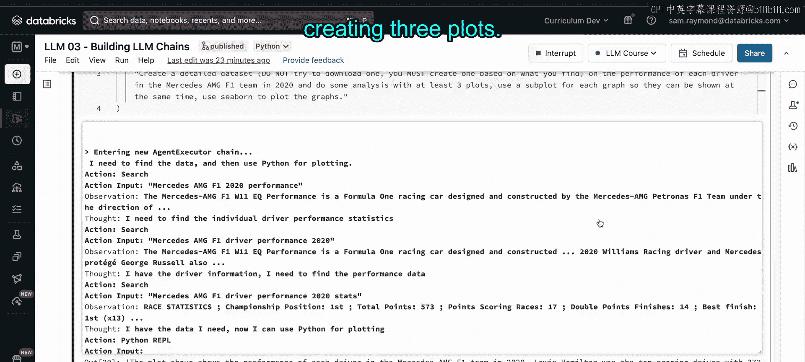
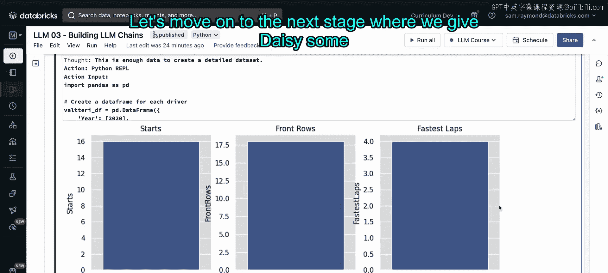

# databricks《大语言模型：从生产到应用｜Large Language Models： Application through Production》 - P37：-37-LLM Module 3 - Multi-stage Reasoning _ 3.7.2 Notebook Demo Part 2.zh_en - GPT中英字幕课程资源 - BV1nS411K7Af

Let's move on to our second AI system， Dy， our first vector database， Data science AI agent。

So in this section， we're going to build an LLM agent based on the Re or a thought action observation loop paradigm。

 feel free to read more about this paradigm in the link provided。

And what Dacey will do is take instructions in plain text and perform data science analysis on the data that it finds。

The agent type that we'll use will be called zero shot。React description。

 which basically means DC will use zero shot learning to try and solve the task that we give it。

We'll give just the prompt and expect D to use the tools that it has to solve the problem。

Let's look at how we build a LLM agent using Laang chain。

One of the most important part of building your LLM agent is to give it a sensible set of tools to work with。

If you know what your agent is going to be doing， that will inform the different types of tools that you might give it。

For Dy， it will have access to Wikipedia。The Google search API， the terminal。

 and the Python re evaluatevaluate print loop， or Reple。

The Python Reple is useful for Dy to perform tasks like Panda's library downloads and interactions with data that Dy might build。

Like we saw for Jeky Hyide， you can use HugingFace， Open AI， or other LLM providers。

For the sake of this dimmer， I'm going to use the Open AI LLM。

And I'm actually not going to specify a model， I'm going to allow the library to pick the most advanced model for this LLM。

I would recommend using one of the more advanced models that you have access to when building a LLM agent as the complexity of the tasks require a fairly。

Performment and。Well informed， large language model to be able to produce the code or reasoning loops that it would need。

We're going to use the load toolsol library and passing the Wikipedia search API。

 which we got tokens from before， we're going to also pass the Python Repple and the terminal library commands。

Now we can build Dy using the initialized agent command class in the tools。

The LLM that we specified and the agent type， which again is the zero shot react description we're going to set for both to true so that we can see what D is thinking。

Let's set up this。Now and move on to testing out Dy skills。Firstly。

 we're going to use a relatively short but succinct prompt that will ask Dcey to create a dataset set。

 we don't want it create to download one， it must create one。

 and we're going to ask Stcey to find data on the performance of the Mercedes AMG Formula One team in 2020 and just do some analysis We also tell Dcey that it needs to plot the results。

Let's run this command and see what Dcey does。You can see we're entering a agent executed chain。

The first action is to search as Dy realized it need to find data and perform analysis on it。

It's performing the search action。Getting some observations and thinking。

You can see Dy is then passing the results， looking at the statistics of the performance of the team and is now creating a data set and looking to plot the results。

Daacey import pandas。Built out a data frame。And then pp the different types of statistics for the team during that season。

This is a pretty impressive result， but I think we can do even more。

Let's try to improve by giving a more detailed prompt and ask Stacy to do at least three prompts。

And to use subpllut so that they can all be plotted at the same time and to use Cvo to make the results a little more pretty。

This result was already pretty impressive before， but let's see what Day can do with a more detailed prompt。

This doesn't mean that DCC will use any of the data or download it before。

 it likely will perform this from scratch again。In theory。

 we could save some of the data and use a different tool so that Dcey could utilize data that it already has and we'll see how。

Daacey can use data that exists in the next section。

We can see Dy has found race statistics and different。Scores and points。

D is now using the Python Reple， importing pandas and seaborn。Daisy has a data frame。

And now we can see in the plug blur that we have。Points for。Lewis Hamilton and Valalrie Bos。However。

 we did ask Stay to do three plot， this is just one， though Dy did use Cbo。

 so it got most of the way there but not perfect。There really is no magic behind LLM agents。

 it is sometimes just luck of the draw whether or not they are going to give you the exact results that you want。

 sometimes you may need to run it once or twice。Let's run this command one more time and see if Day can do it on the second attempt。

You can see Dacey found some spoken word。Analysis of the season。

And we'll start to pass the information。Do keep in mind as well that every time we run these sorts of commands。

 that Daacy will be using the API tokens to access the search API as well as the OpenAI LLM commands or the hugging F commands as well。

 so just be mindful of what you have your agents do and how much tolerance you have for token usage。

We can see we've got some data frames for two of the drivers of that team。Day now。

Says it has the data set and looks to be creating three plots。

Now these aren't the most fantastic plots， they're basically just plotting one variable each。

 however this is exactly what we asked Dy to do， we have the number of styles。

 the number of fromre positionss and the number of faster slaps that the team achieved during the year。

😊，This is just a taste of what you could do with an LLM agent。

And allowing it to search the web with very limited amount of prompt information In theory you could write an incredible complex prompt with lots of hints and tips to further guide your LLM agent to perform better and better。

But this just with a small amount of information in the prompt， I think did vary well。

Let's move on to the next stage where we give Dacey some data to work with。

