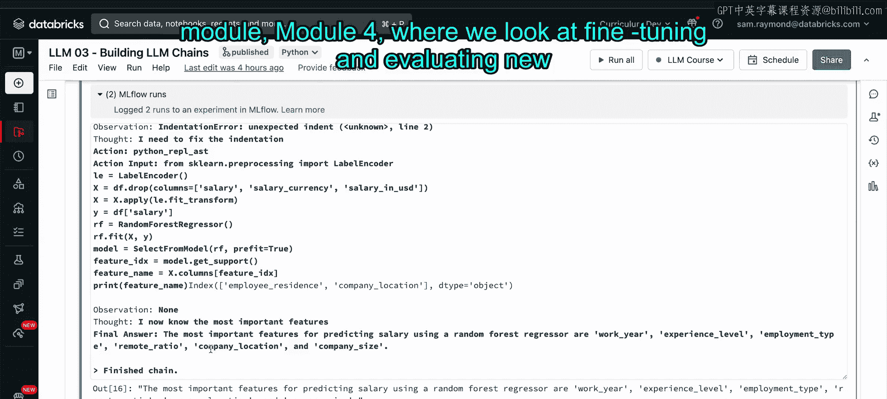
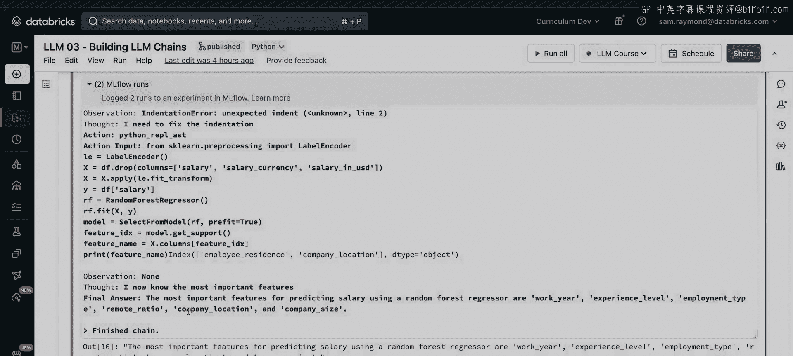

# databricks《大语言模型：从生产到应用｜Large Language Models： Application through Production》 - P38：-38-LLM Module 3 - Multi-stage Reasoning _ 3.7.3 Notebook Demo Part 3.zh_en - GPT中英字幕课程资源 - BV1nS411K7Af

Now in the final part for this module。Let's take a look at how we can give Day some data to analyze。

We're going to create a very specific type of agent and this is the Pandas data frame agent。

 which is the name suggests， utilizes pandas directly so that this agent can work on data frames that we give it access to。

We're going to use a data set from KaGL， which is of data science salaries for 2023。

We can see in command 30 that we're first reading in the CSv file of this data。And then assigning。

That to a data frame。Then to create a new version of Dy we'll use the Cate panda's data frame agent。

 we're going to pass the data frame and we're going to use the open AI LLM。

 but in this case we're going to specify that temperature equal to zero we won't go into the details of what temperature is too much in this course。

 but you can think of it as how much we allow the model to be creative with its responses。

Setting the value to zero means that it has to use effectively。😊。

Just the factual information that's present。This is important when we deal with data sets as we don't want it to。

😊，Imagine any data that's not there。Let's instantiate Dacey。And now that we have our data and Day。

 let's ask Day to analyze the data and just look for any interesting trends making some pretty plots。

We can see we're entering a new agent executed chain。And now we can see Day looked at the data frame。

R describe on the Pdas data frame to get some information about the statistics of this particular data frame。

Daceacy then does some group buy in order to look at how well each variable is affected。

And how that affects celery？And now we can see D C。

Plotted the company size versus the salary range to have a look at the effect of company size on salary。

 and based on this it looks like the medium company sizes offer the highest salaries on average。

The output you can see that Dy said is I can see that the average salary increases with experience level。

Is higher for full time employees and for contract employees and increases with company size Now this may all seem quite obvious but realize that we gave no other information to Dcey other than just the data and the ability to run Python code。

Now this is pretty impressive already， but we can go a step further and ask Day。

 an AI model to create a machine learning model on its own。😊，In this situation。

 we're going to ask Dy to train a random forest regression model。

 which is a type of machine learning model that's based on decision trees for more information。

 check out the links that we provide， but for now you can just assume that this is some type of classical。

😊，Machine learning model that is not a type of deep learning model。

We could ask it to do deep learning， but for the sake of time and computational lift it。

 we're going to use a random forest。We're going to ask Dy to predict the salary using the most important features。

 and we're going to ask it to tell us what variables are most influential to the model。😊。

Those of you who have done any machine learning in the past can see just how much we're asking Dea to do with this simple command。

We'll run the cell and see how well Day does。We can see Day has found SKL and is going to use the random forest Regressive from the Ensemble library。

You can see as well， there's an indentation error in this Python code that Dy wrote。

And Dy realizes there's an indentation error and that it needs to fix it。

 let's see how it goes about doing this。We can see Dy removed all of the。

Spaces at the start of each of the sentences of the or lines of code， and so now it can move forward。

It sees that it finds an error converting strings to floats。

And realizes that it needs to convert the string values to numerical values and selects label encoder I want to stress that we did not。

Lead or direct the LLM to do anything other than just train the model and tell us the variables Dy is figuring out。

How to overcome all of these obstacles on its own？We can see it used the label encoder。

It then ran into that indentation error， it fixed the error。And now Dy sees。

That it knows the most important features， and it says the most important features for predicting salarylery using a random forest regressor a work year。

 experience level， employment type。😊，Rumor ratio， company allocation and company size。

Those of you who are familiar with machine learning。

 know just how much effort and knowledge it takes to build something like this。

 and yet we did this without knowing anything about machine learning。Anything about SK learn。

 anything about。Feature importance。This is just a taste of what you can do with LLM agents。

 I hope you're getting excited about what we can build nowadays with these amazing pieces of technology。

😊，And if you're wondering what if this model just isn't quite doing what I need it to do？

Let's head over to the next module， module4， where we look at fine tuning and evaluating new types of models that we need for our custom uses。

