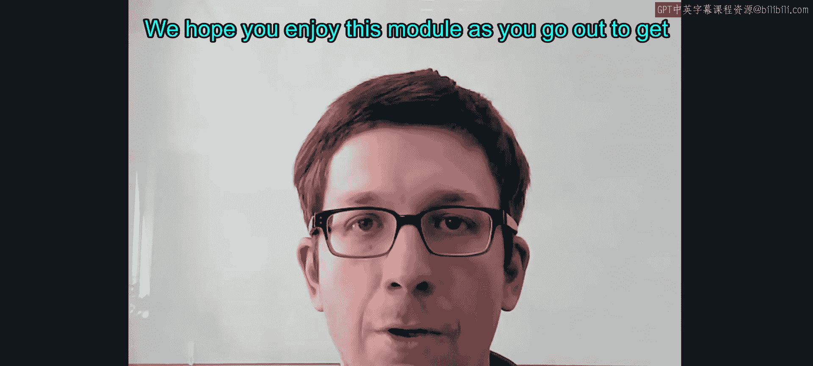

# databricks《大语言模型：从生产到应用｜Large Language Models： Application through Production》 - P39：-39-LLM Module 4_ Fine-tuning and Evaluating LLMs _ 4.1 Introduction.zh_en - GPT中英字幕课程资源 - BV1nS411K7Af

嗯。Welcome to module4， which is about some of the finer aspects of getting high qualityality LLM applications。

 notably fine tuning and evaluating LLMs so in this module we're going to talk about what to do if you set up an application you have some data for it。

 you have some feedback and you want to improve the quality of the model there are a lot of different ways you can do this。

 starting with what's called fewchar learning where you give a few examples of your task to the model in a pump and get it to do it。

 all the way to fine tuning where you actually update the parameters of the model to tailor it for your specific application and we'll talk about sort of three general approaches you can take the few short learning with an existing frozen model。

 some of the things you can do with LLMs as a service and finally do it yourself fine tuning which you mostly do with models you train yourself for open source models where you have full control over the process。

can can control many aspects of it to make it good at specific things One of the big things we'll also talk about here is some of the available open source models that have powerful capabilities like instruction following and high quality prompting available including the dolly model from databases and others that are somehow based on it or in general that are doing well in this space and the other really important thing we'll talk about is evaluating LLMs and systematically checking how well they're doing and improving that with classical machine learning it's sort of easy to evaluate because it's making some predictions you can check whether each prediction was right and you can give it a score with something that's generating text it's a bit harder to tell you know is this big blob of text better than this other one so we'll talk about techniques to do that we'll also touch a little bit upon alignment which is getting the model to。

you know， to not be offensive， you know， to be friendly。

 to avoid doing certain kinds of things in general to reason a little bit in some sense about what it's being asked and do sort of some kind of content moderation we hope you enjoy this module as you go out to get the best performance possible from your LLMs。

