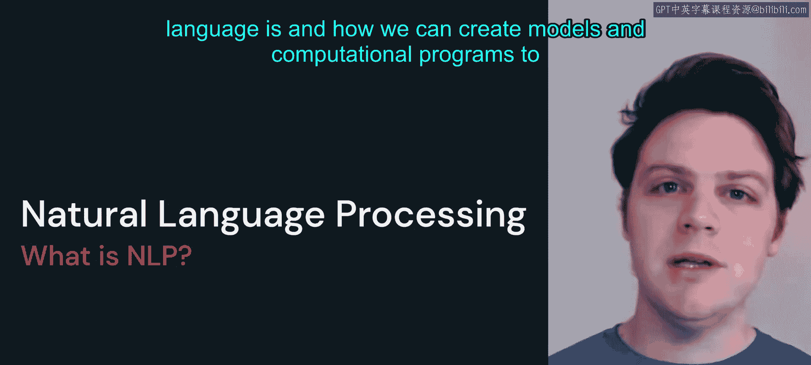
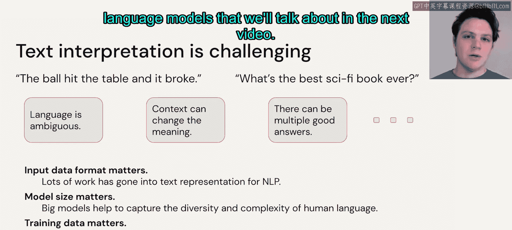

# databricks《大语言模型：从生产到应用｜Large Language Models： Application through Production》 - P3：-03-LLM Module 0 - Introduction _ 0.3 Primer.zh_en - GPT中英字幕课程资源 - BV1nS411K7Af

I'm sure you're all excited to learn even more about large language models thanks to that brilliant introduction by Mattteay。

As we move forward now， we're going to cover a quick primer on what NLP is and some important definitions and concepts。

Natural languageage processing is the field of study that considers what natural language is and how it can create models and computational programs to solve problems in natural language。

Whether we study the topic or not， we tend to use natural language processing every single day。

 whether we're typing something into our prompts in our computers or in our phones。

 NOP is used to give us autocomplete to look for spelling。

 all kinds of things that you might not realize are actually in the field of natural language processing。

Not all of these problems are being solved with large language models。

 but I think in the future we'll see many of these solutions being LLM based solutions。

NLP is useful for us as it enables us to solve a number of different tasks。

This could be from whether or not the sentiment of a review that someone's giving about a particular product is positive or negative。

If we want to translate from one language to another。

 or if we want to create a chatbot or some kind of interactive system that relies on natural language as its form of input。

 natural language processing is the field that considers how to solve these challenges。

Other use cases like similarities searching， which we'll cover in module2。

 are also in the field of natural language processing where we want to use a natural language input and have a natural language output。

Similarly， if we want to summarize complex documents or find just the important pieces in a very long document。

 summarization is also an important component of NLP。

Finally text classification can be more than just a positive or negative review。

 it also can tell us what the certain genres are， what the moods are。

 and what is contained within the text so you can see there's a lot of different applications that NLP is applied to。

Let's talk about some important definitions。If we consider the sentence。

 the Moon Earth's only natural satellite has been a subject of fascination and wonder for thousands of years。

Well that's a pretty long complete sentence if we think about what that sentence is made up of。

 we could think phrases， words， characters， those individual building blocks are whatever are known as tokens in natural language processing。

Tokens don't have to just be words or characters or sub wordss。

 they're a choice that we make when we create our models。Tokens。

 you can think of as the building blocks or the atoms of our NLP problems。 A sequence， therefore。

 is a collection of tokens that's meant to imply a sequential listing of those tokens。

 If we consider tokens to be words， then a sequence might be an entire sentence or a fragment of a sentence。

If a token is considered to be a character， then a sequence might be T。

 H and E of the single word of the。The vocabulary then is the entire set of tokens that we have at our disposal for our particular model。

This could be our vocabulary of words in the English language。

 it could also be a vocabulary of all the characters that we're using to define our problem。

This means that we can then classify different problems in NLP using these definitions。

 so if we think back to the translation task that we were trying to solve before。

 we can think of that as a sequence two sequence task as it takes one sequence in and usually responds with one other sequence。

Sentiment analysis， if we think of it as a classification problem。

 is technically a sequence to a non sequence prediction as it typically responds with either a token or a couple of tokens。

Question answering is even more complex as we take in a sequence of text。

 and then usually we generate a large sequence of text that's non deterministic so that it's a more of an open problem。

Being able to classify these different types of tasks will be relevant further on in the course。

 as we will find that being able to evaluate whether or not a model is good or bad can be quite subjective and dependent on the tasks that you're solving。

Now NLP is of course a larger field than just text modeling this course is going to focus on NLP as a text based problem because there's plenty to cover in that area。

 but you should be well aware that NLP is much larger than just text to text problem solving。😊。

If we think about speech recognition where we convert audible language into text or audible language into another audible language。

 if we think about image caption generation， the amazing tools that we've seen in the last 12 months from things like dly and stable diffusion and image generation from text as well。

Are all within the realm of NLP。Now you might wonder well why don't we cover those things in this course Well text interpretation on its own is actually pretty challenging we'll see that even as we dive into simple problems just dealing with text on its own is complicated In fact。

 if you think about your daily life and interacting with other individuals。

 just using language as it is in its verbal form is prone to a number of different challenges。😊。

Language can be ambiguous， the context can change depending on how you say it。

 where you say it and when you say it， and there can be multiple good answers to a particular question or comment。

We've seen in the last few years that the amount of input data that we're giving to these models is growing and growing。

The model sizes are growing in part in the same way We'll talk more about what the sizes of these models really mean in Co two of this program。

 but for this course we're really just going to take as read the fact that model sizes will grow and grow to become more accurate and performant。

Training data likewise is something that we will look at in the fine tuning module in module4。

 but we won't spend too much time on the details for this particular course。

All of these are important as they inform the different types of language models that we'll talk about in the next video。

