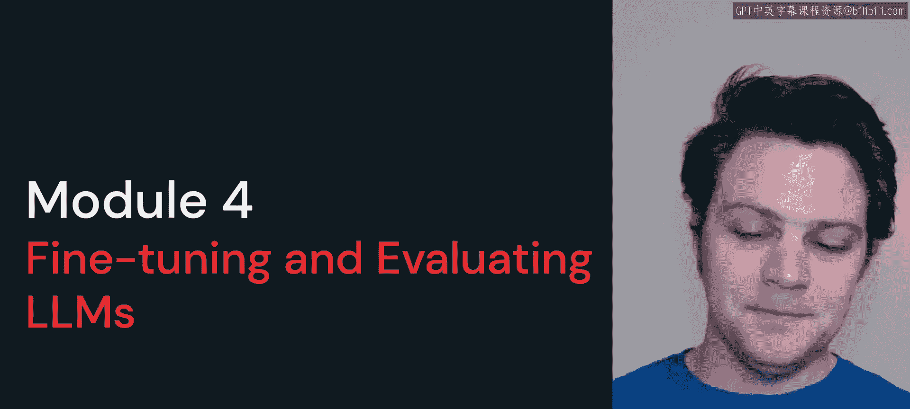
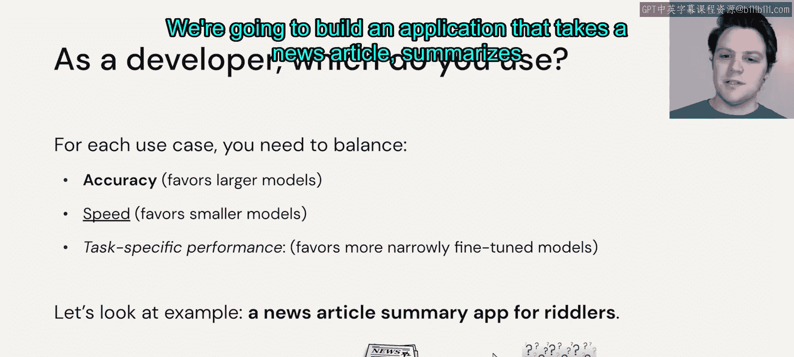
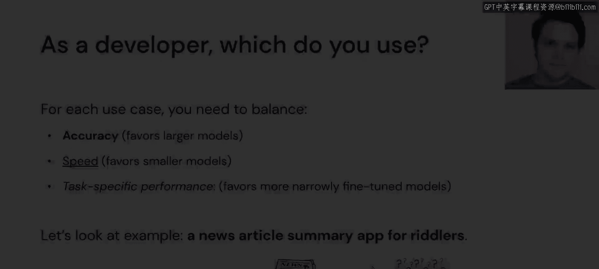

# databricks《大语言模型：从生产到应用｜Large Language Models： Application through Production》 - P40：-40-LLM Module 4_ Fine-tuning and Evaluating LLMs _ 4.2 Module Overview.zh_en - GPT中英字幕课程资源 - BV1nS411K7Af

Welcome to Mo 4 we're now halfway through this course and we've already seen some amazing things that we can do with large language models from using hugging face to answer almost any problem in natural language processing to the vector databases that we saw in module too and then the amazing tools that we can use and apply with Langcha it seems like large language models and the applications around them give us flexibility to build almost anything that we want but what if there's an application that you think a large language model that exists isn't quite suited for。

 maybe it needs customized data to work with or maybe you're just not sure how to build your application in the most efficient manner the goal of this module is to show how we can take different types of large language models apply them to build a specific type of application and go through the process of fine tuning if we think that we just need to create something that's special for us。

😊。

By the end of this module， you'll understand when and how to finet different types of Live language models through our notebooks we'll look at deep speed and how we can use hugging face models to be fine tuneed specifically for our use case and we'll look at how we can evaluate these different types of Live language models so that we know that when we fine tuned or customize these models that they're giving us the answers that we want。

So let's talk about a typical large language model release。

 We're going to consider the open source large language model releases that tend to occur almost weekly at this point。

😊，Usually they're released in a number of different sizes， so we have a foundation model。

 which is a model that's just trained to predict the next word on all of the text that it's seen so far these typically come in a base model size and then a smaller and a larger version The size here is the number of parameters or the amount of gigabytes that it might take up on your storage or RA。

It could also be released with different sequence lengths。

 so these are the amount of input tokens that we can give to a model in a single pass。😊。

Newer techniques and we'll cover some of these in course two allow large language models to expand the amount of sequence length up to tens of thousands。

 whereas typically we're limited to around 4000。We might also see that a large language model is released with some pre fine tuned versions along with the base model that is built just to predict the next word for a generative model。

We might also see a chat based model。That is released with this foundation release that's been trained to converse in a more humanlike interaction。

 and we might also see an instruction based model， which is slightly different to the chat based model in that it's specifically designed just to respond to tasks that it has been given。

So as a developer， you might wonder which direction do you take， which one do you choose？

In every situation， we're going to have to balance accuracy。

 which tend to favor larger models as the larger models typically will give better performance as they've seen more training data and have a larger parameter count to solve different problems。

😊，Speed， so the speed for inference is going to be an important factor and usually smaller models because they take up less space and there are less calculations involved are much faster at inference than larger models。

 And then the task specific performance is also something that we need to take into account。

 La models while they might have a broad knowledge set might not be as efficient or task specific performance values might be different for these just Bland large models rather than a fine tune model on a specific use case。

😊，In this module， we're going to focus on a very specific use case to show you how you might tackle your problems。

 we're going to build an application that takes a news article， summarizes it。

 and then turns it into a riddle for the users of that application to solve。😊。

