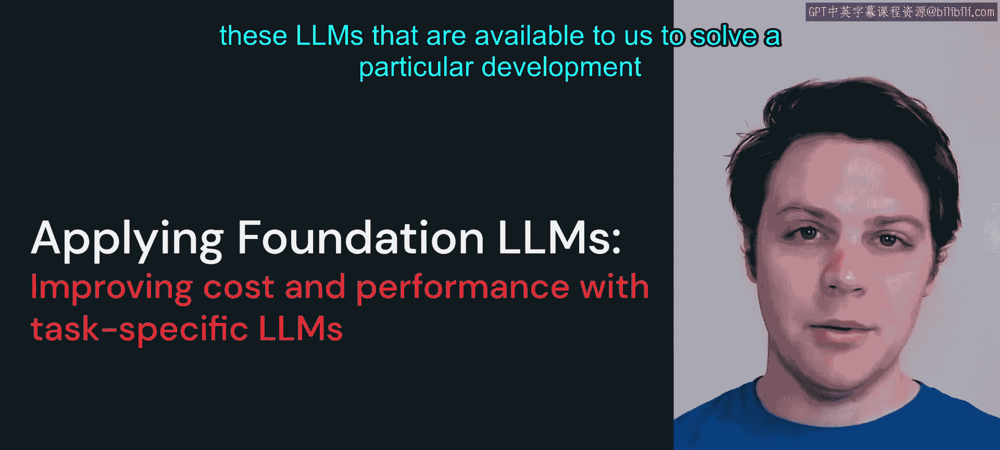
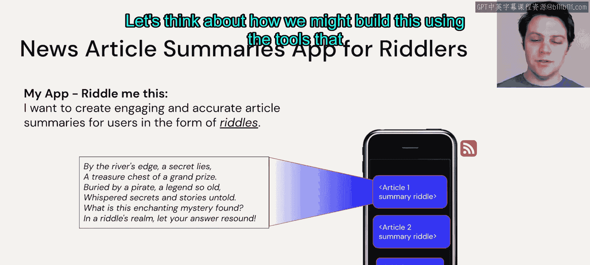
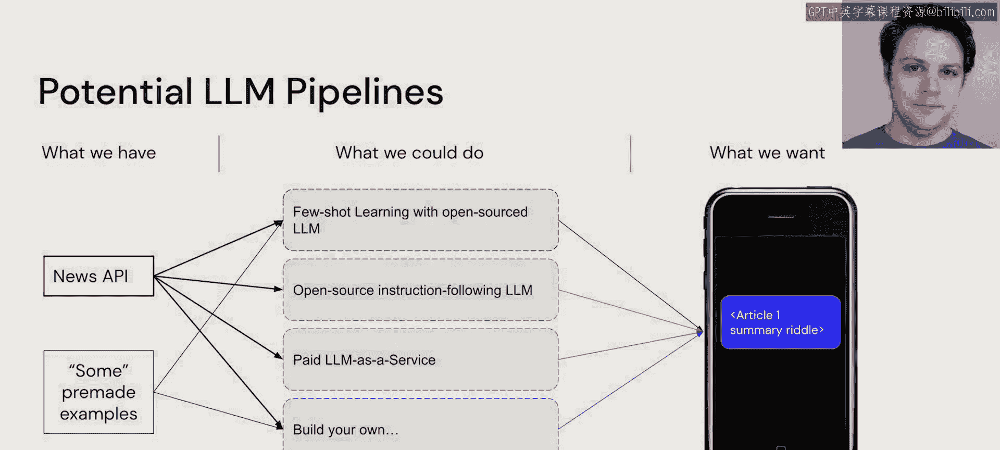

# databricks《大语言模型：从生产到应用｜Large Language Models： Application through Production》 - P41：-41-LLM Module 4_ 4.3 Applying Foundation LLMs.zh_en - GPT中英字幕课程资源 - BV1nS411K7Af

Let's walk through an example of how we might apply some of these LLNs that are available to us to solve a particular development of an application。

😊。

Our application is going to be a news app that summarizes the daily news articles and presents them as riddles for the users to read through to try and decipher what's going on。

Let's think about how we might build this using the tools that we have available。

We have a number of different potential LLM pipelines。

Let's consider what we already have we'll have an application programming interface or an API connected to some sort of news outlet so that we can get daily articles of what's going on around the world。

 and we might have some premade examples written by either us or people that we know are good at writing riddles from news articles We don't have too many samples but we've got enough to maybe do some few shot learning later on。

If we think about the。LLMs that were released by the community。

 we could do some fus learning with that open source LLM。

We could use the instruction following LLM and do some zero shot learning there。

We could use an LLM as a service paid option， or we could go down and build our own path。Ultimately。

 we just want to end up with a way to take the news articles and present that as an application interface for our users。

We'll go through each of these options to see how we might implement them。😊。

