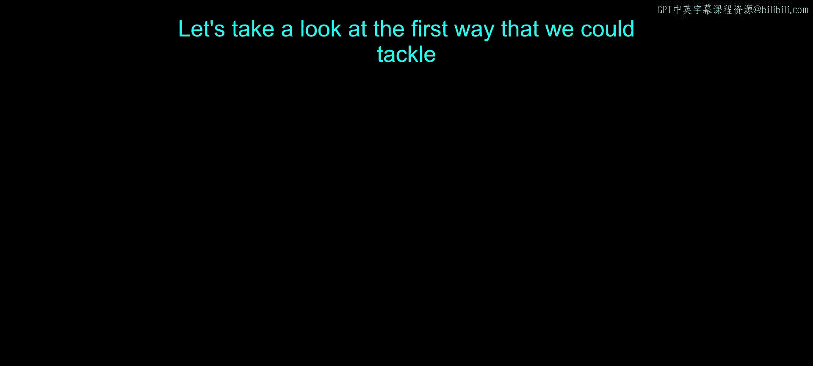
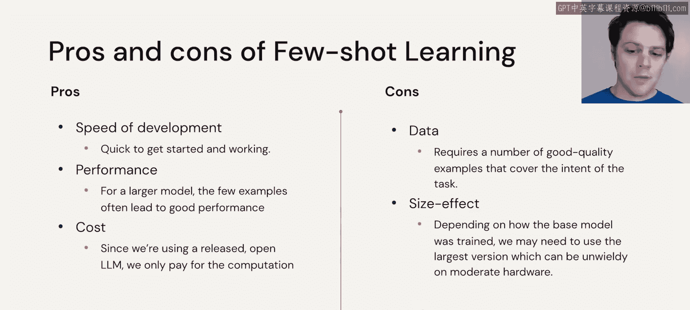
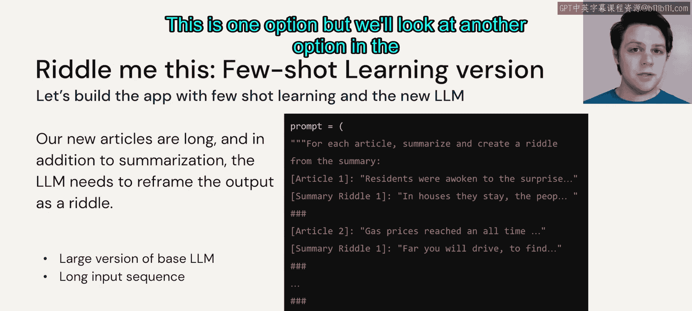

# databricks《大语言模型：从生产到应用｜Large Language Models： Application through Production》 - P42：-42-LLM Module 4_ 4.4 Fine Tuning_ Few-shot Learning.zh_en - GPT中英字幕课程资源 - BV1nS411K7Af

Let's take a look at the first way that we could tackle this problem with fu shot learning。😊。

Just to recall， we have the news API that allows us to gather articles from our news outlet and we have some prem examples of other articles that have been turned into riddles so we could potentially have a look at how feasible the fu sh learning approach might be。

If you think about the pros and cons of few shot learning。

 it's certainly quick to develop as we have all the data that we need and we just apply our LLM as is with just a specified prompt。

For a performance sake， we'll need probably a larger model as the few examples that we have will be needed so that we can get good performance with a lower number of examples or with a smaller model。

 we tend not to get as good a performance with few shot learning。

And the cost since we're using a released open source LLM， we won't be doing any training。

 we're just using it for inference， we have minimal amount of computation cost associated。

The downside with few shot learning， we need quite a few good quality examples that cover the intent and scope of the entire task so that we need to make sure that the few examples that we do have。

Cover enough breadth for the articles that we expect to see in the real world so that our model is able to infer enough information。

The size effect also is something that we touched on in the performance part of the pros。

 but is's actually something that we need to consider as a con in that if we do need to use the largest or larger versions of the open sourced LLM。

 that can have some space and computation difficulties depending on how big the model actually is。😊。

But let's take a look how we might implement this in our application。So let's build our prompt。

 we're going to tell the large language model that it needs to summarize and create a riddle from that summary。

 Now， if you think back to what we did in module3 for a lane chain。

 we might split this up into two different steps， but for now we'll just consider this to be a single approach just to simplify the prompt here。

We'll have all of our articles and the summary riddles as examples that we give in our prompt。

And then the final part of our prompt will be the article that we have and then an empty space for the summary riddle so that the LLM knows to begin by producing the summary riddle for that article。

We need to keep in mind though， that for these kinds of applications。

We'll probably need a very long input sequence model。That might be a very large version of the model。

 or it might be one that's actually quite difficult to get hold of as long input sequence models are only starting to be released。

Typically for future shot learning， the larger the base or foundation model that you use。

 the better the performance that you have and so that will need to be taken into account as well This is one option but we'll look at another option in the next video。

