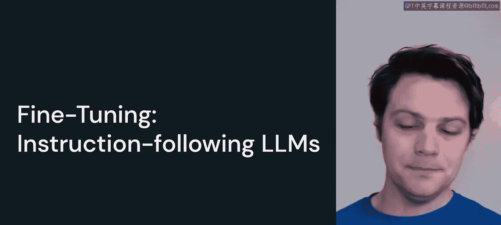
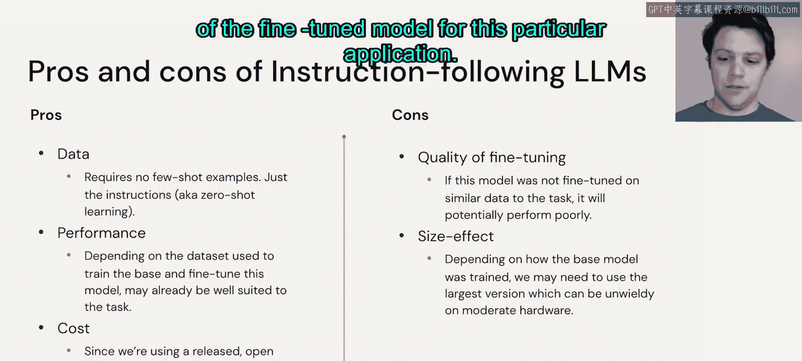
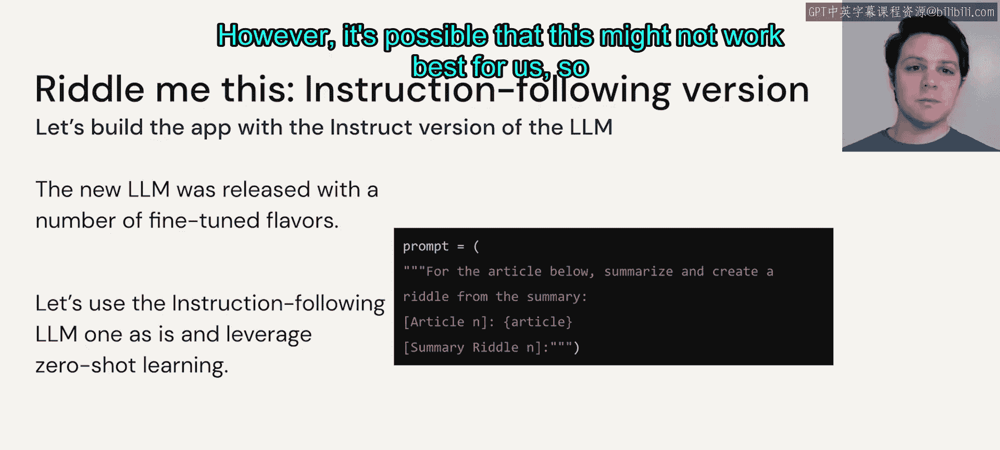
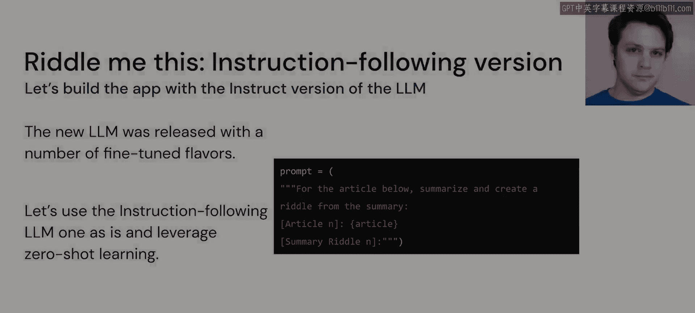

# databricks《大语言模型：从生产到应用｜Large Language Models： Application through Production》 - P43：-43-LLM Module 4_ 4.5 Fine Tuning_ Instruction-following LLMs.zh_en - GPT中英字幕课程资源 - BV1nS411K7Af

Let's take a look at another way that we could potentially use some of these open sourced LLMs。

 and that's by using the pre fine tuned instruction following version of the LLM。

In this situation we're going to assume that we actually don't have any premate examples if we do have premate examples。

 then we could follow a very similar path to what we did in the few shot learning example with just the foundation model depending on how the instruction model is constructed depending on how it was trained using the foundation model or the instruction following model with few shot examples might give similar results or the instruction model might be better or worse depending on how it was trained in this example that we want to go through the scenario where you actually don't have any premate examples to work with in that situation we'll actually need to utilize zero shot learning where we just describe the task and then give the article for the model to summarize。

So here we just have the news API， we have our instruction following LLM that's been released by the open source community。

 and we want to create our app。So let's think about some of the other pros and cons。

Because we are assuming that we have no data available。

 we might need to pay more attention to how we construct the prompt so that it's very specific and well thought out for the model to follow。

Performance， depending on the dataset set that was used to train the fine tune model from the base model。

 it might actually already be excellent at solving this problem even with a zero shot approach。

And for cost， likewise， because we're using a open sourced LLM that's already been trained。

 we only pay for the computation at inference， we're not doing any training ourselves。😊，However。

 if the fine tuning of this model meant that it actually doesn't really know how to do this kind of task。

 then that might degrade the performance that we have and this might not be a viable option for us。

Likewise， for the size effect， depending on how the model was trained。

 we might need to use the largest version if there is one of the fine tune model for this particular application。

The way that we'd implement something like this would be a very smaller prompt。

 much smaller prompt than the one from the fu shot learning where we just described the tasks that we needed to solve。

 and then we give it the article as the input variable and ask it to produce the output。

Depending on how well it is trained， as I said， we might get different results。

 We may get fortunate that this is already ready to go for us and so we wouldn't need to do any further options。

 However， it's possible that this might not work best for us。

 so maybe we need to look at another option。

