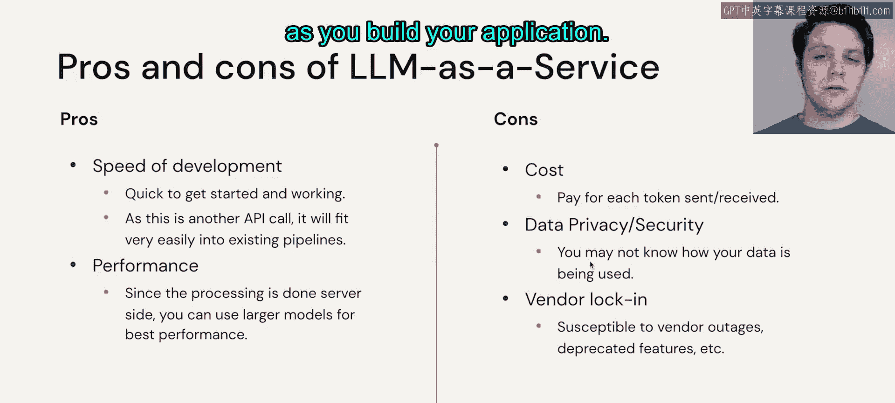
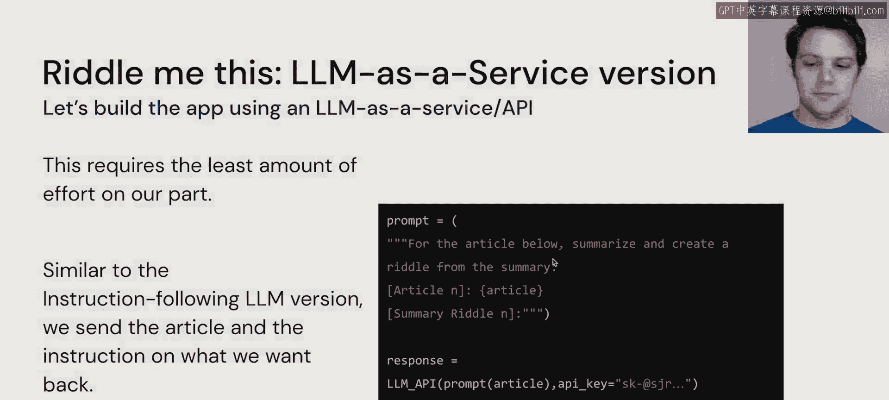

# databricks《大语言模型：从生产到应用｜Large Language Models： Application through Production》 - P44：-44-LLM Module 4_ 4.6 Fine Tuning_ LLMs as a Service.zh_en - GPT中英字幕课程资源 - BV1nS411K7Af

Let's look at a slightly different approach where we actually utilize a proprietary or LLM as a service offering。

To solve our application development problem。

In this scenario， we're going to assume that we don't have any preate examples to send along with our news API results。

 but you could imagine that if we wanted to include some premate examples for fu shot learning with our paid LLM as a service。

 we could do that too。The goal for this though is to really look at how incorporating an LLM as a service would fit into the workflow for your application。

😊，Because this is just another API call as your LLM is a service。

 it's very quick to get started and build up your application around this particular call。

 as this is just another API interface that you'll be using in the same way as you would interface with the news API。

Because we're dealing with all of the computation and all of the infrastructure on the service side of things。

 the performance tends to be higher when dealing with an LLM as a service as all of that is done offite rather than locally with your machines。

The downside， of course for going with the LLM as of service is the cost that you would pay as you send each token and receive each token。

 however， you do have to balance that with the cost associated with running all of this on your own hardware。

There is of course a risk for data privacy and security as all of the data that you send to the provider of the LLM。

Has access to the data in some format， depending on the terms and conditions you just need to be aware of what to expect your data to be used for。

And likewise， because you're using a vendor just as any other vendor in any other sort of situation。

 you need to be mindful of vendor locking risks。If the vendors suffer outdages。

 if they deprecate features or change their pricing structure。

 that's something you're going to have to keep in mind as you build your application。

So let's look at how we might implement this， it's very straightforward。

 especially relative to some of the other ways of building this LLM based application。

 really we just described our prompt as the tokens that we're going to send to our API we'll send it along with some kind of API key that we've attached to some credit card or other funding body。

😊，And then we receive that response from the service of the API provider。

So this is really the lowest effort， and we tend to get very good performance from closed source。

Providers of LLMs at this stage in the sort of development cycle of large language models in general。

 the proprietary software so far has outperformed the open source community。

 though theres certainly a race to improve the performance of the open source community as well。

So let's see if none of these situations really fit for us。

 even the close source proprietary versions， perhaps they're not as good as we really need。

 maybe we really do need to fine tune in one of these large language models。

 let's tackle that in the next video。

