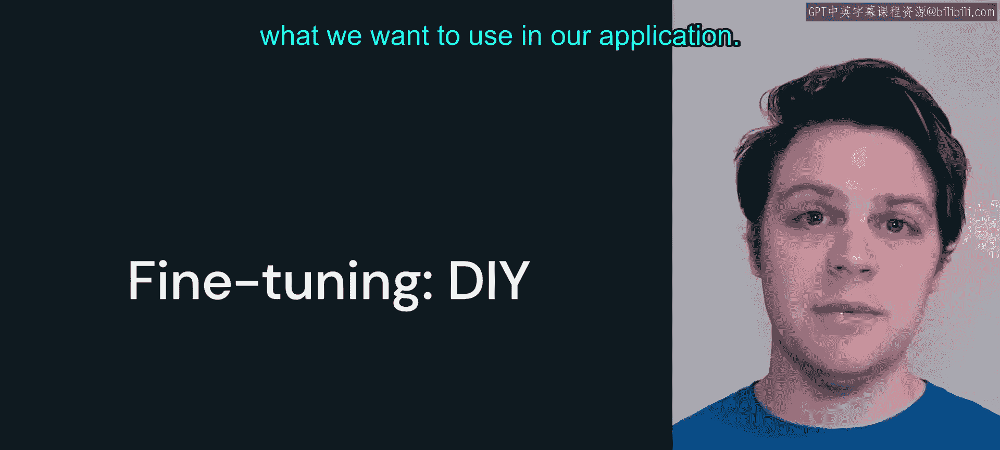
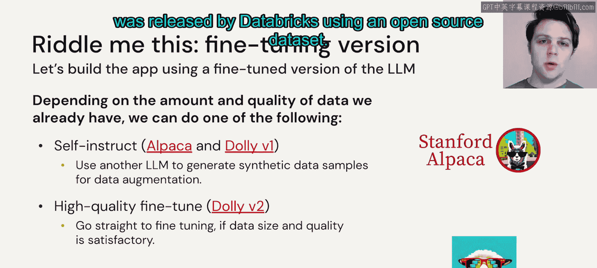
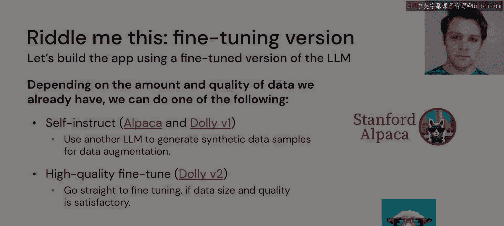

# databricks《大语言模型：从生产到应用｜Large Language Models： Application through Production》 - P45：-45-LLM Module 4_ 4.7 Fine Tuning_ DIY.zh_en - GPT中英字幕课程资源 - BV1nS411K7Af

Let's say we've tried all of the other LLM offerings and none of them quite give us the results we want。

 maybe they just haven't been trained on data that's specific enough for what we want to use in our application。

In this situation， we're going to need to try and do it ourselves。

Let's assume that we still have a good number of prem examples that show the article being summarized and transformed into a riddle。

 and we also have our news API connections so that we can get as much inference data as we need。

So when we come to building our room we have two options。

 we can build our own base model foundation model from scratch。

 which would include constructing the architecture for the base Foundation model。

 we would need to gather a data set that encompasses a huge amount of training data sources and then we would fine tune that model once that's been trained。

Or we could take an existing model and fine tune it on just the data set that we have available right now。

😊，Almost never will we go down that first path of training a foundation model from scratch。

 It requires the resources of a very large company to do it properly and cost efficiently。

 In most cases， really only a dozen or so companies across the world are doing this and are making them available in open source。

 It's just such a time commitment cost commitment and resource commitment that it's really infeasible and unnecessary for almost everyone else to do。

But let's go down the fine tuning and existing model path as there's a lot of interesting nuances that we need to keep track of。

😊，If we're going to fine tune an existing large language model。

 this means that we can really create a task specific version of the late language model for us。

We also tend to save on inference costs as a very tailored model if it's for a specific use case。

 can often be smaller than a large model that we're using a few short of zerosha learning for We also control all of the data of the model and the data so that everything stays within our locus of control。

😊，There is a downside to some of this as we do need to invest time and computational cost in fine tuning this model。

 though it's not too bad。For the types of models that we might want to build。

 we may need a large data set so that we can find tune properlyly on。

 let's assume that we have enough data in this scenario。

We'll also need some skill sets that enable us to fine tune these models。

 but if they're taking this course， then they should be okay。

The way of fine tuning instruction following models has really come into its own in the last few months as we've seen some really fantastic results from Stanford University and others working on projects like Alpaca and Dolly V1。

However， these were somewhat held back as they used proprietary data sets or data sets。

 at least that had commercially restrictive licenses。In the last few weeks。

 a new version of Dolly Dolly V2 was released by Databricks using an open source data set。

 Let's talk a little bit about why Dolly2 is so special。

