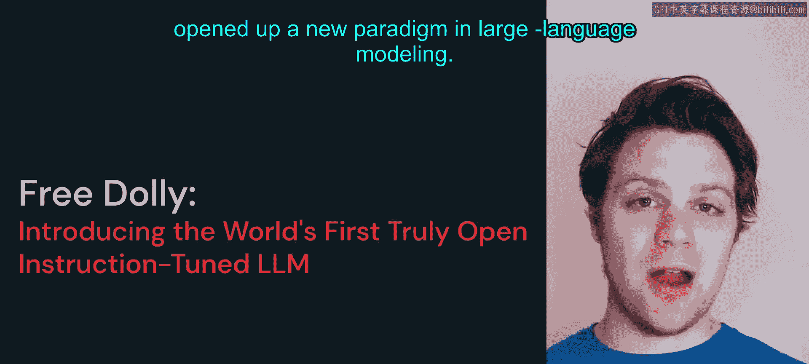
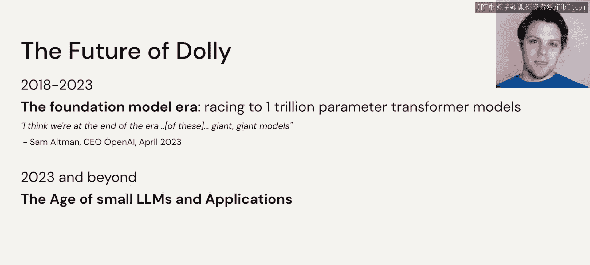
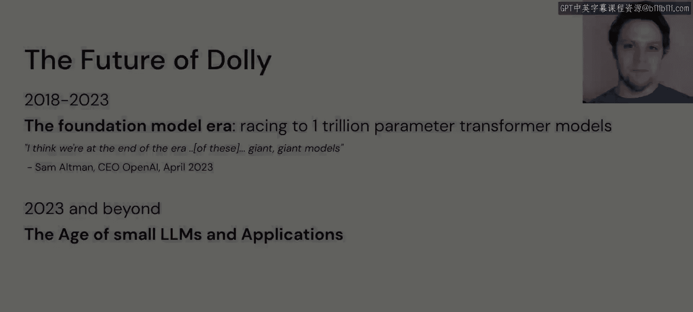

# databricks《大语言模型：从生产到应用｜Large Language Models： Application through Production》 - P46：-46-LLM Module 4 _ 4.8 Dolly.zh_en - GPT中英字幕课程资源 - BV1nS411K7Af

Let's talk about Dolly， one of the innovations of 2023 that really opened up a new paradigm in lifes language modeling。

😊。

Dolly is a 12 billion parameter model based on the LiI Pythia 12 billion parameter model。

Dlly is an instruction following larger language model。

 which means that we can ask it to do specific tasks and it responds in the way that it was trained。

😊，Doullly is special in that it represents an approach that has been neglected or at least not investigated fully by the open source community。

 however we've seen now a huge momentum shift into this kind of direction in the early months of 2023。

😊，Dolly was built by first taking an open sourced pretrain foundation model。

 the Pythia 12 billion parametermeter model， which was trained on the pile。

 a data set comprised of a number of different open source dataset sets。And then for Dolly。

 we fine tune the model on these Databricks Dolly 15k data set。

This data set is probably the real core of what makes Dolly special。

The Iluther AI 12 billion parametermeter model is an open source model that we can use however we wish。

 however， it's not fine tuned in any particular way。😊，If we do want a find unit。

 we need a data set of high quality that we can use so that it elicits responses that's useful for us。

😊，The Databricks Dolly 15k data set was produced by the employees of Databricks。

And contains within it， pairs of instructions and responses of high quality intellectual tasks。

The special source behind Dolly is the fact that this Dolly 15k data was released by the Databricks owners to be completely open and commercially usable This is different from all of the other approaches prior to this as they had some kind of licensing issue。

😊，Dolly itself is not a state of the art model， it's just an approach that shows that you can take a model such as the Luther AI open source model。

 combine it with a high quality but open source data set and produce something that is commercially viable。

😊，Many new approaches are now taking place to combine this dully 15k data with even newer open source architectures。

The idea for Dlly came from the Sanffordt Alpaca Project。In this project。

 they used 175 instructions that they created themselves and gave this to the open AI model Tt Da Vinci3 to create synthetic and new versions of these tasks。

😊，After going through a process of trial and error， they ended up with about 52。

000 high quality instruction following examples they combined this with Meta's Lama 7 billion parameter model which was released。

😊，Not long ago， with a high quality this high quality data set meant that they produced a very capable model。

However， this model was restricted with the licensing involved both with the Lama 7 billion parameter model and with the fact that they were using open AI to produce more training data。

This held back the Stanford Al Packer model from being used in the commercial setting。

This gave a hinter that we could actually use small models with high quality data sets to replicate the kinds of performance we're seeing from these larger models。

Moving forward now。😊，Sam Altman， the CEO of ONi， expressed。

His sense that we're at the end of this era of chasing larger and larger large language models。

The focus for 2023 and beyond seems to be now the age of small LLMs and applying them in different use cases we've moved from this broad approach where we try to build a master of everything and now trying to create it so that we have fine- tuneed bespoke models for different types of tasks。

😊。

Where this will go， we're not sure， but it's exciting to see where this field keeps evolving and moving into。

😊。

