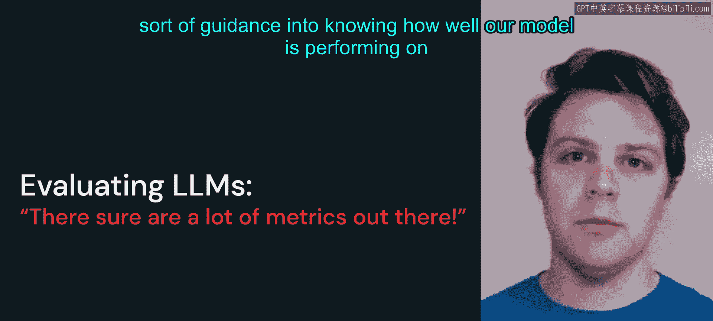
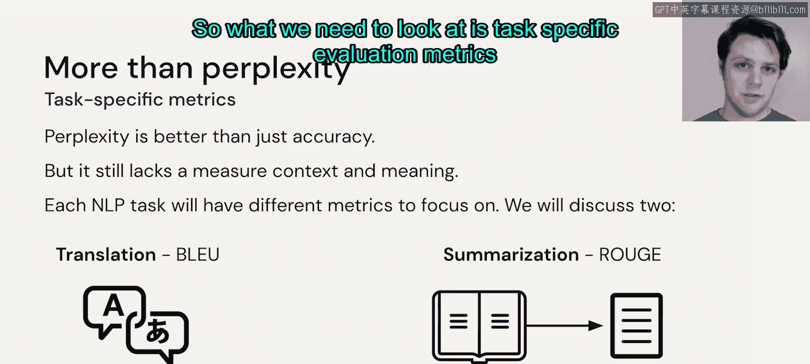

# databricks《大语言模型：从生产到应用｜Large Language Models： Application through Production》 - P47：-47-LLM Module 4_ 4.9 Evaluating LLMs.zh_en - GPT中英字幕课程资源 - BV1nS411K7Af

While fine tuning is great and there's a lot of interesting applications that we can do by fine tuunning LLMs。

 we still need some sort of guidance into knowing how well our model is performing on the tasks that we have defined for it。

If we decide to find tune our model， we really need to understand how to evaluate the model for its performance。

Intuitively， understanding how well a large language model performs is really quite difficult to verbalize or to come up with a consistent definition。

😊，Whilst we training， of course， we do look at things like the loss or the validation scores as we go through the training process as these are still deep learning models and they try to optimize some sort of loss function。

But for a good large language model， what does the loss really tell us nothing really。

 Not to really any of the traditional metrics you would see for some kind of binary classifier。

 If you remember what a large language model does， it's really just producing a probability distribution over the entire vocabulary of tokens and selecting which one it thinks is the right answer。

How that really relates to whether or not we're getting a good conversational agent or picking a good riddle for our summaries。

 it's hard to see how those are connected。One way that we can improve on just whether or not it got the right answer is looking at its perplexity。

Pplexity is really just how the spread of the probability distribution is over the tokens that it's trying to predict。

😊，If we have a very sharp。Probability distribution of our tokens。

 that means it has a very low perplexity and it knows that it's very confident that that is the token it should be picking。

😊，Whether or not that token is correct or not depends on the accuracy。

 so really what a good language model will have is high accuracy and a very low perplexity。

 it'll know which words should come next and it'll be correct in picking that word。😊，Perplexity。

 though， is really not the end of the story either。

 even though we're confident and correct about picking the next word。

 that doesn't necessarily mean that we're getting a good quality of the result we're getting。

 We don't have any context for the rest of the words that is picking in that sentence。

 if it's choosing the same word again and again， maybe that has a high value of accuracy and a high value of a low value of perplexity。

 but if we're doing say translation or summarization， that's probably going to be complete nonsense。

😊，So what we need to look at is task specific evaluation metrics and we're going to look at that in the next video。

