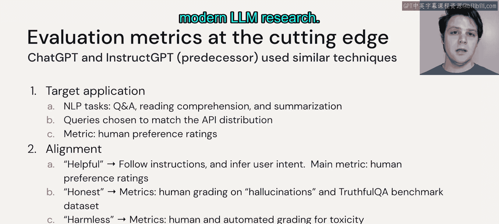

# databricks《大语言模型：从生产到应用｜Large Language Models： Application through Production》 - P48：-48-LLM Module 4_ 4.10 Task specific Evaluations.zh_en - GPT中英字幕课程资源 - BV1nS411K7Af

Let's talk about some task specific evaluation metrics。😊，For translation， we can use the blue metric。

 which evaluates how LR output compares to reference samples of the translations that we want to produce。

In blue we calculate how many unigrams， those are single words appear in the output compared to our reference。

 we also look at how the bigrams， trigrams and quadgrams appear in the output from our model compared to our reference samples。

Blue then combines all of these and creates the geometric main of the uni by try and quadgrams and gives a total value for the blue metric。

A unigram in this situation is a single word， so if a word appears。

 say six times and it's the exact same word will' actually have a very high value for the unigram score in blue。

 however， when we extend this to the bigram and trigram case we'll see that the values quickly drop off to0 if we have a very good translation willll see that it matches very well。

 the references and so we'll get a high value for the blue score。😊，Likewise， for sums。

 we can look at the Rouge score。Rouge is quite similar to blue and how it matches the reference samples to the outputs given by the summarization model in this situation。

 however it also takes into account the length of the summary so that we have as shortest summary as possible if we have quite a verbose summarization。

 but it still contains many of the words in our reference sample that does so so。

 but not fantastically。Ruge then looks for situations where both words are common in both the sample and the output。

 but also that the output is as small as possible relative to the reference samples。

But what if we want to do something where we're not using just our data。

 what if we want to benchmark our model compared to other models。

 we might not have the same data sets that they have。

 and so that's where the community is also produced。

Benchmark data sets so that we can evaluate our models and compare that to the others in the community。

Squad， the Stanford question and answering data set is a very commonly used toolkit。

Which contains a number of different data sets that we can use for our models to compare different LLMs as they've been fine tuned。

Finally， some of the more cutting edge evaluation metrics focus on things like alignment。

 and that's how well if we give， say an instruction following LLM a particular task。

 does it give us one a relevant result based on the input that we asked it？

Does it give a hallucination， which we'll look more at in the next module， And is it harmless。

 Is there a measure of toxicity or。Profity in the response that we might want to reduce。

 depending on the particular use case， different evaluation metrics are used by researchers and even more are becoming produced day by day The problem of alignment though is still a very critical component in modern LLM research。

