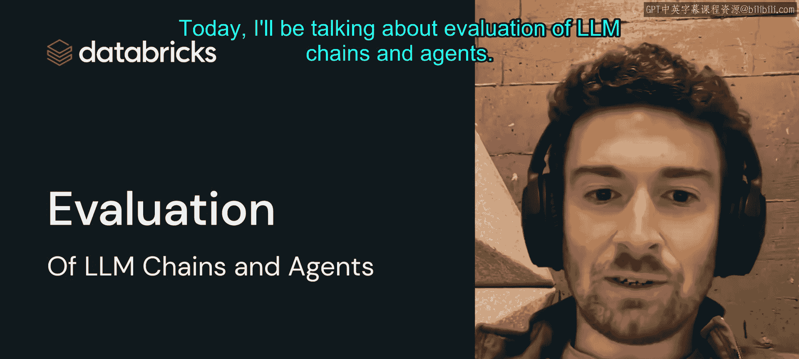
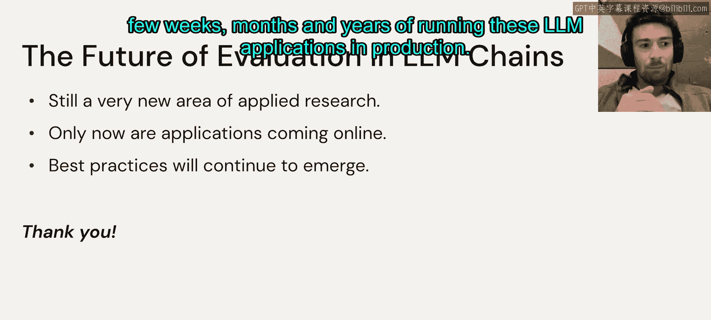
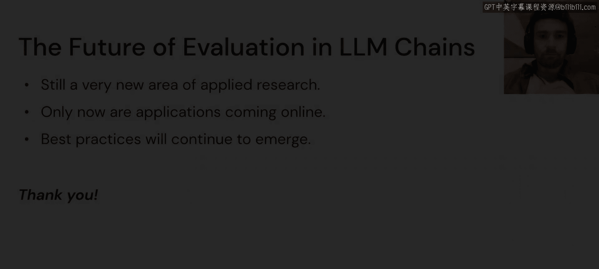

# databricks《大语言模型：从生产到应用｜Large Language Models： Application through Production》 - P49：-49-LLM Module 4_ 4.11 Guest Lecture Harrison Chase, LangChain Creator - GPT中英字幕课程资源 - BV1nS411K7Af

Hi， my name is Harrison Chase， creator of Lnkjain， a framework for developing LLM applications。

 today I'll be talking about evaluation of LLM chains and agents。😊。

So today I'll cover an overview of LLM chains and agents what are they， why why are they interesting。

 why are they useful， then I'll talk about why evaluation of these change agents is hard primarily due to two main reasons lack of data and lack of metrics I'll then discuss a few potential solutions that are emerging as best candidates and then I'll talk about offline and online evaluation which are just to concrete representations of applying these solutions for evaluations to the problem at hand。

So first， an overview of LLM Janes and agents， the core idea of this is using an LLM as the reasoning engine。

 so we'll use the LLM to determine how to interact with other sources of data and computation。

 but crucially we will use those sources of data and computation for their。

Knowledge rather than using the knowledge that's present in the LLM。

 We'll use the LLM more as a reason invention。 And so the canonical example of this is rettrievval augmented generation。

 And we can think of this as a chatbot that can answer questions about。

Particular documents or documents that are proprietary to you that the language model。

 GPT3 or whatever has not been trained on。And so the general flow for this type of application is first you'll have the chat history。

 which you'll condense into a standalone question and this is important because you'll use that question to retrieve the relevant documents if you don't do this condension step then you might retreat and you only use the final chat message in the chat history。

 it could be referencing things prior that you won't know about so this condensing step is really important。

So you do that， then you look up relevant documents and you get back a list of relevant documents and then you pass this to a language model to generate the final answer and so this will take in the original question。

 the chat history， the retrieved document， which are're now which the prompt will generally ground the response in and it will generate a final answer and so here you can see that we're using the language model as a reasoning engine which takes in a question and some data and then reasons about an answer relative to the data that's been provided。

 but we're basing everything we're grounding everything in that data that we've retrieved。

 we're not using the knowledge present in the language model itself for that。

So why is evaluation of these types of applications hard first is due to a lack of data so unlike traditional problems machine learning。

 you generally don't start with a data set， you generally start with an idea a problem or an application that you want to build and then you start building and then you need to evaluate it and you't have you don't have the traditional machine learning training data set to start from。

😊，It's also unclear for this what the data would even be so for a lot of these questions if we start to think of some of the more complex ones。

 they could be constantly changing based on the day。

 so a lot of question answering applications have to do with up- to-date data。

 so it's unclear if there's even a ground truth answer that that remains constant over time。

 so it's really challenging to gather data。S。The other issue is a lack of metrics。

 so it's hard to even evaluate with your eyes so a lot of these applications if you think about the chain before there's three different steps that could be going wrong at any of those intermediate steps and you might not necessarily know which one and where。

And then it's also tough to evaluate quantitatively with metrics looking at the final answer。

 so in the question or in the example above of a question answering chatbot。

 the final answer that the chatbot gives is free form text and so it might have a particular fact in it and that's the thing that we should be evaluating but there's a lot of conversational text around it as well so you can't do things like exact match on that text and you need to do some sort of more advanced things which we'll talk about later。

😊，She。So some potential solutions here that are emerging as best practices。First。

 around the lack of data。There's two things here that people tend to do one is generate data sets ahead of time and so you can generate these programmatically and oftentimes a language model is part of that programmatic generation of these things so in the example of question answering over a document。

 if you want to generate a test set for it one thing one chain that we commonly used to do that is a chain that splits the document up into chunks and then for each chunk you ask the language model to generate a question and an answer pair and that becomes kind of your test set for this application。

The other thing that is commonly done to gather this data is just accumulated over time so if you have a application running in production。

 you can keep track of the inputs and outputs and you can start to eventually add these to a data set and grow that data set over time。

For lack of metrics。The first and most important thing is just to make it really easy to inspect visually what's going on so what are the inputs and outputs at each step in the chain。

 what are the inputs when it finally goes to the language model when it finally comes back。

 this is really important for understanding if the application is messing up due to a lack of retrieving the right information or it's retrieving the right information is just not synthesizing it properly。

Another thing that we can do is use a language model to judge whether the final answer is correct or not。

 so this will handle the cases where there's a fact。

 but it's surrounded by a bunch of conversational texts and so we'll use the language model to take a natural language answer and then a natural language ground truth label and compare whether they're semantically equivalent。

And then the final thing that we can do here is we can just gather feedback directly or in directly from users。

And so I'll talk a little bit more about this during online evaluation。

But first offline evaluation so the main way to evaluate chains and agents in an offline manner is create a data set of test points to run against you then run the chainer agent against them you then visually inspect them so you can you can look at the inputs and outputs at overall at each step see how it's doing and then that's not really scalable of course。

 and so then the next thing to do is use a language model to autograde them and you can either。

Fully trust this auto grid so you could have it assigned correct or incorrect to each run and then just average that。

 or you could just use that as a way to guide your eyes to the data points that might be most correct or incorrect and then do another visual inspection on top of there。

An offline evaluation is usually used before the model goes into production。

So this can be right after you've finished developing it and you're doing a final test to see whether it's ready to go in production。

Online evaluation on the other hand is after the model' has been deployed。

 so now it's running in production， you're serving users and you want to make sure that it's continuing to do a good job and so the main method of doing this is gathering feedback on each incoming data point。

So there's ways of gathering this feedback directly so you could add a thumbs up or a thumbs down button to your application and then user can click on it and you can track this feedback over time and if you release a new version of the application or if the model starts doing poorly for whatever reason you can hopefully notice a downtrend in this feedback and you can use that as a mechanism to know that you need to fix your model there's also other forms of feedback that can be more indirect so if you're serving up know relevant links if someone clicks on a link that probably means you did a good job if they did not click then that means that the model might not be doing a good job and so you can use this as an indirect measure of feedback。

And both of these， the idea is to track these over time。

 and you can start to notice when the model performance starts to degrade。

That is pretty much it evaluation of these applications is a new and exciting topics these applications are just starting to kind of like go in production so there's just starting to emerge kind of like a set of best practices around them and I'm sure we'll continue to add and grow our knowledge about evaluation as more and more go into production so I'm personally really excited to see what develops over the next few weeks months and years of running these LLM applications in production。

😊。

