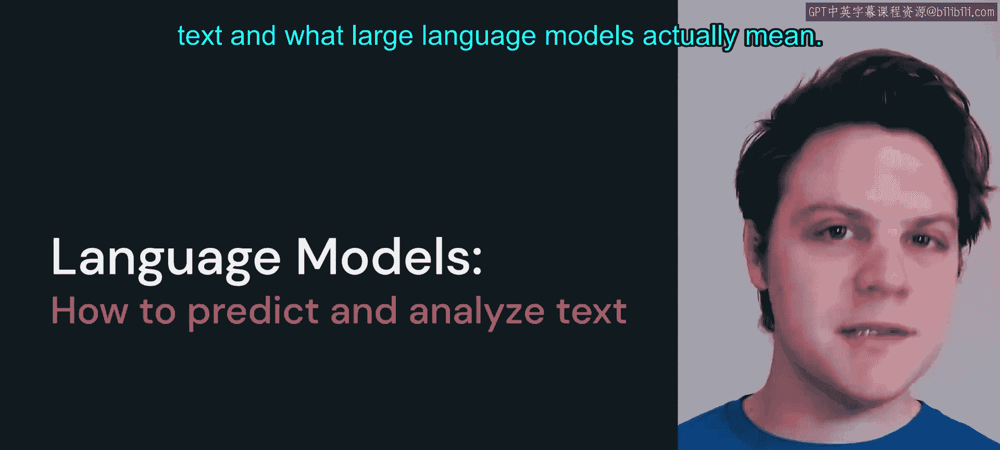
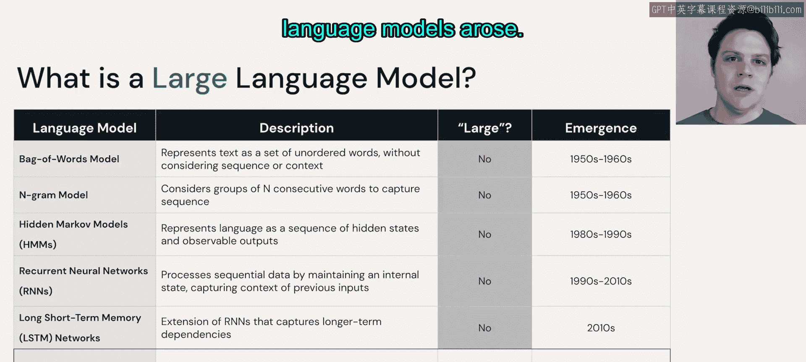

# databricks《大语言模型：从生产到应用｜Large Language Models： Application through Production》 - P4：-04-LLM Module 0 - Introduction _ 0.4 Language Models.zh_en - GPT中英字幕课程资源 - BV1nS411K7Af

Let's talk about language models and how we use them to predict text and what large language models actually mean。

😊。

So you've heard obviously large language models being a term thrown around in the last。😊。

12 to 24 months， but you might be wondering what makes them large and what the heck is a language model in the first place Well if we break down that term of large language models into two parts。

 that'll help us clarify some of these points。😊，So first we're going to look at the language model part of LLM so what's a language model。

 and then we'll talk about what makes them large and why have they become large suddenly or were they always large。

 so let's take a look。So a language model is really just a computational model that takes in a sequence of some kind。

 it might be a sequence of tokens like we spoke about just before。😊。

And then finds a probability distribution over the vocabulary。

 which is what we talked about just before as well。

 to find the most likely word now LLMs or language models in general actually can really be split into two categories。

 they could be generative or they could be classification based。😊。

Typically for a classification model， the prediction that the model is looking for is a masked word that it tries to uncover。

So in a sentence， if we blank out one of those words。

 the goal of the model is to find the most likely word that fits into that spot。

For generative models and for generative AI， which is the topic of most of the research at the moment。

 what the models are trying to do is to predict the likely next word after that sequence that it's been shown。

So a language model is really just a model that's internally trying to find a probability distribution where that probability distribution is spread over the entire vocabulary that the model has to use to find the word that fits best to come next。

So really that's all a language model is The interior of it can be based on something like a transformer。

 which we will go into the details in this course， we'll talk more about the architecture and details of transformers in cost2。

 but in this situation we can think of it as a black box where all that's going on is a probability is being calculated for every token in the vocabulary。

Large language models then are just types of language models that have grown in size from typically 10 to。

50 million parameters to the billions of parameters that we see these days。

Transformers are a type of architecture that was presented to the world around 2017。

And then have dominated the natural language processing field since then。

Prior to this there were many language model formats。

 some even with deep neural network architectures， however they weren't considered large as typically those models would have less than say a few million parameters。

 we weren't talk too much about what a parameter is and even though these language models prior to transformers were not considered large。

 they still required a lot of computational effort to get results。

Transformers unlocked a lot of potential for computation efficiency。

 and that's why things really took off after 2017 and this new term of large language models arose。😊。

