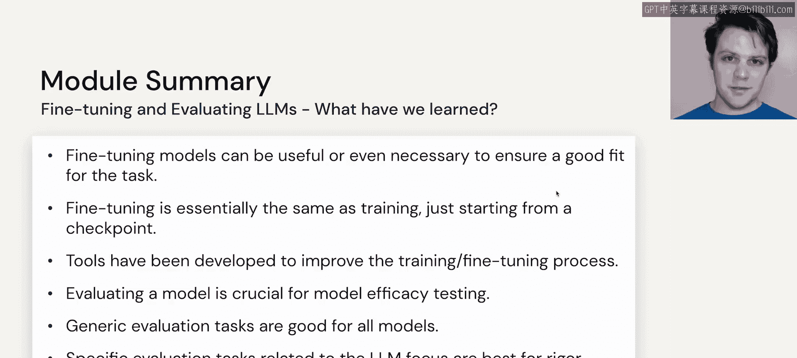
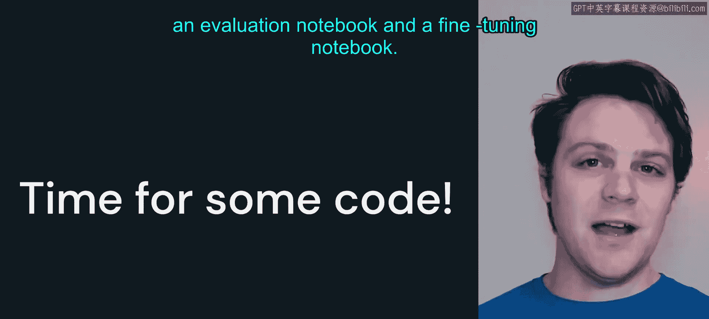

# databricks《大语言模型：从生产到应用｜Large Language Models： Application through Production》 - P50：-50-LLM Module 4_ Fine-tuning and Evaluating LLMs _ 4.12 Summary.zh_en - GPT中英字幕课程资源 - BV1nS411K7Af

I hope you've enjoyed going through module4 where we looked at both fine tuning models and evaluating models based on different task specific duties that they have to perform。

😊，I hope now also that you know which path to take when you're deciding whether to use an LLM from scratch。

 whether to find S one， maybe to use an open source or a close sourced offering and what type of evaluations you should use so that you can make sure that what you're getting is what you need for your applications。

😊。

Let's jump over to do some code where we'll look at both an evaluation notebook and a fine tuning notebook。

😊。

