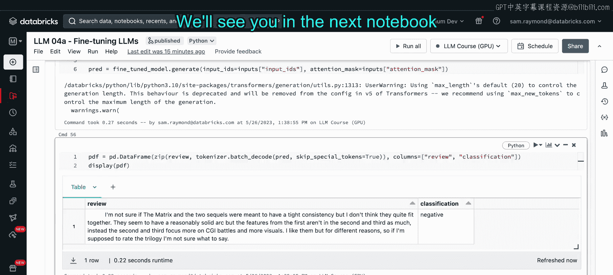

# databricks《大语言模型：从生产到应用｜Large Language Models： Application through Production》 - P51：-51-LLM Module 4_ Fine-tuning and Evaluating LLMs _ 4.13.1 Notebook Demo Part 1 - GPT中英字幕课程资源 - BV1nS411K7Af

Welcome to this first notebook in moduledule 4， where we're going to explore how we can do some fine tuning。

In many situations， we need to use a little bit of fine tuning to make sure that our LLM is performing as well as possible at the task that we specifically want it to do For this notebook we're going to utilize the power of a GPU to speed up the fine tuning process if you only have a CPU at hand odds are it will take far too long for this to run and you'll end up spending more time than you need。

We're going to also show how you can utilize Microsoft's deep speed technology so that you can run code on not just a single GPU。

 but also on multi GPU on a single node and multi nodeode configurations We won't go into the details of how to set up the infrastructure。

😊，For the multi node or multi GPU setup， but we'll show you the code that you would need to do so。

In this notebook， we're going to fine tune the T5 small LLM， and we're going to have it。😊。

Classify movie reviews as either positive， negative， or neutral。For our first step。

 we're just going to check that we're running our cluster with a GPU。😊。

We get no output from this assert statement， so we're good to keep going。

We're going to need to download some of the Kuda Library。Installs from the Nvi website。

 so we'll do that by running this cell here and we're also going to install these kuda libraries。

In our workspace。Next， we need to install Deep speed and we're also going to run our classrooms setup。

We can check that we have our classroom set up working correctly by looking at our username at our working directory。

Okay， now that that's all done， we see we're ready to go。😊。

We'll keep moving through our notebook and we're also going to need to create a temporary file to store the outputs of our model checkpoints。

And now we can start with the fine tuning process。We'll grab the pandas library and also transformers and data sets from Huging faceace。

And now in our first step， we need to make sure that the data that we have is in the right format for us to fine tune our model。

😊，On this problem。We'll download the IMDB data set， as you said before。

 this is a collection of movie reviews。😊，With the tag of either positive， negative or neutral。

And we also have a pretrain model that we're going to utilize the T5 family。

 which we've seen before in this class and that we'll see even more later on is a very。

Well made model with a number of different。Ts that it can perform。

We're going to utilize the T5 small version of this family， which has about 60 million parameters。

We'll store this T5 small as our model checkpoint。And we'll also download a tokenizer so that we can convert all of the text that we have into the right format。

 the right token set for the T5 model。Now， one thing that we do need to make sure that we're wary of is the format with our labels。

For the IMDB data set， it's a binary sentiment data set that has。

Nummerical values corresponding to the meanings of the sentiment， it uses a negative  one。

 zero and1 for the unknown， negative and positive values。

Because we want to utilize the natural language part of this workflow。

 we're going to convert these to their natural language counterparts。😊，So we're going to run。

We're going to write a couple of functions here that will allow us to take in our。

Data and convert it so that the labels correspond to words。Now that we have this function set up。

 we can apply it to our data set so that we can convert our numerical labels to text labels。😊，Okay。

 now we have our data set that's been firstly labeled to use。😊，Natural language for the negative。

 positive and unknown sentiments， and we've also tokenized our data set so that now it's ready to be directly input into our model。

😊，Now we need to set up our training process for this。

 we're going to use the training argumentsments class from Huing Face。

We can see here we're going to train over one epoch。

 so that's a full loop over all of our training data we're going to send 16。

Enries every time we do a small update in our optimization step for training and we're going to use the AdamomW Torch Opr we're also going to utilize Tensor boards so that we can see the progress of our training。

And now we can load in the model from the auto model for sequence to sequence language modeling from Hing face。

😊，This will use the model checkpoint of T5 small， and if we wanted to use a different type of T5 model。

 we could change that here as well。We're then going to set up our trainer。

 which is going to utilize the model that we've just created。

 the training arguments that we just wrote， and the data set that we just tokenized。

 and we're also going to use a data colaator to make sure that the data is always ready to go and that there's no delay in making sure that the batches are ready for the GPU to process。

😊，The next step now is to continue the training from our foundation model to a fine tuned version of that model。

As we said before， we're going to use Tensor board so that we can look and monitor our run as we train。

 so let's get that set up here。😊，We'll see when it first initializes。

 it'll be blank as we haven't started training anything yet。

 but we'll see that as we update our training procedure， more information will be。😊，Displayed here。

Now all that's left is to run the training process and again for fine tuning all that we're doing is training a model further than the last checkpoint that it stopped with。

 we're going to be using that optimizer to try and minimize the amount of error in the predictions that it makes。

😊，The predictions in this such situation are going to be trying to predict the positive。

 negative or unknown sentiment label for the movie review that we give it。We're going to run trainer。

trainin and we're going to run this for one epoch。We're then going to save the model and save the state。

This will take about five to six minutes。Okay， now we can see that our training has completed the 1。

500 steps that it took to go through a full epoch of our data。

Let's scroll up to Tensor board and have a look at the graphs of how well this did。

And if we look at our training loss and turn this to a log scale， we can see that there's still some。

Training that perhaps we could perform and do this even further to reduce the amount of training loss that we are currently seeing。

However， this is enough for us to continue on， so let's go to the next part here。😊。

Where we save the model to the Databricks file system， the DBFS。

And now let's use this fine tune model to predict。We're going to use the final model path that we just saved our model to。

 and we're going to load that in as our fine tuned model so that we can run it for inference。

We have some reviews here that we've written。All about different movies that have different types of sentiments。

 you can take a moment to read these through and think for yourself whether or not these are positive。

 negative or maybe unknown sentiments。😊，As we'll need to， we'll take all of these reviews。

The text will be converted to tokens for our model to then interpret。

 and then we'll store the predictions of this model in line 12 using the dot generaterate。

We'll run this cell and then put these reviews through our model。And now we're going to。😊。

Put all of the predictions。Into our tokenizer and perform the decoding so that it takes the tokens from numerical values to。

Plain text， and then we're going to combine this into a new pandas data frame and look at the classification for each review。

So we can see that the first classification it says was negative， the next two positive。

 and the last one negative。You can decide yourself whether or not you think it did a good job or not on these reviews。

 but I think it did pretty well。Now let's talk about deep speed。

We just ran this fine tuning model on one of the smallest。T5 models that there are T5 small。

 and we ran this on a single GPU。In many situations。

 we're going to find that models don't fit into device memory。

 or we just simply need more compute power to run our fine tuning in a reasonable amount of time。

In order to enable us to run on multi GPU and multi node multi GPU。Clus。

 we're going to need to utilize some special software， Deep speed。

 which was released by Microsoft allows us to perform these kinds of tasks。

We're going to run this just on the single node， single GPU instance that we have right now。

 but keep in mind it's not designed for this kind of use。😊。

All you would need to do is to change some of the environment variables that we're going to show you and rerun the code using the deep speed command。

😊，We'll rerun this just so that you can see this working。

 but keep in mind that we actually need to run this in a special form。

So that it will run on our single GPU single device。

We'll enable some operating system environment variables here。

 and then we'll look at the configuration options that we have for our zero optimization target。😊。

You can read more about what these different configuration variables mean。

 but these are pretty commonly used in multi GPU setups。The process is very similar。

 or we are going to create the exact same model setup as we did before。We're going to take our data。

 convert it to tokens， and make sure that we have the labels associated in the correct way。

And we're going to load in the model from the model checkpoint of T5 small， so again。

 this looks exactly the same as we did before we've just put everything in one cell。

We're going to download the data again。Because this is effectively treating everything as brand new。

And now as you can see， we there are only two changes that we make to the training setup。

We're going to add a different checkpoint name so that we don't overwrite the fine tune model we just made。

 and we're also going to add the deep speed configuration to an extra variable inside the training arguments from Huging face。

This provides us a nice， clean wrap up around the deep speed architecture that Huging F uses under the hood。

So you can see we're doing the same process using one epoch， the same batch size。

 we're just adding in this deep speed zero configuration。

We're also setting up our trainer with the same training arguments and data set。

We're going to utilize Tensorboard again。And then we're going to run our trainer in the exact same way as we did before。

You can see we've got a little bit more of an output here as Deep speed is trying to figure out what configuration it's working with。

I do want to stress because we're using a plastic configuration that deep speed isn't optimize for。

There is extra overhead that deeppe uses so that it can talk over the network to different nodes and devices。

 so we'll actually find that when we run deeppe on this particular configuration of hardware。

 it'll actually take longer to do the exact same training as we did for the vanilla type of fine tuning。

The purpose of running this code is to show you how little you need to change if you were to change your cluster setup。

We'll come back after this training has concluded。Now you can see that took quite a bit longer than the original one。

 but we arrived at more or less the same state of training loss and number of steps。

We can go through the same process and save this into the final model path like we did before。😊。

Loaded in as a fine tuned model。And then perform some predictions in this case we're going to do a different review。

😊，And we're going to pass it through the generate model。Predictions as well。

And then we'll use the tokenizer to decode the output and have a look at the classification。

So this is again， just a taste of what deep speed can do for fine tuning， you will need more。

Advanced hardware and。More。Nos and GPU resources in order to fully utilize Deep speed。

 this will give you a starting point so that you can get quickly underway and you won't have to edit your code very much to get started。

This is just a taste of what we can do with traditional fine tuning of LOMs。

 you can see we took T5 small and made it a movie reviewer sentiment analysis tool。

We'll see what we can do to make sure that our fine tuning models are giving us the results we want in the next notebook。

 when we look at how we can evaluate these different types of fine tune models。

I hope you found this exciting， we'll see you in the next notebook。

