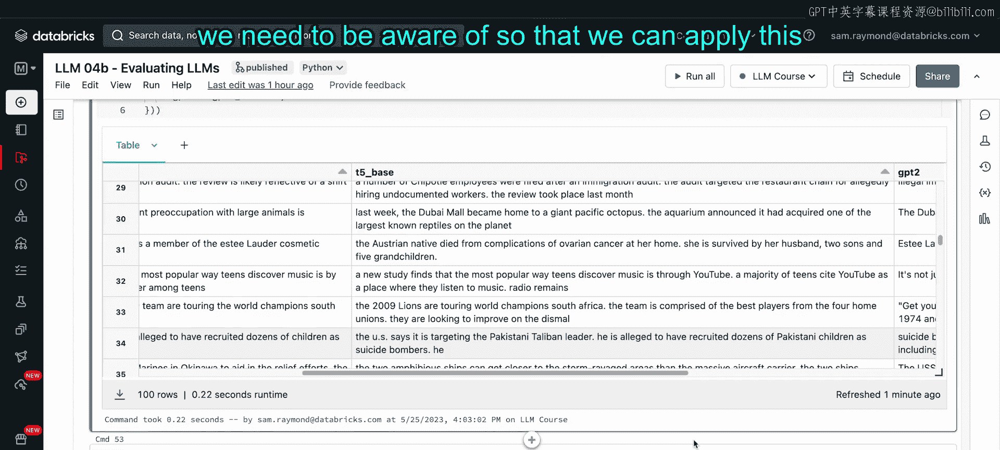
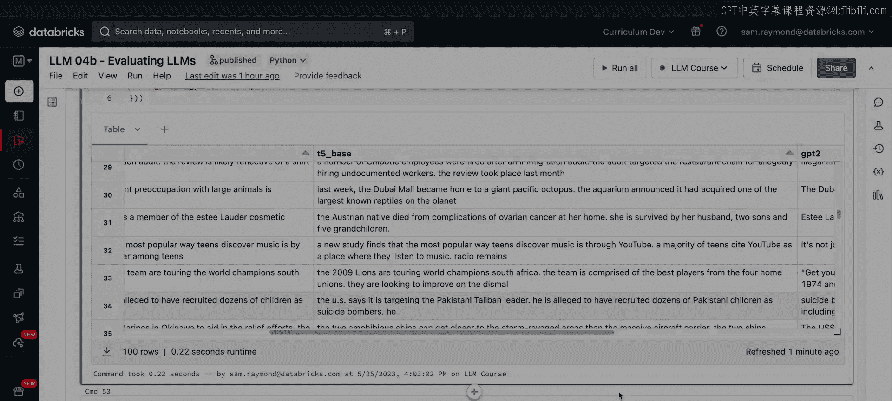

# databricks《大语言模型：从生产到应用｜Large Language Models： Application through Production》 - P52：-52-LLM Module 4_ Fine-tuning and Evaluating LLMs _ 4.13.2 Notebook Demo Part 2 - GPT中英字幕课程资源 - BV1nS411K7Af

Welcome to the second notebook in this module。In this notebook。

 we're going to look at how we can evaluate the performance of our large language model under a specific task。

In this case， we're going to look at the summarization task for our large language model。

We'll use the Rouge metric that we talked about in the lectures and you'll see how you can build up a workflow so you can take all of your articles and perform Rouge analysis using your large language model。

😊，We'll also look at how different models perform and how different sizes of the same model perform and compare their results。

😊，Let's get started by running our classroom setup。

 we need to install a couple of libraries and our regular classroom setup script。

And now while that's running， let's talk about how we can actually evaluate summarization。

As you can see， we've got a pretty standard example that we're going to run through where we have news articles and we're just going to create an article summary。

However， how do you know if you're creating good summaries for these articles？

Suppose you're developing a smartphone app。And you need to display automatically generated summaries on the fly。

 we need to know whether or not our model is performing well at producing these summaries。

We'll walk through step by step to see how exactly we could approach this and build up some intuition for how Rouge works and how we can execute it。

We're going to be using a dataset from CNN Daily Ma。

Which you can check out more at the Huging F Datas Library。But basically。

 this provides us with news articles and highlights or summaries。Paired with them。

We're going to use these highlights or premade summaries as our reference material。

We'll load in the data by using the dataset sets。Library from Huging F。

And we'll pull in just 100 samples so that we don't take too long running the analysis。For reference。

 if you're going to do this outside of this particular notebook。

 this may take quite a bit longer as we've downloaded intentionally some of the data sets and stored them locally in a cache directory so that this speeds up the download process。

 as you can see we have a user warning here that during large dataset downloads that this could take quite a while。

This shouldn't take too long， as I said， we've already preloaded a lot of this data。Okay。

 now that we're ready， let's have a look at the data set that we just downloaded。

You can see we've got a number of articles here。And then next to it。

 we have another column for highlights， which shows a summary of that article。

Let's just take a look at an example here of a randomly selected article and a highlight。

And so you can see we have information from CNN about， in this case。

 people moving their music listening preferences from more traditional formats to YouTube。

So now let's talk about how summarization works and what we can do with our large language model。

We're going to download the Transformers auto tokenizer and T5 for conditional generation libraries because we'll be utilizing the T5 model。

Now we need to create。A function to help us to build up this pipeline。

If you remember how the Rouge score works， it looks at the generated summaries and compares that to the reference summaries and does a。

Uigram， bigram， Trigram analysis to see how well these are represented。

 both in the generated summary。And the reference summary。Because we're doing this from scratch。

 we're going to show you how you would build up your own pipeline to perform this analysis。Firstly。

 we start off by defining a batch generator。That's going to take in our data。

And a batch size that we pass in and it will use。The yield statement to output。

Btches until we've reached the end of our data。Our next function will be to perform the summarization using the T5 model。

You can see the definition here on line 12 summarized with T5。We'll pass in a model checkpoint。

 so that is a setting of the weights for this particular model as it was trained through the training process。

We'll also pass in a list of articles。The batch size and we'll set that as a default to eight。

And you can see here， this function， as I said before。

 is going to compute the summaries using a T5 model that could be a T5 base， a T5 lodge。

 depending on what we want to do。We're assuming that we're going to run on the CPU for this。Notebook。

 but there is also code here that would enable this to run on a GPU as well。

We're going to define the model。Coming from the T5 for conditional generation。

And we're also going to define our tokenizer。Which will convert both our input into tokens。

 which can then be passed into the model。But it will also be able to take output from our model and convert that back to plain text。

We can see we've got our maximum model length of 1024 and that's our sequences input length。Next。

 the define。Perform inference is going to utilize our large language model。We'll create our inputs。

 which will take use of the tokenizer that we just built， it'll take in the batch。

Of data that we are grabbing for the article， pass that to the tokenizer。

We're going to tell the tokeners what the maximum length should be for the input。

We're also letting it know that we're using Pytoch rather than TensorFlow in this case。

We're adding padding equal to true， so padding will just mean that if our input doesn't take up all of the 1024 sequence inputs。

That it should pad the rest of them with a skip token， if you like。Similarly。

 if we end up in a situation where our input is actually longer， then 1024。

 were telling the tokenizer。To truncate the input， this does mean that we lose some information。

 but usually 1024 is fine for a single input。Next， we use the model and we generate the outputs and we're going to store the output in our summary IDs。

We're calling generaterate on our large language model， we're passing in the inputs。

And we're also telling it some other features that we've seen。In the lectures。Finally。

 we use our tokenizer to decode this batch and we pass in the summary ADs that we just generated from the large language model。

This means it will be returning plain text rather than token IDs。

We're still within the overall function here。That is summarized with T5。

 so now we can go to the next step where we're building up our responses。

We initialize the response with an empty array。And now we're going to start to fill it。

The summary articles will basically just be the prompts that we're going to give to our model。

We do this by using a Lambda mapping function to add summarize colon space and then the article that we want it to summarize。

We go through the batches by leveraging the batch generator that we created first。

And then we append all of the summaries to our array。If we're on the GPU。

 we also need to empty the cache and use the garbage collection so that we don't run out of。

GPU memory。And then finally， also to look after our memory usage。

 we're going to delete the tokenizer， delete the model and delete everything else after we've finished all of the runs here。

 and then finally we return our response with the full vector of our article summaries。😊。

So just to reiterate， this function builds up how to summarize our models with T5。First。

 we create our batch generator so that we take our data and produce batches of data。With it？

And then I'll summarize with T5。Puts all of the data in the right format。

Takes the tokenizer and the model and configures them to be ready。It performs the inference。

It generates the outputs and converts those outputs back to plain text。It then。Retevs the responses。

Puts them together and then returns them。Now were going to utilize T5 small。If youre recall。

 this was the model checkpoint。And we can use T5 small， T5 base， T5 large。

 any of the models that are compatible with this type of。

Architecture that we stored here at the T5 for conditional generation。

 there are a number of different models that can fit this type of structure。So if we run this。

 we're going to see that we're going to summarize with T5， our sample article。

Always make sure that you're running the cell before you go to the next one。

And so if we run this here， we can see our sample article is going to be summarized with T5 and we'll see the output of our response array。

😊，This may take a moment。Okay， now that we're done， this took a few minutes to run。

Keep in mind that it needed to。Load all of the right libraries and model information。

 but now we have our summaries from T5， so let's have a look at the reference。

So now we have our T5 generated summary and we have our reference summary。

Let's take a look at those two and see how well it performed。

So you can see we have the generated summaries on the left and the reference summaries on the right。

We'll go through how we might compare these next。So let's take a first approach at defining how well our model created these summaries。

We're going to loop through all of our reference summaries。

We're going to look at the T5 summaries and the reference summaries and if the generated summary is exactly the same as the reference summary。

 we'll give it a score of1， otherwise we'll give it a score of zero。So before we run this。

 think about how likely it is that we'll get exact references。😊。

And generated summaries that match and how likely it is that they'll be slightly different if they're at all different。

 it will get a value of zero， if they're exactly the same we'll get a value of 1。Let's have a look。0。

0， not so good。Hopefully you're expecting an accuracy of zero because the odds of getting the summaries to be exactly the same as the references are almost infinitely small。

😊，Very small variations in wording， no matter how。😊，Minor they might be will make this approach。

Infeasible。To score the performance of our summarization。So this brings us to Roe。

Rouge looks at different subparts of our summaries and compares them with the references。

Ruge is built out of four different scores， Rouge 1，2， L and L sum。You can see the definitions here。

 so Rouge1 looks at unigrams， so those are single words or single tokens。

And it matches whether or not the。Reference words appear in the summary that was generated。

Ruge 2 looks at diagramgrams， which are pairs of words or pairs of tokens。

And then Rouge L looks at the longest common sub sequenceequence shared by the summaries。

Rouge Alsam looks at the summary level so that ignores things like sentence breaks or new lines。

Let's import the Rouge library and see how well our model does with summaries。

We're going to use two pieces here， we're going to download the NLTK library。

 particularly because we want to be able to tokenize our sentences。

And we're going to grab the Rouge metric from the Huging F Evaluate library。

Now we can use the Rouge score that we established here on line six， we can use that directly。

 however， we need to make sure that we're formatting。😊。

Our input in such way that the evaluation library expects。

Ruge requires that the sentences be separated by new lines when it compares summaries and we can't ensure that that's what our T5 model produced。

 so we're going to create a wrapper function that just makes sure that our inputs are in the right format。

So we're going to use a new function definition and we'll call that compute Ro score。

We're going to pass it the list of generated summaries and the list of reference summaries。

You can see here all that we're really doing in this function is making sure that we join a new line character。

Using the。Sentence tokenization。Function from NLTK。That just breaks up our sentences using this very。

Well written library and append a。New line break to them。

Once we've done that and we have our references。And our generated summaries with new lines。

 we can pass that into the Rouge scoring function。We're also going to use SteMmer equal to true。

 and we'll talk about what that means in just a moment。Let's run this function and define it。

And now let's compute the Ro score for our T5 small model。In the output here。

 we can see we're given each of the Rouge values， so we have Rouge 1， Rouge 2。

 Rouge L and Rougeja summary。For Rouge1， we can see that approximately 31% of the unigrams are common in both the generated summaries and the reference summaries。

Bgrams though。Decreases to 10%。We can see that the longest running subequences are around 0。2。

And in the summary， we have around 0。3。This is a decent score for a small。LLM。

 but I think we could do better with a larger model。Let's just check that we're。

Developing the right instincts for what we can get out of these rouge scores。

So here we're going to rerun that same function， but we'll just passing the reference summaries。

This means we're going to be comparing the reference summaries to themselves。

 so this is the best possible scenario if you feel that a summary LLM could do。😊。

Relative to the reference summaries。You can see here we get a value of one for each of them。

 and so that basically means we have a perfect match of the output of our summary to our references。

Now that doesn't necessarily mean that our model is excellent and perfect。

 it just means that it matches our reference summaries。😊，As always。

 when we're dealing with large language models or really any part of machine learning。

 we need to be very aware of the bias and the quality of the data that we use。😊。

Just because we're getting perfect scores。Doesn't mean that our model is perfect。

 it actually usually means that there's something wrong。

 and in this case it just means that by' referring。To the。Output that we created。

We can see the lowest value that we can get as well if we have basically nothing。

In our references and keep our references that we compared to the same。

So if we generated an empty string。We would see we get value for zero for our reference summaries。

So Rouge gives us a score between zero and1。Stemming looks at how we can ignore minor differences in words and we'll show an example of that。

Here we have large language models Beaat World Record and large language models beating world records。

There's minor differences here in beat and beating and record and records。

And if we set use SteMmer equal to false。The value that we get for our Rouge score。

A shown here so we have。67% for Rouge1 and 40% for Rouge 2。And then if we turn stemming on。😊。

And ignore those differences and assume that they mean the same thing in the sense of。Summaries。

We can see we get perfect scores。Now it's up to you whether or not you agree with these two being。

So different or so similar。That's part of the art that still exists in large language modeling。

So let's explore more about how Rouge can change in different situations。

Let's say we have one word that the reference contains， but our prediction is actually much longer。

What does Rouge give us when we run this？We see we get。A relatively decent score for Rouge1。

 zero for Rouge 2， as we don't actually have any bioograms to compare against。

It's also worth noting that the Rouge score is symmetric with respect to predictions and references in that if the lengths are different。

Symsymmetrically。That we get the same value， so if we run this cell。

 we can see we get the same result as we got before。

Let's now make this a two word prediction that matches our summary。

 and you can see we get a higher value for Rouge1 and Rouge 2。And Rouge L and L sum。

Now if we look at how Rouge1 differs from values larger than one。You can see that in Rouge one。

Because we match every single word。That doesn't actually take into account the order of the words。

 and so that's why Rouge1 can be a misleading。Metric at times and using larger values， Rouge 2。

 Rouge 3 and Roug L。Can be very helpful in making sure that we're getting a good quality result。

And all of these things are really just us trying to do the best that we can to evaluate something that's quite subjective。

Another type of comparison we can do is to look at differences between small and large versions of the same model family。

We've been working with the T5 small model。But let's look at something a bit bigger than T5s more。

For this， we're going to create a new function to help us look at each of the articles as we pass them through our models。

And this is with the compute Rouge per row。Here instead of looking at。

The overall score of the Rouge value。Over the entire article sample set that we're using。

 we're going to compute Rouge for each value。This will take each row of an article and create a score for the generated references。

Pairing that we have for every article。Now let's talk for a moment about the T5 small model。

As we mentioned in the lecture notes。When a open source model is typically announced。

It comes in a number of different sizes， usually a base size， a small size， and a largedge size。

And then potentially some fine tuned versions as well。T5 was one such model。

 T5 small is a smaller version as the name implies of the T5 model family and has around 60 million parameters。

If we run our T5 small like we did before， we can get the Rouge score for our summaries。

And if we look at how this differs with our new function。We can look at the Rouge scores per row。

 and so this you can see gives us the different metrics for every article that we have。

 so we can spend some time looking more granularly at how well it does for different types of articles。

But let's look at a different model， T5 base。T5 base。

Is more than three times the size of T5 small with 220 million parameters。

The architecture is still the same， it's just a scaled up version of T5 small。

 or rather T5 small is a scaled down version of the T5 base model。

Let's run the same function that we've been running before， this summarize with T5。

 but in this case we can actually use a different checkpoint。

T5 base because it's the same family as T5 small。Means that we can reuse it。Reuse this function。

With a different checkpoint。We can compute our Roe scores。Using T5 base。Okay。

 now we can see that the T5 base model has completed running over the articles and produced its summaries。

Our Rouge scores are quite a bit better than they were for the T5 small。

 which we would expect out of a larger model the scores are roughly a third。Highya。

 which for a model that's three times the size is more or less the kind of improvements that you could expect。

Let's also look at。the computing Rouge per row to see how well it performs。

 and you can see that generally the values for the Rouge are better for T5 base compared to what they were for T5 small。

 which is intuitive for this kind of upgrade in model architecture。Next third。

 let's look at a different model family entirely。The T5 models are an encoder decoder type model。

 we'll talk more about different types of architectures of large language models in course2。T5。

 as you saw， can do some of the tasks that we would ask other types of models to do too。GPT。

 the geneative pretrain transformers。Is a decoder only type architecture。

 the only thing GPT2 does is to generate the next word。GPT2 was an open source。Model from Open AI。

And it has 124 million parameters。Let's see how well GPT2 performs at the same kind of task。Now。

 because we're using a different type of model architecture。

 we need to use a different type of summary function compared to what we did for the summarize with。

T5。Here we're going to create a summarize with GPT2 type model。

And you can see we were going to pass in a checkpoint， the articles and the batch size。

 so this is all very similar to what we did for the T5 model。

 however we just need to make sure that we're consistent with how we treat the input format for GPT。

Different large language model architectures and families require different types of inputs。

 there is no standardized way that this is done， although the industry is slowly converging on this。

You can see that our tokenizer here looks slightly different to what we did before。

 but it's more or less the same。And the model that we're downloading is the GPT2 model。

To perform our inference， we're going to define our perform inference function。

 it'll take again the inputs as。Tokens from the tokenizer。

 which will use the batch function to take our data and split it into batches。

AndNow one thing that we need to be mindful of for our tokenizer and the model behavior is that because GPT just completes sentences and generates new data。

 we actually need to give it a prompt such that it rather than responds to a particular command。

Knows that it needs to。Write and generate new text。

Just for one of the peculiarities that GP2 happens to have。

 we can prompt it to complete the article summary task by using this TL。Dr。

Command or prompt string that we're adding to articles。Before when we worked with T5。

 we added a summarize command or prompt， here we're using this TLDR string。

If you want to know more about how this is achieved and why this is the case。

 check out the link here for Chapt seven。After this。

 we create our summary IDs in the same way that we did for T5 and then convert our summary token IDs back into plain text using our decoder of the tokenizer。

We then collect all of our summaries and return them at the end。

One thing we need to do to post process our summaries is just to make sure that we're getting everything that comes after the TLDR statement。

We don't need the article summary plus the article itself。

 we're just going to take the article summary that it generates。

We then do some cleanup again to protect our memory usage。

And then now we're ready to use GPT2 to create our article summaries。

We'll do the same thing we did for T5 small and T5 base， now we're going to run with GPT2。

It's completed， let's take a look at how well GPT2 did with the Rouge scores。

And you might notice that these are actually a little bit lower than we saw before。

But let's compare all of these models in a systematic way。

We'll use a helpPA function to put all of our model results into a single data frame。

 and then we can look at these results。So we'll create our generated and reference model results。

And put them into a data frame for each of the models that we have。And then look at the model。

 the Rouge12 L and L sum results。Let's pass in the T5 small results， the T5 base results。

 and these GPT2 results we just created。We can see for the entire data set。

 T5 small does reasonably well， T5 base is the best performing and GPT2 is the worst performing。

If we think about how GPT2 was trained， it was mostly configured so that it would produce the next word after seeing some period of text。

 whereas T5 is actually more broadly trained on different types of tasks， including summarization。

We can now compare all of our summaries and put this into a data frame and look at how each model scores on each row。

So let's look at how each of the models。Performs on each of the different summaries。

So we can see here for the first article T5 Small produces this output， then T5 base has its output。

 and then GPT2 does reasonably well。However， if we look more at what GPT2。😊。

Can do we can see that sometimes it actually gets caught in particular loops if we look at the line 30 here。

 we can see that it gets stuck in producing this same output。😊。

If we think back to what we were talking about。When we mentioned accuracy and perplexity as scores for a good model in the lecture notes。

 this is an example of how， even though we might be getting a high accuracy。😊。

It's or a high perplexity， the accuracy and the relevance of what it's producing is actually not。

What we really want。Well it's a zoo， it's not a zoo。

 it's not a zoo might make sense to the model in terms of being right at producing the next word for us。

 this is clearly nonsense if we look at the results from T5 small。😊。

It says a crocodile is the largest species of octopus on the planet， which is also not true。

 but T5 B does actually quite well。Feel free to play around with this notebook and see if you can look at more models that might do better at different types of evaluations。

😊，In the next module， we're going to take a look at how large language models and society interact and some of the important features that we need to be aware of so that we can apply this technology to society in an ethical and safe manner。

😊。

