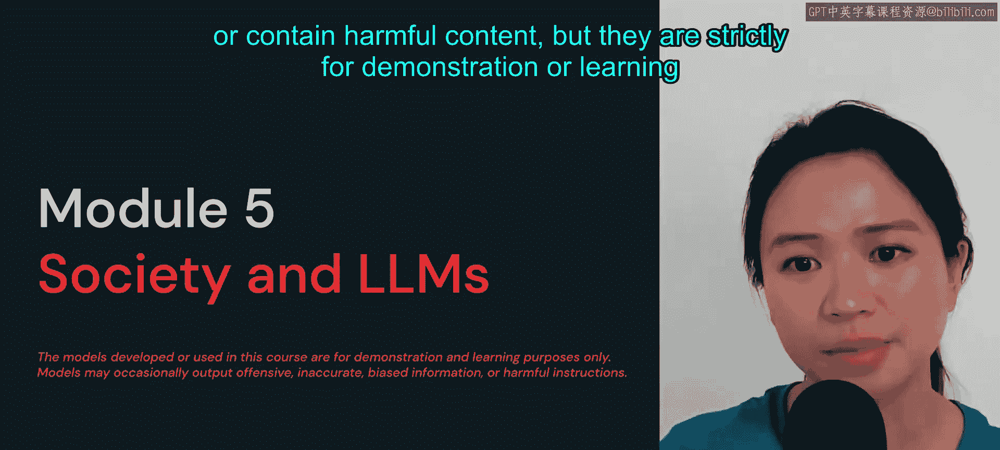
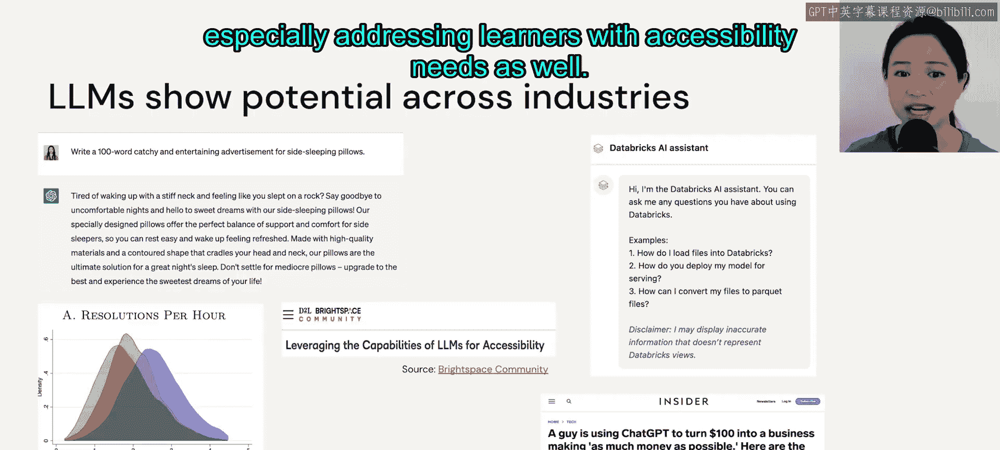

# databricks《大语言模型：从生产到应用｜Large Language Models： Application through Production》 - P54：-54-LLM Module 5_ Society and LLMs _ 5.2 Module Overview.zh_en - GPT中英字幕课程资源 - BV1nS411K7Af

In this module we' inspect the impact of RMs on society。

 the model results that we show here may occasionally be offensive。

 biased or contain harmful content， but they are strictly for demonstration or learning purposes only。

By the end of this module you should be well versed in the merits and risk of LOMs。

 we will also look at the data sets that are commonly used to train LRMs and how that impact the models as a result。

Well then go over the causes and consequences of hallucination。

 a very well known LM problem these days， and discuss what are the ways to evaluate it and mitigate hallucination alongside with other risks and limitation of LMs as well。

We'll lastly wrap up by discussing ethical and responsible usage and how we can govern our Ms in general。

In the very beginning of this course you heard from Matt that LOMs are revolutionizing every industry and you probably don't need further convincing that this is true。

 we are seeing so many examples in the industries they can help reduce manual labor and cost they can also increase efficiency in content creation and here is an example of me doing so by asking the chatbot to generate me marketing worthy content to advertise a site sleeping pillow。

And we can also use LOMs in other customer service contexts as well， in fact。

 there is a paper recently published that shows that using LOMs can increase the number of resolutions in customer service cases。

We can also use LOMs as chatbots for any online websites to help answer customer questions。

Perhaps most excitingly， LOMS have the potential to transform how we learn。

 especially addressing learners with accessibility needs as well。

