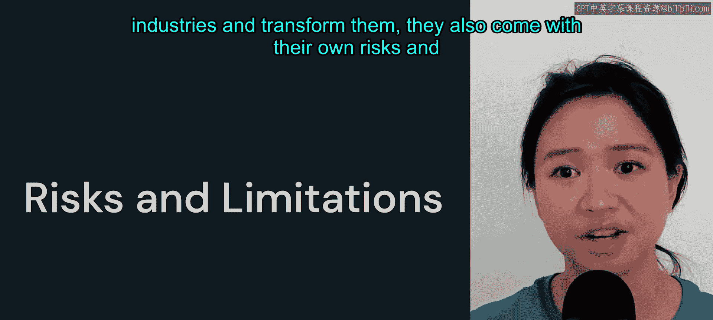
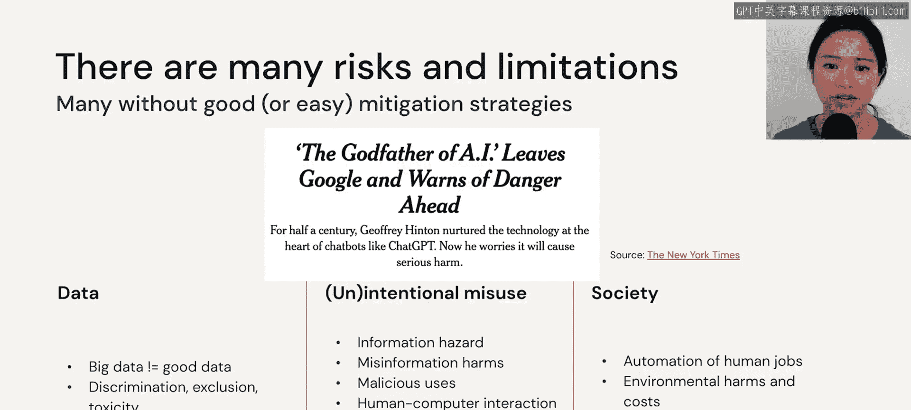
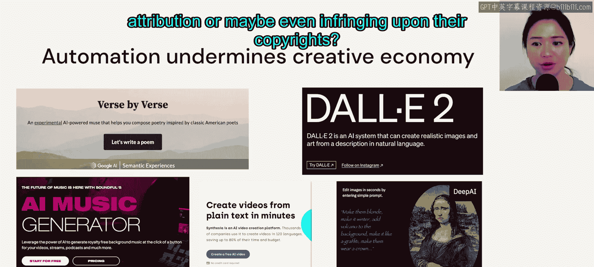
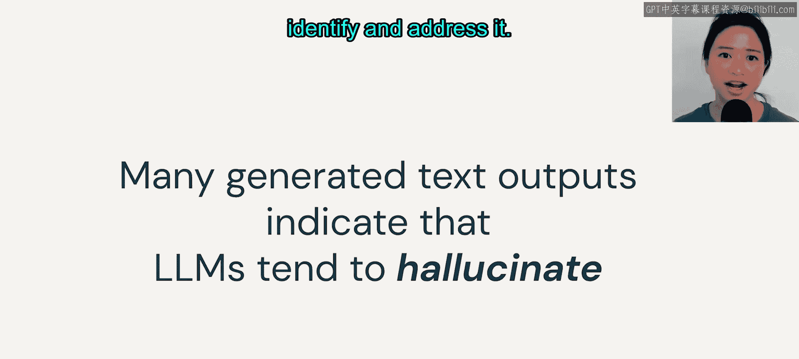

# databricks《大语言模型：从生产到应用｜Large Language Models： Application through Production》 - P55：-55-LLM Module 5_ Society and LLMs _ 5.3 Risks and Limitations.zh_en - GPT中英字幕课程资源 - BV1nS411K7Af

There are always two sides to every coin and same goes to LOMs as well。

 even though LOMs have the great capability to apply to many different industries and transform them。

 they also come with their own risks and limitations。

Many of these risks and limitations are really hard to mitigate。

 especially if they are intentional and irresponsible and malicious actors。

 but we'll first look at the source that enables LOM power today， which is the data。

And look at how data can also translate to model bias。Then we will cover different aspects of misuse。

 whether intentionally or not。We will also go over LOM's potential impact on jobs and their environmental cost。

But I would like to note that going through this list of risks and limitations doesn't mean that we're necessarily asking you to stop using them altogether。

 but rather， I hope that this section will serve as an invitation to all of you whether you're a user or whether you're a developer to think about how we can collectively be more responsible as we interact with these models and as we build these applications。

While it's great that LOMs can improve content creation efficiency。

 we also have to acknowledge that it undermines the creative economy。

 you probably have heard about the debate you know is AI generate art still art。

 we are not here to answer that question， but it does share some insight into the uncertainty around how much we can trust the content out there and are we actually jeopardizing the artist industry by not giving them attribution or maybe even infringing upon their copyrights。

Automation can also displace jobs the US Bureau of Labor Staistics shows that the number of customer service employees will decline by 4% in 2029。

And a lot of new roles introduced by AI may also have limited career opportunities in terms of skill development and which gain margin。

For example， if someone were to work as a data labeler。

 which means that you are doing the manual work of classifying text into categories or maybe label this text。

As toxic or not。So this type of jobs are likely not having a lot of growth for a particular person in terms of a career progression。

But there are also reports to show that human annottheators for toxic text classification often have a higher chance of exhibiting poorer mental health because of the regular and constant exposure toxic content。

And for many of us who are watching this video， who have internet access or who have access to cutting edge technology means that these technology advancements can service a lot of good。

 but it also does mean that less privileged people in less developed countries will not be able to take advantage of the technology。

Hence， we are increasing the global inequality。LOM also incurs a lot of environmental and financial costs。

 on average， a typical US person who emit three times as much carbon dioxide than a global average person。

Training a large language model from scratch is very costly。

 so here is an estimate published by paper for every thousand parameter that is roughly cost you $1 to train a model and for a chat GPPD model to be trained from scratch。

 you probably have taken $175 million。So， this high cost means that。

Most organizations either have only one shot to do it right， or maybe even no shot at all。

 especially when you are really a small business or maybe when you are an individual。

And in today's age， we are really fortunate that we can build powerful models from big data。However。

 we must remember that big data doesn't always imply good data。

Remember that most data that go into model training comes from the internet and if your grandparents are like mine。

 then they probably don't use the internet all that much。

 it means that internet data tend to over representpresent younger people and also those from developed countries too。

It goes without saying that most of the training texts are geared towards English and perhaps not unsurprisingly。

 but specifically in the UK and also in the US。This paper from 2021 also points out that GT2 data is sourced from Reddit outboundings。

 but almost 70% of Reddit users are men and over 60% of the users are younger than 29 years old。

Similarly， only up to 15% of Wikipedia entries are about females。

 so the idea behind this paper is that perhaps the language models that we're using today are really not that smart。

 they are simply parrots who are really good at copying what the humans say。

It means that if the data is bad， we probably cannot imagine these language models to do much better。

So we talk about how the size of the data doesn't guarantee the diverse representation of data。

But what is also really challenging to do is to audit the data。Do we actually have good data quality。

 but how do we even start auditing when the data is so big？

So when the model the data input is biased， we can almost certainly expect the model to be biased as well garbage in garbage out is an old a that still applies to language models。

But the other fundamental limitation with the data today is that only certain types of stories make into the news。

 for instance， a peaceful protest is much less eye catchy on the newspaper than a violent protest。

 therefore the former oftenpha goes unreported。Which means our model doesn't know about it。

But the other limitation is that we cannot afford to update our model all that much。

 even if we can update our data。As we established earlier that training a model from scratch is expensive。

So when we cannot update our data， then we risk having a dated model。Models can be highly toxic。

 discriminatory and also exclusive and a reason is because our data is flaw so if you look at the examples on this slide over here。

 we see that on the right hand side。We have many more females represented in a family context versus a politics context。

 so in fact the paper actually found that female sounding names are depicted often as less powerful。

And we can argue that this is a reflection of the society。

 but it does also mean that we need to carefully consider how to use such a model when it can embed bias that we may not necessarily want the model to incorporate。

There are also some other models that exhibit。Certain bias again certain demographics groups。

 and it's also not surprising that these models can have poorer performance for some languages as well because of the data problem that we mentioned。

The next risk has to do with information hazard。So this comes in two promptngs。

 the first is when we can accidentally compromise privacy by leaking or inferring private information。

So this slide over here shows how Sydney， the Microsoft chatbot accidentally reviews itself to be Sydney。

 and employees can also accidentally leak company secrets by interacting with another closed source model。

But what is really interesting but also concerning is the image on the bottom over here where it shows that the LM can confidently output information that is incorrect in fact。

 it suggests that violence within the couple can actually be good。OOMs can also facilitate many。

 many malicious use cases， for example， fraud， censorship， surveillance or cyber attacks。And lastly。

 this is something that we're all prone towards as well。

 which is when we are relying on this technology way too much when we give way too much trust to these models。

 for example， if I were to struggle with mental health。

 it would probably not be wise for me to consult the chatbot on what to do。对。

Many of these generated text indicate that large language models tend to hallucinate。

 so we haven't touched upon the term hallucination at all。

 but in the next section you will hear about hallucination and how we can identify and address it。

