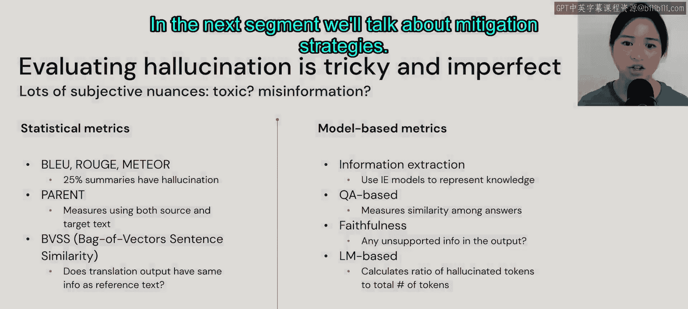

# databricks《大语言模型：从生产到应用｜Large Language Models： Application through Production》 - P56：-56-LLM Module 5_ Society and LLMs _ 5.4 Hallucination.zh_en - GPT中英字幕课程资源 - BV1nS411K7Af

We talk about how many of the outputs from large language models indicate that this model is hallucininate。

 but what does hallucination mean？

From this paper in 2022， it indicates that hallucination refers to when the generated content is nonsensical or unfaithful to the provider source content。

It means that the output can sound completely natural and fluent。

 and it also means that the output can sound really confident even when it's wrong。

There are two types of hallucination， intrinsic and extrinsic。

 based on individuals we may all have different tolerance levels based on how faithful or how factual we expect this outputs to be。

 and we'll talk in just a second about what faithful actually means in this context。

Intrinsic refers to where the output directly contradicts the source。

If I give a source text that indicates the first Ebola vaccine was first approved。

 was approved by the FAA in 2019， but a summary output indicates that the first Ebola vaccine was approved in 2021。

 so this is a very clear case of contradiction and it means that the output is not faithful to the source text over here。

And it also means that this output is completely not factual as well。On the other hand。

 for extrinsic hallucination， it refers to when we cannot verify the output from the source。

 but the model itself might not be wrong。For example。

 if I were to say at least one first price in fencing last week。

 and then the model tells me that at least one first price in fencing for the first time last week and she was ec。

It's probably true that Alice did that for the first time and she was really excited as she got it。

 but we cannot verify that from the source。It means that we cannot really say that the output is factual or faithful towards the source。

So one leads to hallucination， the first component， probably without any surprises， is the data。

So how we collect data matters a lot in terms of how the model performs。

 and we talked about in the earlier segment that when we have big data it's really hard to do audits well or do any audits at all。

Same goes to the data collection process， we may gather any text that we have without any factual verification。

We also do not filter out exact duplicates most of the time， for example。

 if you were to ingest the same reddit thread twice， that counts as a duplicate。

And duplicate case can bias the model if we have many of the same reddit threads show up in the data。

 then it means that it's more likely for the model to output responses from those reddit threats。

But the other problem regarding the data is actually just regarding how open ended this generative tasks are。

For example， in a chat application， we will probably want the chatbot to be more engaging and therefore it means that we would expect more diverse responses if we were to ask the chatbot about the same thing many times but the chatbot will always repeat the same things。

 it will probably be a chatbot that we won't use for very long。

So we want the chatbot or some applications to have more diversity to improve engagement。

 but this type of diversity can also corre with bad hallucination。

 especially when we need factual and reliable output。When we ask a chatbot about medical literature。

Our tolerance level for anything that is nonf will be quite low compared to when we ask something about how to make a perfect salad。

But this open ended nature of generative task is just a really hard to avoid problem and it's something that well have to deal with as a user of file and applications。

The second prong that leads hallucination is the model。

 the first reason within the model itself solve is the imperfect encoder learning means that encoder learns wrong correlations between parts of training data。

The second reason can happen at decoding time， which means that when the model is trying to generate text output。

 the decoder actually attends the wrong part of the input source。

 but there are also called decoder design that is。By design。

 encouraging randomness and also unexpectedness， for example， top K sampling。

 so for those type of holders rather than picking the most likely token。

 it would select any one all of the four candidates over here that you see on the slide to generate the next token。

The third reason is exposure bias， so very technically speaking。

 this means that there is a discrepancy in decoding between the training and also inference time。

But plainly speaking， it means that model tends to generate output based on its own historically generated token。

So it also means that the model can veer off a topic when you start off asking about dishwasher。

 maybe the。Model itself would then start generating content about the dryer。

The fourth reason has to deal with parametric knowledge bias。As a summary。

 it means that the model will stick to what it knows。

 so all models tend to generate output based on what it has memorized rather than the provider input。

E hallucination is tricky and imperfect， as I mentioned before。

 different individuals can have different expectations about how the models actually behave。

 and we can also have very different decision criteria to determine whether a certain content is toxic or whether a certain content is classified as misinformation。

There are two categories of metrics here that we can rely on to assist with evaluating hallucination。

The first category is statistical metrics。Blue Roche meteor have been around for some time in NLP。

 and when using this metrics， we see that approximately 25% of sum ray contain hallucination。

 which means it contains unsupported information。The second metric over here is co parentent。

 which measures the hallucination， using both source and also output text。

 it means that it's actually using ngrams behind the scene to capture what is in the source versus the target and then calculates the F1 score。

The third type of metric is called BVSS， which stands for back of vectors sentence similarity。

 it measures whether the translation output has the same amount of information as the translation reference。

The second category。Is model based metrics， which means that we are leveraging another model to help us evaluate hallucination。

But this category of metrics also means that any of the errors from these models that we're leveragingveraging。

Also get propagated throughout as well。So the first type of model that we can leverage is information extraction。

 and this is especially useful for any name entity recognition use cases we are trying to extract knowledge。

So we can use this to compare with a language base， with a language model output。

The second metric over here is question answering based means that we can measure the faithfulness by measuring with similarity among the different answers to the same question。

The third metric over here is faithfulness if ask the question。

 does the output actually contain any unsupported information？

The last one over here is language model based， which means that we're using a language model to help us calculate if there is a ratio of hallucininated tokens to the total number of target tokens。

So as you can see over here， there are a variety of metrics to help us evaluate hallucination。

 but none of them is perfect。In the next segment， we'll talk about mitigation strategies。

