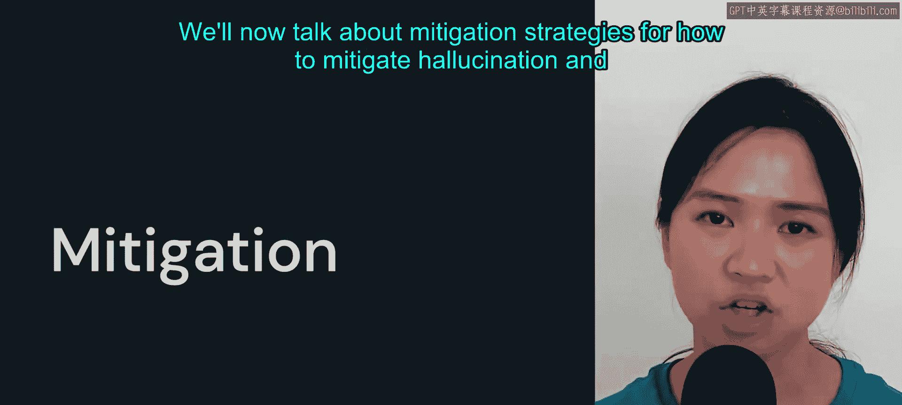
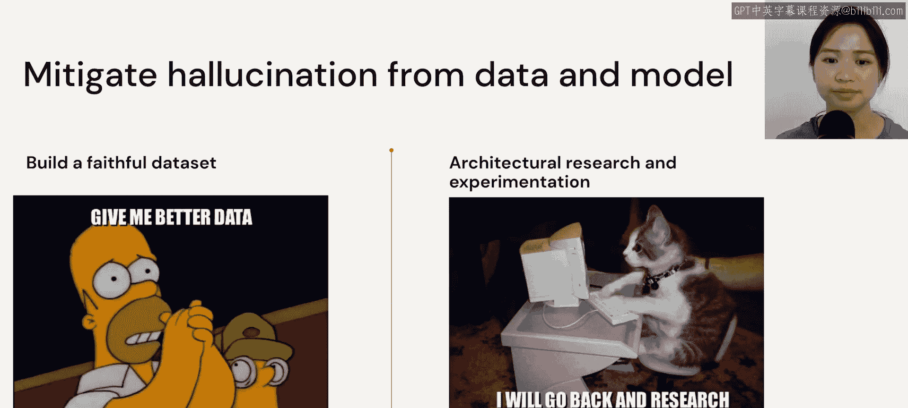
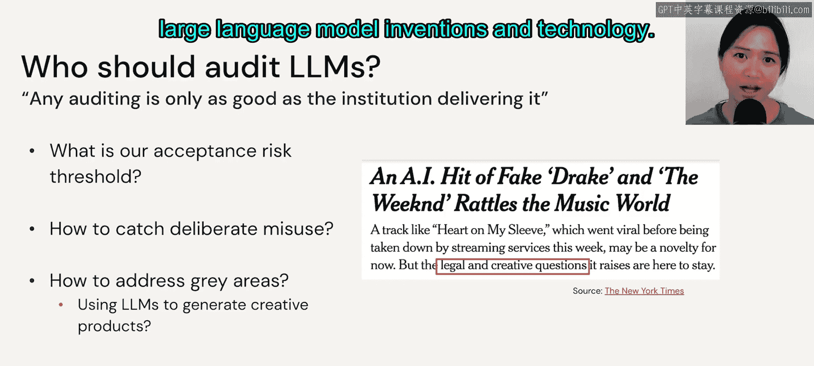

# databricks《大语言模型：从生产到应用｜Large Language Models： Application through Production》 - P57：-57-LLM Module 5_ Society and LLMs _ 5.5 Mitigation Strategies.zh_en - GPT中英字幕课程资源 - BV1nS411K7Af

We'll now talk about mitigation strategies for how to mitigate hallucination and also the different risks and limitations of these large language models。

Since hallucination stem from both data and model it's only appropriate that we address them from both data and model perspectives as well。

 so the first is to build a faithful data set， what this looks like is involving humans to write clean and faithful targets from scratch given the source text。

 we may also want to rewrite the real sentences on a web。

And that may also involve having humans to actually filter out any nonfual data or make corrections to the current data。

We may also want to look into augmenting the input data sources with more sources。

The second angle is about doing more architectural research and experimentation to improve the current modeling and inference methods。

Maybe this involves using more reinforcement learning。

 and maybe this also involves using more multitask learning because hallucination stems from the reliance on a single data set。

We can also do more post processing correction as well， and that would involve human in look too。

But how do we reduce risks and limitations in general for all large language models。

 so we talk about data bias， we talk about toxic models。

 we talk about information hazard and also malicious users。

 so all of this we have to combat them using a united F。For data bias。

 we want to look at the data slices and maybe even update our data more frequently。

But for to any toxic models this will require approaches from multiple angles first of all it has to do with assessing the data as well but we can also incorporate some post processingces tool like from Huging F and Spark NLP and in fact these are the two tools that we'll look at in the code later on。

Or even implementing some guardrails around these large language models。

 such as using MIEmo gutrails， and it can also involve curating more data for fine tuning as well。

For misinformation hazard or information hazard， we want to look at the source。

 where the information actually comes from so that can include curating data for fine tuning or fine tuning your own model。

For malicious users to catch these bad actors or malicious actors。

 there has to be some type of regulation。But chances are a lot of this。

Rs and limitations that we see within large language models do need some type of regulation to help us govern the usage。

We can think about our regulation from a three layer standpoint。

 so this paper in 2023 proposes that we can audit on three separate layers versus governance。

 which refers to the fact that we should audit technology providers。

 this means all the big companies that are providing us the models to use。

The second audit can come in a form of models， which means that we audit a model prior to any release to the public。

The third audit has to do with application level， which means that we are assessing the risk of these models based on how users are actually using them。

But even with this framework， there are still some open questions for us as a community to answer。

How do we actually capture the entire landscape when we cannot be totally sure how users are interacting with these models？

And how do we actually audit close source models？But thankfully。

 there are a lot of discussions in the works recently by different countries globally。

And perhaps the biggest question of all is even with an auditing framework in place。

 who should actually be the one doing this audits and any auditing is really only as good as the institution delivering it。

We also have to recognize that all large language models cannot have zero risk。

 so we will have to come up with arbitrary thresholds of what is our acceptance level。

But how do we capture deliberate misuse？And how do we actually address gray areas like when we are using large language models to generate creative products？

So these are the types of questions that we as a society would need to wrestle with as we advance more and more in large language model inventions and technology。

