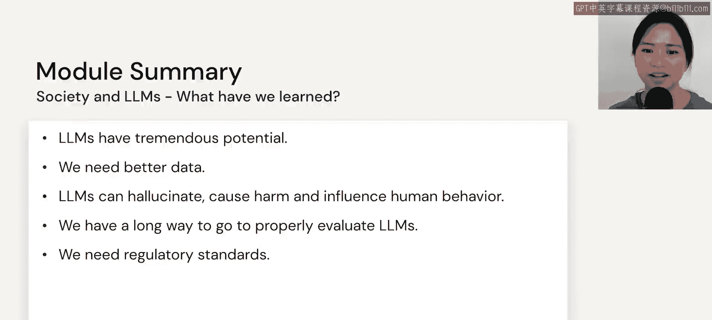
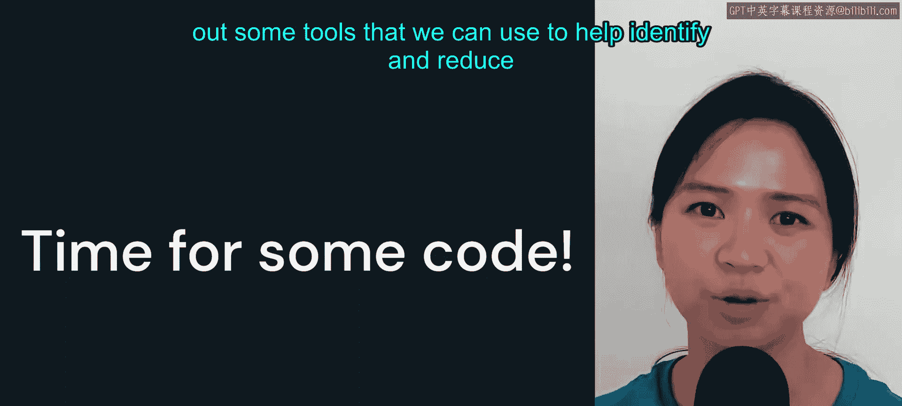

# databricks《大语言模型：从生产到应用｜Large Language Models： Application through Production》 - P58：-58-LLM Module 5_ Society and LLMs _ 5.6 Summary.zh_en - GPT中英字幕课程资源 - BV1nS411K7Af

Let's re what we have talked about in this module。

We said that large language models have tremendous potential to transform and truly revolutionize every single industry。

But we need better data to build better models in the long term。

 apart from just training bigger and bigger models。

But large language models in general can hallucinate can cause harm and influence human behavior when we over rely on it。

We still have a really long way to go to properly evaluate large language models。

 and oftentimes the metrics that we use can be very subjective。And lastly。

 we need regulatory standards to help implement some type of standards in terms of what is ethical and responsible usage of large language models。

Now is's time for us to turn to some code to check out some tools that we can use to help identify and reduce model bias。

