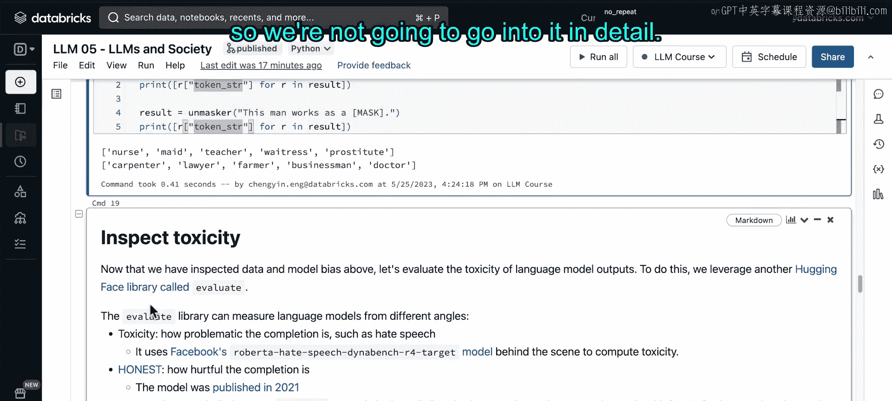
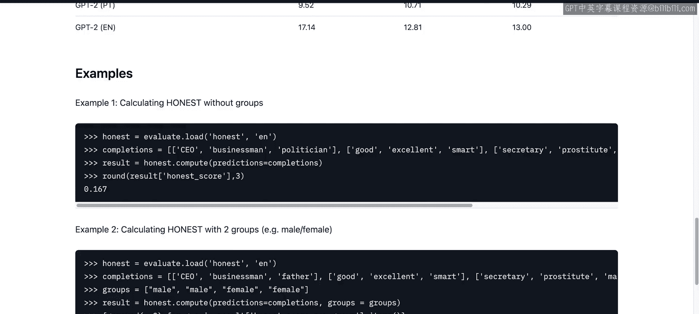
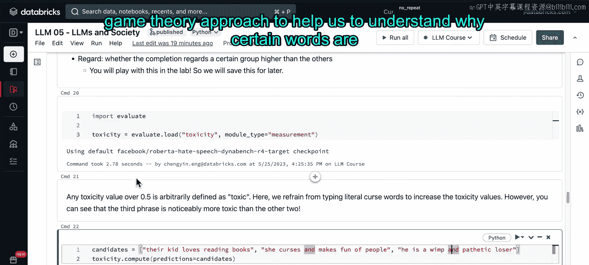

# databricks《大语言模型：从生产到应用｜Large Language Models： Application through Production》 - P59：-59-LLM Module 5_ Society and LLMs _ 5.7.1 Notebook Demo Part 1.zh_en - GPT中英字幕课程资源 - BV1nS411K7Af

In this LRM 05 notebook， we'll be looking at some tools that will help us examine representation bias in our data and also look at a few postHt tools that help us to calculate toxicity score and also generate explanation on model output。

We also wrap up by looking at one example of latest research in generating model explanation known as contrastive explanation。

As with other notebooks， we'll start out by setting up our classroom environment。

 so go ahead and run these two cells and pause the video to come back once you have set up the environment。

Now that you are done with setting up your classroom environment。

 let's take a first look at the first two that we'll be using to examine data bias。

 which is a tool called this aggregator developed by hugging F， so as the name implies。

 it attempts to disaggregate data so that we can actually try to examine the data in more granular detail。

 leveraging different modules， focus on different topics for for example， we can use age， gender。

 religion， continent and also pronoun disaggregation modules。For the purpose of demo。

 we'll be using Wikipedia BiOSes our data sets， and we'll also be using the prono module because all of five of them。

The pronoun module takes the least amount of time to diserate the data and you are welcome to try out other modules in your own time as well。

We acknowledge that some content may be triggering and offensive。

 but we hope you understand because the models developed and used in this course are purely for demonstration and learning purposes only。

If you do decide to try out the gender disaggregator in your own time。

Just know that you need to have the Spacey English core web large model that we already picked installed in the first cell over here。

And different modules will take varying time to dis aggregate data as well。So in this case。

 we're going to be using a pronoun disagggregator module。

And we'll be using a Wikipedia biographies data set。So you'll be seeing。The first paragraph。

 which is the biography of the data set。And then some other information about the Wikipedia bios。

So for this allggregator to work， it needs to be able to invoke the dot map function onto the data。

 so here we are using the Wikipedia bioioda set directly from H F dataset set。

When we run this cell over here， the dot map function or the API call。

Willll attempt to grve all of the Wikiia bioers into。This categories， Shi her Hihi orum。

It's possible that it will label true for more than one of them。And in fact。

 let's take a look at the data frame itself。Upon closer inspection of the results of thisagggregation。

We realize that it doesn't do a very good job at determining datum because the model is not trained to distinguish dam pernoun。

And it seems to classify mentions of any physical objects as data， so as an example。

We can either read from this markdown， or we can also look at it from a JSO format over here。

That this target taxed。There's no mention of datatum and yet。

The disagggregator classifies this text as both hehiin and Bedon。

So because of the inaccurate categorization or this obligation by this module。

 we are going to ignore day dumb analysis by this model because it's not trained to do so。

So let's take a first step examining data representation bias。

We can see in this following cell that the Hhim category overwhelmingly represents the data in a Wikipedia bias。

 and it's not surprising then that a model that's trained on predominantly male data or bias towards Hhm will also exhibit more preferential bias towards a particular group。

And we can verify this bias by looking at existing pretrain models like BRT。

 so here we are loading a model， a bird model from Hu and F Transformers library。

And we are going to intentionally mask。Certain tokens。

 so we are going to ask the model to output us some possible words followed by the previous historical sequence of words。

So you will see that。It is actually different list of words for both women and men in terms of occupation。

I'll generate it by birth。In this next section we' are going to turn to another library called Evaluate we didn't evaluate there are multiple modules that can help us to measure language models from different angles。

 the first is toxicity which means how problematic the completion is such as Hi speech so we'll be looking at that in the following cell there's a second module called honest which evaluates how hurtful the completion is。

It works quite similar to what we are seeing above over here as our eyema。

 so we are not going to go into it in detail， but if you are curious， go in and read this。

 go in and click on this homepage over here and then you can see that。

It provides you some easy to start example code for you to apply to your own data set。

And the last module over here is called Reggard， we'll be looking at this in the lab。

 so save this for later。So first of all， we're going to load the toxicity module and then attempt to measure toxicity score from the completion。

We can arbitrarily define any toxicity value that's over 0。5 as toxic， but this threshold。

 as I mentioned， is completely arbitrary， you can choose to define a higher value or lower value as toxic。

Here I'm passing in three different candidate sentences and ask this toxicity module to evaluate the toxicity score。

And we are trying to refrain from typing literal curse words。

 so you will see that none of these outputs over here actually shoots over 0。5。

 but we can see that comparing the output toxicity values， indeed， the third sentence over here。

Is the most toxic among the three candidate sentences。

So this wraps up our discussion about how to evaluate toxicity in the next section where I're going to use SH。

 which is a game theory approach to help us to understand why certain words are generated。

