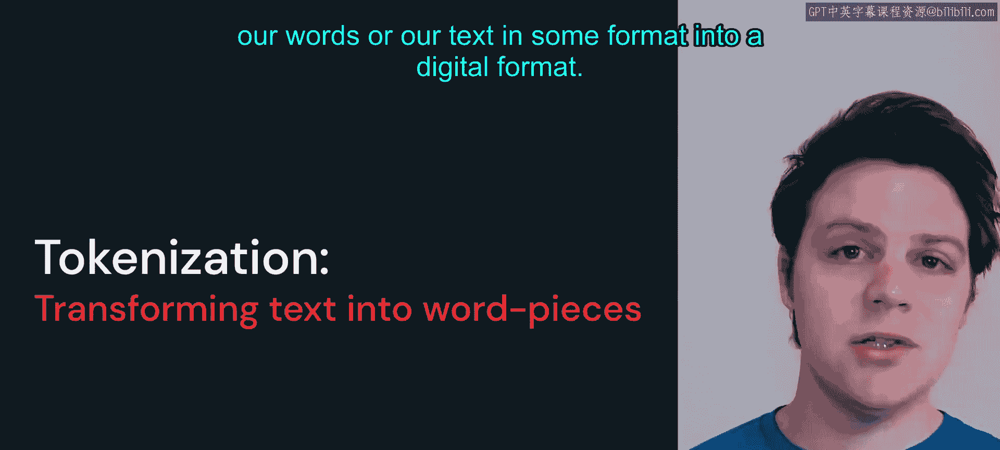
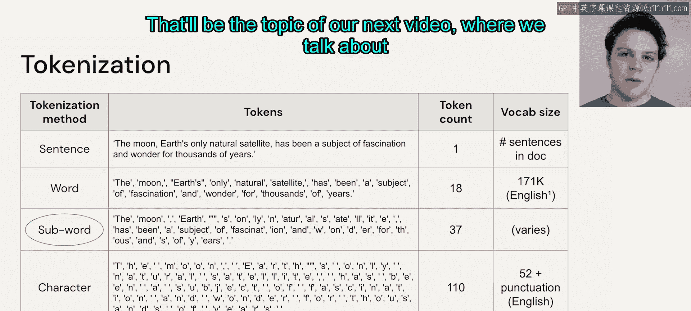

# databricks《大语言模型：从生产到应用｜Large Language Models： Application through Production》 - P5：-05-LLM Module 0 - Introduction _ 0.5 Tokenization.zh_en - GPT中英字幕课程资源 - BV1nS411K7Af

Let's talk about what tokenization is。 We defined earlier that if we were given a phrase or a sentence。

The tokens that build up that Frser sentence become a design choice for the modeling that we're going to do in NLP。

 Those could be different words， they could be characters， they could be pieces of words。

 and we'll talk about what that means in just a moment。

 but the process of tokenization is meant to take the words or whatever we choose to break up our text as and convert it into a format that we can use in computation Now computers aren't good at symbolic mathematics。

 so we need to convert our words or our text in some format into a digital format。

One of the most common and typical places to start when thinking about how to tokenize would be to cut a sentence up or a sequence of words into individual words themselves。

So the process of tokenization is twofold。Firstly， we create a vocabulary of all of the different tokens that we can see in our training data。

 so if we have the English dictionary， for example。

 we could take every word in that dictionary and convert that into our vocabulary so that every word has an associated number。

 we could start with the first word give it the number zero and then go all the way through for the rest of the dictionary。

This would build up our index， and then anytime that we see a new sequence of tokens。

 a new sequence of words in this case。We could convert that to a list of indices numbers so that we could codify this as a series of numbers that our models could then work with。

Now there are some limitations and problems with using word tokenizations。

If we think about the training set that we're using to build our vocabulary。

 if we miss out on common words or uncommon words， and we see them later on in our usage of our language model。

 it will come up with an error as this will be technically a out of vocabulary or OOV error。

This is a limitation for word based tokenizations as you have to associate every individual word with a particular token value。

😊，This also means that if we have misspellings， if we want to create new words。

 we can't do that as these tokenization schemes won't allow for this kind of。Dactile behavior。

 They're very brittle。It also means that we end up with very large vocabularies as we have to account for every type of every word。

 so if we have， faster， fastest， we have to take three different tokens in order to store those three words and then if we have slower and slowest。

 we again have another three words， whereas if you think about it。

 we could take just the stem of both of those words and then add those suffixes as separate pieces。😊。

Another solution to make our vocabulary much smaller would be then to just look at individual characters。

If we're picking， say the English language， we would have 26 characters for the lower case。

 26 for the upper case， and then maybe some other punctuation and numerical。Characters as well。

 and so we would have a vocabulary of around 100。In size。

This would create a very small vocabulary for sure。

 and we'd be able to create any new words that we want to。

 we would be able to account for any misspellings， however the problem lies in the fact that we lose the notion of what a word is。

We have to keep in mind that when we're dealing with problems in NLP。

 the context and the meaning is something that we're going to have to try and serve。

By breaking things down into individual characters， we lose the sense of what a word is。

It also means that our sequence lengths become very。

 very long so that if we were doing word tokenization。

 the first two tokens in this sentence would be the word the and the word moon。

But if we're doing character tokenization， then the first two tokens in this sequence would be T and H。

 and so we would end up spending a lot of time on very long sequence lengths。

 which is also something we want to try and avoid。The middle ground for these two extremes would be to do something in terms of sub wordss。

So this would break up words like subject， for example， you could take the first sub andject。

 and then you'd be able to build up other words like object subjective。

Subordinate submarine you'd be able to build up words using these pieces of words Now there are a number of different strategies byte pairing coding is a popular scheme to build up these kinds of vocabularies there are many others like sentence piece and word piece as well which are very commonly used in modern large language models and these tend to have a good tradeoff of vocabulary size to flexibility in looking for words that are outside of the vocabulary and also looking at how to build sufficient how to retain sufficient meaning from the words that you're describing。

We'll find that subway tokenization is really the main application that people use for tokenizes in this field。

And so if we compare these different tokenization schemes。

 we can see that the subword is really the one that gives us the best balance of。

Tokenken count to vocabulary sets。Once we have these tokens then we want to try and figure out how we can incorporate meaning and context。

 that'll be the topic of our next video where we talk about word embeddings。😊。

