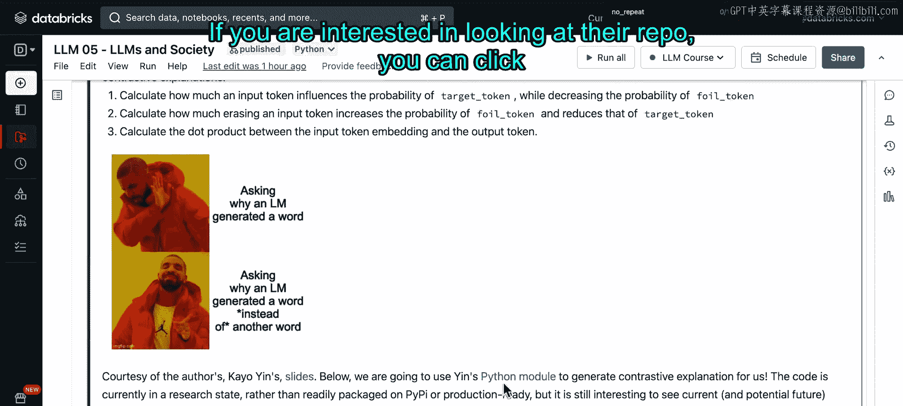
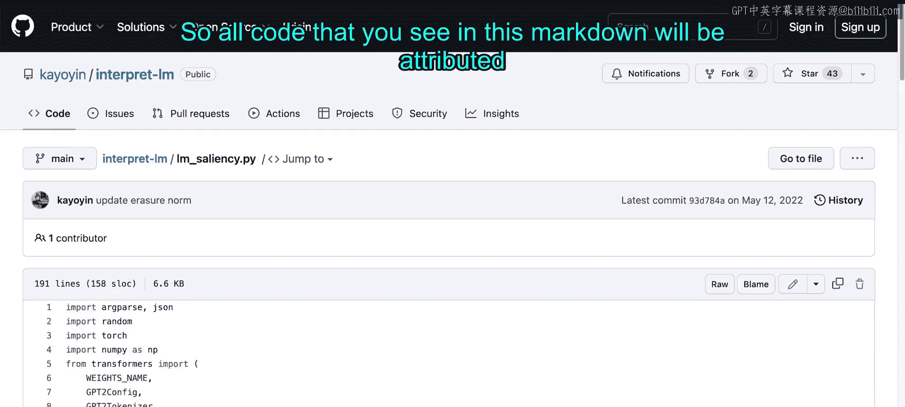
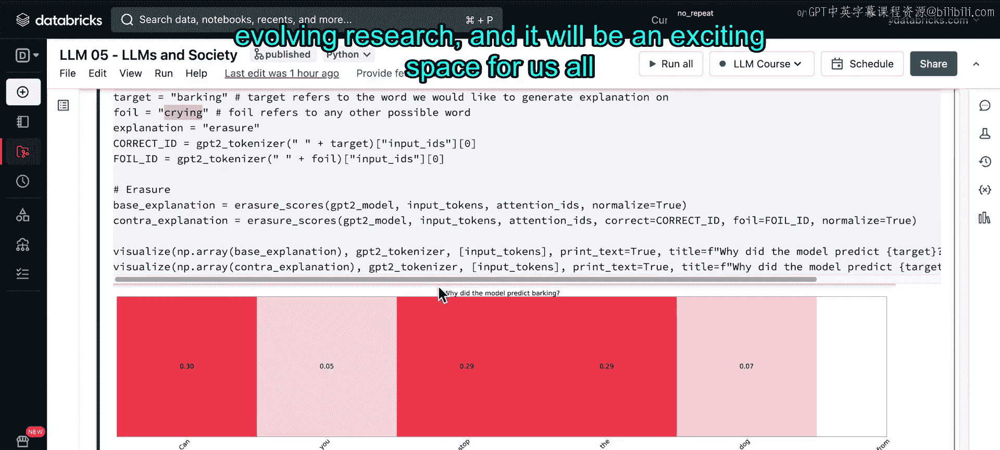

# databricks《大语言模型：从生产到应用｜Large Language Models： Application through Production》 - P60：-60-LLM Module 5_ Society and LLMs _ 5.7.2 Notebook Demo Part 2.zh_en - GPT中英字幕课程资源 - BV1nS411K7Af

In this section， we are going to talk about how to use She。

To explain the output of our language model， She stands for a sharply additive explanation。

 it is a game theory approach that has been widely applicable for even classical machine learning models it is agnostic the type of machine learning model that you pass in。

 which is why we can extend She。In the language model context。

 and ask Shebb to explain our language model output。Intuitively speaking。

 S is a permutation based approach that holds all other variables constant by changing only one input variable value。

By doing so， you can actually then attribute the changes in the output easily to the。

Only input variable that has changed。Take this diagram as an example。

 if we were to check if we allow cats or not in the same apartment building would have an effect on the apartment price and here by holding all other variables constant and indeed we see that by changing the cat policy。

 we do see a price difference in the apartment building。

So let's see how we can apply this to our language model output。

Here we are going to be using a GT22 model to generate text for us and we're also going to set some model configurations。

 first of all the model config is decoder should be true because GPT is a decoderon model and if you're unclear what decoderon model means don't worry because we haven't touched upon it in this course but we'll touch upon it in course too and it has to do with the fundamental buildings of and theories behind how a language model is implemented。

Other half specific parameters include temperature。

 which means you can turn off the randomness in the text output and no repeat ngram size were setting it a to。

 So if you are not familiar with what Ngram is Ngram is a word sequence of n words So by saying two over here it means that we are looking at a word sequence of two words。

 For example， San Francisco， Los Angeles， New York。

 these are all two words and we can call this words as。N gram size of two。

So by setting this no repeat engram size of equals to2。

 it means that we are not allowing any repeating two word sequences in the same output。

 so if I have mentioned San Francisco once in a text output then。

The word San Francisco wouldn't be allowed to appear again。

It also means that we need to set this en grand penalty with caution because in some cases。

 we do actually want the language model to generate。

More accurate names and it wouldn't make sense for it to generate loss without Angels and in that case then it is not appropriate to set the repeat engram size to be2。

So let's go ahead and run this cell。And then we're going to start by giving an example input sentence。

Here we say that sunny days are the best days to go to the beach so and we're expecting GBT2 to complete the rest of the sentence for us。

To interact with Shep， we are going to use this explainer object over here and we're going to pass in the model that will generate us the output and also the tokenizer as well。

 because we will need Shep to know how we are chopping the sentences up into different tokens。

So this is a step that might take quite some time to run because it is generating explanation behind the model output。

Once this is done， you can inspect。The sharp output by plotting。

So let's look at the shared values in the following cell and immediately I see that there's red and there's also blue。

 red means positive contribution towards that particular token and blue means negative contribution。

And the color intensity， meaning how long， how wide the bars are。

 will indicate how strong the contribution is。When I hover over a particular token or particular word。

 I can see that there are different contribution values by each word。

So if I pause and looking over here， then you will see that so is the token or is the word that contributes most to outputting this word looking。

And then two is the word that contributes the least。To outputting looking in a negative direction。

 so positive direction means that it's more likely for us to see looking。

It may also be easier for us to look at this in a bar plot as well where we can see clearly that so is the token or is the word that contributes most has to outputting the word looking。

Let's give another input sentence。I know many people who prefer beaches to the mountains and then let's see what Shep generates this time in terms of explanation。

And you will see that GT2。Complete the sentence bias saying。

 but I'm not one of them and again I can pause at any of this token over here。

 any of those words and in which token contributes the most to output the word on them or not。

And let's look at it in the bar format。And you can see that eye is the token that contributes most to output the wordnot。

So you can see that while Sha is quite helpful to help us figure out which word or which token contributes most to outputting a certain token or certain word。

We also know that language models are biased towards the most recent token。

 so it is highly possible that the explanation has the tendency to recency bias where。

The most recent token has the highest influence on the subsequent predicted token。

So this is quite a difficult problem to tackle， and while She does give us an idea what input token might have contributed towards the output token。

We can also say that it's really not that useful， well， even though it can be interesting to look at。

So you can see that in this sentence over here， we pass in。

 can you stop the dog from something and aGT2 says that it should be barking but。

Other plaus tokens could also be crying， eating， biting， and so on。

 and it's much more interesting if we can know why the model output gives us barking instead of biting or crying or other any viable word candidates。

So the fact that we're exploring these hypothetical words。

 instead of explanation is what we call as a contrastive explanation as denoted by these two contributors in their paper in 2022。

 so they propose that instead of explaining why and language model generates a word。

 it is much more useful to ask why a language model generates a word， instead of another word。

We're not going to dive into the neattty gritty of the research details published by this paper。

 but I just want to highlight that this is actually a very exciting and interesting space to see the future research direction because we might actually get。

A better sense of why a language model generates a word instead of another word more and more clearly in the future。

And in fact， we're going to look at some of the code that these two authors have written。

If you are interested in looking at their repo， you can click on this link and get their code directly and we'll be using code from this LM salency file。

So all code that you see in this markdown will be attributed to them。

So you will see that we can still use the same GT2 model and then say that we are going to use this eraial method to generate an explanation。

 which means that eraial means that，How much does erasing an output input token increase the probability of of the candidate token rather than the actual output token so foil token over here means any viable output token so it could be crying eating biting so basically any output that is not provided by the model itself。

 but target token is the actual output token provided by the language model。

So we'll be looking at how erasing and input token will increase the probability for other viable candidates。

So here is an example of running this target and foil token where target is the truth and crying is another viable approach。

 so you will see here that it generates some visualization to help us understand which token contributes the most to generate em barkking instead of crime。

So the score that you'll see on this boxes over here measures how much each token influenced the model。

To attribute a higher probability to the target token。Which is the bark in token。So in this example。

 when we compare both， we can see that stop the word remains high， probably wise。

 regardless of in the context of barking or crying。

So we can see that stop then is a word that will make the model more likely to predict barking instead of crying。

 whereas the， this word， you can see that the probably drops way down when we inspect the probability of outputting the word crime so it means that this word the doesn't actually influence whether or not the model predicts barking or crime。

So this is an example of how we can use contrastive explanation to improve large language models。

 but it is still very much an evolving research。And it will be an exciting space for us all to watch for development。

