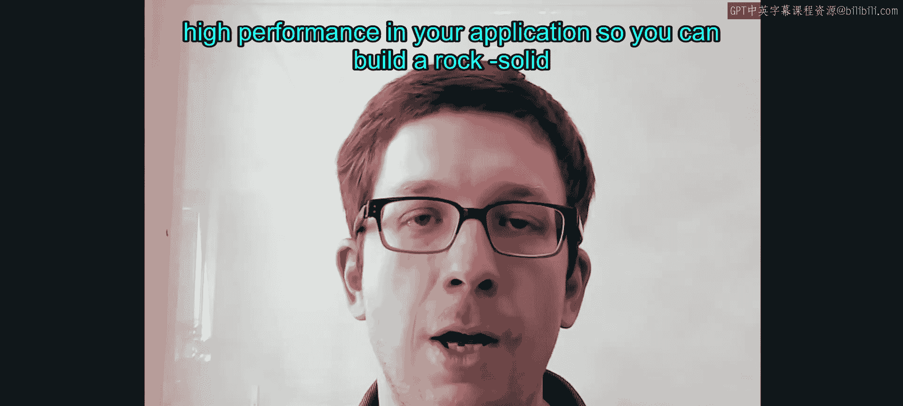

# databricks《大语言模型：从生产到应用｜Large Language Models： Application through Production》 - P61：-61-LLM Module 6_ LLMOps _ 6.1 Introduction.zh_en - GPT中英字幕课程资源 - BV1nS411K7Af

Welcome to our final module which is about LLMOs getting your large language model application into production so before we talk about what LLM ops is I want to just talk about the importance of getting applications to production with a little bit of a story from my past what I was a PhD student I developed this open source framework for analytics Apache Spark at the time it was a much smaller research project and a lot of companies were excited about using it they had all these use cases but they asked you know can I operate this in production is that something I could really rely on sort of bet part of my business on and get at the work and of course as a research project it wasn't really necessarily ready for that so over time we started a company around that we got a lot more sort of care going in the development in the open source project and we turned it into something that is it very solid for production and a lot。

Workwise required to go beyond sort of a cool demo。

 something that's changing quickly to a very reliable application that lots of people depend on and have jobs running on every day so the same will be true for your LLM application if it takes off you what was a cool prototype today needs to be something that runs reliably in the future even as the world is changing around that users are asking things in a different way the base models you depend on if they're third-party models they might be changes the data set。

 the knowledge bases you connect to and are changing as well so much like in machine learning we have this field of ML ops of how to maintain and operate applications we need the same for large language models and a lot of classical ops ideas apply。

 but large language models are also different in some ways they generate this unstructured text they have different things that affect the quality so it makes sense to sort of rethink that and look at what goes into that。

Talk about some of today's best practices for LLM ops for the whole stack， not just the LLM。

 but also the vector databases， the chains， end to end applications。

 everything from monitoring to improving quality， doing development in a flexible and collaborative way。

 testing and getting highper in your application， so you can build a rock solid production LLM application。

