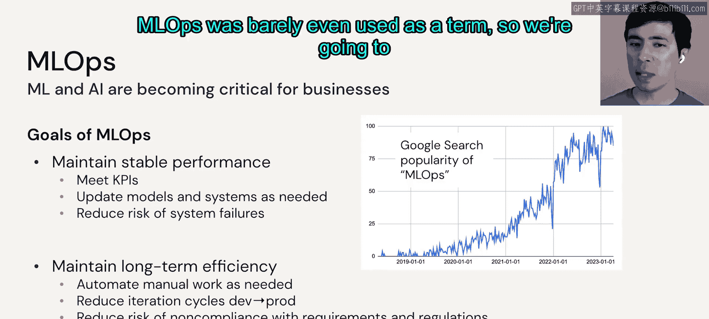
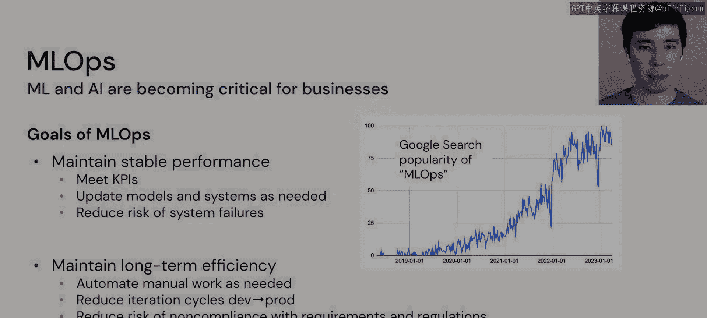

# databricks《大语言模型：从生产到应用｜Large Language Models： Application through Production》 - P62：-62-LLM Module 6_ LLMOps _ 6.2 Module Overview.zh_en - GPT中英字幕课程资源 - BV1nS411K7Af

Welcome to moduled6 LLM Ops。As Meto is saying， our goal is to get LLMs to production。For that。

 our learning objectives will be， discuss how traditional MLOs can be adapted for LLMs。

 review end to end workflows and architectures around that。

 and assess key concerns specific for LLMOs， like cost performance tradeoffs， employment options。

 monitoring and feedback。In the code， we're going to walk through the development to production workflow for deploying a scalable LLM powered data pipeline。

MLOs has become a huge field in the last few years。As ML and AI have become critical for businesses。

 those businesses need to be serious in production。So in the lot says two main goals。

 the first is maintaining stable performance that may mean KPIs around the null like accuracy or other metrics or KPIs around the system。

 latency， throughput， so forth。To do that， we need to be able to update models and systems as needed and reduce the risk of failures。

The other big goal is maintaining long term efficiency that can mean an automating manual work when needed。

 reducing iteration cycles from dev to production。And reducing the risk of noncompliance with any requirements or regulations。

On the right you can see that just a few years ago， MLLse was barely even used as a term。

 so we're going to spend a bit in the next video， giving a background on traditional MLLs。

