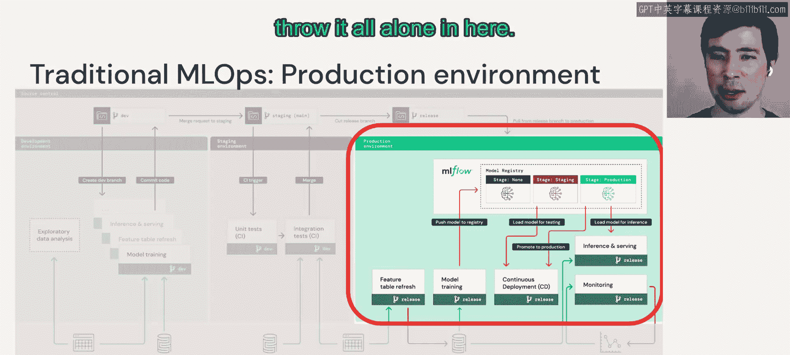

# databricks《大语言模型：从生产到应用｜Large Language Models： Application through Production》 - P63：-63-LLM Module 6_ LLMOps _ 6.3 Traditional MLOps.zh_en - GPT中英字幕课程资源 - BV1nS411K7Af

Let's quickly cover traditional MLOs。I like to define MLOs as DevOs plus dataOs plus ModelOs that means a set of processes and automation for managing ML assets like code。

 data and models to improve performance and longter efficiency our two goals from the last video。

When you think of MLlose， you may think of things like a dev staging and Broadro testing and monitoring。

 CICD， we won't have time to delve into all these details in this course。

 but for those who want more background， look at the ebook linked at the bottom for more details。

Instead I want to talk through a high level reference architecture for traditional MLOs shown here。

 like all good reference architectures， this is a generalization。

 but I think it highlights a lot of key ideas。At the top you'll see source control for managing code at the bottom。

 a Lakehouse data layer， and going left to right in the middle are development。

 staging and production environments。Starting on the left。A data scientist， for example。

 might operate in the development environment， maybe doing some exploratory data analysis。

 that code might not move towards production， but also writing pipelines like a model training pipeline。

 a future table refresh pipeline， and these are geared towards production。Once those are ready。

 they can be committed to source control， and that is going to be one of our primary conduits for moving ML assets。

 code in particular towards production。At the bottom is our Lakehouse data layer。

 We't have time to cover what a lakehouse is， but I think key elements here are that。

It is a shared data layer across a possibly diverse set of tools forming this broader MLLOs set of environments and systems。

Having shared access， but with access controls is very important for a data scientist， for example。

 operating in the development environment might need read access to production data in order to debug something out there。

 but they certainly shouldn't have right access， and so this kind of flexible control shared access to this data and a single source of truth is really valuable。

Yeah。Now， Az our code moves towards the staging environment。

It goes through continuous integration or CI tests。That basically breaks stone into quick unit tests。

 does this piece of code work in isolation and longer integration tests。

Does this piece of code work alongside all the other pipelines and services it'll see in production？

That last point is crucial。 The sta environment needs to mimic the production environment as closely as reasonable。

 That means the same set of services， the same set of pipelines。 And so in the simplified。

Reference diagram， we're not showing all those pipelines explicitly， but when we look at production。

 remember that those same pipelines and services are instantiated and staging。

 just maybe in a smaller setting， less data for faster tests Once tests have passed that code can move towards production。

Here we've zoomed in a bit， showing all those pipelines which were being developed and dev。

 test and staging， and now are instantiated in production。 Go from the bottom left。

 we have data being read into a feature table refreshed job may be written out to a feature table that could be done in a batch mode。

 streaming whatever that might be fed into say an automatic model retraining pipeline may be run once a week when a new model is produced it is put into that model registry at the top layer。

If you're not familiar with MLF or model registries。

 think of them like opinionated repositories for models opinionated in the sense that they come with statements of this model has this many versions and for this version it is in a stage development staging or production basically tracking these different model versions as they move towards production readiness。

 Sp of moving them towards production， that's what the continuous deployment or CV pipeline does。

 it puts th through either incremental rollout or stages of tests。

And eventually marks them ready for production， at which point they can be loaded into inference in serving systems on the right and also monitored。

That's pretty much all I wanted to cover for traditional MLOs。

Gives you a rough idea of the general structure， and now we can turn to the question of what happens when we throw an LLM in here？

