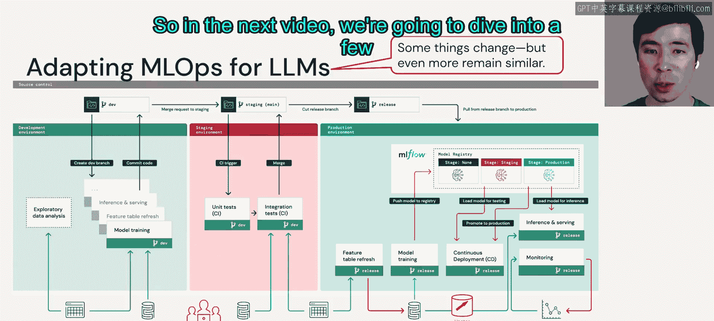

# databricks《大语言模型：从生产到应用｜Large Language Models： Application through Production》 - P64：-64-LLM Module 6_ LLMOps _ 6.4 LLMOps.zh_en - GPT中英字幕课程资源 - BV1nS411K7Af

Let's talk about LLM Ops。In particular， how do we take this traditional limo Los architecture diagram and figure out what might change when we put NAA lemon here？

So that's the same diagram we just saw in the previous video。

 but I'll walk through and point out a few key areas。First， model training might change。

In traditionalL， you often retrain a model pretty frequently。

 as we've discussed previously in the course， model training outright completely de novo training for an LLM is often infeasible。

 so this might be replaced with something lighter weight like model fine tuning which still produces a new model。

 or maybe pipeline tuning or prompt engineering， and these don't produce new models。

 but note that no matter what we do。All of these pipelines or findG models。

 they are either models or pieces of code。And our existing MLOP infrastructure structure knows how to handle those。

Next， we've talked about human feedback， that being really important for LLMs。

 and so I'll say two comments about them in the bottom left。

Human user feedback should be treated as an important data source available from development to production。

 and I'm saying data source because you may aggregate this feedback from multiple potential sources internal and external。

On the right， traditional monitoring， which is often fairly automattable。

 may need to be augmented by a constant human feedback loop。Now。

Automated quality testing related to human feedback may be much more difficult。

 so we've talked about how it needs to be augmented with human evaluation and the place where that will probably happen is then this continuous deployment part rather than doing what you might do with the traditional me like tests on a batch data set offline you'll more likely do incremental rollouts showing a model or LLM pipeline to a small set of users seeing how they respond and increasing that percentage as you gain confidence。

😊，You also might see different production tooling。A big model might miss moving serving from CPUs to GPUs。

And your data layer might have a new object like a vector database。Now。

 cost and performance can also be challenging we've talked about this earlier in the course。

 and here I'll point out that one model training and re tuning may need to be managed carefully on the left。

And then in serving， you may see larger costs that they can see in performance trade offs。

 especially when you're comparing your own fine tune model versus a paid third party LLM API。

I will give the caveat that， I'm comparing against traditional MLL。

 by which I mean if you're coming from a computer vision or NOP background where you worked a lot with deep learning already。

 LLMs are going to be pretty familiar in terms of the costs of training， fine tuning and inference。

So we've seen some things which may change。But even more will remain similar if you look at this diagram。

The dev staging， production separation， and access controls for enforcing those remains the same。

Our conduits for shipping， pipelines and models are still Git and model registries。

The Lakehouse architecture for managing data is still critical。

Our CI infrastructure can be reused and we still have this modular structure for MLOs where we develop these modular data pipelines and services you see in the boxes here。

But we did mention something which change， so in the next video we're going to dive into a few more details about those。

