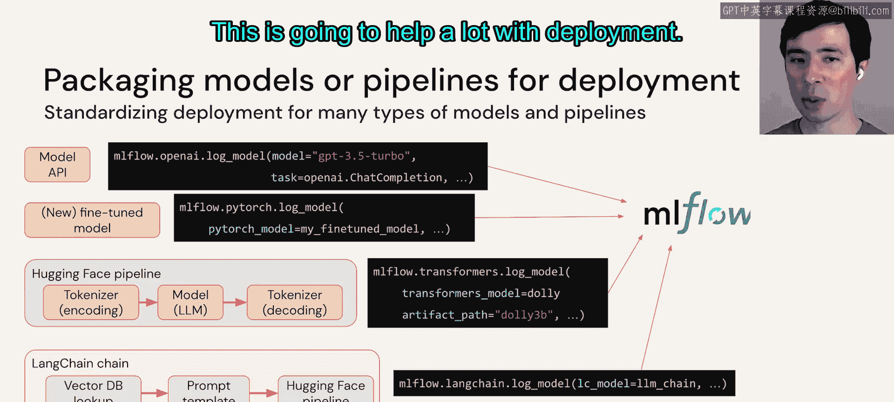
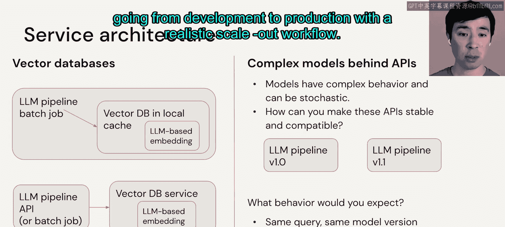

# databricks《大语言模型：从生产到应用｜Large Language Models： Application through Production》 - P65：-65-LLM Module 6_ LLMOps _ 6.5 LLMOps Details.zh_en - GPT中英字幕课程资源 - BV1nS411K7Af

Let's talk through some details around envelopeOse。

There are a lot of topics which you may hit along the way and we'll cover some of these。

 we will skip some overlapping topics we already talked about earlier in the course like how to make an LLM pipeline in the first place and how to find tune models。

 even though some might call these quote ops。I do want to make a note about that theres a you know it's vague what is ML versus what is ops and I think prompt engineering the top concern will list is a good example。

 we've already talked about techniques for it and I would call that ML。

 even if you're making just a prototype you only even care about production you still may do prompt engineering。

But there are aspects of prop engineering which are important to consider in order to move things towards production。

I'll call that up。For prompt engineering， you may hit things in this order， wanting to track。

 then template， then automate。So。😊，By tracking， I mean， tracking queries and responses。

 comparing these， iterating on prompts， and for this you might use tools like MLLF which offers some native LLM capabilities。

This is very useful when you have a smaller number of queries when you're iterating quickly。

 doing detailed comparisons。😊，And here， ML flow and such tools may be very useful in development when you go towards staging and production。

You'll probably start to treat query and response pairs more like traditional data and data pipelines because you have a lot more queries and you want to do more aggregate comparisons。

Next may come tempempline。Here rather than creating prompts manually。

 you may want to standardize formats using tools for building templates like Lchain or Lama Inex。

 some of these APIs in there do them through this templine explicitly and some implicitly under the hood。

And finally， you may encounter wanting to do a bit more automation that means replacing manual prompt engineering with more automated prompt tuning using tools like DSP or demonstrate Search predictt F。

If you haven't seen this before， think of it like traditional hyperparameter tuning。

 use a data driven approach to tune hyperparameters。You can think of a prompt as a hyperparmeter。

 a complex one， buts still hyperparmeter， and use a data driven approach to tune it。

The next topic I want to cover is packaging models or pipelines for deployment。

Here our goal is really to standardize deployment for many types of models and pipelines on the left you can see some of those many types。

😊，callinglling an existing model API， creating and deploying a new fine tune model。

Deploying a hiking face pipeline， maybe a length chain chain。And for all of these。

 our goTo tool is MLF。It offers what it calls flavors for logging these different models in a uniform format。

 this is going to help a lot with deployment。

If you haven't seen Mmoflow， here's a one slide summary of it。

It is an open source platform for the ML lifecycle on the left you can see a lot of different libraries or custom ones you can log these as an MLF quote model meaning in a standardized metadata format。

That can be logged to them while flow tracking server along with metrics， parameters。

 other information about how that model was produced。

That can then be registered in the model registry which tracks its movement towards production。

 and then when it hits production， it can be deployed in a lot of ways， inline code， containers。

 batchcher streaming scoring， different inference services， your custom services and so forth。

The point is on the left you have a lot of different models or libraries on the right。

 a lot of deployment options， and in the middle you want this operations part to be as standardized as possible。

 that's what MLOflow does。The next topic I want to touch on is scaling out or distributing computation for larger data and models。

Here， if you've seen this in traditionalL， the concepts are all the same， but the tools may change。

For fineineian and training， we'll probably use distributed Tensorflow or pytorrch or deep speed or tools like that。

These may run on top of your existing scale out frameworks like Apache Spark or Ray。

Serving an inference for real time will want scale out endpoints and for streaming and batch inference。

 will want scale out pipelines。These will probably match your ones for traditional ML。

 like Spark and Delta Lake。When it comes to managing cost performance tradeoffs。

 we've already covered some related topics， like the cost of training and inference。

 and techniques for reducing costs like fine union and creating smaller models。

There are a lot of metrics you might optimize the cost of queries and training。

 time for development and so on。We'll give some general tips and really it's up to you and your application。

 which of these is most appropriate。First， go from simple to complex。

 start with existing models and APIs。You can reduce the costs or improve performance later。

Then invest in prompt engineering that can get you so far and eventually。

 especially once you've collected a decent element label data， consider fine tuning。

Expect these fine tune models to outperform generic models once you get there。

You can scope out costs ahead of time， especially development versus production costs and in terms of production。

 look at expected query load， how much a query will cost， and so forth。

And then think about reducing those costs。That may mean probably at first doing things which are quick and easy。

 like shortening queries and responses， or tweaking inference configurations just to speed up computation。

Then use smaller models that may mean fine tuning， but there are techniques we won't have time to go into detail on in discourse like distillation。

 quantization， pruning。Finally， I know we're over emphasizing it。

 but get human feedback it's easy to make a model run faster。

 it's a little harder to tell what the impacts on your end users are unless you ask them。Finally。

 don't over optimizetimize， there's a really fast changing area and in six months the trade offs you're optimizing here may differ。

Let's talk a little bit about human feedback testing and monitoring。

We have established that's critical， so plan for it。You know。

 you can explicitly pay people to give feedback and that's fine。

 but think about building applications which have human feedback built into them from the beginning。

Then operationally， human feedback can be treated just like any other data。

 feeding into your lakehouse， meaning it's available both at production time for monitoring。

 but also in development for further analysis and tuning。On the bottom。

 there are a couple examples of。Applications with implicit feedback on the left， say have。

A model which generates images and users can click an image to download it。

 that's implicit feedback about which image they wanted or like。In the right。

 an example tech support bot gives an answer but also links to sources for more information indicating maybe it wasn't quite enough information or a particular source sounds particularly relevant。

 or an escape hatch to chat with a human outright saying this spot's answer was not useful。

One very interesting and maybe complex topic， I'd say。

 is thinking about deploying models versus deploying code。

What assets are you moving from development to production？Remember in our reference architecture。

 we talked about both using version control for code， but also model registry for models。

And so I will emphasize you may use both of these in your architecture。

 it's important really joke though to think about what you are doing in any one instance。😊。

To explain why mean by these in the upper right is deploying models in development。Code。

 you write code， you produce a model and set model which is moved towards production in the bottom right with the deploy code。

 you write code to produce a model， and you move that code towards production。

The model which is used in production is actually created in production。

Now deploy code may sound more expensive， but keep in mind that in Dev staging。

 you may train on a tiny data set and only run for real in production。Also， keep in mind。

 you have that continuous deployment pipeline in production， which can do testing there。

And that's really the key point， think about where you're doing testing if you know what you're deploying i。

e。At what point you produce that final model or code， that artifact。

 which is going to be put into production， then you know where you need to test it。On the left。

 we try to instantiate this with a few examples。For prompt engineering and pipeline tutoring。Here。

 it's possible to deploy those as code。I would say you may want to think about deploying those as models because MLOflow provides a way to wrap up those as quote。

  MLflow models and simply register them in theLflow registry that may simplify things。

For fine tuning or training models。You could go either route。I would say think about your needs。

 your reference architecture， but also think about the expenses training a novel model of course might cost a million dollars lesser minus order of magnitude。

Find tuning in a model might cost $100 and so it may make sense to have an automated fine tuning job in production。

Probably it doesn't make sense to have an automated like did novo training job in production。

And then in reality， you may be able to deploy multiple pipelines。

 deploy in multiple or fine tune multiple models here。

 think about a service architecture and I'm usinging the term service architecture loosely。

 but basically think about decoupling each of the processes for moving these different models or pipelines towards production。

A little bit more on service architectures。Here I'm giving two examples which may appear frequently。

Not all LLM applications require vector databases， some do， and when they do。

Think about whether that LLM should call the vector database as a separate service or whether the vector deviation just be like a local library or tool used within that LLM pipeline。

Say we're doing document Q&A。That elder L L M pipeline is that doc Q And A L L M。

It calls into the vector DB to get some documents for context。

In the top we're showing it as a batch job and there you may often see this in batch or streaming settings or in demos。

That the vector DB will just be held in local cash and not be a separate service。

In the bottom we're showing it pulled out as its own service。

 that will make sense when maybe you have multiple LLM pipelines calling into it。

 or you want to decoupled them so you can update them more independently。

It also note there are two LLMs here potentially。The main one on the left or El part。

 which is your do QMA LLM， and then the embedding used by the vector DB。

 that embedding is quite disjoint from the other LLM and can be updated independently。

On the right you can see a note on complex models find APIs。

 and here when you start to think about service architecture， you need to think about stability。

But LLMs can have complex behavior and can be stochastic。

 so how can you make these LLM based APIs stable and compatible？

Say you're upgrading from LLM pipelinepe V 1。0 on the left to 1。1 on the right。

What behavior would you expect in this scenario？What， if you weren't even upgrading the model。

 would you expect the query to returnjo the same response all the time？Now。

 if you're using certain paid APIs like say， you know open AIs APIs。

 they kind of force you to specify an API version and that solves part of this problem for you。

 forcing the user to say maintain the stable API version That said there are inference configurations we mentioned in previous modules for making sure the model is more deterministic。

 not stochastic。I think this really comes into Plato when you are offering as a service。

 an API powered by an LLM to internal or external users in your organization。In that case。

 think about versioning your endpoints and make sure your users know how to set configurations for determinism。

This brings us to the end of the LLMOs topics hope this gives you a good sense of what you might think about for your specific use cases。

And then the code， we're going to walk through a detailed example going from development to production with a realistic scale out workflow。

