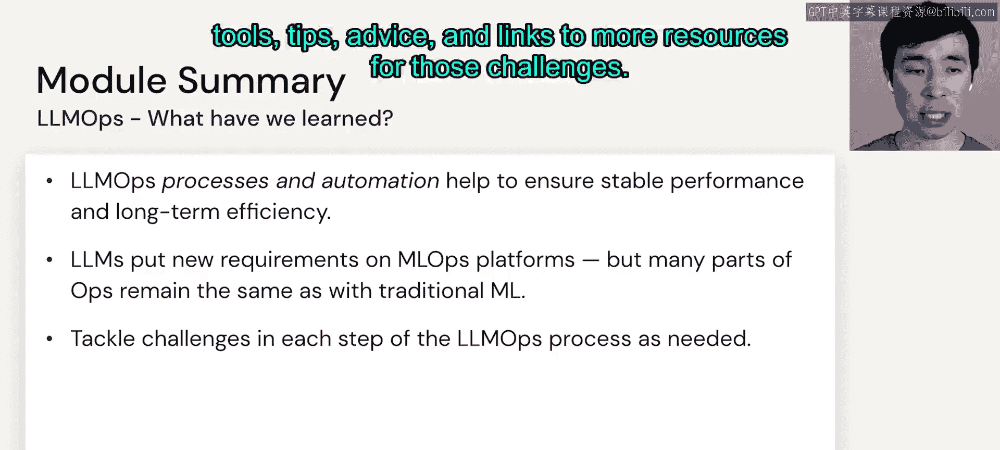

# databricks《大语言模型：从生产到应用｜Large Language Models： Application through Production》 - P66：-66-LLM Module 6_ LLMOps _ 6.6 Summary.zh_en - GPT中英字幕课程资源 - BV1nS411K7Af

In this module。We've talked about LLups， processes and automation。

 which can help to ensure stable performance and long term efficiency。

This is very similar to traditional MLOs， but LMs put some new requirements on those platforms。

 still， many parts remain the same as with traditional ML。

Then our recommendation is really to tackle challenges in each step of the L Ups process as needed。

 and we gave a number of tools， tips， advice， and links to more resources for those challenges。

