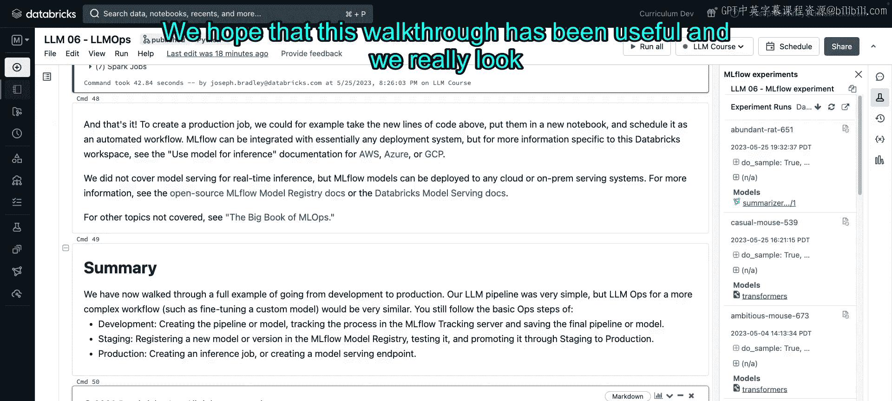

# databricks《大语言模型：从生产到应用｜Large Language Models： Application through Production》 - P67：-67-LLM Module 6_ LLMOps _ 6.7 Notebook Demo.zh_en - GPT中英字幕课程资源 - BV1nS411K7Af

In this notebook， we're going to talk through an example of LLM Ops。

Our goal will be to take an LLM powered pipeline to production。

The pipeline itself will be very simple and familiar from previous modules。

 summarization of news articles using a pretrain model。We are going to focus on the ops aspect。

In terms of what we mean by an LOM based pipeline。You can think of this like a data augmentation pipeline。

We're taking data in this case， a data set of news articles and augmenting it by using an LOM to compute one or more new columns。

 this case is summary column。You can imagine extrapolating this to other scenarios where you have interesting data with speech or text or other things which might be processed by LLMs。

 using an LLM to augment that initial dataset。In terms of ops。

 we will go through our familiar stages of development， staging， and production。In development。

 as I mentioned， the pipeline will be simple and will not be the focus。

 instead we'll look at tracking what we do carefully using MLF tracking for later auditing and reproducibility。

And then using MLflow models to package our model or pipeline in format to simplify future deployment。

And staging。Our goals are to show the mechanics in terms of operations。

Tracking the LLM's progress through testing and towards production using the MLF Model registry。

And doing so programmatically to demonstrate APIs needed for future CICD automation。That said。

 we will show the UI with well， which is nice for human readability。

Our focus will not be on the testing techniques themselves。

 we cover those already in the evaluation module。However。

 you could certainly take those techniques and apply them in this pipeline。Finally， production。

Our goal here is a scale out batch inference pipeline。

 so scale Out code is important for operations to meet future demands on our data pipelines。😊。

And then in terms of simplifying deployment， we want to emphasize how MOflowlow allows us to write model agnostic deployment code to really simplify the lives for deployment engineers。

The tools we'll use are the model registry again， and then for the scale out data pipeline。

 Apache Spark Data frames and Delta Lake。If you're not familiar with these latter tools， that's okay。

 we'll get to them in production。Before we continue a couple notes about this workflow。

This is a notebook demo。In reality， you would probably break this up into multiple notebooks or scripts in order to have separation between code for development。

 for staging workflow and for production。But the tools you'd be using would be similar。Thus。

 this does show you the workload which you would see in modular scripts with a division between dev staging and broad。

For promoting models versus code， which we covered in the slides。

 we're going to focus on promoting models。That means tracking the path from dev to Prod via the MLOF Model registry。

Note that。The ebook linked here does have more discussion of these two paradigms。

 and even if you're doing the promotion of code and study models using Git。

That's okay because a lot of the same tools and techniques will remain relevant there。

Let's get started by running the classroom setup。While that runs， I'll note that for this notebook。

 we're going to use these familiar data sets and transformer models。

 so the data set is that data set exome of articles。

And the T5 transformer is going to be a multipurpose LLM。

 but we're going to use it for summarization。So now that that classroom setup has finished running。

 I will import load data set and pipeline， I'll load the XM data set， and for development。

 we're going to use a very small subset of that data。The articles and summaries， just 10 of them。

But for production， we want to show how to use scale out tools and for this。

 we're writing that test subset of the data into Delta format。

 which is going to be much more useful for production pipelines later on。

Moving on towards development。So in developing an LO pipeline。

Our first step will be to create that familiar hugging face pipeline。This is nothing new。

 it's the same thing we had done in module1 note though in this point。

 I am pulling out these parameters used to specify the pipeline configuration。

 that's because we want to log them later explicitly to MLLF。Just as we've seen before。

 we can call the summarizemarr on a particular document。

 here's the original document and here's the generated summary。

This works and this is all we're going to get into in terms of what a data scientist might do to develop that LLM we covered that already in the course。

😊，What we want to focus on is tracking this。So。😊，Say we do our testing on a larger set of samples in this case。

 our sample is just 10 rows， but it gives us a set of queries and responses。

 which we're then going to log to MLF。Now there are links to MOF details。

 more explanation of what MOF tracking offers。😊，I'm going to explain these。

 but in the code below and in the UI for them a flow tracking server。

A couple of key terms I do want to call out first， though。

 are an experiment is the highest level organizational。Primitive for ML flow tracking。

An experiment generally corresponds to creating one main model or pipeline， in this case。

 this summarization pipeline。It contains some number of runs， a run might correspond to say。

 one trial during hyperbramed or2 name， or in this case。

 since we're only making one pipeline per run of the notebook。A quote。

 MlF Run corresponds to one run of or execution of this notebook。

The run can contain not just the model or pipeline that was created， but other metadata。

 which we'll show later。So。😊，Getting into the code， I'm going to show the code first。

 and then I'm going。To show the results in the UI， which you just saw flashed up there。

So walking through the code， we'll import the MLFat Library。

We're then going to set an MLflow experiment explicitly。

This can be good if you want to make sure that as you move this code through to production。

You're very clear about what experiment you're tracking here。By default and Databs。

MLFlow will log to a notebook level experiment， but here we're just trying to be very explicit about where we want to log。

We're then going to wrap most of our code and MLflow start run。

This is going to tell MLF very explicitly， start a run here and end it once we get out of this segment of code。

We can then log things to this run。We mentioned that we are storing some of the model or pipeline configurations as variables so that we can log them to MLF later。

 and that's what we're doing here。MLflow does have some auto logging functionality， but this。

Manual logging can be useful when you have custom things， which are not picked up。

We then want to log inputs and outputs or queries and outputs This can be useful if we want to manually inspect our queries and outputs and maybe think about prompt engineering。

 not necessarily relevant to this pipeline， but certainly if it were a more complex。

 say maybe few shot learning pipeline that we were working with。

 we'd probably want to iterate multiple times in the development stage and this logging of inputs and queries would end up being quite useful。

We do that using this log predictions call。Of inputs， outputs。

 and prompts note that this is a very simple L pipeline which doesn't have an explicit prompt。

 but if we were doing some prompt templates， then we could separate the raw user inputs from the prompts。

We're then going to log our model。Now。Logging a model can be very straightforward just via a log model call。

 but it can be useful to log some additional information which we can manually extract first。

So first we're going to infer a signature， that means what is the input and output schema for this LLM pipeline？

MOF provides a helper method for that， which we call here。And we get the signature。 It's very simple。

 in this case。 Take a string， return a string。But for more complex pipelines。

 this can be very helpful to log。And so this gives you the pattern for how to do that。

We then want to log inference configurations and in particular for MLflow。transformers。

 logging inference configurations explicitly is helpful in making sure that these same configurations are used by the pipeline when it is reloaded。

And so now we can log the model。So this is saying MLF。

 we're using the Huging F transformformers' flavor。

 there are ways to log arbitrary Python code as custom models。

 but we don't need to do that here because MLF provides a transformers's plugin。

We'll then log the model， passing at the model。The artifact path。

 which is basically the folder within the MLflow tracking server where we want to store this model。

Till the Huging face task is summarization， give it the inference configuration。

 that signature for input and output schema that we got before。

 and then we can log an input example which can be handy for future reference。

This returns a model info object which we'll use later on in the notebook this object is useful because it includes metadata about our logged model。

 such as a model UI， which we're going to use later to load our model back。So。😊，As we mentioned。

 the signature is just string to string。And now that we have logged this model。

 we can query them a flow tracking server。So as I mentioned， there is an API。

 there is also UI and this GF is showing the UI being used。

 but let me actually just skip over it the GF and show that in practice。

 you go over here to the right MOflow experiments is this beak this is showing the current experiment that we're using where this is one run。

 this is another run， this is another and so forth and you can see that。

Not only has it logged and is it currently logging to this latest run that I had done but。

I also have the history of runs I have done in days or weeks or years past。

It's very useful if we need to go back and audit or figure out what we did some time ago。

So I'm going to click this in order to expand。This to the MLflow tracking server UI Here I am looking at the experiment named L M06 Mflow experiment。

And each of these lines is a run。These are given just arbitrary names and if I click into one of these names。

 then I will be able to。See more details。 Let me click into this first one。

I'm not going to go through everything the MLflow here。

 please refer to other demos going into more details of MLflowlow or the documentation if you need more info。

Let me point out just a couple things， automatically log metadata。Links to source code。

 the parameters that we explicitly logged， and then the artifacts that we logged。First。

 we logged some predictions and you can see the inputs and outputs logged here。As just a CSV file。

 and then the model itself。This has the schema that we logged。

 we are able to manually register a model but I'll hold back because we are going to do it programmatically。

 and then if I expand this， I can see some standard metadata files。

Some files specifying the environment， which is good for reproducibility and moving towards production。

Our input example that we logged a model card generated， which is useful if you want to say。

 go and register this on the Hing F H and so forth， then the model data itself。

That's all I want to cover for the MLOF tracking server for now。Going back to our notebook。

Let's point out that。We can load our model， we have saved it。

We got that model info handle and we can get a quote， model UI。

This model UI is going to let us load that model under multiple forms Here I am saying let's load it as a regular Python function。

 which we can call。MmLF loads this as a quotePyunk model。

 but a predict method we can pass in the document。And。Get back the summary。

So this is the same model and basically just showing that loading it back from the MOflow tracking server。

Produces that same model， and here is our summary。We can also call it on more than one document at a time here we're calling it on this pandas data frame of our documents。

Getting the results and display them。Great， and there are summaries。

We're now ready to move to staging， and in order to do that。

 we're going to register the model with the MLF model registry。First。

 we're generating a name we will use to register the model。

I'm appending my username just for convenience and then we register the model by passing it。

 which model we want to register and the model name。

And this is creating a new model in the model registry with one model version instantiated to be this model saved in the MLflow tracking server。

And now it is registered under stage none， Aka development。ここで。

Let's move on to the staging environment。Here， our goal is to test the LOM pipeline and to track the movement of this model in the model registry from development to production。

We already created a registered model， we created that initial version of it。

And it is in stage none or development。 Our goal is to move it to staging and then production。First。

 we'll import the MLflow client and instantiate it。

This is going to let us interact with the Mflow Model Registstry and Traing server programmatically for CICD implementations。

You can see I can， for example， search registered model and see the model that I just made。

Now this is machine readable but not a human readable， so for the human readable version。

 go over here and you can see that this icon and this link will lead us to the UI for the MLF model registry where I have this summarizer and the initial model version that I created。

Have a link back to the source run where that pipeline was defined and created with all the information about how that happened。

And it is in stage none。Note that when I'm in the UI， since I'm patent an admin and have permissions。

 I'm able to， for example， manually transition the staging， transition back to none and OK it。

 and this creates an audit log。Now in general， I would not recommend doing this so manually。

 but I did want to demonstrate how it logs what has happened。

There are also concepts of permissions and so forth within the registry。

 which will be important for allowing some people like admins to do things。

Or CICD processes to do things which not everyone should be allowed to do。

Now I'm setting it back to stage none because I really want to progress this version through the registry towards production programmatically。

 let's do that。So。😊，First， I want to show how to load a model。This is a registered model。

 and you can tell that because the model URI starts with models colon。Pass it。

 the model name used in the model registry， and then the model version。And you get back that model。

 in this case， I'm telling it to load it back as a Python function。

Note that there are other ways to specify URIs， refer to the MLflow docs for more info。

 but one I want to call out is specifying the model stage where you could say give me the latest staging version or the latest production version of a model。

Now this is a development stage model。There is a note about model dependency stated here。

Definitely check this out because making sure that your dependencies in production are the same as those specified in development and staging。

 it's really important for maintaining the same behavior。Now。

Let's move this to transition this model version to staging there is a method in the client for that and we say we're moving it to staging。

Now I have permissions to do that from this context， and so that staging transition did happen。

If I go back to the model registry， I can see that and that was logged。And now。

An actual CICD workflow probably load the staging model programmatically。

 don't want to create copies of models though， so I'm actually saying， you know。

 we know this is the same as the development model。

 but here are examples of your eyes for grabbing staging models。No。

We're going to quote test the manual the model manually on sample data here I'm just going to print out results。

 pretend I'm an expert on this task and say I am manually okay in it Now while human evaluation is very important and of course for LLMs。

 you would likely use a combination of some of the automated and manual methods we covered in the evaluation module of the course。

Here I'm looking at the summars I say yes， this model is excellent and should replace our current production one。

 so we're going to transition to production。We can basically set that via the model registry。

 and then we go back to that model registry UI in a moment， or if I rush it。

 I'll just refresh the page， then we see that that has been transitioned to production。No。

This was done in a very rushed way where we did not emphasize how we were doing the tests。

But we showed how to interact with a model registry， make transitions programmatically。

 and those are the key elements you need to implement the CICD workflow。Now that's in production。

Let's move to that stage。Talking through production， let's create a workflow for batch inference。

You could use batch and fronts or streaming， serving in points， edge devices， even。

Here we're showing within the same notebook， batchching for En use Apache Spark Data frames with Delta Lake format。

This is valuable when you want scale out high throughput low cost jobs。

If you're not familiar with Apache Spark in Delta Lake。

 definitely look at the resources linked here for more information about scale out data pipelines。

I'm going to look at loading the data first， recall that at the very beginning of the demo。

We saved our data out to a Delta table here we're reading it in using the Sp read functionality。Now。

 for the sake of a quick demo， I'm limiting it to 10 rows。

 but this gives you the idea and of course in a larger pipeline we would not use a single instance cluster。

 we'd use a scale out auto scalinging cluster， handle more data。

And that we would make real use of Spark and Dlta， but this shows you how to do this programmatically。

Here is our data that we want to test on。And I'll note that before we were loading the model。

 using MLF P fununk。But not Sp UDF。Here we want to load it as a Spark UDF。

 if you're not familiar with that as a user defined function which can be applied very efficiently to big data。

And the key thing that I want to note here is that this deployment code。

 saying load my model and then next apply it is model agnostic。

All I'm saying is I want to load it as something that can be applied to a Sp data frame at scale in a scale out manner。

 I pass it this Spk session object， look at the Sp documentation for more information on that if needed。

The model， U are I， but this is not saying this is a Huging face transformers's model or anything like that。

I'm telling it what environment manager for the Python environment to use to replicate the environment from the development stage and the result type a string。

Note that if this were not a hugging face pipeline。

 if it were a lane chain chain or some other type of LOM model or pipeline。

This code would change very little or none because the MLflow basically hides the model specific or library specific works under the hood。

This is taking a moment because it is setting up a virtual environment in order to make sure that it is mimicking the development environment。

 note that I didn't really necessarily have to do this because I'm running in the same notebook。

 but in a realistic workflow， this code would be pulled out into a separate production script and job。

Once that user defined function is loaded。We're going to apply it to that Spark data frame。

This is the Spark data frame and I'm saying add a column called generated Sumary where I apply the UDF。

 which is our LLM pipeline for summarization to the document or article text。

And so it's going to populate the batch inference inference results with a new column called generated summaryumm with exactly that。

So now that beauty are finished mode。I'm going to run the batch inference。

 recall that this is just on a small instance type or machine and that this is a small set of data。

 but the workflow we have gone through would scale out to millions or billions of rows。

And much larger clusters。We're going to display the results which are in a spark data frame。

And here are our results， note that。This does have some overhead from distributing across a simulated cluster。

Once you scale out to be large enough， that overhead is quite negligible and the benefits from scaling out to the overall time it takes to process data are huge。

Now that we have that Sp data frame， we can write out inference results to another Delta table。Here。

 our goal is going to be a pending。Here is the target we're going for。M6 and Fri results table。

And wew write it in Delta format， appending， and then save to that path。

We haven't talked a ton about Spark and Delta and so forth。

We're specifically using Delta and I'll mention that because it works very well with Spark and other scale out technologies。

 and it works particularly well by supporting both batch and streaming pipelines。

 allowing concurrent reads and rights to and from a table with acid transactions。

 definitely check out the docs on it for more details。And that's pretty much it。

 We just depended results to that table。To create a production job。

 we would probably take this and turn it into an automated workflow in Databricks or whatever orchestration tool you use。

And we also did not cover model serving for real time inference。

 but do see information about MLOF model registry for that or model serving documentation。

That pretty much brings us to the end， so we've walked through a full example of going from development to production。

Our pipeline was very simple， but LOM ops for more complex workflow like fine tuning a custom model would be very similar except that that development process would be swap out。

You would still follow the basic up of development， staging and production。

 and in those you would use tools that we already saw， MLLF Traing server。

 MLLF Models and Model reiststry for batchch En， Apache Spark and Delta Lake。

 or model serving endpoints for real time。We hope that this walkthrough has been useful and we really look forward to seeing your LLM pipelines in production。

