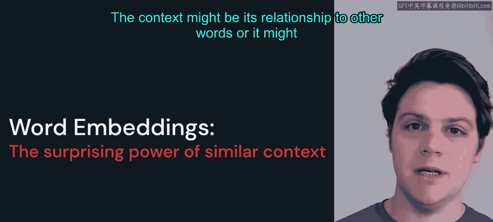
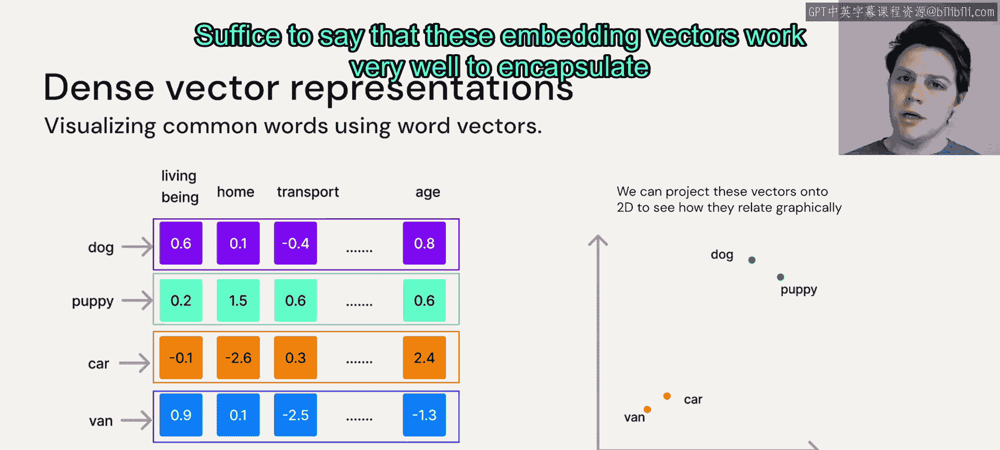

# databricks《大语言模型：从生产到应用｜Large Language Models： Application through Production》 - P6：-06-LLM Module 0 - Introduction _ 0.6 Word Embeddings.zh_en - GPT中英字幕课程资源 - BV1nS411K7Af

In our final topic on our primer in natural language processing。

 we're going to talk about word embeddings。The goal of wording bedding is to try and conserve the context that a particular token has in its vocabulary。

 the context might be its relationship to other words or it might be the intrinsic meaning that a particular word might have。

We've taken our sentence， we've converted it into tokens。

 and we've used a tokenization scheme to convert that token into a particular value。However。

 what we often want to do in natural language processing is compare two sentences together or two documents together to see if they're similar if they contain contrasting points of view or sentiment or all kinds of things that relate to comparing one sentence to another。

Words therefore with similar meaning， often tend to occur in similar context。

 so if we take the two sentences， the cat me out at me for food and the kitten me out of me for treats。

We would see that those are clearly different sentences。 However。

 they have almost the same meaning in some context。 We have a。Felline。

Miaowing at me for something that it can eat。 Now， the word cat and the word kitten are obviously different words。

 They mean different things， but they have very similar meanings。

 There's a sense that if we were to project these words into some high dimensional vector space。

 that they would sort of be close together in some sense， Likewise， for food and treats。

 as there's this contextual similarity that these words have。

What would be fantastic is if we could build up some kind of scheme or some kind of model that would let us express this numerically。

The goal then is to try and build up some vectors that we can use for context mapping and for embedding。

Let's take a first evidence by just thinking about these three sentences with our vocabulary。

 which consists of the words， all of the words that we've seen in these documents。😊。

What we're going to do then is count the frequency of how often each word appears in these documents。

And see how that helps us compare different documents together。So the first sentence， the cat set。

 we see we get three values of one in the first three words in our vocabulary。

 the rest are then zero。The second sentence， the cat sat in the hat， we get two the words。

 and then we get one of almost everything else except the word with。And then the cat with the hat。

 the last sentence， we again get two words of the， one cat， no sat， no in， one hat and one with。

 and so we can see that we're building up a vector representation of these documents。😊。

And so if we wanted to compare these two documents together or these three documents。

 any pair of these three documents together， we could use these vectors to see how much the。

Notion of say the wordth appears in each document relative to each other。

 so you could say that the last two sentences are more similar because they tend to have more words in common。

 and so there's a sense that this is true。However， if we think about how we would extend this to a much larger situation with a realistic vocabulary。

 we would actually have almost 99% of the vector being filled with zeros as most sentences of any reasonable length are not going to contain anywhere near the amount of different words that you might have in a typical language。

😊，If the English language has something like 250，000 unique words。

 you're never going to find any sentence or really any document that's going to come close to containing all of those words unless you're trying to use the dictionary。

So while this is a useful tool and indeed many language models have been built using this kind of approach。

 if you're interested in learning more about how you can use this， check out TF IDF。

 which is a very commonly used tool in older versions of language model。Ideas。

But the problem of sparsity here means that this is not really going to work for us as we build this and scale it up into larger problems and more complex documents。

And this also loses the sense of what each of the words are。

 While we can see that the word the appears more commonly than any other word。

 it doesn't really give us a sense of what that word actually means。

 If we think about the previous slide， we want to try and find a way for cat and kitten to appear together in some kind of sense。

And so this is where the embedding functions or vectorized functions for words comes into play。 Now。

 we won't go into what a word embedding。Method is， as it's beyond the scope of this course。

 but feel free to check out tools like word to Vec。

 which is a set of algorithms that convert different words into a vector representation。

 but in essence， what happens is that we use every word in our training dataset and we look at the words that surround it We have a window that looks at the words to the left and the words to the right of every single word for every other word。

What this does then is it builds a map of how one word appears with three other words and how another word might appear with the same three other words in particular contexts。

 If we think about the phrase that we looked at before with the kitten meowed at me and the cat meowed at me。

 we could see that kitten and cat are both in the same place and are surrounded by the same words。

If we do this over the entire vocabulary or the entire training data set that we have。

 we can build up vectors that represent what words are usually near these words。

If we then give our vector a dimension size of many hundreds to many thousands。

 we can start to build up some interesting meaning and embedding values for these words。

So typically we'll have a word， we'll turn it into a token。

 we'll then put that token into the embedding function。

 and then we'll get some kind of vector out of that single index of the token。Once we do this。

 we can then have a bit of fun by looking at how different words relate to others。

As we saw just in the previous slide， these vectors are very long。

 hundreds and thousands of dimensions， but what we can do in certain situations is project those vectors onto 2D and plot them on the screen like you can see here。

 and if we do the projection right， we tend to see these clusters of vectors that are actually in similar meanings grouped together。

 So as you'd expect dog and puppy are closely related as our car and van。😊，Now。

 we don't always know exactly what the different column names mean。

 They are almost never exact concepts like we have displayed on the screen right now。 however。

 you can get a sense of what's happening with these embedding vectors is that the word or the token that we're using。

 is described by a collection of values in this high dimensional space。

 and so you can think of this conceptually at least of a dog consisting of some value of living being。

 some value associated with home， some value probably not associated with transportation and some value associated with age。

 say a dog and puppy you'd have a different value there。😊。

If we were able to control what these columns are， now。

 I want to stress again that these columns do not correspond to specific meanings like this， however。

 the way that the vectors behave， there is some sense of this being distributed across the different vector columns。

Now if this is confusing， don't worry too much about it as we won't need to worry so much about this。

 suffice to say that these embedding vectors work very well to encapsulate meaning for every token。

