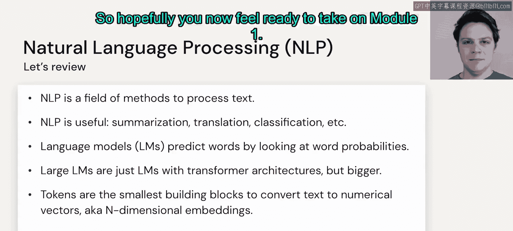

# databricks《大语言模型：从生产到应用｜Large Language Models： Application through Production》 - P7：-07-LLM Module 0 - Introduction _ 0.7 Summary.zh_en - GPT中英字幕课程资源 - BV1nS411K7Af

And that's the end of this primer on natural language processing。

 Let's take a couple of moments just to review。Natural language processing is a field that focuses on natural language and how to study it。

 particularly text， though natural language processing is much wider than just looking at how to how to model text based problems。

 we also look at speech， and text video， image to text。

 all of these other concepts where natural language is important。

Natural language is incredibly useful for things like translation between one text to another text。

 summarizing long pieces of text， classification problems where we want a natural language input and a natural language output these are done by language models which are essentially just tools to create a probability distribution over the vocabulary of the tokens that we have to use。

And large language models are language models based on the transformer architecture with millions and billions of parameters。

Tokens， like we saw， are the smallest building blocks of our language models。

 and they convert our text to indices， which we then convert to ndiional word embeing vectors so that we can understand more detail about the context and the meaning behind each token or each word。

So hopefully you now feel ready to take on module1。

We'll see you in the next one。