# databricks《大语言模型：从生产到应用｜Large Language Models： Application through Production》 - P9：-09-LLM Module 0 - Introduction _ 0.9 Install Datasets.zh_en - GPT中英字幕课程资源 - BV1nS411K7Af

If you're bringing your own workspace and you want to utilize all of the code that we have provided on your workspace。

 there's a couple of initial steps you need to perform so that you can run the course as it's intended。

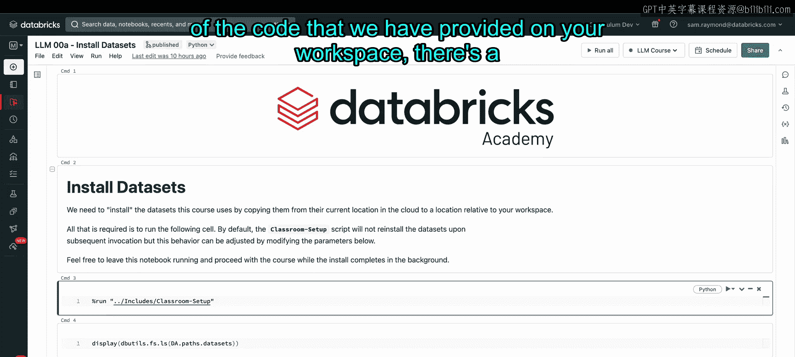

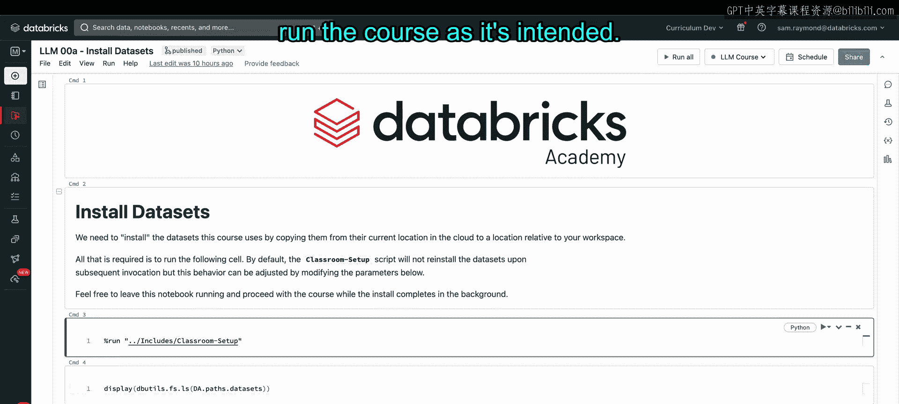

The most important of this is to make sure that the data sets are installed。

And cached in your workspace， Otherwise they can take a very long time to run and may use up unnecessary compute resource。

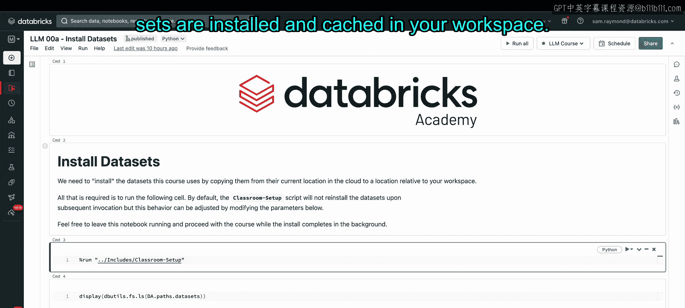

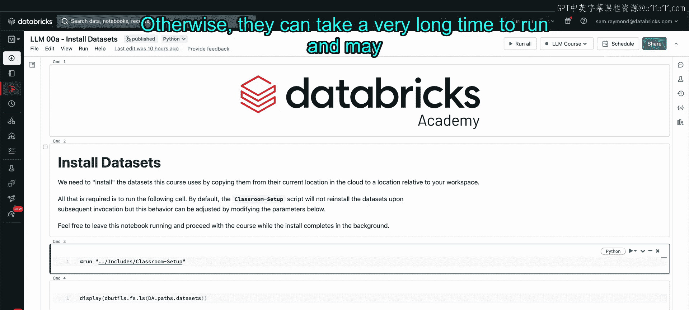

Once you've。

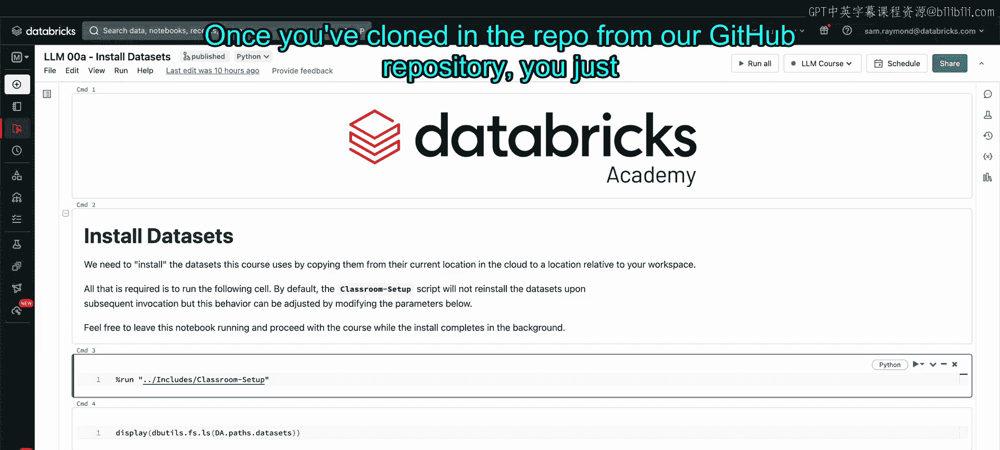

Clonned in the reaper from our GitHub repository。You just need to navigate to the LLM Ze introductionuction folder and check out the Ins datasets notebook。

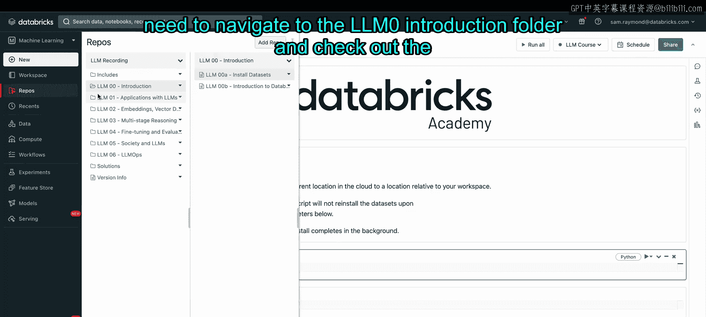

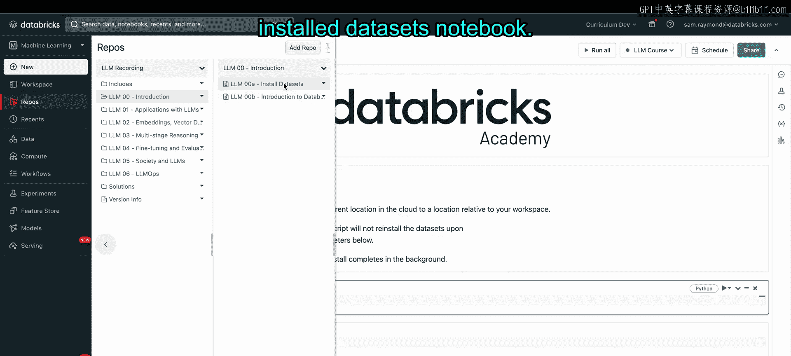

All you'll need to do is to run command3 includes slash classroom setup。

And this will go and look for all of the。

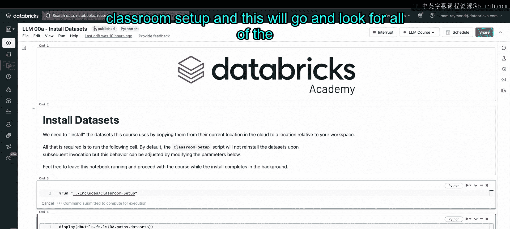

Dataets and install them locally relative to your workspace。

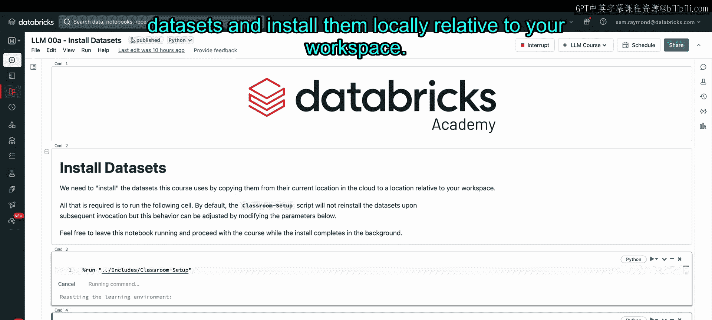

Depending on your internet connections and the availability of the data。

 this may take up to around 20 minutes。

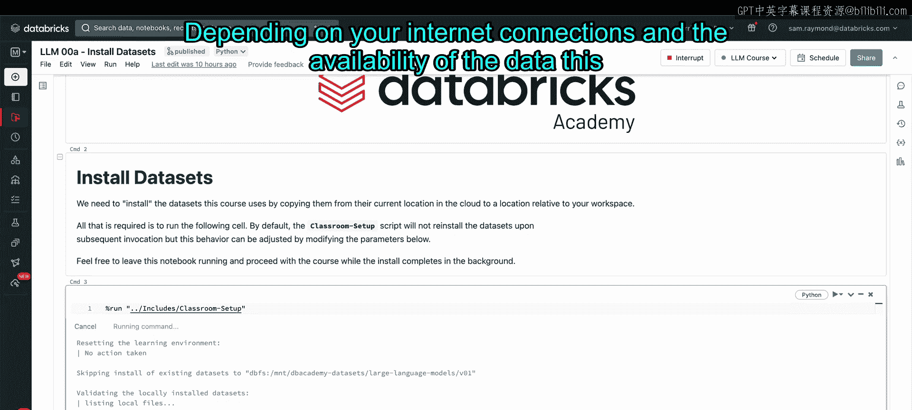

If they're already installed， this will take no time at all and you can check that they're all in the right location by running command4。

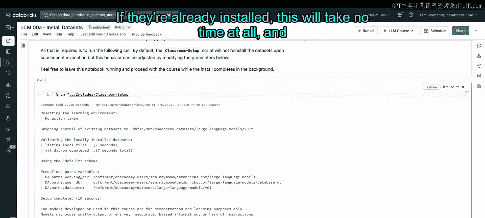

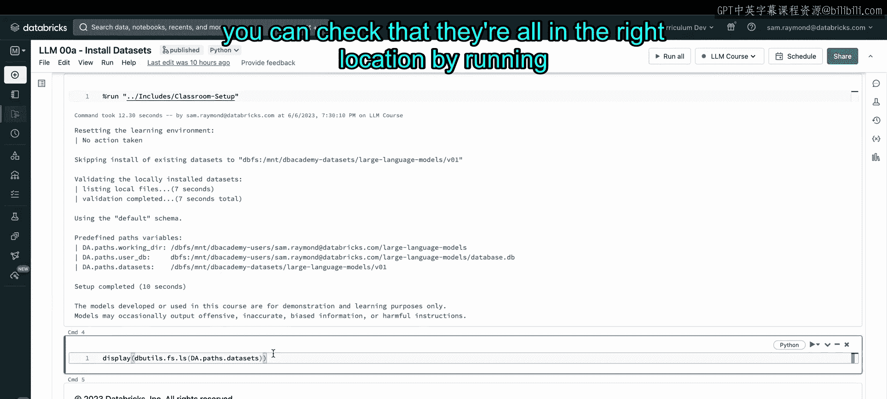

This will show you all of the。Dataets in their location。

 and then you'll be good to go to run the rest of your code。

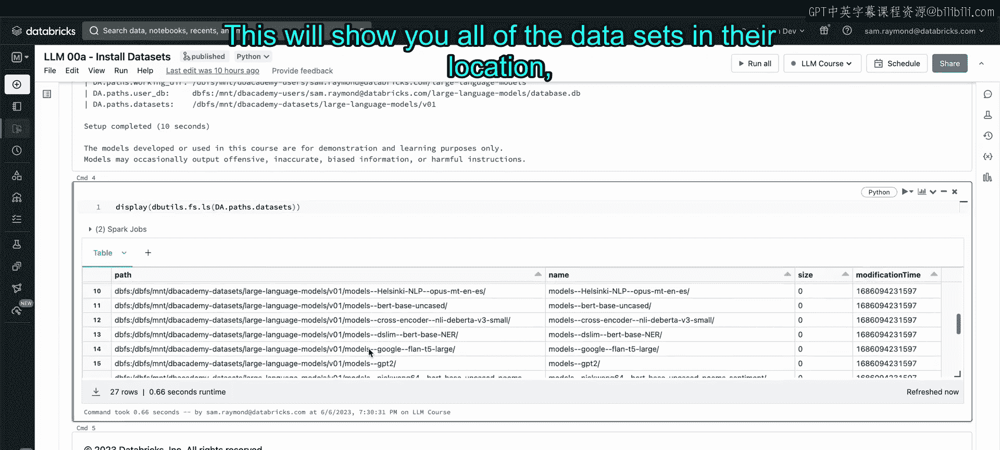

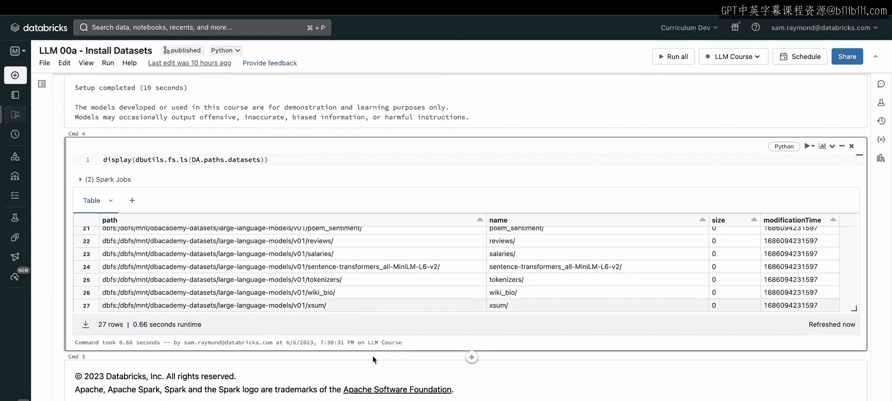

Thanks for watching。