# hugging face《如何用gradio搭建机器学习API｜How to Build Machine Learning APIs Using Gradio》 - P1 - GPT中英字幕课程资源 - BV1bD421u73M

Hello everyone， thank you so much for joining us， we're super excited to share our summer update our launch today。

 so I'm Abu Bcker from the Gdio team at Hugging F。😊。

I'm just going to go ahead and kind of get things ready and we'll get started in just a few seconds。

😊，Hello everyone。We have folks from Japan joining us from Spain， wonderful， so good to see everyone。

And yes， we'll get started in just a second here。All right， yes。

 so welcome to the Radio Python and JavaScript Client launch。as I mentioned。

 we're very excited to see everyone here and today we're going to cover four things in today's live stream so we're going to talk about first of all。

 why we're branching into why we're talking about the topic that we're talking about。

 why are we talking about APIs and clients， why is that an important topic for us as you know as the radio development team and for all of you as radio users。

😊，Then we'll go into the kind of the practical piece of how do you actually build a machine learning API with radio？

And then we'll do a live demo， which is always a bit of a gamble。

 but we'll do a live demo and then we should have some time towards the end for questions and answers。

So with that， let's get started。So first of all， I think we're actually at a somewhat of a golden age or a historic moment in machine learning。

 if you think about who's actually using machine learning today。

Versus who was using machine learning models and machine learning technologies that were being developed even just a decade ago。

 But a decade ago， it was almost entirely machine learning engineers or maybe software engineers。

 But now， really anyone who can use a Gui or a browser。

And has access to the internet can use state of the art machine learning demos that's actually super cool you know nowadays when a paper comes out。

 it almost always comes with a demo as well right so if you know you have a paper comes out on building consistent images and just you know the same day or a few days later either the paper authors that kind of the machine learning researchers themselves。

 build a demo or the community builds a demo and makes it available and accessible to anyone。😊。

A lot of that is powered you know through radiodio， which we're very， very excited about。

 and there are more than 500，000 such machine learning demos un hugging face spaces。

 I'm sure many of you all have used these demos or have built these demos yourselves。😊。

And if you have built these demos， maybe you know you know that building these machine learning demos used to be hard。

 so in the dark ages of you know building machine learning web apps and demos。

 you needed to know a lot of different languages and frameworks in order to just build a web application。

😊，So you know， we used to talk a few years ago we used to talk to people who wanted to build。

 you know， in Johnny to show off their machine learning models with a web application and then they were like。

 oh wait， I have to learn Flask and Docker and JavaScript and CS said， you know what， I'm good。

 I'll just publish a paper and let somebody else figure it out。But now with Raio。

 you can do all of that in Python right you can create the GuUI that you want。

 you can define it in Python Gdio automatically takes care of things like queuing so you don't have to worry about what happens if this demo goes viral it'll automatically be able to handle thousands of requests if it needs to be Gadio also lets you host you can either host your demo on spaces or you can create this idea this temporary link just with a single parameter it's a public link that lets anyone try out your demo。

And so Gr deal lets you do all of that all in Python and that's very much in line with our mission。

 which is giving Python developers superpowers that let them create these machine learning demos and applications and kind of increase the accessibility of machine learning as a field。

😊，As a result， we're very honored really that almost 1 million developers are using radio each month and actually just yesterday we crossed 30。

000 stars on GitHub。But we're not satisfied with that and one of the reasons we're not satisfied is when you look at how radio is used。

Oftentimes there's this tight connection between machine learning prototyping and radioio right so graio is oftentimes you know used to build these machine learning prototypes and when people deploy their web apps in production。

 sometimes they move away from radio or they use some other technology。

And we set out to think and you know work with users to actually change this。

 so today what we'll be talking about is not just using radio for prototypes。

 but also how do you use radio for production。So what I mean by production is so for prototype。

 you know， maybe you're working in the Jupyter notebook or you're working you're testing out a bunch of different models and you spin up a quick graio Gui to kind of visualize and share your results。

But we want to go from that to a production API， so an API that you yourself or other software developers who may not know anything about machine learning I can use in their product。

So the goal that we set for ourselves is what is the fastest way to go from a prototype to a production API that anyone can use？

And you can use it within your software and you can use it as your software skills with many different users and things like that。

So as we thought about this， you know， one of the challenges we thought about why is it so hard to actually do this right now。

 why are ML machine learning API so difficult？And part of the reason is because there's different steps that are involved in building a machine learning API right so the first step is you might prototype with some sort of machine learning tool or library。

 you might be using a hugging face， you know transformers library。

 you might be using something else like Pytors ors learn。

 you might be running things locally with things like Lama CPP or outlines。😊。

Then at that point once you're kind of ready， once you've prod and by the way。

 prototyping is super important in machine learning right because you know unlike typical software engineering。

 you there's a lot of different hyperparameters that you have to try and sometimes the connection between the hyperparameters and your your final piece of software sometimes that can be a little bit opaque and so prototyping is very very important and so right now grade is already used for that but once you've prototype then you have to think about containerizing and deploying your model on scalable infrastructure once you've done that you're still not done because youre now have to think about the end users of your of your API so you have to write a documentation you have to build downstream clients that can consume your API you have to make sure this documentation is always up to date。

And then finally， you might be interested in monitoring the API usage。

 you want to know you know how many people are using the API you might want to know what percentage of requests are coming through。

 what does the latency look like， things like that。

 and not only do you need to know various frameworks in order to do all of this。

But all of these frameworks might be in different languages right and so the goal that know that we set out is is it possible to do all of this with just a single framework radio in a single library Python or in a single language Python？

😊，And the reason I think this is especially important is because。

Although you know it's possible to do this separately with various different packages and so on。

 it is quite time consuming and this is problematic because oftentimes after you've deployed a machine learning app。

 if you've ever deployed one， you know you're not done you're almost never done you have to sometimes go back to the prototyping stage and this happens for various reasons。

 maybe your data distribution changes。😊，Maybe a new model comes out and you want to try you know let me see if Lama3 works I built my product on top of La2 does it still work with Lama3 or do I need to change different hyperparameter。

 things like that and so oftentimes we're kind of doing this dance between okay we've deployed something but hey I want to go back to prototyping okay and I've changed some stuff I want to deploy that again and so on so there's this kind of this know back and forth that always happens and so if we can make this process super fast then you can iterate faster you can try out what is the actual kind of best thing that we can do here。

So with that， I want to transition into how Gio is actually solving this problem。And first of all。

 I'll just start with some basics if you've used if you've built a radio app before。

 you know that every radio app is already an API and as we'll show it's actually also a production ready API。

At the bottom of every graio app is this link here in the footer use via API and if you click on it。

 you'll actually see that every function in your Gdio app is documented right so here if I go back you I have a text box a slider and it generates an image know this is a very very simple gra app but even if you have many different endpoints。

 many different functions that are happening here。😊。

You'll see all of those endpoints documented automatically when you click this， you use via API link。

And so everything is documented， the parameters are documented。

 that the payload types are documented， whether they're required or whether there is a sensible default that is automatically generated。

 all of that is is kind of documented here as well along with the return statements as well along with a payload so example payload which is sometimes you know which is what we've heard from developers as this is really important I want to be able to copy and paste an example query automatically。

And， then just modify it based on the payload that I want to kind of use in my application。

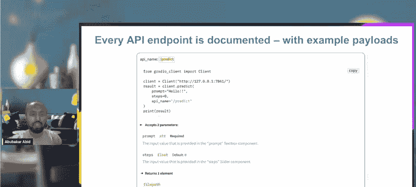

When it comes to infrastructure， you can deploy radio apps anywhere。

 but radio apps naturally work with hugging face spaces， so I'm sure you'all are familiar with this。

 but you can just drop your radio code inside hugging face spaces it automatically builds and gets deploy and then you can choose whatever hardware you want and you can choose when I say scalable what I mean by scalable is oftentimes your GP GPU load varies and don't want there might be times where your kind of load spikes and there might be extended hours where nobody is calling the endpoint and so you don't want the GPU to be running the whole time so spaces lets you very very easily control the sleep time and things like that so you only have to pay for however GPU you' are actually using。

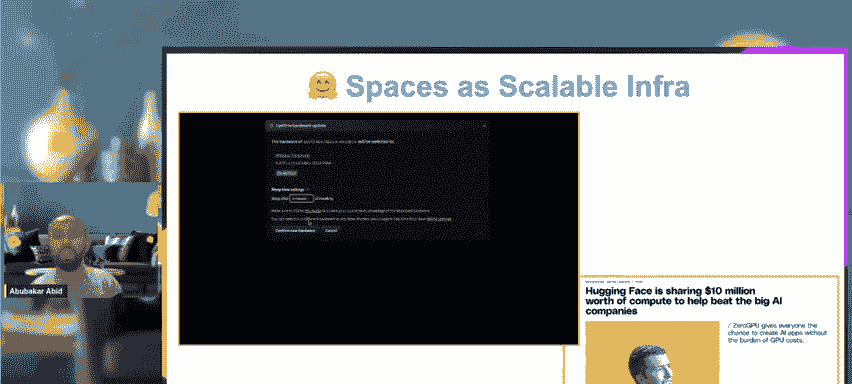

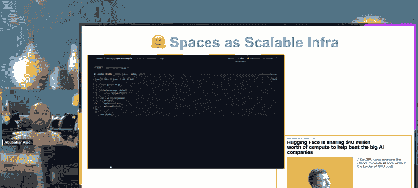

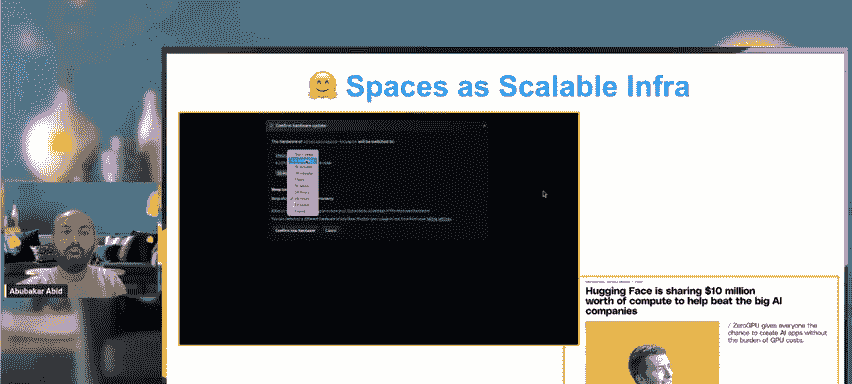

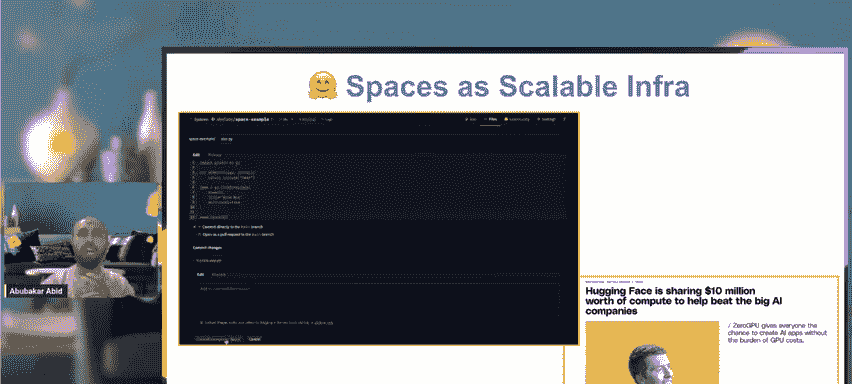

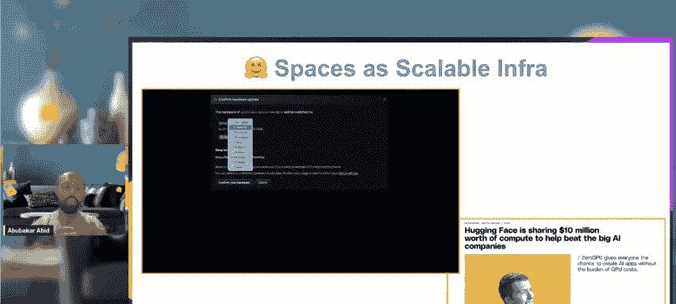

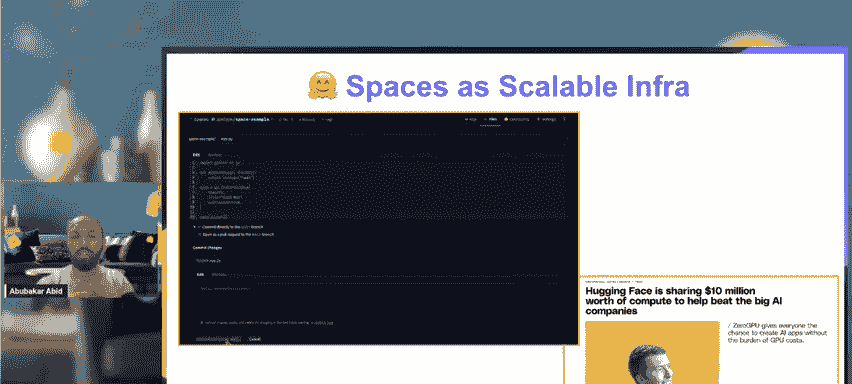

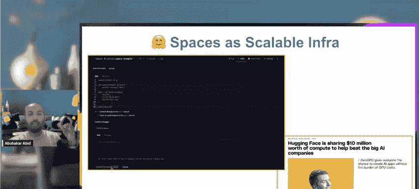

and even that we're hoping to reduce so one of the things that we just launched recently is zero GPU。

 so it's this ability for you to actually。😊。

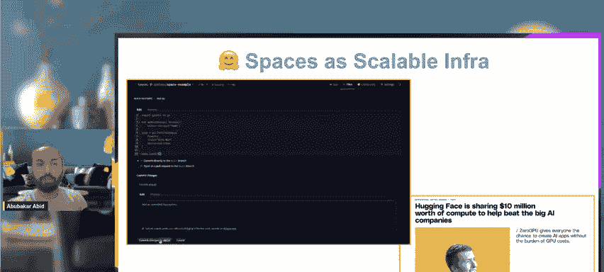

Run GPU loads without paying anything and this is powered by something that we built called zero GPU which lets you share GPU across different users and so zero GPU works very。

 very nicely with the clients and I won't talk about that too much right now。

 but if people have questions we can maybe talk about that towards the end。

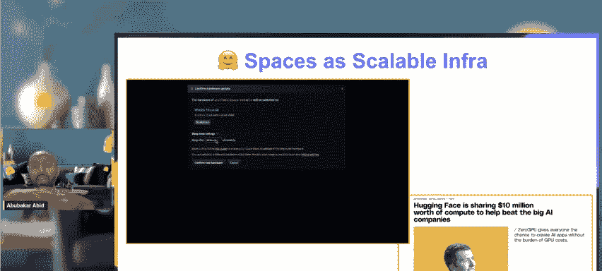

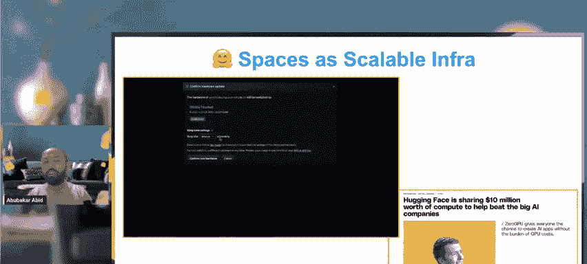

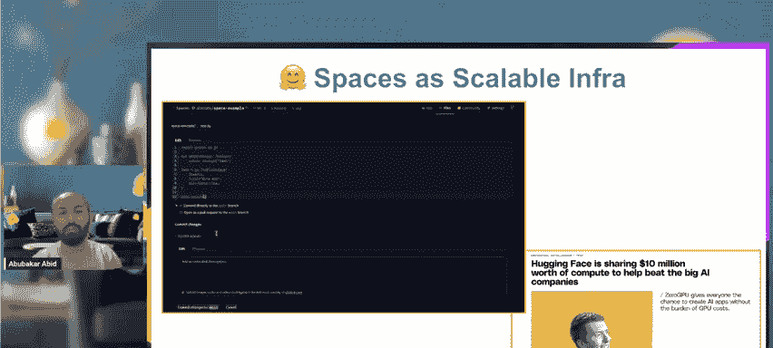

But yeah， so Huging Face Space is a very natural place to deploy your radio application and then use it。

 consume it via the client， but of course you can deploy it anywhere including your own server or infrastructure。

😊。

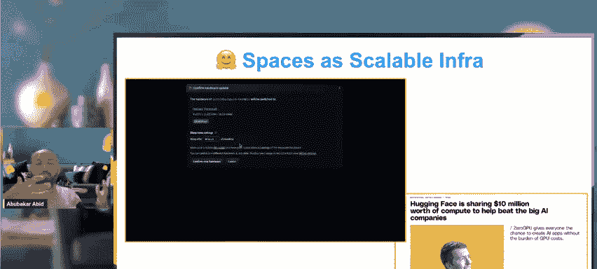

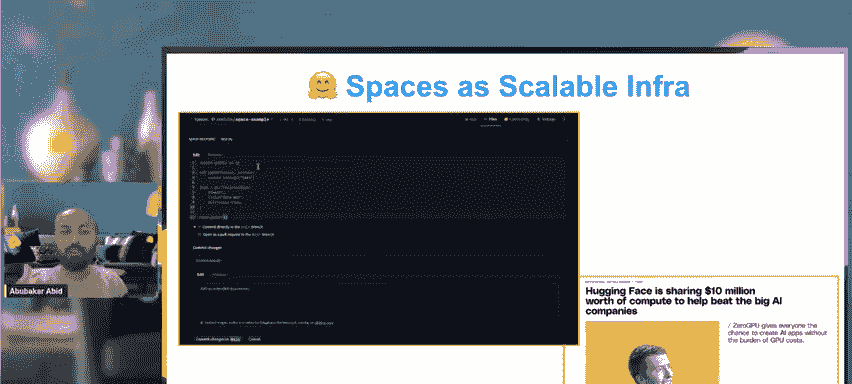

Okay， with that， I'd like to actually transition over to my colleague Ali Abbod。

 who'll be talking about more things that we've built， including some very， very recently。

 in order to make it easier to use radio as an API。So I'll just bring on Ali here。

Thanks Bucker So yeah， so if you were working with APIs。

 one of the things that you're gonna to have to run into is documentation and the two frustrating points about documentation is that someone has to write documentation and someone has to read documentation and so we solve that by just having no documentation and so what we introduce instead is even though there is some documentation well you can do to get around that is use the API recorder which instead of having you making you rely on the documentation you can just use your UI interactions and have grade your record them and as you're interacting with the app it records your interactions and the API the client API calls that you would need to make those exact interactions so now you can just click you know enter your input。

 click submit click whatever interactions you want and you can see the client API calls you would need to make those exact interactions。

So no more wrangling with documentation anymore， this makes it much easier to go from your UI to your client script that you need to make those same API calls。

Additionally we make it very easy to manage the queuing managing heavier or like high traffic with very simple parameters so imagine your app goes viral and you know you have hundreds of requests coming in。

 we manage a queue for you for all the requests that are coming in and there are two arguments really that you need to just configure to manage your queue the first one is a concurrency limit。

 which is basically the number of workers that will be processing this function at any time so if you have like let's an image generation function and you know you have three GPUs available to you then you could set you know that concurrency limit to three to let the gradient note don't run like have three workers working on this function。

😊，And that's how you can control how many workers are working on a function。

 the other argument that you have available to you is concurrency ID。

 which in case there are some functions that can share workers they can have the same concurrency ID so let's say you know you have two GPUs and you have a couple different functions that all use GPU you could give them all the same concurrency ID and the concurrency the limit to two so that Gr knows all right between my two workers or between all these functions well have two workers assigned to handle all of these functions and in that way you can control the flow and of your queue based on the resources that you have。

Another thing that we've been working on is just making sure that we are adding no or almost no overhead to your request so when you make a request to grade there's obviously the network traffic and there is the processing time for your function that for the code that you have written whether that's like image generation or text generation whatever it is that is something that can be changed the grade is obviously also doing a little bit of work you know processing the input processing the outputs returning that to the front end and we wanted to make that as minimal as possible and so one of the tests that we do is that we serve 100 requests being served by 100 workers concurrently that are streaming text and we want to see how much overhead are we adding to the request and we've been working on eliminating this overhead as much as possible so now we've almost decreased。

Are overhead by 75% over the last few releases， which should make it almost negligible using radio to serve your APIs。

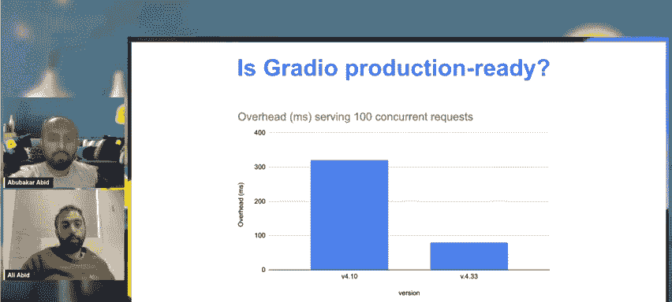

An example of a heavy or a very popular use case is the chat LMs ci app。

 which is one of the most popular apps that use radio that basically provides two chat boss or two LLMs responding to your request and basically compares the responses and creates an EO ranking of all the models based on this they serve if I think 50。

000 users a day they serve 400，000 streaming requests per day and it's all done with radioio and they don't have to worry about any of the scaling costs or anything like that they just provide the resources and radioio will handle the resources through the queue or through the workers that are assigned to them and so this is just one example of like a very heavy workload that is able to use radioio entirely to handle their production use case。

Ely do they need to do any sort of like any extra optimizations on the server or are they just serving a radio application so they do have replicas that they do specifically for this because there's so many requests coming in so they do create replicas and that's pretty easy to do radioio we have guys on how to create replicas and serve radio across machine replicas。

 but it was very easy for them to get that up and running with Grdio。😊，So所。Lastly。

 the last thing you want to do is if you're using radio for a production use case is to see your traffic。

 you want to see you know how many requests are coming in， how long they're taking。

 how many are' successful if they're failing what's failing and so what we've added is an API dashboard that comes with every single radio app now so all you have to do is go to your app slash monitoring and this monitors all your requests that are coming in。

 whether they're coming from the UI or from an API request you can see all all the usage。

 monitor all the traffic and all the usage that's coming in for your app。

 which should make it which is something very important if you're using your radio as your production back in and so now you have control over that to see how it's being used and you can make your decisions for your API based on。

Do you need to do anything specific to enable this or does every Grio app have this so this will actually come with every single gra app so it's ready to go as soon as you start running it is something that's not that's only available to the app creator so not everybody if you make a public radio app it's not like everybody can see your analytics it's only the creator who gets the URL for this analytics dashboard and the way you do it is basically you go to your URL/lash monitoring and then it'll provide you this if you are the the creator of the app it provides in the console the link to the actual dashboard。

😊。

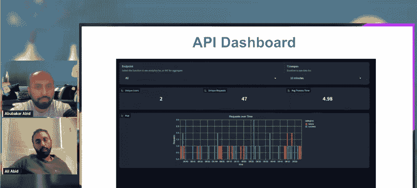

All right， so I'm going to hand it off to Freddie now who's going to talk about。

Hi everyone I'm Freddie， super happy that you guys are all here and I'm really excited to talk to you guys about the radio clients so Abu Ber and Ali you know really motivated how radio can serve a production use case and it can be used to power like a production endpoint so now that you know that stage has been set like how do you actually use radio as a API production endpoint and the answer is with the client libraries so you know like and over the next couple of slides you know we'll talk about the design philosophy of the clients and like the three main pillars that we followed when implementing the clients are that they're ergonomic so the API is very easy to use you know like the whole like API reference it's like about like 50 lines of code basically they're transparent in the sense that anything you can do with the radio UI you can do with the client so you can basically recreate radio in another language if you wanted to and they're also portable so you can run them anywhere especially like for the job。

script use cases anywhere that you could run jascript。

 you could connect to radio and get predictions next slide please All right so to talk a little bit about the API's ergonomic design first I want to talk about like an example application so this is like a radio chat interface hopefully you've seen this before if you haven't it's just it's like a oneline way to create a streaming chatbo as you can see here we ask this model programming questions here I'm asking it how to do a for loop and python and then it's able to stream the response okay so next slide now I'm going to show you like the code needed to connect to that application right so know the first step just install the client Pip install radio client and then you import this client class from the G client library and one thing I should say is that the G client comes with radio already so if you already using radio you don't have to install anything else and then we can connect to our server in this case i'm connecting it using this like。

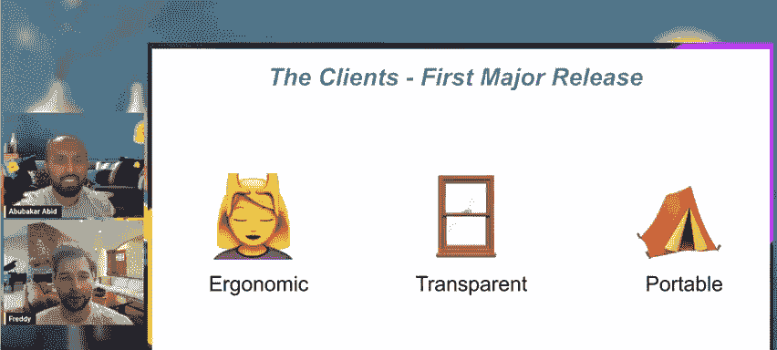

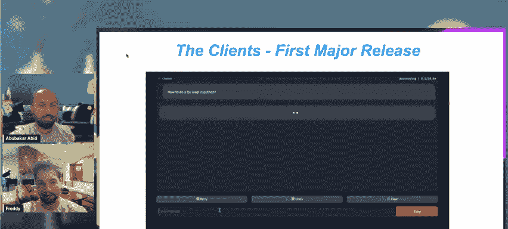

ID syntax because I'm hosting it on hugging face spaces but if you're hosting it on your own infrastructure just put the publicly accessible URL and then in order to get a prediction you just call the predict you know just call the predict method and then the only two things you need to pass in are the keyword arguments so they'll match the function signature of the deployed space so if you're the app creators really easy to map the client code to like what that radio app is using and you can also get all this information from the UAP page or the API recorder and then yeah and then you' just print the prediction that's all it takes and then streaming is also really easy in radio if you're used to streaming and radio you know you should be writing for loops is thing with a client if you're trying to stream write a for loop submit a request and then just iterate over the results and print them or do whatever you want with them so that's how it looks like in Python and then in JavaScriptscript that's very similar my colleague Hannah who will be talking shortly and Pete who will talk at the end they done a lot of work to read。

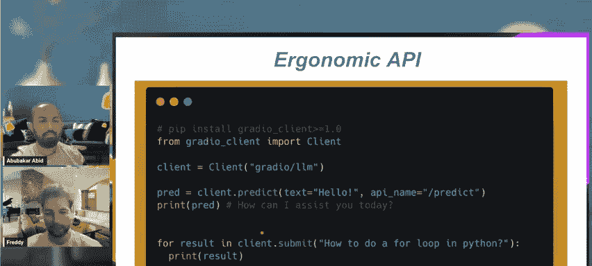

On the client so that it matches the Python API as much as possible and you know， to get started。

 you know， you just install the client library and then you just await this connection method。

And then yeah and then use call predict this is you know basically the same thing and then the same four loops syntax also works we'll cover that in a second。

 but yeah so that's you know how the you know the sort of ergonomic design of the client and now I'll hand it over to Hannah to talk about the other two principles。

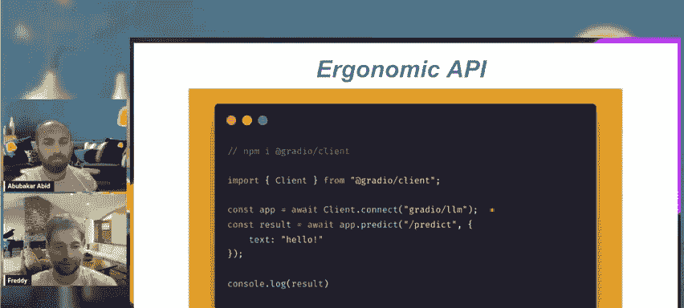

Yeah thank you Freddie yeah so here's an example of how you can how can log into a radio space with basic authentication enabled you can connect to any space now just by passing the credentials to when you're connecting the app this is quite a recent addition as well so anybody who's been using the client before and has been waiting for this you can go ahead and try it yourself now。

😊，Next is here's an example in Python using cancel so you've also got a lot of power over what happens in the queue as Ali Abbot was talking about earlier。

 here's an example of how you do that with the Python client so when running a prediction you can choose to cancel a job that has been queued as long as it hasn't already started so if it has started then it won't be canceled but the client will no longer listen to updates。

😊，The VOpi so here's an example of where you'd inspect the API of a simple Hello worldld app on radio this is on the Hing face spaces at the moment so you can see the configured endpoints for a space as well as their respective parameters and data types that you need to pass in and the data they're going to get back from the endpoint so yeah when you're not sure about how to use a space that's how you can access it as well as the use via API page that Ivacca mentioned earlier。

😊，Another example is the queue position。😊，Sorry， just a quick question， Hannah。

 so this example is in jascript， but you can do the same thing in Python as well Yes you absolutely can its also using your API as well the same syntax too。

😊，The queue position so here's how to get information about a job via the status event this returns and iterable which is really valuable has really invaluable information about what's going on behind the scenes so this example is checking the position of a job in the queue but you can also see other data like the state it's currently in the queue slide and the ECA of the like job completion as well so you've got a lot of information there that you can feed to the user in your app which is yeah very helpful。

😊，Another really powerful method that we've included is duplicate so you can use any public space that you see anywhere that has a radio space embedded and anywhere on Huging face as well as an API but there are times you might get rate limited if you make too many requests for example。

 you also can't always rely on the owner of the space to have it constantly running and it might be stopped or there might be an error or something and you might need to change that but you really want to use whatever's going on in this space and also other restrictions around this might be the hardware that they're using you might want to use a different GPU for example and a solution to this is to duplicate the space is pretty much the same as connect but has all of the same parameters plus a few more and this will be duplicated under your own hugging face account so that's why we ask you to provide the hugging face token and you also can declare whether it be private so it can be a public space or a private space and what that's can you do you can make it。

😊，Yeah you can change the hardware as I said as well which is great and you can also set the time out of it so this is the value in minutes that before the space will go to sleep after an inactivity so this is also great for developers who might not be super familiar with the Python Library I'm not much from backend developer so this is great for example for me if I wanted to build a really cool product around a great space that I've seen so yeah it allows me to or anyone to leverage a space that they found as long as space is available and work then there are very few reasons why you might ever actually need to write any Python。

😊，And next so another really cool thing about what we've been working on is making this as portable as possible and compatible with many platforms。

 so as part of the improvements that we've made one of our priorities is to make sure it is usable anywhere so whether you want to make a mobile app。

 a web app， a desktop app， and if you're using Gs， Den you can use S， nodeJS。

 react react native Cloudfloware workers， you're able to use a radio space API。😊。

Another example of this happening is a hugging chat。😊。

So this is currently available for anyone to use right now it's hugging chat tools so this means that there's a really cool tools feature at the moment which queries radio spaces from within the chat and it leverages all of this functionality from different spaces to produce more interesting outputs for example so here in this one as you can see there are certain tools that the hugging chat is using the document past the image generation and the image editing in that tools list all hugging face spaces that you can just use right now and access so this is a really great example of how you can use the client for yourself and another really good example of the radio client being used the Jeff client is actually the core radio library itself so we actually use it internally to build our radio app so in theory anyone could use the client to replicate a lot of what the core radio library actually does and as a result we're constantly testing and improving ourselves and yeah so that's a gradient client beyond that where also。

😊，We've also had users requesting programmatic access to apps outside of Python and JavaScript environments we've just added support for direct request through curlL which is brand new which means you can only access can you can also access from Bsh scripts but in theory any language curl can be easily ported to various languages so that's really exciting and in this slide you can notice see if you want to see the example usage of this use it you can see it by the use by API button in any radio space so yeah going ahead we're really excited to partner with the community and create community supporteded clients in any other language like Ru。

 go and Swift。😊，And yeah， I'll hand her to Pete now for our demo。啊s。好辟。Hey， thanks。

 can you share my screen as well？

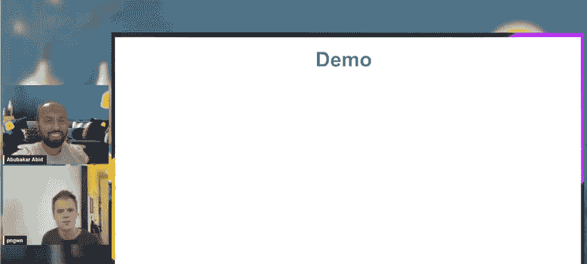

Perfect。Okay。Thank you so。So yeah thanks lot Hannah so I'm going to try and walk through now little a little example of how you might use the clients now I like everybody else love the Grio UI but I've got my own kind of brand so。

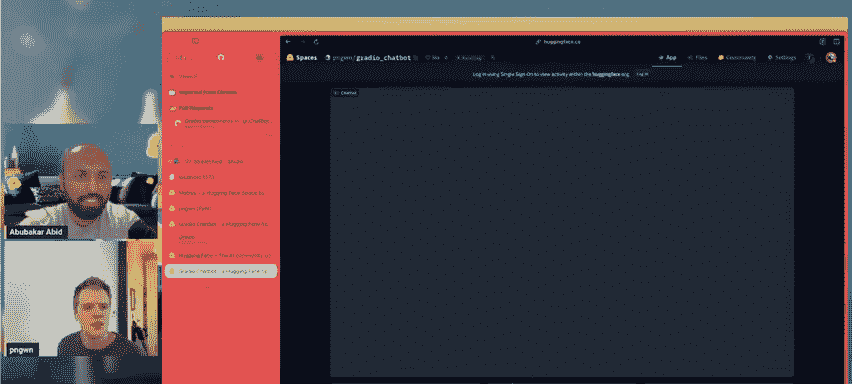

I want to kind of use the clients in my own website that I've set up with my beautiful penguin wallpaper and so to do that I'm going to use the I'm going to use the API so what we're going to build here is we're going to build a little a little joke generator。

Using everyone's favorite and large language model so one of the things that I kind of want to try and get across is is the kind of workflow that use in radio and then and that you know using radio directly including in the UI and then kind of gradually migrating into the API when you want to you know when you want to kind of build an MVP or even go to production and why that kind of workflow has a value so。

Obviously there's an enormous amount of models on the hub。You know。

 over a million or something same for spaces and stuff but。

One of the nice things is that when you are kind of you know you can search through trending and stuff one of the nice things is being able to kind of look at a space so an example of this is is this is this chat i've got running here so this is。

Lma 3，70 B instruct。 So a pretty good model in this demo， we're running it via the inference API。

 So I want a joke generator。 I'll zoom in a little bit so we can see what's been written。

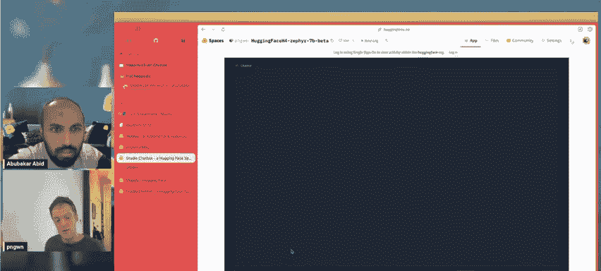

So， I'm going to ask。To write a joke about Penguin。

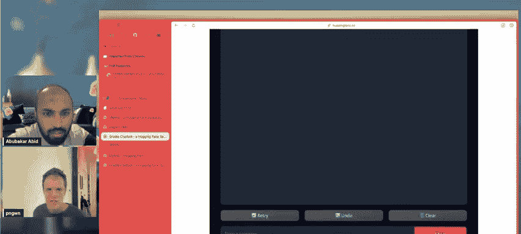

And and here we go why did the Penguin join a rock band to be the lead flipper。

 which is exactly what we're looking for。 So So I'm going to do is I'm going to jump across and obviously we can play around with this can we can dial the temperature right up and see what it does。

Y as expected so we probably want to keep the temperature where it is but this is the kind of the nice thing is there are lots of parameters。

 there are lots of things you can play with with models you know large language models there aren't too many parameters there are quite a few and some of them can have a significant impact on the kind of output you're going to get。

With other kinds of models and text image models come to mind here， there are lots of parameters。

 there are lots of things that you can play with and there's a huge variety of results that you're going to get and having a nice UI that you can just mess around with to try and see exactly how you want to set things up what you want what values you want to set the parameters to you know what kind of in the case of language models you know do you want to play around with different system prompts。

 this is a really nice way to do it and then when you're happy with your results。

You can just jump across and start using it as an API。

 So we're going to jump across here to the Java and。And we can kind of copy in here。

 So that's a chat interface so that we get this kind of like nice chat demo。 So we're going take our。

 our little kind of joke app， and we're going to。Wing a little bit of code so what we've got here is we've got another application that i've already set up i'll just very quickly walk through it it has it's a spelt kit application and we basically just have two pages we've got this kind of main page which is tell me a joke。

And we have a kind of a judge page， which we' look at later and that's going to judge judge Os。So。

We can go into this this joke component to actually。

To actually get our joke and all we're going to do is we're basically going to take that low。

We're going to take the joke prompt from earlier， so kind of I have tweaked this one a little bit I'm just going to pop it in here。

 I'm going to pop it in here。

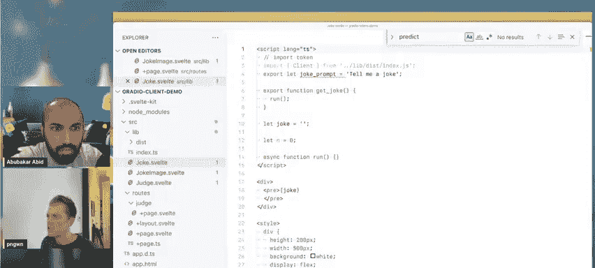

嗯。And here you can see this is。This is the space URL so we just pop in a space URL this is a public space so we don't need to authenticate we just call client。

 connectn as expected and。We kind of pass pass in the prompt and the prompt here is just telling me a short joke featuring a penguin。

 tellingly the joke， obviously you've got to go through the usual trickery to try and get the language model to do what you want it to do。

We give it some values， I give it a max tokens here that's quite short。

 just a pretty average temperature value and top P value。

And then we're just going to kind of run this。 So we go back to our application。We should。

There we go。 We got a joke。 So why did the penguin join a band Because he wanted to be in a flatman one slight issue is this。

It does just keep giving me the same joke over and over again。

 I guess I need to give it the whole history。For it to do a little bit better though。

 but we are getting a joke， which is cool and another thing that I think it would be cool to do here is I quite like an image for my jokes of。

😊，So if we go back to my browser， I found this this is a pretty recent image model it's really good actually and again you know we can play around with it。

 we've got all these different kind of things we can play with this model is called Mobius。

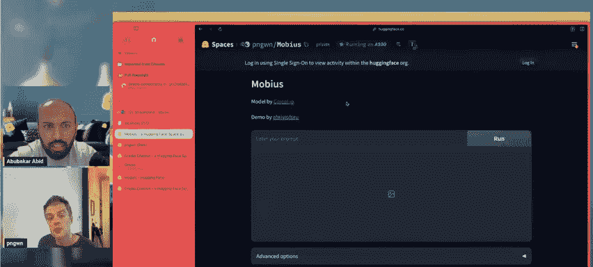

By Cosel Io， and we can just。Try out this this space here so I've duplicated this space so that I don't have a queue so I kind of found the original space you can see the original spaces here。

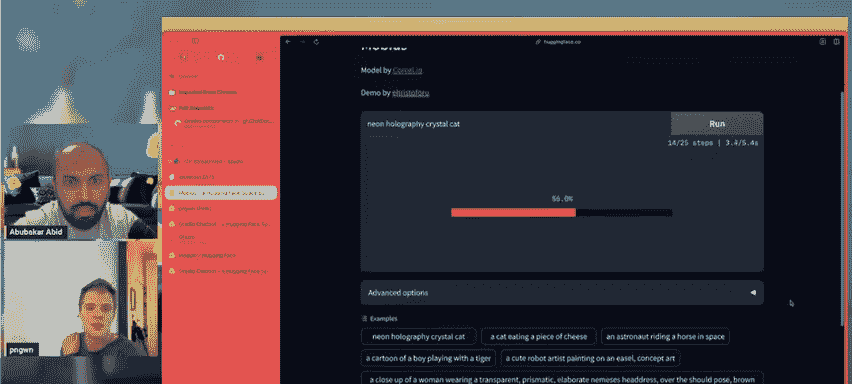

And I just kind of went to not the I went here and I duplicated the space and I just created a space here。

And you can assign whatever hardware you want and I set this to a private space was it gone。

 was it gone？So and as you can see the results are pretty nice like the pretty high quality。Cartton。

Of a boy playing with a tiger。Pretty cute。 And so what we're going to do is I want。

 I've prepared a little illustration that I wanted to illustrate for me。

 And this is just a little scene with some penguins in it。嗯。

So it just says in the illustration a group of penguins stand apprehensively on the ice flow。

 I generated this with an language model as well， peering across the ocean towards a distant vague outline of the UK。

 the penguins with comically frightened expressions look back and forth between the silhouette and a large。

Playful depiction of a whale peeking out of the water nearby so。

That that's what we are working with and we're going to create a 3D animation。Which is silly。

 playful。joke， and hopefully。It'll give us something。Something reasonable。It's not bad。

 that's not bad。And you know， we could play around with the the guidance， I think if we turn。

And again， it's the same story， you know， you can kind of play around with these ideas。

You can tweak the model you're liking and you can see what kind of results you get you obviously got negative prompts here。

Were use a random suit here， we turn this right up the guidance scale。

 let's see what let's see what impact that has and this is this kind of， you know。

 this is what makes radioio valuable。

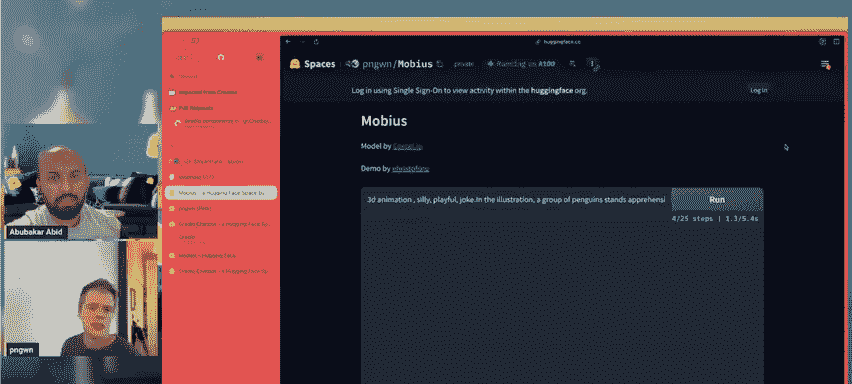

You know， whether you're a oh， that's interesting。Maybe we'll drop that back down。 You know。

 whether you are a kind of。You know you're building demos that you want to share。

 you're actually kind of like building your own machine learning models that you want to share whether you're a seasoned Python engineer。

 you know you've got all the queuing system and a bunch of other kind of nice features or even if you're a frontend engineer and you know obviously Grdy was a UI tool so it doesn't seem immediately obvious that it would be useful to you know frontend engineers or full stack engineers but again this idea that you can just play around with things。

Prototype with them embed them straight in your application to build MVPs to get buy in from stakeholders to。

 you know， to scale things up。 And even to be honest。

 you can stay with radio until like you're at quite a high scale。 Obviously。

 if you're serving millions of users， you know， you might want to do something more custom at that point So that's that's too much。

So we're going do this here。 So we're going to go back to our demo。

And we've got a little joke image thing here and。We are just going to kind of run this。 Obviously。

 ideally， what would be nice to kind of get a description of。

The actual joke itself and that's that you know， that's something that you could do that' that's I'll leave that as an exercise to the reader to expand this demo to include。

The actual joke somehow in the image。You'll notice here we're connecting to a private space。

 so this is a private space。You can see here it's private， no one else can access this。

 I don't want them using my expensive GPU that I don't pay for。So。I've kind of set a。

 I'm not going to show you my API， but it is a very fine scoped token we have finally scoped tokens on the hook now should you should use them wherever possible and I've popped this in an end file down here。

And that's that's get ignored so that willll never get committed and then we just pass it in here。😊。

🤧U。And then the result， we want to get the result and the result is。Its。A source will be equal to。

I think it's。It's actually this。So let's see how I'm getting along。In my little lap。

So that should run， I think。And there we go， we've got。AI generated penguins in。

You know kind of like joke generator。And so now we've seen now that we can use a private space。

 We can use a public space all hosted。 So just for reference。

 the first space that I used was a was a chatbot that was running the。Using the inference API。

 so we're using the inference clients in Python here you can use it in JavaScript as well。

In the Mobius。Is。Is not like that at all。 The Mobi Sap is using。

Is using diffusers and it's doing on device inference hence why I gave it a nice GPU and it's still not too much code it's more code。

 but it's not too bad but what I want to show is as well you can also use。Local local demos as well。

 so I've got demo running here。嗯。Running here。 I'll zoom this in。

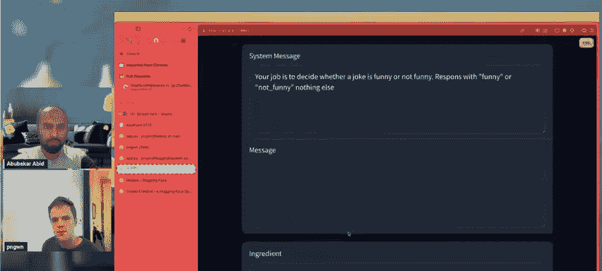

Look again， ignore the fact that it says ingredient。 I may have reused this demo from another demo。

 but I'll show you the app we've got here。 I don't want to go into。

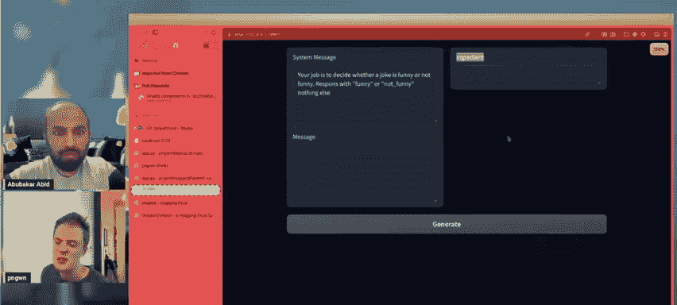

Too much detail。 Again， it's incredibly tiny。 Let me zoom in。

So what we've got here is where you're actually using kind of like Lama CPP。

 so we're running this model locally on my laptop。And one of the big benefits of radio is how close it is well。

 the fact that it is part of the Python ecosystem if you want to use the latest kind of cutting edge kind of technologies and libraries。

 you really need to be in the Python ecosystem or you need a way to access the Python ecosystem。

 there's certainly been you know a lot of development in other languages。

But it's kind of very difficult to get around the fact that everything comes to Python first and that is where the machine learning community is so being close to that ecosystem or having access to that ecosystem is in my opinion really really important if you want to experiment with the latest and greatest tools。

So here。We're using Lama CPP which runs and we're using it via Lama CPP Python。

 which is Python bindings to Lama CPP， and we are loading my probably my favorite local models used which is mixedural AX 7 V instruct it's a really nice model。

And we're actually going to use it with outlines， so what the role of this chatbot is I'll show you what it does first or can find so。

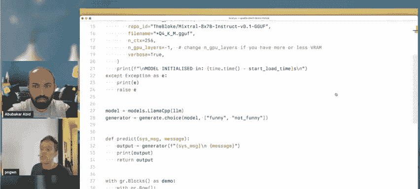

I can't type。So the role of this chatbot is to tell us if our joke is funny or not so it by the way。

 it seems to think an awful lot of things are funny when I tested this so if we take this joke why did the pengu join a band because he wanted to be in a flock band？

That is。That is funny。It's objectively funny。Let's see if Mion agrees， doesn't agree。Well。

 that's upsetting， but if we put something nonsensical。We're just put because of the cheese。

doesn't think that's funny either。What is cheese。I'm not sure this thing any oh it thinks that's funny that's a funny joke。

 So if you are considering a career in stand up maybe you want to pay attention to this。

 but anyway the。Efficacy aside， let's see how to integrate it into our application。😊。

What you'll notice here is we've got a large language model and it is giving us funny or not funny。

That's a very difficult thing to do if all you're doing is prompting it。

 but we're using a library called outlines。

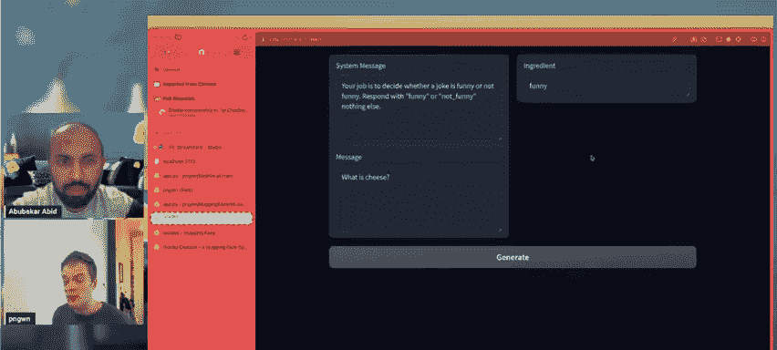

And you can let me。Outlines is a fantastic library that it basically helps you to generate kind of structured output from a language model there are integrations for Lama CPP。

 there are integrations for transformers for X Lama V2 V La member SM so it's a bunch of different integrations and what it allows you to do is to constrain the output of the language model So in our code。

We're using a little API called choices choice。So we load the model in using Lama CPP like so。

 and then we you know we store the model like this and then we create a generator and then in this generator we basically used this choice API there are other APIs where you can pass a for example。

 the pedantic data model in or you can pass a regular expression in and you can use that as a kind of a constraint to kind of guide the output of the language model but in this case。

We're just using funny or not funny and this could obviously be you know it could be any kind of set of set of literals in this way。

 it could be you know red blue blue and green or you know so on and so forth and and what we basically do is we just kind of use the generator here so we're just passing our message。

We're just doing something very basic we should be using as some kind of a chat template here really。

 but we're just passing we're just concatennate the system message and then our actual message so。

In the system we're telling it to analyze the joke and in the message it is the joke and then but it will the generator will constrain it to one of these values funny or not funny and that way we can guarantee that we get those kinds of get the correct result because if we wanted to kind of use this in you know to pass it to another API use in a pre programmatic way if you wanted to do things like tool calling and stuff having structured output is critically important having guaranteed structured output is incredibly powerful now you can't get this。

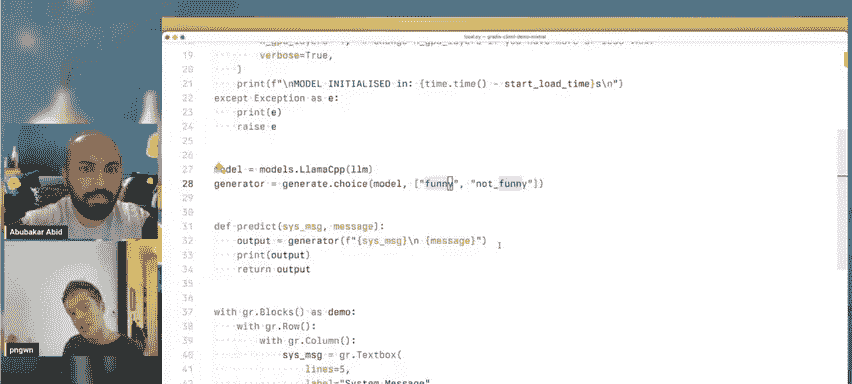

If you're not in Python， you know， you can't get this if you're using kind of。

 you know random APIs I know some providers do provide some support for constrained output。

But being this close to the metal， the way outlines works， it needs to be really close to the model。

 it needs to have access to the different kind of like layers of that kind of LLM inference process。

So being in Python is key。 So even， you know， if you're comfortable with Apis。

 you're happy with APIs， there's a whole world of experimentation that's available if you。

knowIf you dive into the Python ecosystem as well。That right。 Let's jump into。 Let's go to our。

 we've got our little page here， which we can。Is my joke funny， The rendering is kind of。

Its very strange here because I somewhat run out of time。

 But what we're going to do is we're going to hook this up。 So we've got our。

And essentially the same thing is true。 So if I go back， sorry to the demo here。

 there's a use via API thing。Again， and it just shows your local host。 So again。

 a great way to experiment without kind of like bring up a massive bill。I to use local models。

 use quantized models with Alma CPP and I'm not going to basically just copy this except I'm going to copy one that's already got some information filled in。

So we'll jump back into here， we'll go into our judge， which again， it's very same， it's very。

 you know， it's a similar setup。We're basically saying。Is that really？That's not。

 that's not the that's not what we want。What we want is if I can get out of this menu。

 we want this prompt。So I'm going to take this prompt。嗯。We're going to pop it into here。어요 일단？And。

I think that's probably it。Let's go find out。So。Is my joke funny， I will， I think I' can get a joke。

Ft band， obviously， same joke again and again。咁。Is it funny？

It's funny it's funny it's funny now it wasn't funny before but it's funny now so as you can see my application my job generator needs a little bit more work hopefully we'll put this up on GiHub so people can of kind of take a look along with all the demos and stuff and links in the read me on how to run it and how to replicate this and hopefully someone can make it a lot better than it is at the minute so hopefully that kind of explains。

😊，Something that might approach a workflow that you might kind of enjoy when working with various models。

 I think part of the challenge is not just kind of building demos and stuff but it kind of exploring the ecosystem is exploring kind of you know which model is best for which task and you by kind of looking through you know looking at your different tasks and the different libraries。

 looking at what's trending and what's kind of like popular。

 you can really kind of start to get a feel for you know and then being able to kind of go in and look at spaces that are using things and experiment with them and duplicate them and try them in your own applications and whether you're working locally。

 whether you're working with kind of private spaces or with public spaces。

 hopefully this is kind of demonstrated like how you might go about that and what that might look like so thanks I think back to you Buca。

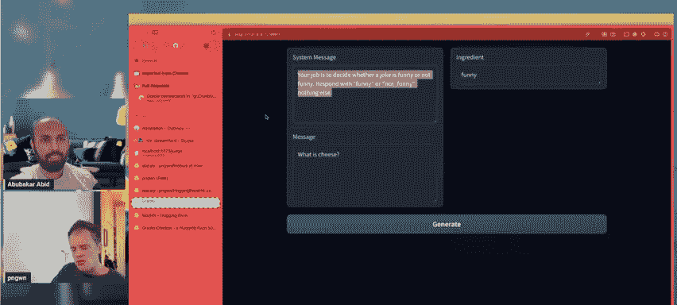

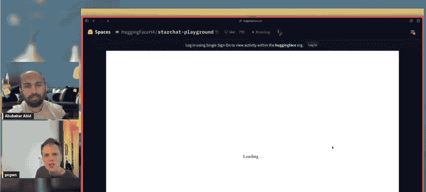

Thanks so much Pete for those live demos so with Pete's demos you saw an example of radioio running a machine learning model that's running via the Huging face inference API you saw one example we' running on spaces hardware itself and then one example we's running locally so hopefully that kind of demonstrates you all of the different possibilities and you there's more of where where the model can be running and then how you can use a client in different applications。

😊。

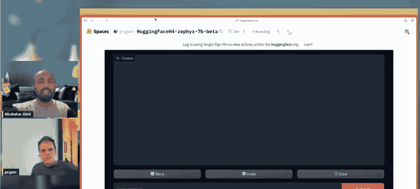

So with that I will go back to the slide real quickly and just recap so to recap this presentation I think hopefully everyone has seen that radio now lets you go from prototype to production really fast out of the box as soon as you build a radio application you get automatic documentation you get an API recorder that lets users interact with the with the UI and then reconstruct that interaction in code and you also get API monitoring as well so today we also announce the first major release of the Python and ja clients the 1。

0 release so take a look the change log is on Gitthub as well as on the radio website so we've tried to make the ja and Python client very ergonomic very easy to use and then again transparent and then also super portable you can run anywhere where you can run Python or ja and there's been questions about this as well in the chat but yeah you can also directly access it with curl or other libraries like。

As well。And the clients， as we mentioned， as Hannah mentioned。

 they're already being used in production， they're being used in hugging chat and in other places and we're very。

 very excited for you to try them and let us know what other kinds of things that you would like to see in the clients who actively working on them and I would love for you to share your feedback with us。

And with that thank you so much for your attention。

 if you have questions about usage the clients are up on our website on the docs I have a link in the bottom left and it looks like we have like maybe six7 minutes for questions as well so if there's any questions that you we have not answered yet in the chat feel free to ask them now and myself or one of the team members are happy to answer them thank you so much for joining。

All right so we have we have a couple of questions so one one question is what would be the use case for not using radio in which case should you simply use a kind of you know build your own web development framework so it's a good question hopefully I think what we've shown is there's lots and loss of reasons to use radio there's lots of benefits that you get and you know out of the box one of the things you haven't really you know talked too much about is。

You know， when you build a radio application it's not just the UI it's not just like what you can see in front of you。

 but there's an entire back and there's a queuing system that actually we didn't mention a little bit El Ait touched upon this that can handle large volumes of requests and the queuees are very very easy to manage as well so lots of reasons why you might want to use radio when should you simply use kind of standard web development framework yourself maybe in very custom use cases if you are scaling to millions and millions of users and every you know there's lots of optimizations you want to do which you cannot do in radio you might want to do that it used to be some of the cases where you people search away from radio would be things related to customization and styling。

So for example you might want to make your UI look very different we now support themes so that's not really a kind of use case anymore it used to be sometimes when you want to build a very custom component you will search away from radio but now we support the idea of custom component so you can actually build your you can bundle a little bit of Python and JavaScript and create a component that works within radio and it even works within the API so it'll like the clients will work with it and you know all of that good stuff so。

嗯。So there's a few more questions here。嗯。So some feedback on the docs that's great for that kind of feedback you're welcome to create an issue on our website well on our GitHub repo as well and we're happy to answer it there。

I made to question there， let's see here。Question about。Python code for the examples， yes， Pete。

 are you planning on sharing the Python code or like the I think the code for your examples anywhere。

 I'll add you back to the stage。Yes， yeah， yeah， there will be a。

We'll create a repo I think with some examples and we'll put both the kind of the front end app and all of the local example as well as maybe links to the the spaces that we use in this demo so you should be able to replicate the whole thing and we'll get we'll try and get a hosted version of the app as well obviously we'll improve it a little bit but yeah we'll watch Twitter I guess for an announcement on Word。

Yeah awesome in our Twitter let me just go ahead and add that here live as well。

 so if we do a lot of announcements on Twitter so Twitter is probably the go to place if you'd like to stay up to date。

 so I'll add our Twitter handle here as well as just add radio。

Okay， great， till we have a comment here that。Someone built an education app using radio with more than a000 students。

 that's awesome。嗯。ok。Sweet，a， if there's any other questions。

 we have a couple more minutes for questions。If not that's fine as well。

 thank you again everyone for joining us we're super excited to have you all try the Gio clients as well as use Gd in production and we're here if you have any more questions we're here on Twitter。

 we also have a discord an active Discord server so feel free to find us。😊，Thank you so much。

 everyone。嗯。嗯。嗯。