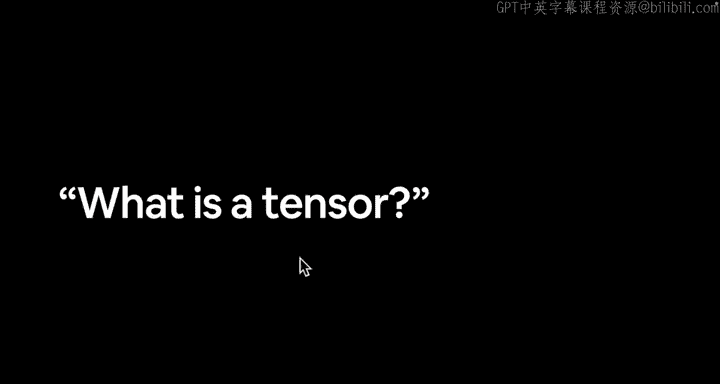
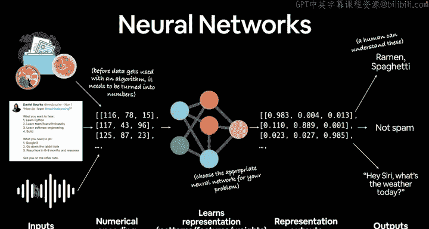
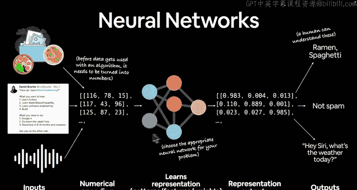
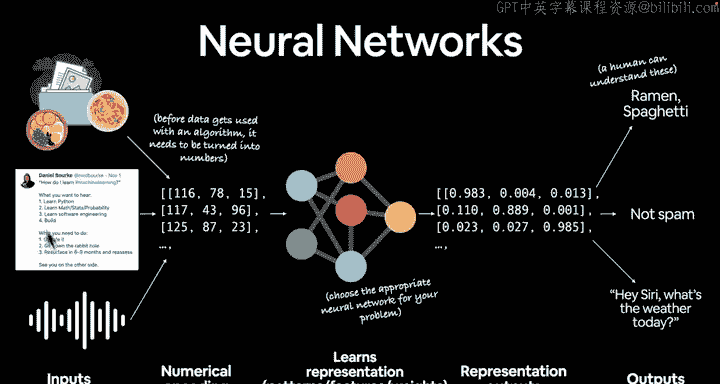
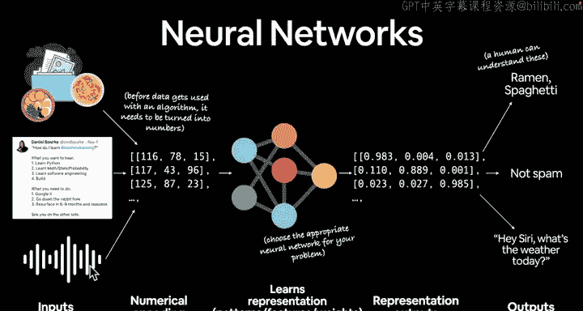
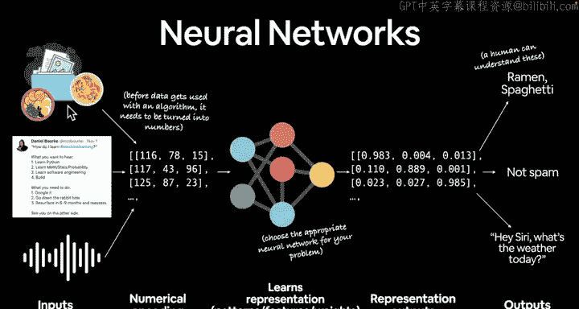
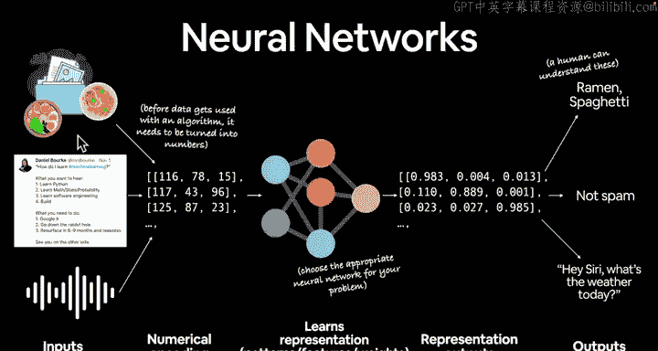
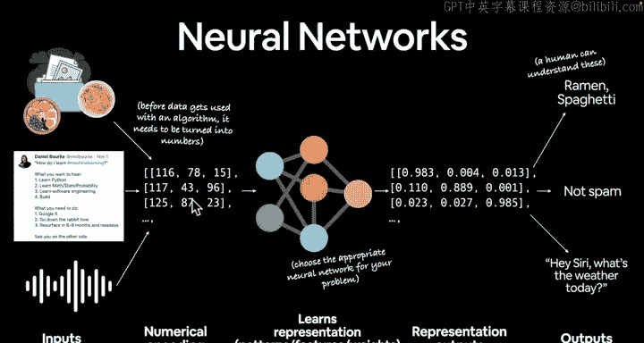
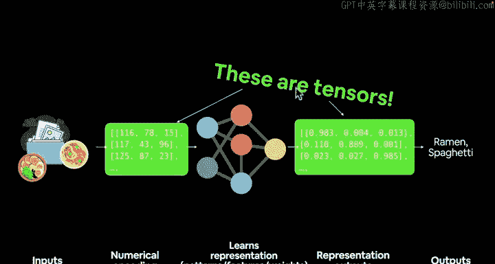

# mrdbourke《一天学会pytorch深度学习｜Learn PyTorch for deep learning in a day Literally》中英 - P10：8. What are tensors.zh_en - GPT中英字幕课程资源 - BV1kx4y1r79d

Last video， I left you on the cliffhanger question of what is a tensor。

 and I also issued you the challenge to research what is a tensor， because as I said。

 this course isn't all about telling you exactly what things are。

 It's more so sparking a curiosity in you so that you can stumble upon the answers to these things yourself。

 But let's have a look。 What is a tensor。 Now， if you remember this graphic。

 there's a look going on here。 but this is our neural network。 we have some kind of input。

 some kind of numerical encoding。 Now， we start with this data in our case。

 it's unstructured data because we have some images here， some text here and some audio file here。

 Now， these necessarily don't go in all at the same time。

This image could just focus on a neural network specifically for images。

 This text could focus on a neural network specifically for text。

 and this sound bite or speech could focus on a neural network specifically for speech。 However。

 the field is sort of also moving towards building neural networks that are capable of handling all three types of inputs。

 For now， we're going to start small and then build up the algorithms that we're going to focus on a neural networks that focus on one type of data。

But the premise is still the same。 You have some kind of input。

 You have to numerically encode it in some form， pass it to a neural network to learn representations or patterns within that numerical encoding。

Output some form of representation， and then we can convert that representation into things that humans understand。

And。You might have already seen these， and I might have already referenced the fact that these are tensors。

 So when the question comes up， what are tensors， a tensor could be almost anything and it could be almost any representation of numbers。

 We're going to get very hands on with tensors。 And that's actually the fundamental building block of pi torch。

 A from neural network components is the torch dot tensor。 We're going to see that very shortly。

But this is a very important takeaway I that you have some sort of input data。

 You're going to numerically encode that data， turn it into a tensor of some kind。

 Whatever that kind is will depend on the problem you're working with。

Then you're going to pass it to a neural network， which will perform mathematical operations on that tensor。

 Now， a lot of those mathematical operations are taken care of by Pytorch behind the scenes。

 So we'll be writing code to execute some kind of mathematical operations on these tensors。 and then。

The neural network that we create or with the one that's already been created。

 but we just used for our problem will output another tensor。Similar to the input。

 but has been manipulated in a certain way that we've sort of programmed it to。

 And then we can take this output tensor and change it into something that a human can understand。So。

To remove a lot of the text around it make it a little bit more clearer。

If we were focusing on building an image classification model so we wanted to classify whether this was a photo of ramen or spaghetti。

 we would have images as input， we would turn those images into numbers which are represented by a tensor。

 We would pass that tensor of numbers to a neural network or there might be lots of tensors here。

 we might have 10，000 images， we might have a million images or in some cases。

 if yourre Google or Facebook you might be working with 300 million or a billion images at a time。

The principle still stands that you encode your data in some form of numerical representation。

 which is a tensor， pass that tensor or lots of tensors to a neural network。

 The neural network performs mathematical operations on those tensors。Outputs are tensor。

 we convert that tensor into something that we can understand as humans。And so with that being said。

 we've covered a lot of the fundamentals。 What is machine learning， What is deep learning。

 What is neural network， Well， we've touched the surface of these things。

 You can get as deep as you like。 We've covered why use Pytorrch。 What is pieytorrch。 Now。

 the fundamental building block of deep learning is tenses as。 We've covered that。

 Let's get a bit more specific in the next video of what we're going to cover code wise in this first module。

 Oh I'm so excited。 we're going to start code soon。😊。

I'll see you in the next video。Now it's time to get specific about what we're going to cover code wise。

😡。