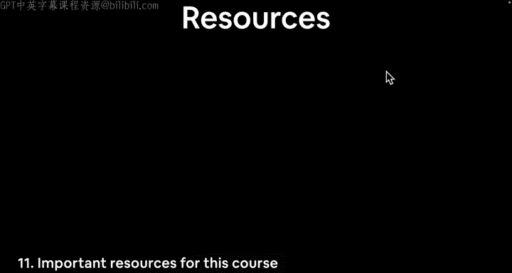
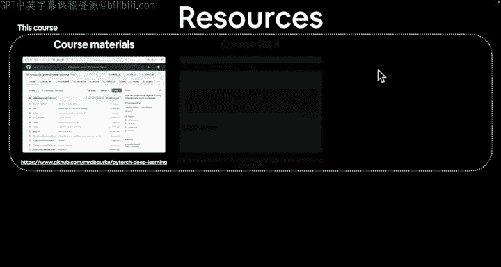
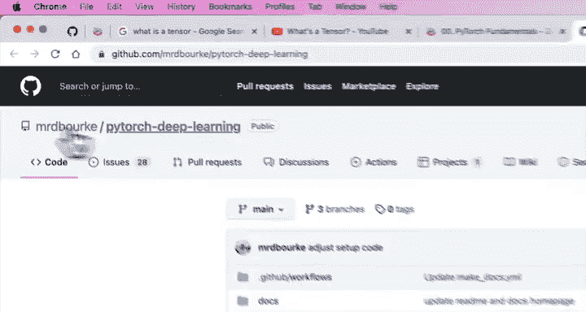
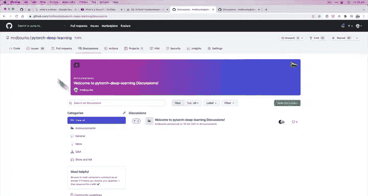
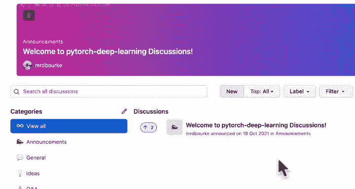
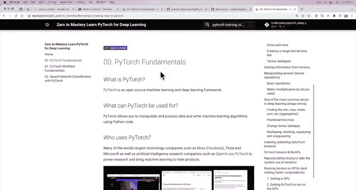
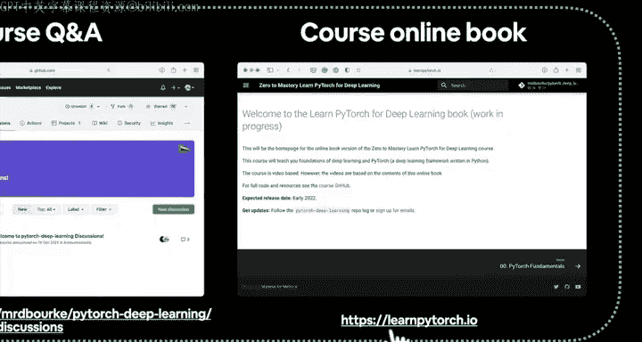
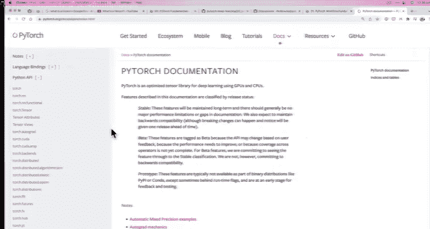
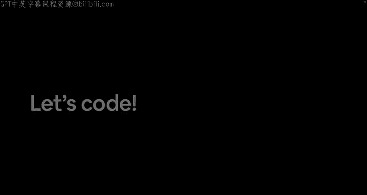

# mrdbourke《一天学会pytorch深度学习｜Learn PyTorch for deep learning in a day Literally》中英 - P13：11. Important resources.zh_en - GPT中英字幕课程资源 - BV1kx4y1r79d

Now， there are some fundamental resources that I would like you to be aware of before we go any further in this course。

 These are going to be paramount to what we're working with。 So for this course。

 there are three things。

There is the GitthHub repo， so if we click this link。I've got a pin on my browser。

 You might want to do the same while you're going through the course。 But this is Mr。

 De Burke and my Github slash Pytor deep learning。 It is still a work in progress at the time of recording this video。

 But by the time you go through it， it won't look too much different。

 but there just be more materials。 You'll have materials outline section。 What does it cover。

 as you can see some more are coming soon at the time of recording this。

 So these will probably be done by the time you watch this Exercis and extra curriculum there will be links here。

 Basically， everything you need for the course will be in the Github repo。 And then if we come back。

😊。

Also on the GitHub repo， the same repo。So Mr。 De Burke slashed pie torch deep learning。

If you click on discussions。😊，This is going to be the Q And A。 This is just the same link here。

 The Q And A for the course。 So if you have a question here， you can click new discussion。

 you can go。Q& A， and then type in video and then the title， pietorrch。Fundamentals。And then。

Go in here。Or you could type in your error as well， what is N dimm for a tensor？And then in here。

 you can type in some stuff here， hello Im having trouble on video X Y Z put in the name of the video so that way I can or someone else can help you out and then code。

 you can go three backtics， write Python and then you could go import torch， torch。Dot Ran。

 which is going to create a tensor。 We're going to see this in a second。 ya ya， ya。

 And then if you post that question。The formatting of the code is very helpful that we can understand what's going on。

 and what's going on here。 So this is basically the outline of how I would ask a question video。

 This is going on。 What is such and search for whatever's going on。 Hello。

 this is what I'm having trouble with， Here's the code and here's what's happening。

 You could even include the error message。 And then you can just click start discussion。

 And then someone either myself or someone else from the course， will be able to help out there。

 And the beautiful thing about this is that it's all in one place。 you can start to search it。

 there's nothing here yet because the course isn't out yet。 But as you go through it。

 there will probably be more and more stuff here。 Then if you have any issues with the code that you think needs fixed。

 You can also open a new issue there。 I'll let you read more into what's going on。

 I've just got some issues here already about the fact that I need to record videos for the course。

 I need to create some stuff。 But if you think there's something that could be improved。

 make an issue。 if you have a question about the course。😊。

Ask a discussion。 And then if we come back to the keynote， we have one more resource。

 So that was the course materials all over the Github。

 The course Q& A is on the course Githubs Disc tab， and then the course online book。Now， this is。

A work of art。 This is quite beautiful。 It is some code to automatically turn all of the materials from the Github。

 So if we come into here code， if we click on Note 0，0。

 This is going to sometimes if you've ever worked with Jupyter notebooks on Github。

 they can take a while to load。 So all of the materials here automatically get converted into this book。

😊，So the beautiful thing about the book is that it's got different headings here。 It's all readable。

 It's all online。 It's going to have all the images there。 you can also search some stuff here。

 Pytorage， training steps。😊。

Creating a training loop and pietorrch。Beautiful， we're going to see this later on。

 So there are the three big materials that you need to be aware of the three big resources for this specific course。

 materials on Github course， Q and A course online book。

 which is Learn Ptorch dot I O simpleple URL to remember all the materials will be there。 and then。😊。

Specifically for Pytorch， all things pytorch， the Pytorch website and the pytorch forums。

 So if you have a question that's not course related， but more pytorch related。

 I'd highly recommend you go to the Pytorch forums， which is available at discuss pytorch org。

 we've got a link there。 and the pytorch website， Pytorch org。

 This is going to be your home ground for everything Pytorch of course。

 We have the documentation here。 And as I said， this course is not a replacement for getting familiar with the pytorch documentation。

 This the course actually is built off all of the pytorch documentation。

 It's just organized in a slightly different way。 So there's plenty of amazing resources here on everything to do with pytorch。

 This is your home ground。 And you're going to see me referring to this a lot throughout the course。

 So just keep these in mind， Co materials on Github course discussions。 Learn Pytorch doo。

 This is all for the course。 and all things Pytorch specific。 So not necessarily this course。😊。

Just Pytorch in general， the Pytorch website and the Pytorch forums， with that all being said。

We've come so far。 We've covered a lot already， but。Guess what time it is。

Let's write some code。 I'll see you in the next video。

