# mrdbourke《一天学会pytorch深度学习｜Learn PyTorch for deep learning in a day Literally》中英 - P14：12. Getting setup.zh_en - GPT中英字幕课程资源 - BV1kx4y1r79d

We've covered enough of the fundamental so far well， from a theory point of view。

 let's get into coding。 So I'm going to go over to Google Chrome。

 I'm going to introduce you to the tool， one of the main tools we're going to be using for the entire course。

 And that is Google coabab。 So the way I would suggest following along with this course is remember。

 one of the major ones is to code along。 So we're going to go to coab do research do Google。

 I've going to typo here classic， you're gonna to send me to lots of typos throughout this course。

 coab dot research dot Google dot com。 This is going to load up Google coab。 Now。

 you can follow along with what I'm going to do。 But if you'd like to find out how to use Google coabab from a top down perspective。

😊。

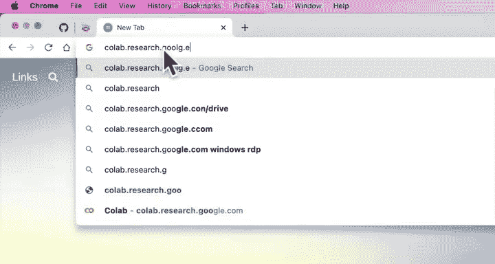

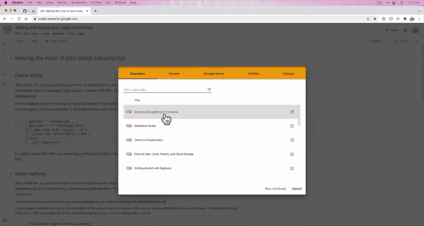

You can go through some of these。 I'd probably recommend going through overview of collaboratory features。

 but essentially， what Google Coabab is going to enable us to do is create a new notebook。

 And this is how we're going to practice writing Pytorch code。

 So if you refer to the reference document of learn Pytorch do I O。

 These are actually collab notebooks just in book format。 So online book format。

 So these are the basis materials for what the course is going to be。 There's going to be more here。

 But every new module we're going to start a new notebook。 And I'm going to just zoom in here。😊。

So this one， the first module is going to be 0，0 because Python code starts at 0，0。

 And we're going to call this Pytorage fundamentals。

 I'm going to call mine video just so we know that this is the notebook that I wrote through the video。

 And what this is going to do is if we click connect。

 Its going to give us a space to write Python code。 So here we can go print。 Hello。

 I'm excited to learn。😊，Pietorrch。And then if we hit shift and enter， it comes out like that。

 But another beautiful benefit of Google Coab or P S， I'm using the pro version。

 which costs about $10 a month or so that price may be different depending on where you're from。

 The reason I'm doing that because I use coab all the time。 However。

 you do not have to use the paid version for this course， Google Coabab comes with a free version。

 which you'll be able to use to complete this course。 If you see it worthwhile。

 I find the pro version is worthwhile。😊。

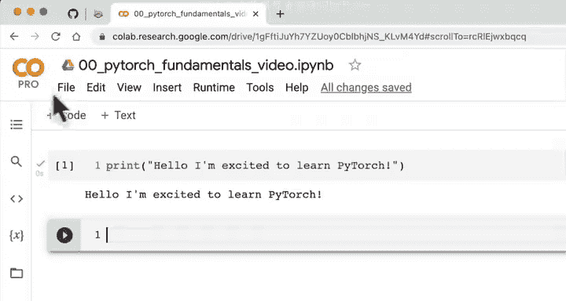

Now the benefit of Google coab is if we go here， we can go to run time。

 Let me just show you that again。 runtime， change runtime type， hardware accelerator。

 and we can choose。

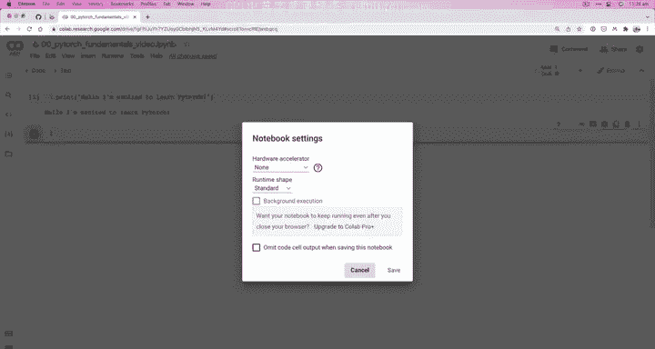

To run our code on an accelerator here。 Now， we've got GPU and TU。

 we're gonna be focused on using GPU。 If you'd like to look into TpU， I'll leave that to you。

 but we can click GPU， click save And now our code。 If we write it in such a way will run on the GPU。

 Now we're gonna to see this later on。 code that runs on the GPU is a lot faster in terms of compute time。

 especially for deep learning。 So if we write here， Nvidia Smi。 We now have access to a GPU。

 In my case， I have a Tesla P100。 It's quite a good GPU。

 You tend to get the better GPUus if you pay for Google coabab。 If you don't pay for it。

 you get the free version， you get a free GPU。 It just won't be as fast as the GPUs you typically get with the paid version。

 So just keep that in mind。 whole bunch of stuff that we can do here。

 I'm not going to go through it all because there's too much。 but。

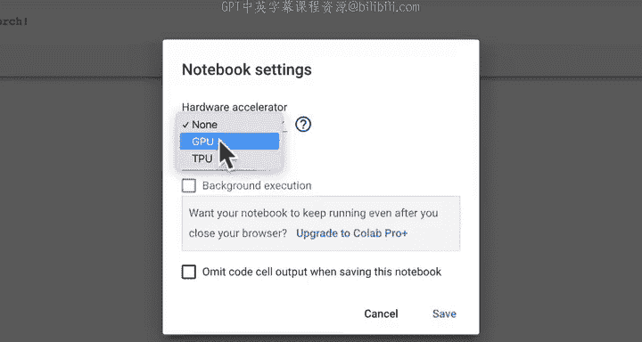

We've covered basically what we need to cover。AndSo if we just come up here。

 I'm going to write a text cell。 So O， O dot。Pietorrch fundamentals。 and I'm going to link in here。

Resource notebook。 Now you can come to learn Pytorch。

 Ao and all the notebooks are going to be in sync。 So 0，0， we can put this in here。

 Resource notebook is there。That's what。This notebook is going to be based off this one here。

 And then if you have a question about what's going on in this notebook。

You can come to the course Github， and then we go back。Back。

 this is where you can see what's going on。 This is Pytoch deep learning projects。

 As you can see what's happening at the moment， I've got Pytorch course creationca I'm in the middle of creating it。

 But if you have a question， you can come to Mr。 Deburgke slash Pytorch deep learning slash discussions。

 which is this tab here， and then ask a question by clicking new discussions。

 So any discussions related to this notebook。 You can ask it there。

 And I'm going to turn this right now， This is a code cell。

 Coab is basically comprised of code and text cells。

 I'm going to turn this into a text cell by pressing command M M。😊。

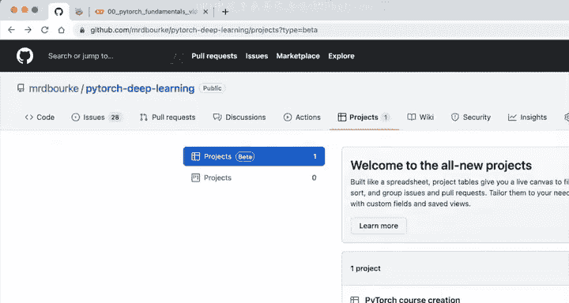

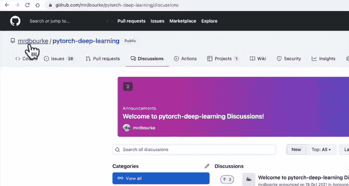

Shift and enter。 Now we have a text cell。 And then if we wanted another code cell。

 we could go like that。 T， code， text， code， yada， yada， ya。 But I'm going to delete this。

And to finish off this video， we're going to import pie torch。So we're going to import torch。

 and then we're going to print。Torch dot， dot。Version。

 so that's another beautiful thing about Google Coab is that it comes with Pytorrch pre installed and a lot of other common Python data science packages。

 such as we could also go import pandas。😊，As PDd。Import NI S MP， importm Mapl Lib。Dot pie as PLT。

This is。Google Collab is by far the easiest way to get started with this course。

 You can run things locally。 If you'd like to do that， I'd refer to you to。

Plytoch deep learning is going to be set up。t M。

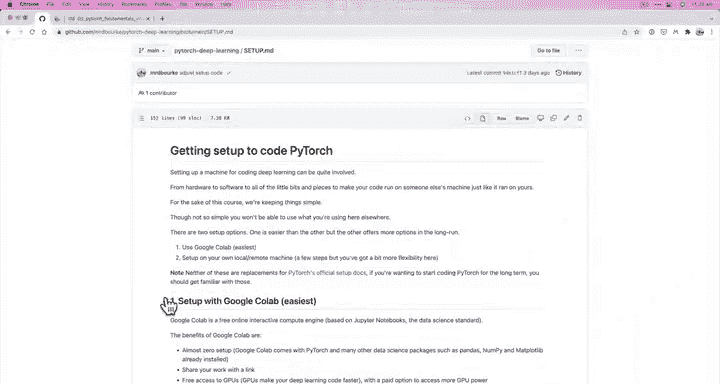

Getting set up to code Pitorrch， we've just gone through number one， setting up with Google Co Lab。

There is also another option for getting started locally。 Right now。

 this document a work in progress， but'll be finished by the time you watch this video。

 This is not a replacement， though， for the Pytorrch documentation for getting set up locally。

 So do youd like to run locally。

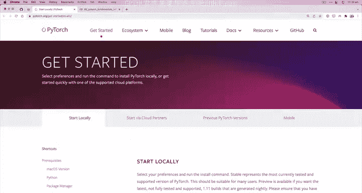

On your machine rather than on Google CoLab， please refer to this documentation or setup up。 Md here。

But if you'd like to get started as soon as possible， I'd highly recommend you using Google Coab。

 In fact， the entire course is going to be able to be run through Google Co La。

 So let's finish off this video。 Make sure we've got pitorrch ready to go。😊，And of course。

 some fundamental data science packages here。 Wo。 This means that we have Pytorch 1。10。0。

 So if your version number is far greater than this。

 maybe you're watching this video a couple of years in the future and Pytorch is up to 2。11。

 maybe some of the code in this notebook won't work。 But 1。10。

0 should be more than enough for what we're going to do。 and plus Co 111。

 see you 111 is stands for Kuda version  11。1， I believe and what that would mean is if we came in here and we wanted to install it on Linux。

 which is what Coab runs on。 there's Mac and Windows as well。 we've gotuda， Yeah， So right now。

 as of recording this video， the latest pytorch build is 1。10。2。 So you'll need at least Pytorch 1。

10 to complete this course。 and Kuda 11。3。 So that's Kuda toolkit。 if you remember Couda toolkit。😊。

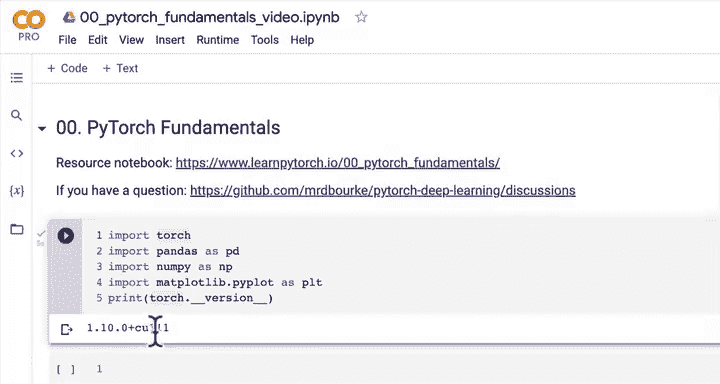

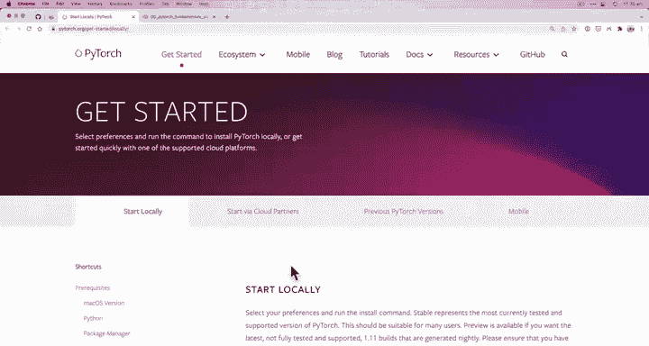

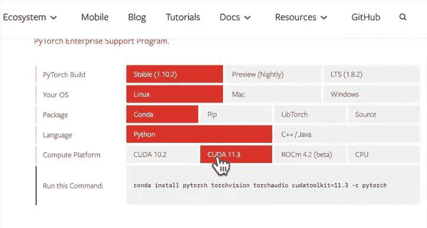

Is Navidia's。Programming， there we go。 Nvidia developer Kuda is what enables us to run our Pytorrch code on Novidia GPus。

 which we have access to in Google Colab。 beautiful。 So we're set up ready to write code。

 Let's get started in the next video writing some pietorrch code。 This is so exciting。😊。

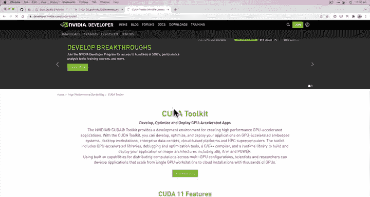

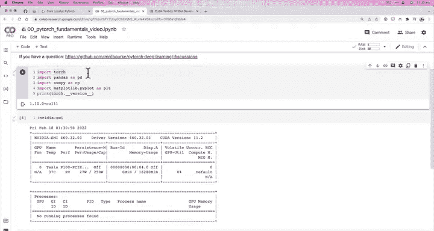

I'll see you there。