# mrdbourke《一天学会pytorch深度学习｜Learn PyTorch for deep learning in a day Literally》中英 - P15：13. Introduction to tensors.zh_en - GPT中英字幕课程资源 - BV1kx4y1r79d

So we've got setup up。 We've got access to Pitorrch。 We've got a Google coab instance running here。

 We've got a GPU because we've gone up to runtime， change runtime type， hardware accelerator。

 You won't necessarily need a GPU for this entire notebook。

 but I just wanted to show you how to get access to a GPU because we're going to be using them later on。

 So let's get rid of this。

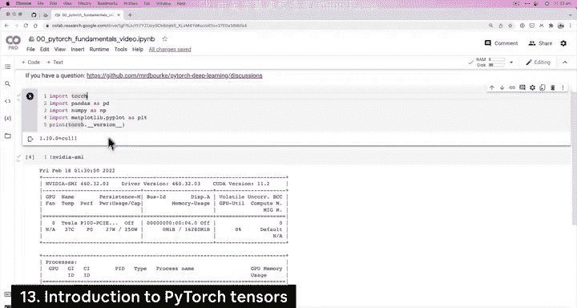

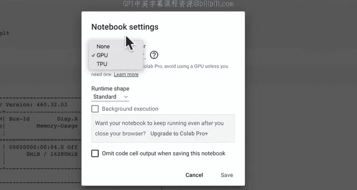

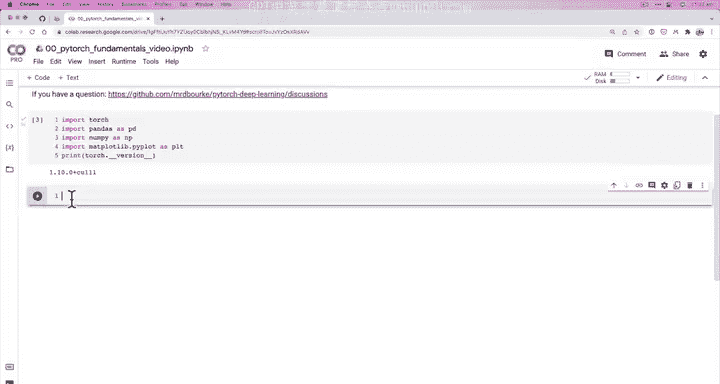

And one last thing， how I'd recommend going through this course is in a split window fashion。

 So for example， you might have the video where I'm talking right now and writing code on the left side。

 and then you might have another window over the other side with your own coabab。

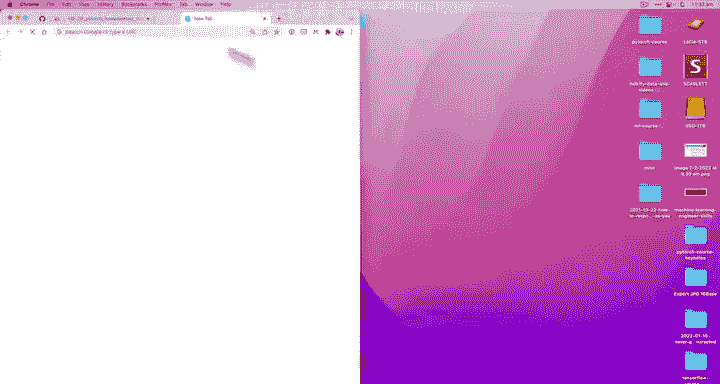

Window and you can go a new notebook。Call it whatever you want。 My notebook。

 You could call it very similar to what we're writing here。

 And then if I write code over on this side。On this video。You can't copy it， of course。

 but you'll write the same code here and then go on and go on and go on。 And if you get stuck。

 of course， you have the reference notebook and you have an opportunity to ask a question here。

 So with that being said， let's get started。 The first thing we're going to have a look at in Pytorrch is an introduction。

To tenses。So tens are the main building block of deep learning in general or data。

And so you may have watched the video what is a tensor？For the sake of this course。

 tensors are a way to represent data， especially multidisional data， numeric data that is。

 but that numeric data represents something else。 So let's go in here， creating tensors。

 So the first kind of tensor we're going to create is actually called a scalar。

 I know I'm going to throw a lot of different names of things at you。

 but it's important that you're aware of such nulanclature。 even though in pytorage。

 almost everything is referred to as a tensor， there are different kinds of tensors。

 And just to exemplify the fact that we're using a reference notebook， if we go up here。

We can see we have importing py toage。 We've done that。 Now， we're up to introduction to tensors。

 We've got creating tensors， and we've got scalar， et cetera， et cetera， et cetera。

 So this is what we're going to be working through。 Let's do it together。 So scalar。😊。

The way to oops， what have I done there， the way to create a tensor in pitorrch。

 we're going to call this scalar equals torch dot tensor。

 and we're going to fill it with the number 7。 And then if we press or retype in Scalar。

 what do we get back？7， wonderful。 And it's got the tensor data type here。

 So how would we find out about what torch dot tensor actually is， Well let me show you how I would。

 We go to torch dot tensor。😊。

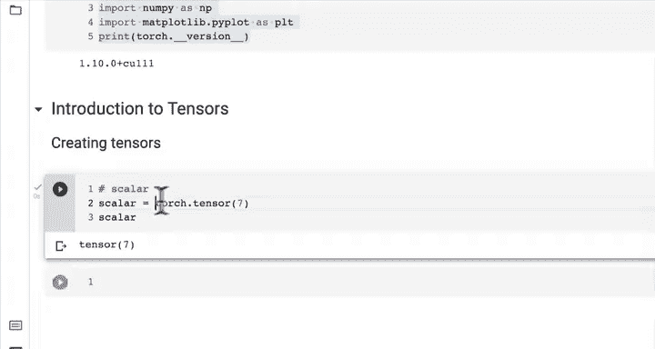

There we go。 We've got the documentation。 So this is possibly the most common class in Pytorch other than one we're going to see later on that you'll use。

 which is torch dot N N。Basically everything in Pytorch works off torch。

10 and and if you'd like to learn more， you can read through here， In fact。

 I would encourage you to read through this documentation for at least 10 minutes after you finish some videos here。

 So with that being said， I'm going to link that in here。So Ptorrch tensors are created using。Torch。

 not tensor。And then we've got that link there。Oops，typoical law， Daniel， come on。

 You're better than this。 Now I'm kidding。 There's got be typocal law through the old course。 Okay。

 now what are some attributes of a scalr。 So some details about scalrs。

 Let's find out how many dimensions there are。 Oh， and by the way， this warning， perfect timing。

 Google coab will give you some warnings here。 depending on whether you're using a GPU or not。 Now。

 the reason being is because Google coab provides GPUus to you and I for free。 However。

 GPUs aren't free for Google to provide。 So if we're not using a GPU， we can save some resources。

 allow someone else to use a GPU by going to none。 And of course， we can always switch this back。

 So I'm going to turn my GPU off so that someone else out there。 I'm not using the GPU at the moment。

 they can use it。😊。

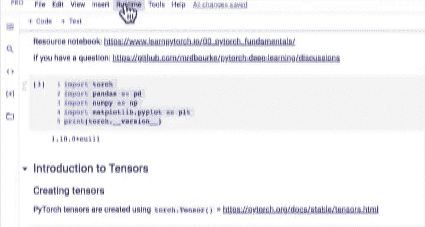

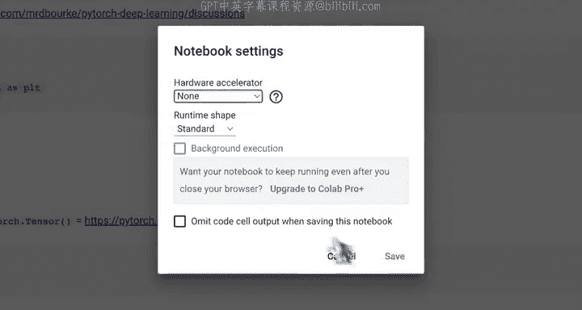

So what you're also going to see is if your Google coab instance ever restart up here。😡。

We're going to have to rerun these cells。 So if you stop coding for a while。

 go have a break and then come back and you start your notebook again。

That's one downside of Google Coabab。 is that it resets after a few hours。

 How many hours I don't know exactly the reset time is longer if you have the pro subscription。

 but because it's a free service and the way Google calculate usage and all that sort of stuff。

 I can't give a conclusive evidence or conclusive answer on how long until it resets。

 But just know if you come back， you might have to rerun some of your cells。

 and you can do that with shift and enter。 So a scalr has no dimensions。 it's just a single number。

 But then we move on to the next thing。Or actually。

 if we wanted to get this number out of a tensor type， we can use Scalar dot item。

 This is going to give it back as just a regular python integer。Wonderful。

 there we got the number 7 back。 get tena。Back as Python。

And now the next thing that we have is a vector。 So let's write in here。 vector， which， again。

 is going to be created with torch dot tensor。 But you will also hear the word vector used a lot。

 too。 Now， what is the deal， Oops，7。t 7。Google Coab's autocomple is a bit funny。

 It doesn't always do the thing you want it to。 So if we see a vector。We've got two numbers here。

 and I we wanted to find out what is a vector。So a vector usually has magnitude and direction。

So what we're going to see later on is there we go。 magnitude。

 how far it's going and which way it's going。 And then if we plotted it， we've got， yeah。

 a vector equals the magnitude would be the the length here and the direction would be where it's pointing。

And， here we go。 Scalar vector matrix tenor。 This is what we're working on as well so。😊。

The thing about vectors， how they differ with scalers is how I just remember them is rather than magnitude and direction is a vector typically has more than one number。

 So if we go vector and dim， how many dimensions does it have。It has one dimension。

 which is kind of confusing。 But when we see tensesors with more than one dimension。

 it'll make sense。 And another way that I remember how many dimensions something has is by the number of square brackets。

 So let's check out something else。 Maybe we go vector。Dot Sha。Shape is 2。

 So the difference between dimension。 So dimension is like number of square brackets。 And when I say。

 even though there's two here， I mean， number of pairs of closing square brackets。

 So there's one pair of closing square brackets here。 But the shape of the vector is 2。

 So we have two by one elements。 So that means a total of two elements。 Now。

 if we wanted to step things up a notch。Let's create a matrix。

 So this is another term you're going to hear。 and you might be wondering why I'm capitalizing matrix well。

I'll explain that in a second matrix equals torch do tensor。

 and we're going to put two square brackets here。 you might be thinking what could the two square brackets mean or actually that's a little bit of a challenge if one pair of square brackets had an end dim of one。

 What will the end dimm B number of dimensions of two square brackets。So let's create this matrix。

Beautiful。So we've got another tensor here again， as I said。

 these things have different names like the traditional name of scalar vector matrix。

 but they're all still a torch dot tensor， that's a little bit confusing。

 but the thing you should remember in Plytorrch is basically any time you encode data into numbers。

 It's of a tensor data type， And so now how many number of dimensions， Do you think a matrix has。

It has two。 So there we go。 We have two square brackets。 So if we wanted to get matrix。

 let's index on the zeroth axis。 Let's see what happens there。So we get 7 and 8。

 and then we get off the first dimension。9 and 10。 So this is where the square brackets。

 the pairings come into play。 We've got two square bracket pairings on the outside here。

 So we have an end dimm of two。 Now， if we get the shape of the matrix。

 what do you think the shape will be。2 by two。 So we've got two numbers here。By2。

So we have a total of four elements in there。So we're covering a fair bit of ground here。

 nice and quick。 but that's going to be the teaching style of this courses。

 We're going to get quite hands on and writing a lot of code and just interacting with it。

 rather than continually going back over and discussing what's going on here。

 The best way to find out。What's happening within a matrix is to write more code that's similar to these matrices here。

 But let's not stop at matrix。 Let's upgrade to a tensor now。 So I might put this in capitals。

 as well。And I haven't explained what the capitals mean yet， but we'll see that in a second。

 So let's go tarch dot tensor。And what we're going to do is this time we've done one square bracket pairing。

 We've done two square bracket pairings。 Let's do three square bracket pairings and just get a little bit of venturous。

 Allright， And so you might be thinking at the moment， this is quite tedious。

 I'm just going to write a bunch of random numbers here，1，2，3，3，6，9，2，5，4。😊，Now。

 you might be thinking， Daniel， you've said tens could have millions of numbers。

 If we had to write them all by hand， that would be quite tedious。 And， yes， you're completely right。

The fact is， though， that most of the time you won't be crafting tensesors by hand。

 Pytorch will do a lot of that behind the scenes。 However。

 it's important to know that these are the fundamental building blocks of the models and the deep learning neural networks that we're going to be building。

So Tensor capitals as well。 We have three square brackets， so。Or three square bracket pairings。

 I'm just going to refer to three square brackets at the very start because they're going to be paired down here。

How many N dim or number of dimensions do you think our tensor will have。3， wonderful。

 And what do you think the shape of our tensor is， We have three elements here。

 We have three elements here，3 elements here， and we have 1，2，3。😊，So， maybe。Ourtensa。Has a shape of。

1 by three by3。 H， What does that mean。Well， we've got three。By 1，2，3。

 that's the second square bracket there。 by one So that's the first dimension there or the zeroth dimension。

 because remember pi torch is0 indexed。 we have， Well let's just， instead of talking about it。

 let's just get on the zeroth axis and see what happens with the zeroth dimension。There we go， Okay。

 so there's。This is the far left 1，0， which is very confusing because we've got a one here， but。So。

 we've got。Oops。Don't mean that。What this is saying is， we've got one。3 by3 shape tensor。

 So very outer bracket matches up with this。 number one here。

 And then this three matches up with the next one here， which is 1，2，3。

 And then this 3 matches up with this one，1，2，3。 Now， if you'd like to see this。

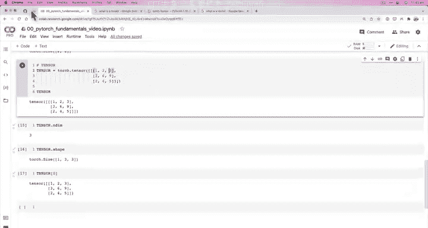

With a pretty picture， we can see it here。So， dim0。Lines up。 So the blue bracket。

 the very outer one lines up with the one。 Then dim equals one。 This one here， the middle bracket。

Lines up with the middle dimension here。 And then dim es2， the very inner。

Lines up with these three here。 So again， this is going to take a lot of practice。

 It's taken me a lot of practice to understand the dimensions of tensesors， but。

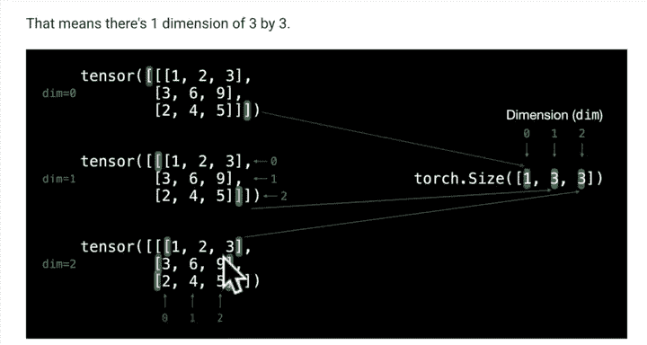

To practice， I would like you to write out your own tensor of you can put however many square brackets you want and then just interact with the end dimm shape and indexing。

Just as I've done here， but you can put any combination of numbers inside this tensor。

 That's a little bit of practice before the next video。

 So give that a shot and then we'll move on to the next topic。

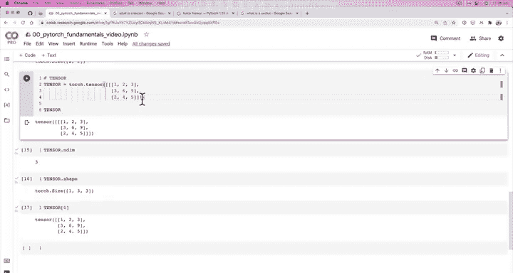

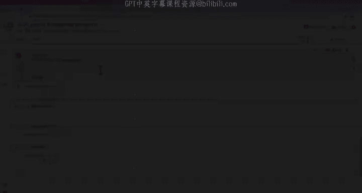

我是以的。Welcome back。