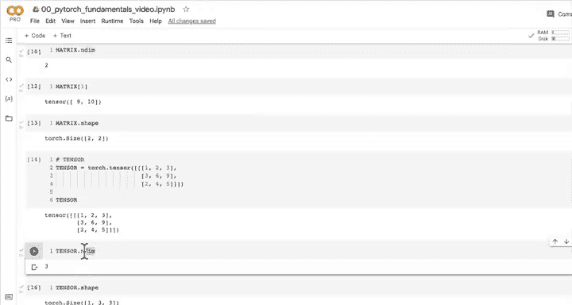
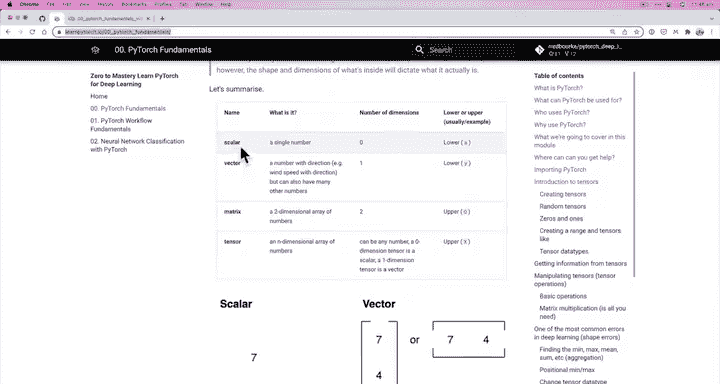
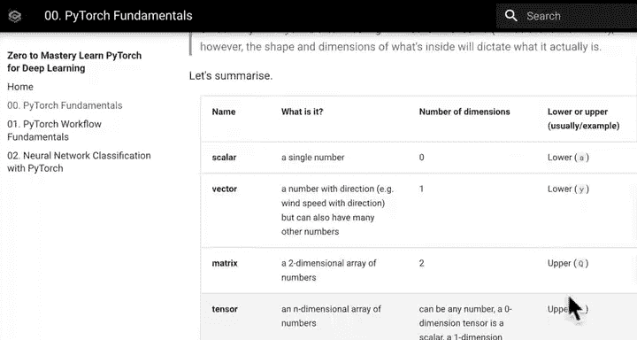
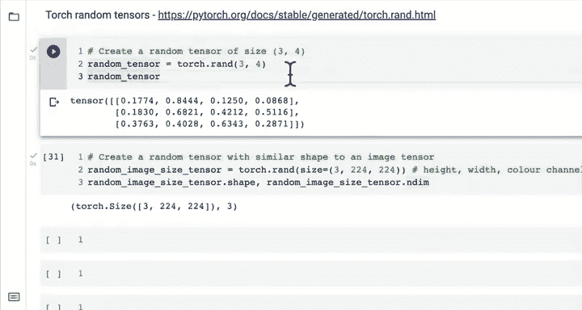
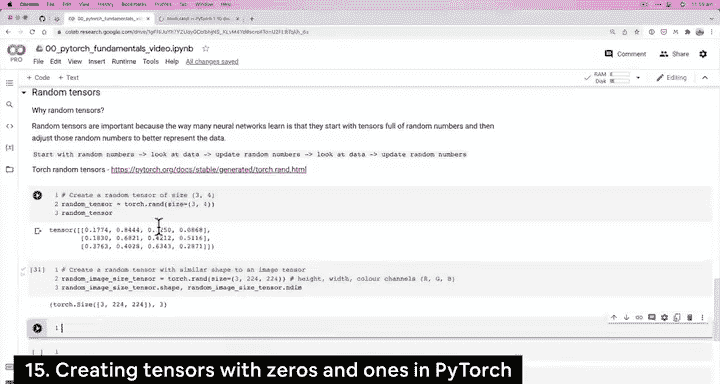
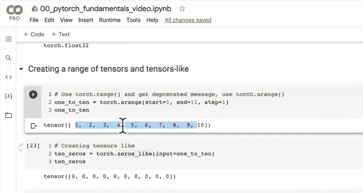
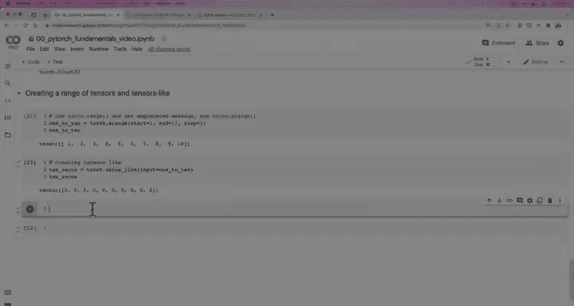

# mrdbourke《一天学会pytorch深度学习｜Learn PyTorch for deep learning in a day Literally》中英 - P16：14. Creating tensors.zh_en - GPT中英字幕课程资源 - BV1kx4y1r79d

In the last video， we covered the basic building blocks of data representation in deep learning。

 which is the tensor， or in pytorrch， specifically torch dot tensor。 But within that。

 we had a look at what a scalar is， we had to look at what a vector is。 We had a look at a matrix。

 We had a look at what a tensor is。 And I issued you the challenge to get as creative as you like with creating your own tensor。

 So I hope you gave that a shot。 because as you'll see throughout the course and your deep learning journey。

 a tensor can represent or can be of almost any shape and size and have almost any combination of numbers within it。

😊，And so this is very important to be able to interact with different tensess。

 to be able to understand what the different names of things are。 So when you hear a matrix， you go。

 oh， maybe that's a。2 dimensional tensor。 When you hear a vector。

 maybe that's a one dimensional tensor。 When you hear a tensor。

 that could be any amount of dimensions。 And just for reference for that。

 if weve come back to the course reference， we've got a scalar。 What is it， a single number。

 number of dimensions，0， we've got a vector， a number with direction， number of dimensions，1。

 a matrix。

A tensor。 And now here's another little tidbit of the nomenclature of things， the naming of things。

Typically you'll see a variable name for a scalar or a vector as a lower case。

 so a vector you might have a lowercase Y storing that data。

 but for a matrix or a tensor you'll often see an uppercase letter or variable in Python in our case because we're writing code and so I am not exactly sure why this is。

 but this is just what you're going to see in machine learning in deep learning code and research papers across the board。

 This is a typical themin scalar and vectors lowercase matrix in tenss uppercase。

 that's where that naming comes from。 and that's why I'll given them a tensor uppercase here。

Now， with that being said， let's jump in to another very important concept with tensors。

 and that is random tensesors。Why random tenses， I'm just writing this in a code cell now。

 I could go here。 This is a comment。In Python， random tenses。But we'll get rid of that。

We could just start another text cell here， and then。Three hasushhes is going to give us a heading。

 random tensors there， or I could turn this again into a markdown cell。With Command M M。

 when I'm using Google Co Lab。So random tensesors。 Let's write down here。 Why random tensesors。

 So we've done the tedious thing of creating our own tensesors with some numbers that we've defined。

 whatever these are。 Again， you could define these as almost anything。

 but random tensesors is a big part in pie torch because。Let's write this down。

 randomand tensors are important。Because the way。Many neural networks learn is that they start with tensors full of random numbers。

And then adjust those random numbers。To better represent the data。 So seriously。

 this is one of the big concepts of neural networks。 I'm going to write in code here。

 which is this is what the tick is for。Start with random numbers。Look at data。Update。Random numbers。

Look at data。Update random numbers。That。Is the crux of neural networks。

 So let's create a random tensor with pie torch。 Remember how I said that pie torch is going to create。

Tensenseors for you behind the scenes。 Well， this is one of the ways that it does。 so。

 So we create a random tensor。And we'll give it a size of random tensor of size or shape。

 Pytor use these independently。 So size， shape。They mean they're different versions of the same thing。

So random tensor。Equals torch。😡，Dot R。 And we're going to type in here 3，4。

 And the beautiful thing about Google Coab as well， is that if we wait long enough。

 it's going to pop up with the dock string of what's going on。

 I personally find this's a little hard to read in Google Coab。

 Who just see you can keep going down there。 You might be able to read that。

 But what can we do while we can go to torch dot R。😊，Then we go to the documentation。Beautiful。

 now there's a whole bunch of stuff here that you're more than welcome to read。

 We're not going to go through all that。 We're just going to see what happens hands on。

 So we can copy that in here。😊，And write this in notes， torch random tenses。Done。

 I'm just gonna make some code cells down here so I've got some space。 I can get this a bit up here。

 Let's see what our random tensor looks like。There we go， beautiful of size 3，4。

 So we've got three or four elements here。😊，And then we've got three deep here。 So again。

 there's the two pairs。 So what do you think the number of dimensions will be for random tensor。

And him。2， beautiful。 And so we have some random numbers here。 Now。

 the beautiful thing about Pytorch again is that it's going to do a lot of this behind the scenes。

 So if we wanted to create a size of 10，10， in some cases， we won't want one dimension here。

 and then it's going to go 10，10， And then if we check the number of dimensions。

 how many do you think it will be now，3， why is that， Because we've got 1，10，10。

 And then if we wanted to create 10，1010。😊，What's the number of dimensions going to be。

 It's not going to change。 Why is that。We haven't run that cell yet。

 but we've got a lot of numbers here。We can find out what 10 times 10 times 10 is。

 And I know we can do that in our heads。 But the beauty of coab is。

 we've got a calculator right here，10 times 10 times 10。 We've got1000 elements in there。

 but sometimes tenses can be。Hundreds of thousands of elements or millions of elements。

 But Pytorch is going to take care of a lot of this behind the scenes。

 So let's clean up a bit of space here。This is a random tensor。Random numbers。

 beautiful of now it's got two dimensions because we've got three by4。

 And if we put another one in the front there。We're going to have how many dimensions。

Three dimensions there， but again， this number of dimensions could be any number and what's inside here could be any number。

Let's get rid of that， and。Let's get a bit specific becauseuse right now。

 this is just a random tensor of whatever dimension。 How about we create a random。Tsor with。

Similar shape to an image。Tensa。So a lot of the time， when we turn images， image size tensor。

 when we turn images into tensesors， they're going to have。

 let me just write it in code for you first， size equals。A height。

A width and a number of colour channels。 And so in this case， it's going to be hyp。

With color channels。And the colour channels are red， green， blue。 And so let's create。

Random image tensil， let's view the size of it or the shape。And then random image size， tensor。

Well view the end dim。Beautiful， okay， so we've got torch size。The same size 2，2，4，2，2，4，3。Height。

 width colour channels。 And we've got three dimensions，1，4 height， width colour channels。

 And let's go and see an example of this。 This is the Pytoch fundamentalas notebook。If we go。

Up to here。So say we wanted to encode this image of my dad eating pizza with thumbs up of a square image of 2。

2，4 by 2，2，4。 This is then input。 And if we wanted to encode this into tensor format。 Well。

 one of the ways of representing an image tensor， very common ways is to split it into colour channels because with red。

 green and blue， you can create almost。Any colour you want。 And then we have a tensor representation。

 So sometimes you're gonna see colour channels come first。

 We can switch this around in our code quite easily by going colour channels here。😊。

But you'll also see color channels come at the end I know I'm saying a lot that we kind of haven't covered yet。

 the main takeaway from here is that almost any data can be represented as a tensor and one of the common ways to represent images is in the format color channels height width and how these values are will depend on what's in the image but we've done this in a random way。

So the takeaway from this video is that pitorrch enables you to create tensesors quite easily。

 with the random method， however， it is going to do a lot of this creating tensesors for you behind the scenes and why are random tense is so valuable because neural networks start with random numbers。

 look at data such as image tensesors and then adjust those random numbers to better represent that data and they repeat those steps onwards and onwards and onwards。

Let's finish this video here。My challenge for you is to create your own random tensor of whatever size and shape you want。

 so you could have 5，10，10 here and see what that looks like。

 and then we'll keep coding in the next video。I hope you took on the challenge of creating random tensor of your own size。

 And just a little tidbit here。 You might have seen me in the previous video。

 I didn't use the size parameter， but in this case， I did here。 you can go either way。

 So if we go torch dot R size equals， we put in a topple here of 3，3。

We've got that tensor air，3，3。 But then also， if we don't put the size in there， it's the default。

 so。It's going to create a very similar tensil。 So whether you have this size。Or not。

 it's going to have quite a similar output， depending on the shape that you put in there。

But now let's get started to another kind of tensor that you might see， zeros and ones。So。

Say you wanted to create a tensor where that wasn't just full of random numbers。

 You wanted to create a tensor。Of all zeros。This is helpful for if you're creating some form of mask。

 Now， we haven't covered what a mask is， but。Essentially， if we create a tensor of all zeros。

What happens when you multiply a number by zero？All zeros。

 So if we wanted to multiply these two together， let's do zeros times random tensor。There we go。

 All zeros。 So maybe if you're working with this random tensor and you wanted to mask out。

 say all of the numbers in this column for some reason。

 you could create a tensor of zeros in that column， multiply it by your target tensor。

 and you would zero all those numbers。 That's telling your model， hey。

 ignore all of the numbers that are in here because I've zeroed them out。

 And then if you wanted to create a tensor of all ones。Create a tenor of all ones。 We can go。

Ones equals torch dot ones size equals 3，4。And then if we have a look。

 there's another parameter I haven't showed you yet， but this is another important one。

Is the default type。 So the default data type。 So that's what D type stands for is torch dot floatat。

 We've actually been using torch dot floatat the whole time because that's whenever you create a tensor with pi torch。

 we're using a pi torch method unless you explicitly define what the data type is。

 we'll see that later on defining what the data type is。 It starts off as torch float 32。

 So these are float numbers。So that is how you create zeros and ones。

 zeros is probably I've seen more common than ones in use。 But just keep these in mind。

 you might come across them。 There are lots of different methods to creating tensors and。

Truth be told， like random is probably one of the most common。

 but you might see zeros and ones out in the field。 So now we've covered that。

 let's move on into to the next video where we're going to create a range。

 So have a go at creating a tensor full of zeros in whatever size you want。

 and a tensor full of ones in whatever size you want。 And I'll see you in the next video。

Welcome back。 I hope you took on the challenge of creating a torch tensor of zeros of your own size and ones of your own size。

 But now let's investigate how we might create a range。😊，Of tenses and tensess like。

So these are two other very common methods of creating tensors。So let's start by creating a range。

 So we'll first use torch dot range because depending on when you're watching this video。

 torch dot range may be still in play or it may be deprecated。

If we write in torch dot range right now with the Pytorch version that I'm using。

 which is Torch dot version。Which is torch or pi torch， 1。10。0。

Torch range is deprecated and will be removed in a future release。 So just keep that in mind。

 if you come across some code that's using torch dot range， maybe out of whack。

 So the way to get around that is to fix that is to use a range instead。

 And if we just write in torchdot a range。We've got tenors of 0 to9 because it， of course。

 starts at zero index。 If we wanted one to 10， we could go like this。1，2，3，4，5，6，7，8，9，10。

 and we can go 0， or we go，1，2。10 equals torch a range。Wonderful， and we can also define the step。

 So let's， let's type in some start。 And where can we find the documentation on a range。

 Sometimes in Google Colla， you can press shift tab。 But I find that it doesn't always work for me。

Yeah， you could hover over it， but we could also just go torch a range and look for the documentation。

Torch a range。 So we've got start and step。 Let's see what all of these three do。

And maybe we start at 0， and maybe we want it to go to。1 thousand。

And then we want a step of what should our step be， What's a fun number，77。

So it's not  one to 10 anymore。 but here we go。 We've got start at 0。

77 plus 77 plus 77 plus 77 all the way up to。 it finishes at 1000。

So if we wanted to take it back to one to 10， we can go up here。1，10。

 and the default step is going to be one。Oops， we needed the end to be that it's going to finish at end -1。

There we go。 beautiful。 Now， we can also create tenseors like。So creating tensesors like。So。

Tensors like is say you had a particular shape of a tensor you wanted to replicate somewhere else。

 but you didn't want to explicitly define what that shape should be。

 So what's the shape of one to 10。1 to 10。 Now， if we wanted to create a tensor full of zeroes that had the same shape as this。

 we can use tensor like or zeros like。 So 10 zeros。Zeros equals。

 I'm not even sure if I'm spelling zeros right then， zeros。 Well。

 I might have a  typepo spelling zeroes here， but you get what I'm saying is。Torch zeros。😡，Oh。

 torch spell it like that。 That's why I'm spelling it like that。 zeros like one to 10。

And then the input is going to be one to 10。And we have a look at 10 zeros。My goodness。

 this has taken quite the while to run。This is troubleshooting on the fly。

 If something's happening like this， you can try to stop。If something was happening like that。

 you can click run and then stop Well， it is running so fast that I can't click stop。

 If you do also run into trouble， you can go runtime， restart runtime。

 We might just do that now just to show you restart and run all is going to restart the compute engine behind the coab notebook and run all the cells to where we are。

 so let's just see that。😡，When you start a run runtime， if you're getting errors。

 sometimes this helps。There is no set in stone way to troubleshoot arrow。

 It's guess and check with this。 So there we go。 We've created 10 zeros， which is torch zeros like。

Our 1 to 10 tense sound。 So we've got zeros in the same shape as 1 to 10。

 So if you'd like to create tensors， use torch range and。Get。Deprecated。Message。

Use torch a range instead for creating a range of tensors with a start and end in a step。

 And then if you wanted to create tensors or a tensor like something else。

 you want to look for the like method， and then you put an input， which is another tensor。

 and then it'll create a similar tensor with whatever this method here is like in that fashion or in the same shape as your input。

So with that being said， give that a try， create a range of tensesors。

 and then try to replicate that range shape that you've made with zeros。

I'll see you in the next video。