# mrdbourke《一天学会pytorch深度学习｜Learn PyTorch for deep learning in a day Literally》中英 - P19：19. Manipulating tensors.zh_en - GPT中英字幕课程资源 - BV1kx4y1r79d

Welcome back。 So in the last video， we had a look at a few tensor attributes。

 namely the data type of a tensor， the shape of a tensor and the device that a tensor lives on。

 And I alluded to the fact that these will help resolve three of the most common issues in building neural networks。

 deep learning models specifically with pietorrch。 So Tensor has not been the right data type。

 Tensor has not been in the right shape， and tensor has not been on the right device。 So now。

 let's get into。

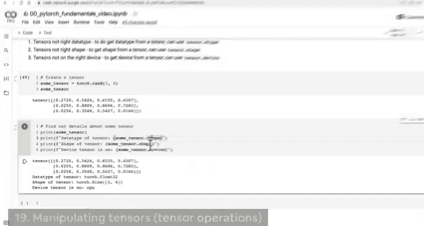

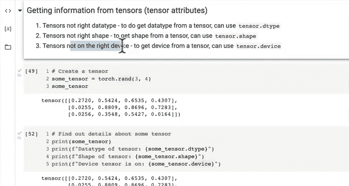

Manipulating tensors and what I mean by that， so let's just right here the title。

 manipulating tensors， and this is going to be tensor operations。

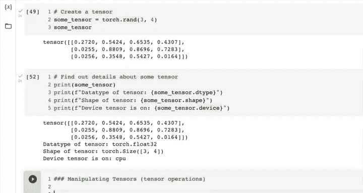

So when we're building neural networks， neural networks are comprised of lots of mathematical functions that Pytorch code is going to run behind the scenes for us。

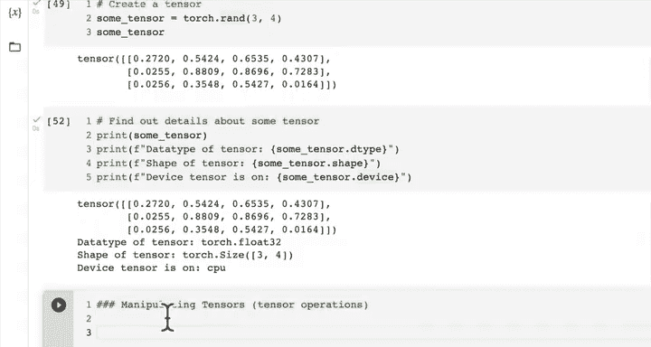

So。Let's go here， Tensor operations。Include。

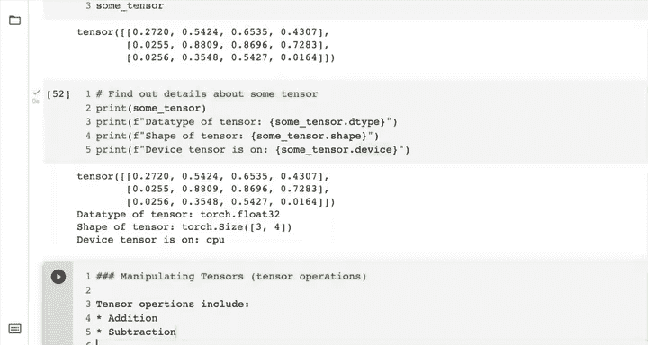

Addition。Subtraction。And these are the regular addition subtract multiplication。

 There's two types of multiplication in that you'll typically see referenced in deep learning and neural networks division。

😊。

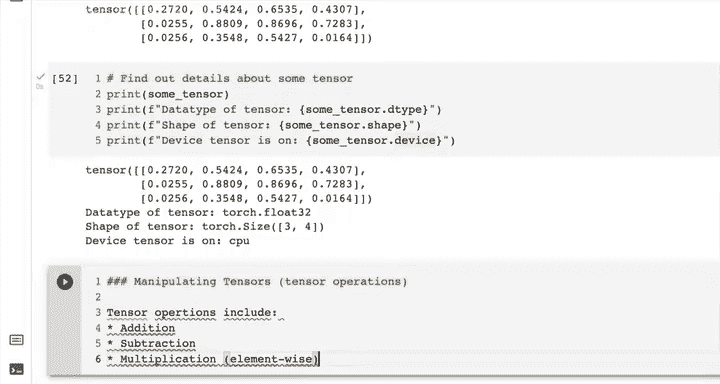

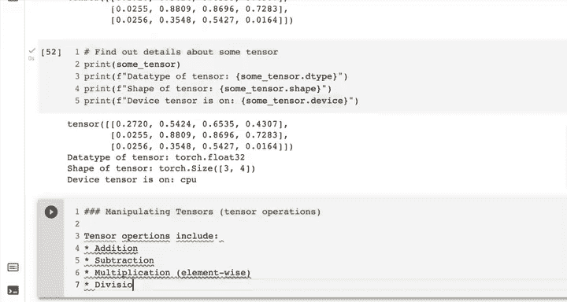

And。Matrix multiplication。 and these the ones here。

 So addition subtraction multiplication division are your typical。

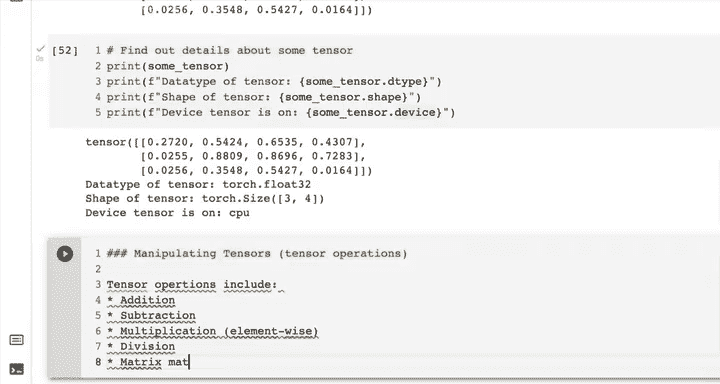

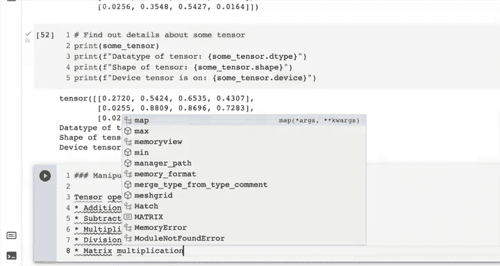

Operations that you're probably familiar with matrix multiplication。

 The only different one here is matrix multiplication。

 We're going to have a look at that in a minute。

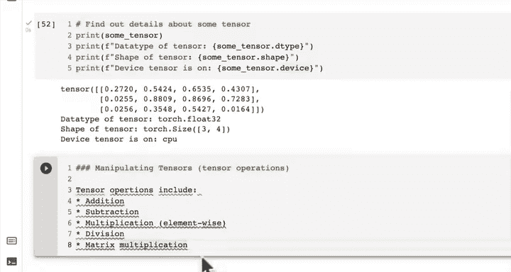

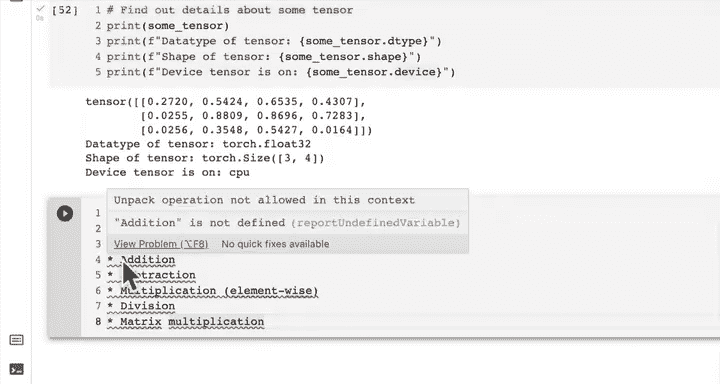

But to find patterns in numbers of a data set， a neural network will combine these functions in some way。

 shape or form。 So it takes a tensor full of random numbers。

 performs some kind of combination of additions， subtraction， multiplication。

 division matrix multiplication。 It doesn't have to be all of these。

 It could be any combination of these to manipulate these numbers in some way to represent a data set。

 So that's how a neural network learn is it will just comprise these functions。

 Look at some data to adjust the numbers of a random tensor and then go from there。

 But with that being said， let's look at a few of these。 So it will begin with addition。

 First thing we need to do is create a tensor。

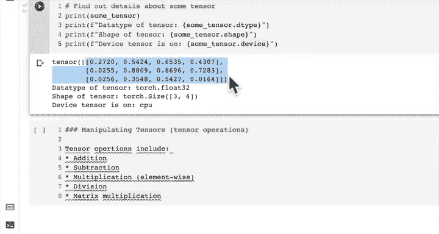

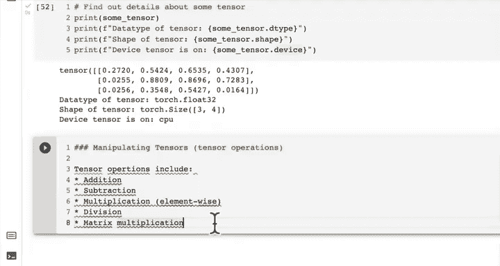

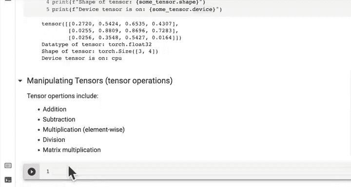

And。To add something to a tensor， we'll just go torch Tensor， let's go one，2，3。

Add something to a tensor is Tensor plus we can use plus as the addition operator just like in Python。

Tenssor plus 10 is going to be tensor 11，1213。 Tensor plus 100 is。

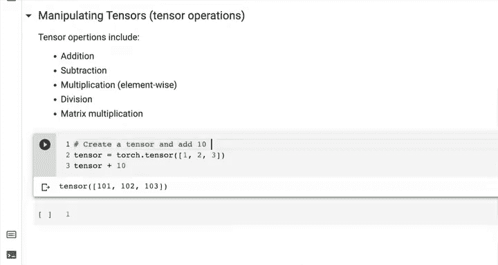

Going to be， as you'd expect， plus 100。 Let's leave that as plus 10 and add 10 to it。

 And so you might be able to guess how we would multiply it by 10。 So let's go。Multiply。Tenser by 10。

We can go tensa。

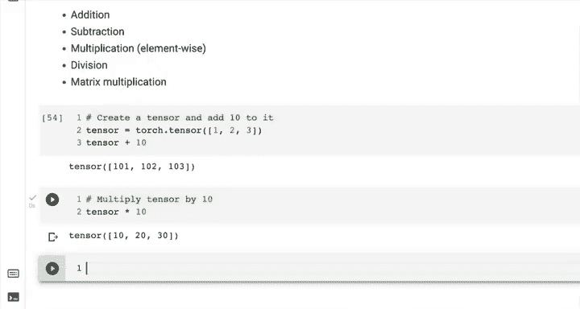

Star， which on my keyboard to shift8。😡，Cen。We get 10，1010 and because we didn't reassign it。

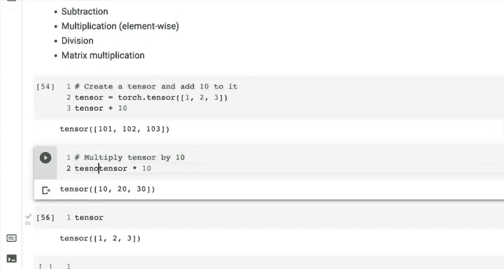

Our tensor is still one，2，3， so if we go， if we reassign it here。

Tensor equals tensor by 10 and then check out Tensor。We've now got 10，2030， and the same thing here。

We'll have 10，2030。 But then if we go back from the top。If we delete this， reassignment。Oh。

 what do we get there？

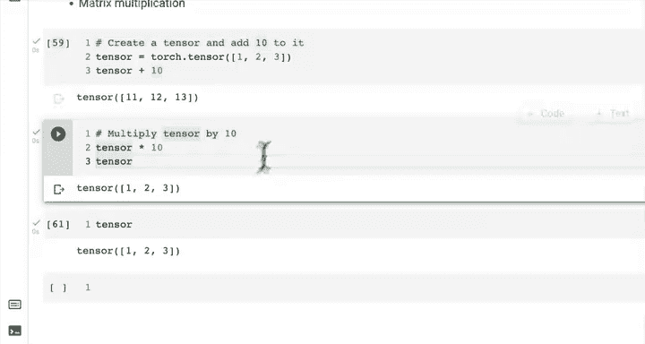

Tenser by 10。Oh。What's happened here。Oh， because we've got， yeah， Okay， I see。 tensor by 10， tensor。

 still 1，2，3。 What should we try now， How about subtract， subtract 10。

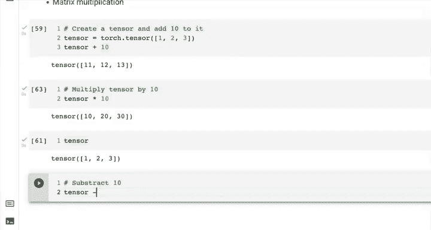

Ms  ten are-10。

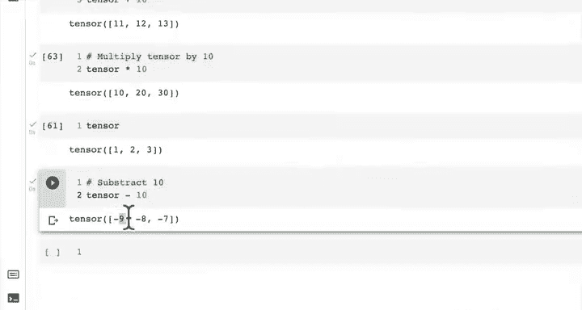

And you can also use， well， there we go，1 minus10。8-10，3-10。

 You can also use like torch as inbuilt functions or pi torch。 So try out pi torch。In built。

Functions。So torch do mole is short for multiply。 We can pass in our tensor here and we can add in 10。

 That's going to multiply each element of tensor by 10。

 So just taking the original tensor that we created， which is 1，2，3。

 and performing the same thing as this。 I would recommend where you can use the operators from Python。

 if for some reason， you see torch dot mo， maybe there's a reason for that。

 but generally these are more understandable if you just use the operators。

 if you need to do a straight up multiplication straight up edition or straight up subtraction。

 because torch also has torch dot ad。

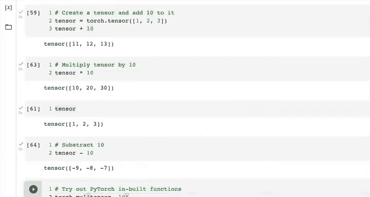

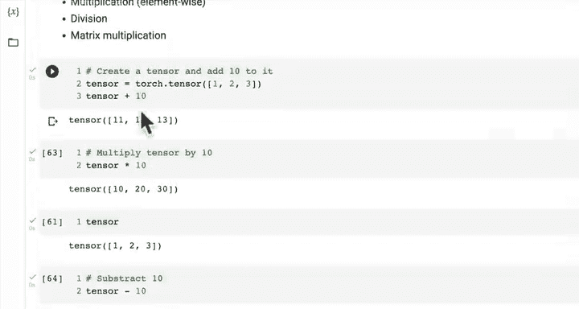

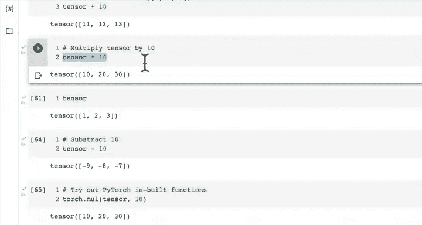

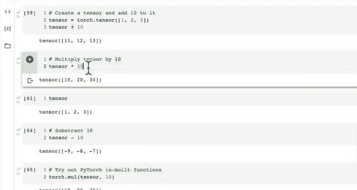

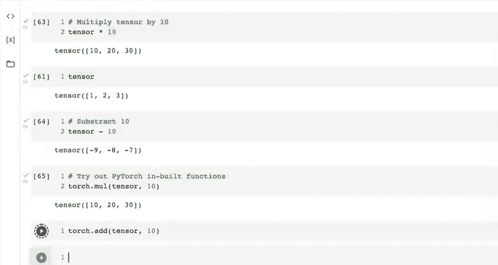

Toorch do ad。 Is it To ad。 It might be Toch ad， I'm not sure。

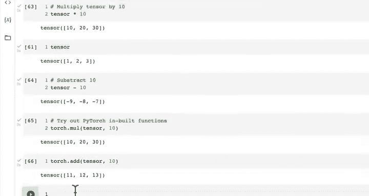

Oh， there we go。 Yeah， Torchdot ad。So as I alluded to before。

 there's two different types of multiplication that you'll hear about。

 elementement wise and matrix multiplication。 We're going to cover matrix multiplication in the next video as a challenge。

 though， I would like you to search。

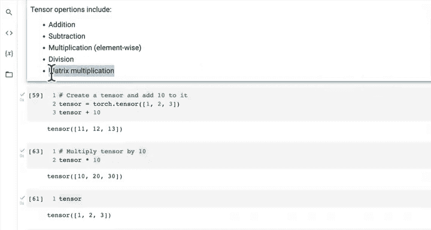

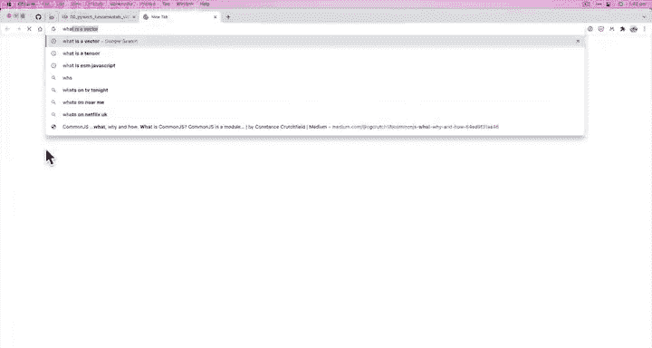

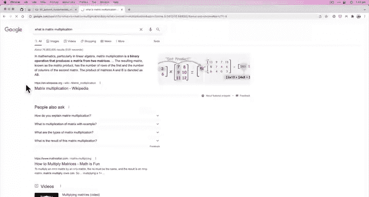

What is matrixtri multiplication， and I think the first website that comes up。

Matrix multiplication Wikipedia。 Yeah， math is fun has a great guide。

 So before we get into matrix multiplication， jump into math is fun to have a look at matrix multiplying and have a think about how we might be able to replicate that in Pytorrch。

 even if you're not sure， just have a think about it。😊。

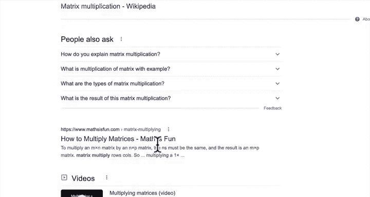

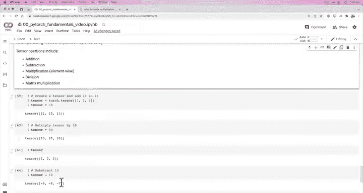

I'll see you in the next video。