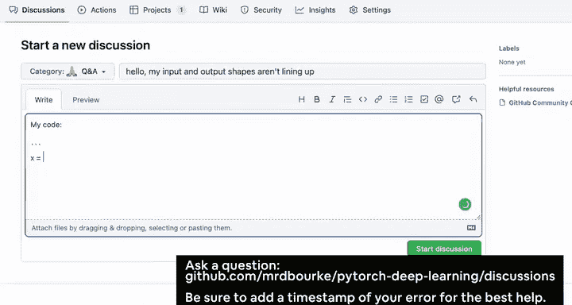
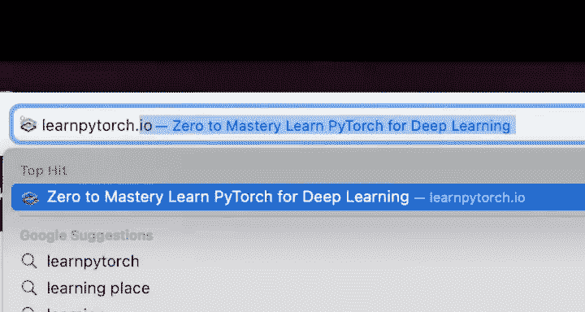
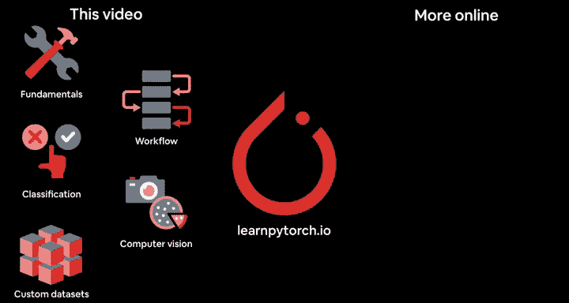
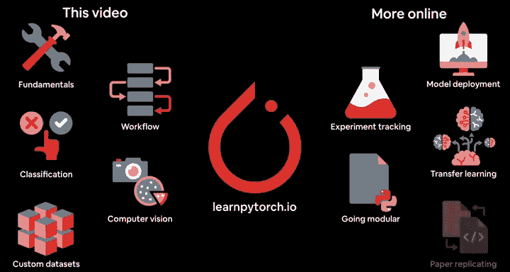
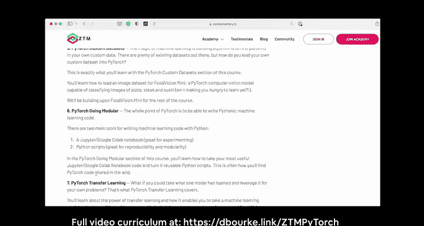

# mrdbourke《一天学会pytorch深度学习｜Learn PyTorch for deep learning in a day Literally》中英 - P1：Hello ).zh_en - GPT中英字幕课程资源 - BV1kx4y1r79d

Hello， welcome to the video。 It's quite a big one。 But if you've come here to learn machine learning and deep learning and Pythto code。

 well， you're in the right place。 Now， this video and tutorial is focused for beginners who have got about 3 to6 months of Python coding experience。

😊，So we're going to cover a whole bunch of important machine learning concepts by writing Pytorch code。

Now， if you get stuck， you can leave a comment below or post on the course Gitthub Discions page and on Github is where you'll be able to find all the materials that we cover。

 as well as on learnpytorch。 Io。 There's an online readable book version of this course there。😊。

But if you finish this video and you find that， hey， I would still like to learn more Pytorch。

 I mean， you can't really cover all the Pytorch in a day that video titles just to play on words of the length of video。

😊，That's an aside。

There is five more chapters available at Learn Pytochdiio covering everything from transfer learning to model deployment to experiment tracking。

 and all the videos to go with those are available at0 to mastery。Iio。😊。

But that's enough for me。Having machine learning， and I'll see you inside。😊。

