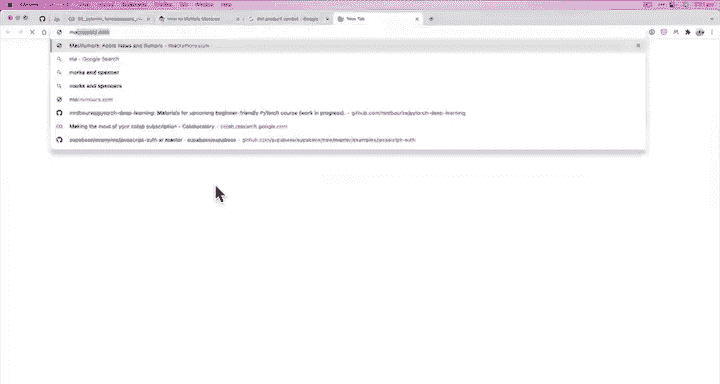
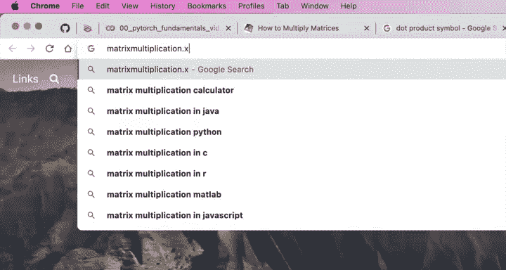
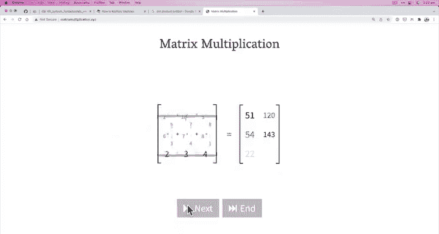
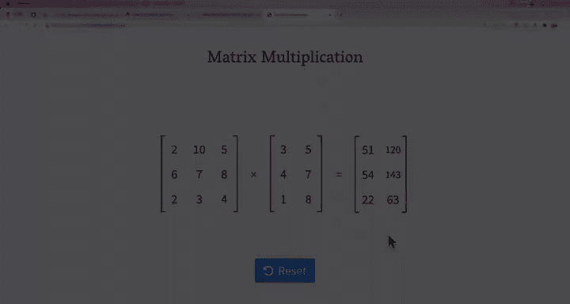
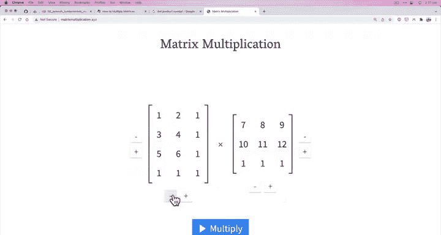

# mrdbourke《一天学会pytorch深度学习｜Learn PyTorch for deep learning in a day Literally》中英 - P20：20. Matrix multiplication.zh_en - GPT中英字幕课程资源 - BV1kx4y1r79d

Welcome back。 In the last video， we discussed some basic tensor operations such as addition。

 subtraction， multiplication， element wise， division and matrix multiplication。

 But we didn' actually go through what matrix multiplication is。 So now let's start on that。

 More particularly discussing the difference between element wise and matrix multiplication。

 So we'll come down here。 Let's write another heading。😊，Matrix multiplication。So there's two ways。

 Well， two main ways。 Yeah， let's write that。 two main ways of performing multiplication in neural networks。

And deep learning。So one is the simple version， which is what we've seen， which is element wise。

Multipplication。And number two is matrix multiplication。

 So matrix multiplication is actually possibly the most common tensor operation you will find inside neural networks。

 and in the last video I issued the extra curriculum of having a look at the math fund co page for how to multiply matrices So the first example they go through is element wise multiplication which just means multiplying each element by a specific number。

 In this case we have two times 4 equals 82 times 0 equals 02 times1 equals22 times negative9 equals negative 18 But then if we move on to matrix multiplication which is multiplying a matrix by another matrix we need to do the dot product。

 So that's something that you'll also hear matrix multiplication referred to as the dot product。

 So these two are used interchangeably matrix multiplication。😊。

dot productAnd if we just look up the symbol for dot product。You'll find that it's just a dot。😡。

There we go。 A heavy dot images。There we go， A dot B。 So this is vector A dot product B。

A few different options there， but let's look at what it looks like in PyToch code。

But first is a little bit of a difference here。 So how did we get from multiplying this matrix here of 1。

2，3，4，5，6， times 7，8，9，101112， How did we get 58 there？ Well， we start by going。

 This is the difference between element wise and dot product， by the way，1 times 7。

We' going to record that down there， so that's7。And then two times9。 So this is first row。

 first column，2 times 9。Is 18 and then  three times 11 is 33。

 And if we add those up 7 plus 18 plus 33， we get 58。

 And then if we were do that for each other element。 That's throughout these two matrices。

 We end up with something like this。 So that's what I'd encourage you to go through step by step and reproduce this。

 a good challenge would be to reproduce this by hand with Ptoch code。

 But now let's go back and write some pytorch code to do both of these。 So。😊。

I just want to link here， as well。More information on multiplying。Marices。

So I'm going to turn this into markdown。 Let's first see element wise。Element wise multiplication。

 we're going to start with just a rudimentary example。 So if we have our tensor。

What is it at the moment， It's 1，2，3。 And then if we multiply that by itself。We get 1，4，9。

 but let's print something out。 so it looks a bit prettier than that。So print。

 and I'm going to turn this into a string。And then。We do that。 So if we print tensar times tensar。

 element wise multiplication is going to give us。Print equals。And then let's do in here。

 tensor times tensor。And we go like that。Wonderful， so we get one times 1， equals 1。

2 times 2 equals 4，3 times 3 equals 9。 Now， for matrix multiplication。😊。

Pinetorrch stores matrix multiplication similar to Torch dot mall in their Torch do mat Ma space。

Which stands for Matri multiplication， so let's just test it out。

Let's just chew the exact same thing that we did here。 Instead of element wise。

 we'll do matrix multiplication on our 1，2，3， Tensor。 What happens here， Oh my goodness，14。 Now。

 why did we get 14 instead of 1，4，9。😊，Can you guess how we got to 14 or think about how we got to 14 from these numbers。

So if we we back。We saw that for where are the multiplying two smaller tensors， by the way，1，2，3。

 this example is with a larger one， but the same principle applies across different sizes of tensesors or matrices。

And when I say matrix multiplication， you can also do matrix multiplication between tensesors。

And in our case， we're using vectors just to add to the confusion。But。😡。

What is the difference here between element wise and dot product。We've got one main edition。

And that is addition。So if we were to code this out by hand。Mattrix multiplication by hand。

We'd have recall that the elements of our tensor are。1，2，3。

 So if we wanted to matrix multiply that by itself， we'd have one times  one。

Which is the equivalent of doing one times 7 in this。Visual example。 And then we'd have plus。

It's going to be 2 times 2，2 times 2。 What does that give us。Plus3 times 3。 What does it give us。

3 times 3。That gives us 14 So that's how we got to that number there。Now。

 we could do this with a for loop。 So let's have a ge when I say geese， it means have a look。

 That's an Australian colloquialism for having a look。

 But I want to show you the time difference in it might not actually be that bigger difference if we do it by hand。

 versus using something like mat Ma。 And that's another thing to note。

 is that if Pytorch has a method already implemented chances are it's a fast calculating version of that method。

 So I know for basic operators， I said it's usually best to just use the straight up basic operators。

 But for something like matrix multiplication or other advanced operators instead of the basic operators。

 you probably want to use the torch version rather than writing a for loop。

 which is what we're about to do。 So let's go。😊，Value equals 0。

 This is matrix multiplication by hand。 So for I in range La tensor。

 So for each element in the length of our tensor， which is 1，2，3。

 we want to update our value to be plus equal， which is doing this plus reassignment here。

The I element in each tensor。Times the I element， so times itself。And then。

How long is this going to take？Let's now return the value。 We should get 14。Print。14， there we go。

 So 1。9 milliseconds on whatever CPU that Google coab is using behind the scenes。 But now。

 if we time it and use the torch method， torch dot map more。Its tensor dot tensor。 And again。

 we're using a very small tensor， so。Okay， there we go。 It actually showed how much quicker it is。

 even with such a small tensor。 So this is 1。9 milliseconds。 This is 252 microseconds。

 So this is 10 times slower using a four loop。 Then pi tos vectorized version。

 I'll let you look into that。 If you want to find out what vectorization means。😊。

It's just a type of programming that， rather than writing four loops because as you could imagine。

 if this tensor was， let's say， had a million elements instead of just three。

 if you have to loop through each of those elements one by one， that's going to be quite cumbersome。

 So a lot of Pyto's functions behind the scenes implement。Optimized functions 2。Perform。

Mathematical operations such as matrix multiplication， like the one we did by hand。

 in a far faster manner， as we can see here。 And that's only with a tensor of three elements。

 So you can imagine the speed ups on something like a tensor with a million elements。

But with that being said， that is the crux of matrix multiplication For a little bit more。

 I encourage you to read through this documentation here by mathsfund dot com。 Otherwise。

 let's look at a couple of rules that we have to satisfy for larger versions of matrix multiplication。

 because right now， we've done it with a simple tensor。 only 1，2，3。

 Let's step things up a notch in the next video。😊，Welcome back in the last video we were introduced to matrix multiplication。

 which although we haven't seen it yet is one of the most common operations in neural networks。

 and we saw that you should always try to use torches implementation of certain operations except if they're basic operations like plus multiplication and whatnot。

 because chances are it's a lot faster version than if you would do things by hand and also its a lot less code like compared to this。

 this is pretty reverse code compared to just hey matrix multiply these two tensors。

 but there's something that we didn't allude to in the last video there's a couple of rules that need to be satisfied when performing matrix multiplication it worked for us because we have a rather simple tensor but once you start to build larger tensors。

 you might run into one of the most common errors in deep learning。

 I'm going to write this down actually here。This is one to be very familiar with。

 One of the most common errors in deep learning。 We've already alluded to this as well。

 is shape errors。So let's jump back to this in a minute。 I just want to ride up here so。

There are two rules that。Performing or two main rules that performing matrix multiplication。

Needs to satisfy， otherwise we're going to get an error。So number one is the inner dimensions。Yeah。

Must match。 Let's see what this means。 So if we want to。Have two tensesors of shape three by two。

And then we're going to use the at symbol。Now， you might be asking why the at symbol。 Well。

 the at symbol is another is a like a operator symbol for matrix multiplication。

 So I just wantan to give you an example if we go tens are at。At stands for Matri multiplication。

 We get Tensor 14， which is exactly the same as what we got there。

 Should you use at or should you use mat Ma， I would personally recommend to use mat Ma。

 It's a little bit clearer At sometimes can get confusing because it's not as common as seeing something like mat Ma。

So we'll get rid of that， but I'm just using it up here for brevity。And then we're going to go three。

 two。 Now this won't work。We'll see why in a second。 But if we go2，3。At and then we have three， two。

This will work。Or， and then we if we go the reverse， say threes on the outside， twos here。

 And then we have twos on the inside and threes on the outside。 This will work。 Now， why is this。

 Well， this is the rule number one。 The inner dimensions must match。

 So the inner dimensions what I mean by this is let's create。Torch R will create of size 3，2。

And then we'll get it shape。So we have， so if we created a tenor like this， three， two。

And then if we created another tensor。Well， let me just show you straight up。Torch dot Mamo。

Torch dot R， watch this won't work。We'organ error。There we go。

 So this is one of the most common errors that you're going to face in deep learning is that matrix 1 and matrix 2 shapes cannot be multiplied because it doesn't satisfy Rule number one。

 The inner dimensions must match。And so what I mean by inner dimensions is this dimension multiplied by this dimension。

So say we were trying to multiply。3，2 by3，2。 these are the inner dimensions。

Now this will work because why the inner dimensions match。2，3 by3，2。2，3。By 3，2。

 Now notice how the inner dimensions。You know。你呢？Match， let's see what comes out here。

Look at that and now this is where Rule 2 comes into play。😊，t2。The resulting。

Matrix has the shape of the outer dimensions。Sir。We've just seen this one， two， three。At 3，2。

Which is at remember， is matrix multiply。So we have a matrix of shape 2，3。

 matrix multiply a matrix of 3，2， the inner dimensions match so it works。

 the resulting shape is what。2，2。Just as we've seen here。We've got a shape of 2，2。 Now。

 what if we did。The reverse， what if we did this one that also will work？Three on the outside。

What do you think is going to happen here？In fact， I encourage you to pause the video and give it a go。

 So this is going to result in a 3，3。Matrix， but don't take my word for it。 Let's have a look，3。

Put two on the inside。And we'll put two on the inside here。 and then the three on the outside。

 What does it give us。Oh， look at that。 A 3，3，1，2，3，1，2，3， now。

What if we were to change this 2 and 2， This can be almost any number you want。

 Let's change them both to 10。 What's going to happen。Will this work？

What's the resulting shape going to be？So the inner dimensions match。What's rule number 2。

 The resulting matrix has the shape of the outer dimension。

 So what do you think is going to be the shape of this resulting matrix multi。Well。

 let's have a look。It's still 3，3。Wow， now what if we go 10。10 on the outside。

And 10 and 10 on the inside， what do we get。Well we get， I'm not going to count all of those。

 but if we just go shape， we get 10 by 10。Because these are the two main rules of matrix multiplication is if you're running into an error that the matrix multiplication can't work。

 So let's say this was 10。 and this was 7。 Watch what's going to happen。

We can't multiply them because the inner dimensions do not match。 We don't have 10 and 10。

 We have 10 and 7。 But then when we change this so that they match。We get 10 and 10。Beautiful。

 so now let's create a little bit more of a specific example。 We'll create two tensesors。😊。

We'll come down actually， to prevent this video from being too long。

 I've read an error in the word error。 That's funny。

 We'll go on with one of those common errors in deep learning Sha errors。 We've just seen it。

 but I'm going to get a little bit more specific with that shape error in the next video。

 Before we do that。 have a look at matrix multiplication。😊。

There's a website， my other favourite website。 I told you I've got two。 This is my other one。

 Matri multiplication dot X， Y， Z。 This is your challenge before the next video。

 put in some random numbers here， whatever you want，2，10，5，6，7。

8， whatever you want， change these around a bit，3。4， well， that's a 5， not a4。

 And then multiply and just watch what happens。 That's all I'd like you to do。

 Just watch what happens。 And we're going to replicate something like this in Pytorrch code in the next video。

I'll see you there。Welcome back in the last video we discussed a little bit more about matrix multiplication。

 but we're not done there。😊，We looked at two of the main rules of matrix multiplication。

 and we saw a few errors of what happens if those rules aren't satisfied。

 particularly if the inner dimensions don't match。 So this is what I've been alluding to as one of the most common errors in deep learning。

 and that is shape errors， because neural networks are comprised of lots of matrix multiplication operations。

 If you have some sort of tensor shape error somewhere in your neural network。

 Chances are you're going to get a shape error。 So now let's investigate how we can deal with those。

 So let's create some tensors。Shapes for matrix multi。 And I also showed you the website。

 sorry matrixtri multi dot x， Y Z。 I hope you had a go at typing in some numbers here and visualizing what happens because we're going to reproduce something very similar to what happens here。

 but with Pytoch code。Shapees for matrix multiplication。 we have。Tensor a。

 let's create this as torchd tensor。 We're gonna create a tensor with just the elements，1，2。

 all the way up to。Let's just go to6。 Hey， that'll be enough，6， wonderful。 and then Tensor B。😊。

Can be equal to a torch tensor。Of where we're gonna go for this one。 Let's go 7。10。

 this will be a little bit confusing this one， but then we'll go 8，11。And this will go up to 12，9，12。

 So it's the same。Sort of sequence is what's going on here， but they've been swapped around。

 So we've got the vertical axis here instead of 1，2，3，4。 This is just 7，8，9，1011，12。

 But let's now try and perform a matrix multiplication。 How do we do that。

 Torch dot mapm for matrix multiplication， P S Torch also has torch dot M M。

 which stands for matrix multiplication， which is a short version。

 So I'll just write down here so that you know， Tensor A， Tensor B。I'm going to write Torch。

mm is the same as torch。mmll。It's an alias。For writing less code。

 this is literally how common matrix multiplications are in Pytorrch is that they've made torch dot M M as an alias for mat Ma。

 So you have to type four less characters using torch dot M M instead of mat Ma。

 But I like to write mat Male because it's a little bit。

 Like it explains what it does a little bit more than M M。

So what do you think is going to happen here。It's okay， if you're not sure。

 but what you could probably do to find out is check the shapes of these。

 Does this operation matrix multiplication satisfy the rules that we just discussed。

Especially this one。 This is the main one。 The inner dimensions must match。Well， let's have a look。

Oh， no， mat 1 and mat 2 shapes cannot be multiplied 3 by 2 and 3 by 2。

 This is very similar to what we went through in the last video。

 But now we've got some actual numbers there。 Let's check the shape。torch size 3，2， Torch size 3，2。

 Now， in the last video， we created a random tensor， and we could adjust the shape on the fly。

But these tenses already exist。 How might we adjust the shape of these。Well。

 now I'm going to introduce you to another very common operation or tensor manipulation that you'll see。

 and that is the transpose to fix our tensor shape issues。We can manipulate。The shape of one of our。

Tenseors， using。Let's go transpose and so。All right， here。We're going to see this anyway。

 but I'm going to define it in words。 I transpose switches。The axes or dimensions of a given tensor。

 So let's see this in action。If we go， and the way to do it is you can go tensor。B。Dot t。

Let's see what happens。Let's look at the original tensor be， as well。So dot T stands for transpose。

 and that's a little bit hard to read。 So we might do these on different lines。Tensor be。

Get rid of that。So you see what's happened here。Instead of tensor B， this is the original one。

 We mightt put the original on top。Instead of the original one， having 7，8，9。

101112 down the vertical， the transpose has transposed it to 7，8。

9 across the horizontal and 101112 down here。 Now， if we get the shape of this。Tensor B dot shape。

 Let's have a look at that。 Let's have a look at the original shape。 Tensor B dot shape。

What's happened。Oh， no。 we've still got。3，2。 Oh， that's what I've missed out here。 I've got a typo。

 Excuse me。 I thought I was。You think code that you've written is working。

 but then you realize you've got something as small as just a dot T missing。

 and it throws off your whole train of thought。So you're seeing these arrows on the fly here。 Now。

 Tensor B is this， but its shape is torched at size 3，2。 And if we try to matrix multiply 3，2， and 3。

2， Tensor A and tensor B。We give an error。 Why， Because the inner dimensions do not match。

 But if we perform a transpose on tensor B， we switch。The dimensions。Around。

 so now we perform a transpose with Tensor B， dot T。Ts for transpose。 We have。

 This is the important point as well。 We still have the same elements。

 It's just that they've been rearranged。 They've been transposed。

 So now tensor B still has the same information encoded， but rearranged。 So now we have torch size 2。

3。 And so when we try to matrix multiply these。 we satisfy the first criteria。

 And now look at the output of the matrix multiplication of tensor A and tensor B dot T transposed is 3。

3。And that is because of the second rule of matrix multiplication。

 The resulting matrix has the shape of the outer dimensions。 So we've got 3，2 matrix multiply 2。

3 results in a shape of 3，3。 So let's preify some of this。 And we'll print out what's going on here。

Just so we know we can step through it because right now we've just got coal over the place a bit。

 let's see。Here， the matrix。Mulipplication。Operation works when tensor B。Is。Transpose。

 and in a second， I'm going to show you what this looks like visually。 But right now。

 we've done it with Pytoch code， which might be a little confusing。 And that's perfectly fine。

 Matrix multiplication takes a little while and a little practice。 So original shapes is going to be。

Tensor A dot shape。 Let's see what this is， and Tensor B。Es。Tensor be dot shape。

But the reason why we're spending so much time on this is because。As you'll see。

 as you get more and more into neural networks and deep learning。

 the matrix multiplication operation is one of the most or if not， the most common。

Same shape as above because we haven't changed Tensor A shape。 we've only changed Tensor B shape。

 or we've transposed it。And then inor B dot transpose equals。Way one。Tend to be。Dot T， dot shape。

 wonderful。 And then if we print。Let's just print out oops。Pront I felt the wrong word there。Print。

We want。 What are we multiplying here。 This is one of the ways。 Remember our motto of visualize。

 visualize， visualize。 Well， this is how I visualize， visualize， visualize things Sha。

 Let's do the at symbol for brrevity。Tensa。And let's get B dot T。 shape。

We'll put down our little rule here in a dimensions must match。And then， print。Let's get the output。

Output， we'll put that on a new line。 The output is going to equal torch dot or our outputs already here。

 But we're going to rewrite it for a little bit of practice。 Tensor A， Tensor B， dot T。And then。

 we can go。Print output。And then， finally。Print， let's get it on a new line as well。

 The output shape， a fair bit going on here。 but we're going to step through it。

 and it's going to help us understand a little bit about what's going on。

That's the data visualizes motto。There we go。 Okay， So the original shapes are what torch size 3。

2 and torch size 3，2。 The new shapes， Tensor A stays the same。 We haven't changed Tensor A。

 And then we have Tensor B dot T is torch size 2，3。Then we multiply a 3 by2 by a2 by3。

 So the inner dimensions must match， which is correct。 They do match 2 and 2。

 Then we have an output of tensor at 27，30，33，61，68，75， et cetera。

 And the output shape is what The output shape is the outer dimensions，3，3， Now， of course。

 you could rearrange this， maybe transpose tensor A instead of tensor B， have a play around with it。

 See if you can create some more errors trying to multiply these two。

 And see what happens if you transpose tensor A instead of tensor B。 That's my challenge。

 But before we finish this video。😊，How about we just recreate what we've done here with。

This cool website matrix multiplication。 So what did we have， We had tensor a， which is  one to 6。

 Let's recreate this。Remove that。 This is gonna be one。2，3，4。5，6。 And then we want to increase this。

 And this is going to be 7，8，9，10，11，12。Is that the right way of doing things。

So this is already transposed just to let you know。

 So this is the equivalent of tensor B on the right here。Tensor B dot T。 So let me just show you。

If we go， Ten to be。Dot transpose。Which original version was that。

 But we're just passing in the transpo version to our matrix multiplication website。

 And then if we click multiply。This is what's happening behind the scenes with our Pytorch code of Mamore。

We have one times 7 plus two times 10。 Did you see that little flippy thing that it did？

 That's where the 27 comes from。And then if we come down here。What's our first element，27。

 when we matrix multiply them。Then if we do the same thing， the next step。

We get 30 and 61 from a combination of these numbers。 Do it again。33，68。

95 from a combination of these numbers again and again， and finally。

 we end up with exactly what we have here。 So that's a little bit of practice for you to go through is to create some of your own tensess can be almost whatever you want and then try to matrix multiply them with different shapes。

 see what happens when you transpose and what different values you get。

 And if you'd like to visualize it， you could write out something like this。

 that really helps me understand matrix multiplication。 And then if you really want to visualize it。

 you can go through this website and recreate your target tenses。😊，In something like this。

 I'm not sure how long you can go。But yeah， that should be enough to get started。 So give that a try。

 and I'll see in the next video。

Whatlcome。